# AI & LLM Mühendisliği El Kitabı

Makine öğrenmesinin temellerinden LLM geliştirmeye, Fine-Tuning'den RAG'e, agent'lardan AGI tartışmalarına uzanan; **sezgisel ama teknik doğruluğundan ödün vermeyen** açık kaynak bir Türkçe el kitabı.

**Kimler için?** Yazılımcılar, veri bilimine geçmek isteyenler ve AI ürünü geliştiren mühendisler.

## Bu kitap nasıl okunur?

Her konu aynı 6 adımla ilerler: **(1)** tek cümlelik özet, **(2)** günlük hayattan analoji, **(3)** görselleştirme, **(4)** nasıl çalışır, **(5)** ne zaman kullanılır / kullanılmaz, **(6)** sık yapılan hatalar ve ipuçları. Metin içindeki "bkz. 5.4" gibi göndermeler konu numaralarıdır.

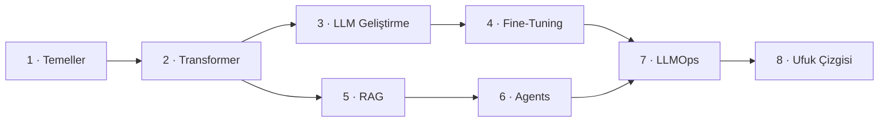

> [!TIP]
> **Acelesi olanlar için kısa yol:** Model eğitmeyecek, hazır LLM'lerle ürün geliştirecekseniz 1 → 2 → 5 → 6 → 7 sırası yeterlidir. Bölüm 3 ve 4'e ihtiyaç duyduğunuzda dönersiniz.

## İçindekiler

**[Bölüm 1 — Temeller](#bolum-1)**

- [1.1 Makine Öğrenmesi Nedir?](#k-1-1)
- [1.2 Öğrenme Türleri](#k-1-2)
- [1.3 Sinir Ağları (Neural Networks)](#k-1-3)
- [1.4 Geri Yayılım (Backpropagation)](#k-1-4)
- [1.5 Eğitim Pratiği](#k-1-5)

**[Bölüm 2 — Derin Öğrenme & Transformer Devrimi](#bolum-2)**

- [2.1 Tokenization](#k-2-1)
- [2.2 Embeddings (Vektör Uzayı)](#k-2-2)
- [2.3 Dikkat Mekanizması (Self-Attention)](#k-2-3)
- [2.4 Transformer Mimarisi](#k-2-4)
- [2.5 Metin Üretimi (Decoding)](#k-2-5)

**[Bölüm 3 — LLM Geliştirme Süreci](#bolum-3)**

- [3.1 Ön Eğitim (Pre-training)](#k-3-1)
- [3.2 Veri Hazırlığı](#k-3-2)
- [3.3 Ölçekleme Yasaları (Scaling Laws)](#k-3-3)
- [3.4 Altyapı ve Maliyet Dinamikleri](#k-3-4)

**[Bölüm 4 — Hizalama ve Özelleştirme (Alignment & Fine-Tuning)](#bolum-4)**

- [4.1 Özelleştirme Haritası](#k-4-1)
- [4.2 SFT (Supervised Fine-Tuning)](#k-4-2)
- [4.3 LoRA / QLoRA](#k-4-3)
- [4.4 RLHF (Reinforcement Learning from Human Feedback)](#k-4-4)
- [4.5 DPO (Direct Preference Optimization)](#k-4-5)

**[Bölüm 5 — RAG (Retrieval-Augmented Generation)](#bolum-5)**

- [5.1 RAG Nedir?](#k-5-1)
- [5.2 Chunking Stratejileri](#k-5-2)
- [5.3 Vektör Veritabanları](#k-5-3)
- [5.4 Hybrid Search](#k-5-4)
- [5.5 Reranking](#k-5-5)
- [5.6 GraphRAG](#k-5-6)

**[Bölüm 6 — AI Agents & Tool Use](#bolum-6)**

- [6.1 Tool Use (Function Calling)](#k-6-1)
- [6.2 ReAct Mimarisi](#k-6-2)
- [6.3 Memory Yönetimi](#k-6-3)
- [6.4 Multi-Agent Sistemler](#k-6-4)
- [6.5 MCP (Model Context Protocol)](#k-6-5)

**[Bölüm 7 — Değerlendirme ve Prodüksiyon (LLMOps)](#bolum-7)**

- [7.1 Eval Metrikleri](#k-7-1)
- [7.2 Hallucination Azaltma](#k-7-2)
- [7.3 Quantization](#k-7-3)
- [7.4 Latency / Throughput Optimizasyonu](#k-7-4)
- [7.5 İzleme ve Güvenlik](#k-7-5)

**[Bölüm 8 — Ufuk Çizgisi: AGI & Gelecek](#bolum-8)**

- [8.1 Reasoning Modelleri](#k-8-1)
- [8.2 World Models (Dünya Modelleri)](#k-8-2)
- [8.3 AI Safety](#k-8-3)
- [8.4 AGI Tanımı ve Tartışmalar](#k-8-4)


---

<a id="bolum-1"></a>

# Bölüm 1 — Temeller

<a id="k-1-1"></a>

## 1.1 Makine Öğrenmesi Nedir?


### 1. Tek Cümlelik Özet (TL;DR)

**Makine öğrenmesi (Machine Learning, ML), bilgisayara kuralları tek tek yazmak yerine ona örnekler gösterip kuralları kendisinin bulmasını sağlamaktır.**

### 2. Günlük Hayattan Analoji: Karpuzcu Çırağı

İyi bir karpuzcu, karpuza iki kez vurur ve "bu tam olmuş" der. Ona *nasıl* anladığını sorarsanız net bir kural veremez: "Sesi tok olacak, sapı kurumuş olacak, altındaki sarı leke belirgin olacak... ama duruma göre değişir."

Bu bilgiyi çırağına bir kural listesiyle aktaramaz. Onun yerine şunu yapar: çırak yüzlerce karpuza vurur, tahminini söyler, karpuz kesilir ve **doğru cevap** ortaya çıkar. Her yanlış tahminde çırağın sezgisi biraz düzelir. Bir yaz sonra çırak da karpuza vurup "olmuş" diyebilir ve o da nedenini tam açıklayamaz.

Makine öğrenmesi tam olarak budur. Tek fark, çırağın bir program olmasıdır:

| Karpuzcu dünyası | ML terimi |
|---|---|
| Karpuzun sesi, sapı, lekesi, ağırlığı | **Özellikler (Features)** — modelin girdisi |
| Kesince görülen sonuç: olmuş / ham | **Etiket (Label)** — doğru cevap |
| Çırağın kafasındaki sezgi | **Model** — girdiyi tahmine çeviren fonksiyon |
| Sezgiyi oluşturan "ayarlar" | **Parametreler (Parameters / Weights)** |
| Yüzlerce karpuz kesip yanıldıkça düzelmek | **Eğitim (Training)** |
| "Ne kadar yanıldım?" hissi | **Kayıp (Loss)** |
| Müşteriye yeni bir karpuz seçmek | **Çıkarım (Inference)** |
| Sadece o tarlanın karpuzlarını ezberlemiş olmak | **Aşırı öğrenme (Overfitting)** |

Analojinin sınırı: çırak birkaç yüz karpuzla öğrenir, modeller genelde çok daha fazla örneğe ihtiyaç duyar. Ayrıca çırak "neden"i sezebilir; model yalnızca verideki örüntüyü (pattern) yakalar.

### 3. Görselleştirme

#### Klasik programlama ile farkı

Klasik programlamada kuralı siz yazarsınız, program cevabı üretir. ML'de cevapları siz verirsiniz, **kuralı program üretir**.

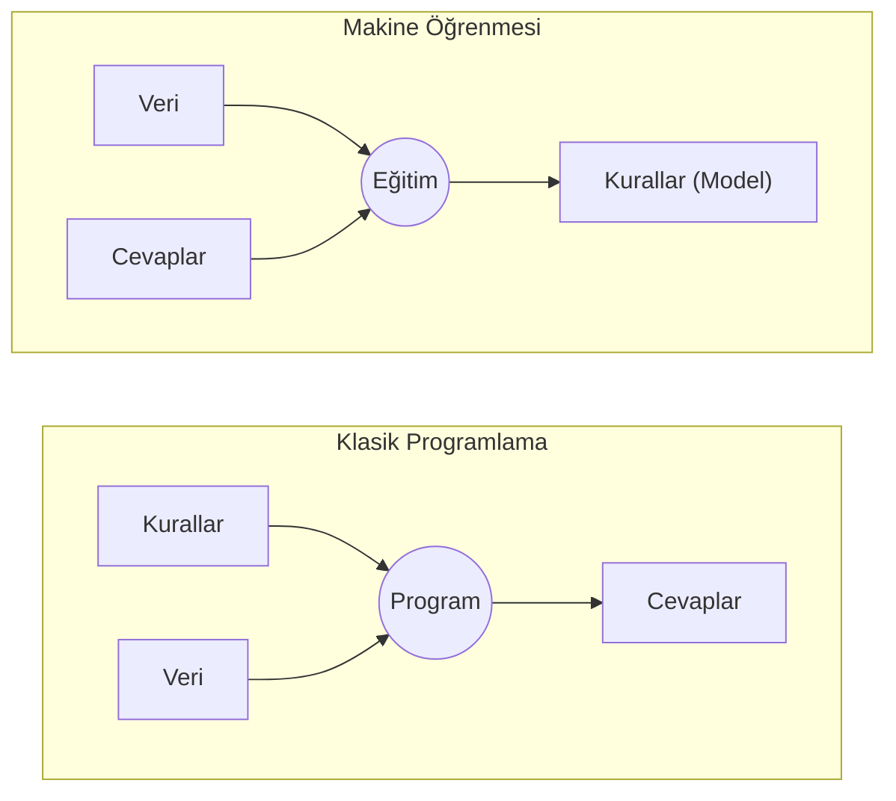

#### Öğrenme döngüsü

Bütün ML sistemleri, en küçük regresyon modelinden en büyük LLM'e kadar, aynı döngüyle öğrenir: **tahmin et → hatayı ölç → düzelt → tekrarla.**

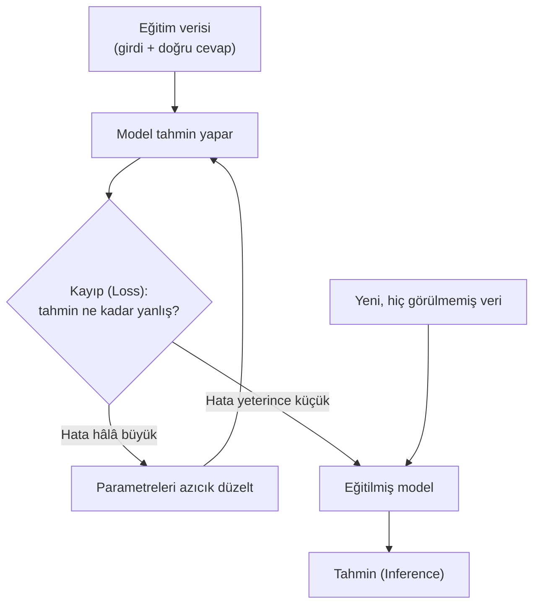

Üstteki döngü **eğitim**, alttaki tek yönlü akış **çıkarım** aşamasıdır. Eğitim pahalıdır ve bir kez (ya da arada bir) yapılır; çıkarım ucuzdur ve her kullanıcı isteğinde çalışır.

#### Üç ana öğrenme türü

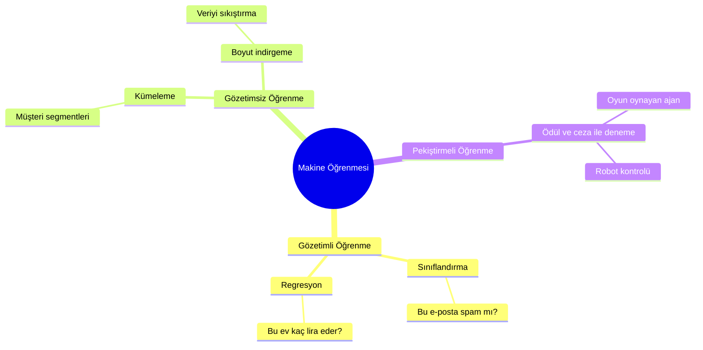

| Tür | Elinizde ne var? | Model ne öğrenir? | Örnek |
|---|---|---|---|
| **Gözetimli (Supervised)** | Girdi + doğru cevap | Girdiden cevabı tahmin etmeyi | Spam filtresi, fiyat tahmini |
| **Gözetimsiz (Unsupervised)** | Sadece girdi | Verideki gizli yapıyı | Müşteri segmentasyonu, anomali tespiti |
| **Pekiştirmeli (Reinforcement)** | Bir ortam + ödül sinyali | Ödülü en çok artıran davranışı | Satranç oynayan ajan, robotik |

> [!NOTE]
> **LLM'ler bu tablonun neresinde?** LLM'ler *kendi kendine gözetimli (Self-Supervised)* öğrenir: etiketi insan vermez, metnin kendisi verir. Cümlenin sonraki kelimesini gizleyip modele tahmin ettirirsiniz; doğru cevap zaten metindedir. Teknik olarak gözetimli öğrenmenin, etiketleme maliyeti sıfıra inmiş halidir. Ayrıntısı 1.2 Öğrenme Türleri sayfasında.

### 4. Nasıl Çalışır?

Her ML projesinde dört bileşen vardır. Somut olsun diye tek bir örnek üzerinden gidelim: **evin metrekaresinden fiyatını tahmin etmek.**

**1. Veri (Data).** Elimizde geçmiş satışlar var: `(metrekare, fiyat)` çiftleri. Metrekare *özellik*, fiyat *etiket*.

**2. Model.** Model, içinde ayarlanabilir düğmeler olan bir fonksiyondur. En basitini seçelim: `fiyat = w × m² + b`. Buradaki `w` ve `b` iki **parametredir**. "Öğrenmek" dediğimiz şey, bu iki sayı için iyi değerler bulmaktan ibarettir. (Bir LLM'de aynı düğmelerden milyarlarca vardır; fikir değişmez.)

**3. Kayıp fonksiyonu (Loss Function).** Modelin ne kadar yanıldığını tek bir sayıya indirger. Tahmin 3,0 milyon, gerçek 3,5 milyonsa hata −0,5'tir. Kayıp küçüldükçe model iyileşiyor demektir.

**4. Optimizasyon (Optimization).** Her hatadan sonra parametreleri, **hatayı azaltacak yönde azıcık** oynatırız. Bu yönteme *gradyan inişi (Gradient Descent)* denir; sisli bir dağda ayağınızla eğimi yoklayıp her adımda aşağı doğru yürümeye benzer. Adımın büyüklüğünü *öğrenme oranı (Learning Rate)* belirler.

Hepsi bir arada, hiçbir kütüphane kullanmadan:

```python
# Veri: evin metrekaresi -> fiyatı (milyon TL)
evler = [(50, 1.6), (80, 2.3), (100, 3.1), (120, 3.5), (150, 4.6)]

w, b = 0.0, 0.0            # Model: fiyat = w * m2 + b  (başta hiçbir şey bilmiyor)
ogrenme_orani = 0.00005    # Her hatada ne kadar düzeltme yapacağız?

for tur in range(1000):                    # Veriyi 1000 kez baştan sona gez
    for m2, gercek_fiyat in evler:
        tahmin = w * m2 + b                # 1) Tahmin et
        hata = tahmin - gercek_fiyat       # 2) Ne kadar yanıldın?
        w -= ogrenme_orani * hata * m2     # 3) Parametreleri hatayı
        b -= ogrenme_orani * hata          #    azaltacak yönde düzelt

print(f"Öğrenilen kural: fiyat = {w:.3f} * m2 {b:+.3f}")
print(f"110 m2 ev için tahmin: {w * 110 + b:.2f} milyon TL")
```

```text
Öğrenilen kural: fiyat = 0.031 * m2 -0.002
110 m2 ev için tahmin: 3.39 milyon TL
```

Dikkat edin: koda "metrekaresi 31 bin TL" diye bir kural **yazmadık**. Model bunu beş örnekten kendisi buldu ve daha önce hiç görmediği 110 m²'lik ev için makul bir tahmin üretti. Buna **genelleme (Generalization)** denir ve ML'in asıl amacı budur: eğitim verisini ezberlemek değil, yeni veride doğru çıkmak.

```text
fiyat
 4.6 |                          x
     |                      .
 3.5 |                  x .
 3.1 |              x .
     |            .
 2.3 |        x .              x = gerçek satışlar
 1.6 |  x  .                   . = modelin öğrendiği doğru
     +------------------------------ m2
        50   80  100  120   150
```

**Peki bu LLM'e nasıl bağlanıyor?** Aynı döngü, üç şey büyütülerek:

| | Bu örnek | Bir LLM |
|---|---|---|
| Parametre sayısı | 2 | Milyarlarca |
| Girdi → çıktı | Metrekare → fiyat | Önceki token'lar → sıradaki token |
| Eğitim verisi | 5 ev | İnternet ölçeğinde metin |

Döngünün kendisi (tahmin et, hatayı ölç, düzelt) aynıdır. Kitabın geri kalanı büyük ölçüde bu üç satırın nasıl büyütüldüğünün hikâyesidir.

### 5. Ne Zaman Kullanılır / Ne Zaman Kullanılmaz?

Temel soru şudur: **Kuralı yazabiliyor musunuz?** Yazabiliyorsanız yazın. ML, kuralı tarif edemediğiniz ama örneklerini gösterebildiğiniz problemler içindir.

| Durum | Öneri | Neden |
|---|---|---|
| Kural açık ve az: "18 yaşından küçükse reddet" | ❌ ML kullanma | `if` daha ucuz, hatasız ve açıklanabilir |
| Kuralı tarif edemiyorsunuz ama örnek çok: fotoğrafta kedi var mı? | ✅ ML kullan | Örüntü var, kuralı elle yazmak imkânsız |
| Kurallar sürekli değişiyor: dolandırıcılık, spam | ✅ ML kullan | Yeni veriyle yeniden eğitmek, kural yazmaktan hızlı |
| Kişiye göre değişen sonuç: öneri sistemleri | ✅ ML kullan | Milyonlarca kullanıcı için elle kural yazılamaz |
| Veri yok ya da çok az | ❌ Önce veri topla | Model, görmediği örüntüyü öğrenemez |
| Hata kabul edilemez ve gerekçe şart: vergi hesabı | ❌ ML kullanma | ML olasılıksaldır; %100 doğruluk garanti edemez |
| Her kararın nedeni denetlenmeli: kredi reddi | ⚠️ Dikkatli kullan | Basit, yorumlanabilir modeller ya da kural + ML karması |

ML'e karar verdiyseniz, hangi seviye?

| | Kural tabanlı | Klasik ML (ağaçlar, regresyon) | Derin öğrenme / LLM |
|---|---|---|---|
| **En iyi olduğu veri** | — | Tablo verisi | Metin, görsel, ses |
| **Veri ihtiyacı** | Yok | Yüzler – binler | Çok büyük (ya da hazır model) |
| **Geliştirme maliyeti** | Düşük | Orta | Yüksek (API ile düşer) |
| **Çalıştırma maliyeti** | Çok düşük | Düşük | Yüksek |
| **Açıklanabilirlik** | Tam | İyi | Zayıf |
| **Davranış** | Deterministik | Olasılıksal | Olasılıksal |

Pratik kural: **işe yarayan en basit çözümle başlayın.** Tablo verisinde bir karar ağacı modeli çoğu zaman sinir ağından hem daha iyi hem daha ucuzdur.

### 6. Sık Yapılan Hatalar & İpuçları

> [!WARNING]
> **Modeli eğittiği veriyle sınamak.** Öğrenciye sınavda, çalıştığı soruların aynısını sormak gibidir; ezberi ölçer, öğrenmeyi değil. Verinin bir kısmını (*test seti*) baştan ayırın ve eğitimde hiç kullanmayın.

> [!WARNING]
> **Veri sızıntısı (Data Leakage).** Modele, gerçek hayatta tahmin anında elinizde olmayacak bir bilgiyi yanlışlıkla vermek. Örnek: "müşteri aboneliği iptal edecek mi?" tahmininde `iptal_tarihi` sütununu girdide bırakmak. Belirtisi: gerçek olamayacak kadar iyi sonuçlar.

> [!WARNING]
> **Dengesiz veride doğruluk (Accuracy) oranına güvenmek.** İşlemlerin %99'u temizse, her şeye "temiz" diyen model %99 doğrudur ve tek bir dolandırıcılığı bile yakalamaz. Böyle durumlarda precision ve recall'a bakın.

> [!CAUTION]
> **"Çöp girerse çöp çıkar" (Garbage In, Garbage Out).** Model verideki hatayı ve önyargıyı da öğrenir. Zamanınızın çoğunu model seçimine değil veriyi anlamaya ve temizlemeye harcamanız normaldir.

> [!TIP]
> **Önce baseline kurun.** Modelden önce en aptalca çözümü ölçün: "her zaman ortalamayı tahmin et" ya da üç satırlık bir kural. Modeliniz bunu geçemiyorsa sorun modelde değil, veride ya da problem tanımındadır.

> [!TIP]
> **Önce metriği tanımlayın.** "İyi model" ne demek? Kod yazmadan önce başarıyı ölçecek sayıyı ve kabul eşiğini belirleyin; yoksa ne zaman bittiğinizi bilemezsiniz.

**Akılda kalsın:** Model = ayarlanabilir düğmeleri olan bir fonksiyon. Öğrenmek = düğmeleri hatayı azaltacak yönde çevirmek. Amaç = görülmemiş veride doğru çıkmak.

<a id="k-1-2"></a>

## 1.2 Öğrenme Türleri

### 1. Tek Cümlelik Özet (TL;DR)

**Öğrenme türünü, modele verdiğiniz geri bildirimin cinsi belirler: doğru cevap (gözetimli), hiçbir şey (gözetimsiz), ödül (pekiştirmeli) ya da verinin kendisi (kendi kendine gözetimli).**

### 2. Günlük Hayattan Analoji: Yemek Yapmayı Öğrenmenin Dört Yolu

- **Gözetimli (Supervised):** Ustanın yanında pişirirsiniz. Her tabaktan sonra usta "doğrusu şuydu" der. Doğru cevap her örnekte elinizdedir.
- **Gözetimsiz (Unsupervised):** Kimse bir şey söylemez. Dolaptaki malzemelere bakıp kendiniz gruplarsınız: "bunlar baharat, bunlar bakliyat." Etiket yok, yalnızca yapı var.
- **Pekiştirmeli (Reinforcement):** Tarif yok. Dener, misafirlerin yüzüne bakarsınız. Beğendilerse o yöne devam, beğenmedilerse değiştirirsiniz. Geri bildirim gecikmeli ve tek bir sayıdır: iyi ya da kötü.
- **Kendi kendine gözetimli (Self-Supervised):** Binlerce tarif okursunuz, her tarifin bir satırını elinizle kapatıp ne yazdığını tahmin edersiniz, sonra elinizi çekip bakarsınız. Öğretmen yoktur; doğru cevabı metnin kendisi verir.

### 3. Görselleştirme

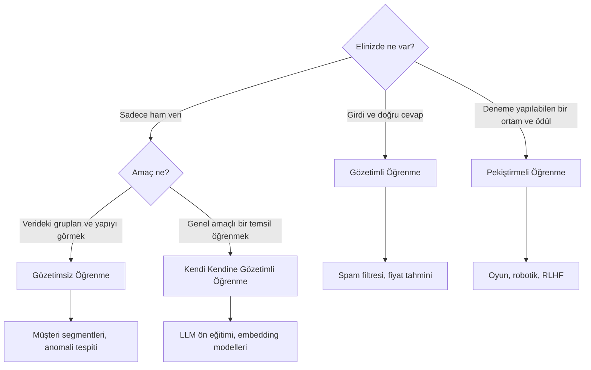

### 4. Nasıl Çalışır?

Dört türde de döngü aynıdır (tahmin et, hatayı ölç, düzelt). Değişen tek şey **hatanın neye göre ölçüldüğüdür**:

| Tür | "Hata" neye göre hesaplanır? | Tipik maliyet kalemi |
|---|---|---|
| Gözetimli | İnsan eliyle verilmiş etikete göre | Etiketleme |
| Gözetimsiz | Verinin kendi iç tutarlılığına göre (ör. küme içi mesafe) | Sonucu yorumlamak |
| Pekiştirmeli | Ortamdan gelen ödüle göre | Deneme sayısı, ödül tasarımı |
| Kendi kendine gözetimli | Verinin gizlenen parçasına göre | Hesaplama gücü |

LLM'leri mümkün kılan sıçrama dördüncü türdür. İnsan etiketi gerekmediği için internetteki bütün metin bir anda eğitim verisine dönüşür. Tek bir cümleden kaç eğitim örneği çıktığına bakın:

```python
cumle = "kedi sütü içti ve uyudu"
kelimeler = cumle.split()

# Her konum için: önceki kelimeler girdi, sıradaki kelime "etiket"
for i in range(1, len(kelimeler)):
    girdi = " ".join(kelimeler[:i])
    etiket = kelimeler[i]
    print(f"{girdi!r:28} -> {etiket!r}")
```

```text
'kedi'                       -> 'sütü'
'kedi sütü'                  -> 'içti'
'kedi sütü içti'             -> 've'
'kedi sütü içti ve'          -> 'uyudu'
```

Kimse etiketlemedi, ama dört adet (girdi, doğru cevap) çifti elde ettik. Modern bir LLM'in hayatında bu türlerin birkaçı sırayla görev alır: **kendi kendine gözetimli** ön eğitim (Bölüm 3), **gözetimli** ince ayar (SFT, 4.2) ve **pekiştirmeli** öğrenmeyle hizalama (RLHF, 4.4).

### 5. Ne Zaman Kullanılır / Ne Zaman Kullanılmaz?

| Durum | Tür | Not |
|---|---|---|
| Net bir hedef değişken var ve etiketli örnek bulunuyor | ✅ Gözetimli | Çoğu iş probleminde ilk tercih |
| Etiket yok, veriyi tanımak istiyorsunuz | ✅ Gözetimsiz | Çıktıyı bir insanın yorumlaması gerekir |
| Kararlar birbirini etkiliyor, sonuç gecikmeli geliyor | ✅ Pekiştirmeli | Simülatör ya da ucuz deneme şart |
| Çok büyük etiketsiz veri var, genel bir temel model istiyorsunuz | ✅ Kendi kendine gözetimli | Pahalı; çoğu ekip hazır modeli kullanır |
| Etiketli veriyle çözülebilen bir problem | ❌ Pekiştirmeli | Gereksiz karmaşıklık ve kararsızlık |
| "Doğru küme sayısı kaç?" gibi kesin bir cevap bekliyorsunuz | ❌ Gözetimsiz | Tek bir doğru cevabı yoktur |

### 6. Sık Yapılan Hatalar & İpuçları

> [!WARNING]
> **Etiket kalitesini sorgulamamak.** Gözetimli modelin tavanı etiketlerin kalitesidir. İki insanın aynı örneğe aynı etiketi verme oranını ölçün; insanlar anlaşamıyorsa model de öğrenemez.

> [!WARNING]
> **Kümeleme çıktısını "gerçek" sanmak.** Algoritma ona kaç küme isterseniz o kadar küme bulur. Kümeler bir hipotezdir; iş bilgisiyle doğrulanmaları gerekir.

> [!CAUTION]
> **Ödül kandırmacası (Reward Hacking).** Pekiştirmeli öğrenmede model, niyetinizi değil yazdığınız ödülü en üst düzeye çıkarır. "Tıklanmayı artır" ödülü, tık tuzağı başlık üreten bir sistemle sonuçlanabilir.

> [!TIP]
> **Etiket azsa önce hazır modele bakın.** Kendi kendine gözetimle eğitilmiş bir modelin üzerine birkaç yüz etiketli örnekle ince ayar yapmak, sıfırdan gözetimli eğitimden neredeyse her zaman daha iyi sonuç verir.

**Akılda kalsın:** Türler arasındaki fark algoritmada değil, geri bildirimin kaynağındadır. LLM'ler etiketi metnin kendisinden aldığı için bu kadar büyüyebildi.

<a id="k-1-3"></a>

## 1.3 Sinir Ağları (Neural Networks)

### 1. Tek Cümlelik Özet (TL;DR)

**Sinir ağı, her biri "girdileri ağırlıklarıyla çarp, topla, bir eşikten geçir" kadar basit bir hesap yapan nöronların katman katman dizilmesiyle, çok karmaşık fonksiyonları taklit edebilen bir modeldir.**

### 2. Günlük Hayattan Analoji: Ses Mikseri

Bir ses masası düşünün. Her kanalın bir düğmesi vardır: vokali aç, bası kıs, gitarı biraz yükselt. Çıkan ses, kanalların **ağırlıklı toplamıdır**.

Bir nöron tam olarak böyle bir mikserdir: girdiler kanallar, **ağırlıklar (weights)** düğmelerdir. Sinir ağı ise birbirine bağlı binlerce mikserdir: birinci sıradaki mikserlerin çıkışı, ikinci sıradakilerin girişidir. Eğitim, milyonlarca düğmeyi doğru ses çıkana kadar azar azar çevirmektir. Düğmeleri çeviren el, bir sonraki konuda göreceğimiz geri yayılımdır.

### 3. Görselleştirme

Tek bir nöron:

```text
 x1 --(w1)--\
 x2 --(w2)---[ topla: w1*x1 + w2*x2 + w3*x3 + b ]--[ aktivasyon ]--> çıktı
 x3 --(w3)--/
```

Nöronlardan oluşan bir ağ:

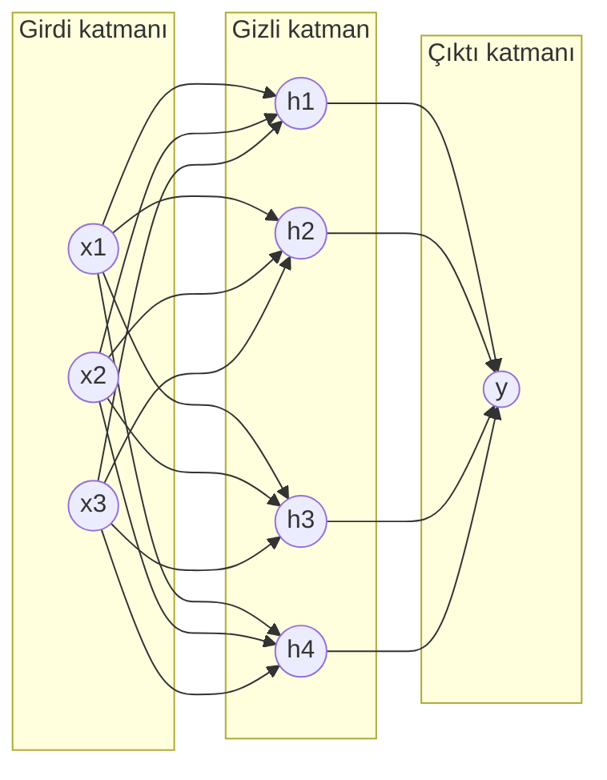

Her ok bir ağırlıktır, yani öğrenilecek bir sayıdır.

### 4. Nasıl Çalışır?

**1. Ağırlıklı toplam.** Nöron her girdiyi kendi ağırlığıyla çarpar, toplar ve bir sabit ekler: `z = w·x + b`. Ağırlık "bu girdi ne kadar önemli?", **bias** (`b`) ise "nöron ne kadar kolay ateşlensin?" sorusunun cevabıdır.

**2. Aktivasyon fonksiyonu (Activation Function).** Toplam, doğrusal olmayan bir fonksiyondan geçer. En yaygını **ReLU**'dur: negatifse sıfır yap, pozitifse aynen bırak. Bu adım kritiktir: aktivasyon olmazsa yüz katmanlı ağ bile matematiksel olarak tek bir doğrusal denkleme çöker ve eğri hiçbir şeyi öğrenemez.

**3. Katmanlar.** İlk katman ham girdiden basit örüntüler çıkarır, sonraki katmanlar bunları birleştirerek daha soyut kavramlar kurar. Görüntüde bu kabaca kenar → şekil → nesne sırasıdır. "Derin" öğrenmedeki derinlik, katman sayısıdır.

**4. İleri yayılım (Forward Pass).** Verinin girdiden çıktıya katman katman akmasıdır. Aşağıdaki kod, yukarıdaki diyagramdaki ağın tamamıdır:

```python
import numpy as np

def relu(z):
    return np.maximum(0, z)

rng = np.random.default_rng(0)
W1, b1 = rng.normal(size=(4, 3)), np.zeros(4)   # 3 girdi -> 4 gizli nöron
W2, b2 = rng.normal(size=(1, 4)), np.zeros(1)   # 4 gizli nöron -> 1 çıktı

x = np.array([0.5, -1.2, 3.0])                  # tek bir örnek

h = relu(W1 @ x + b1)      # gizli katman: ağırlıklı toplam + aktivasyon
y = W2 @ h + b2            # çıktı katmanı
print("gizli katman:", h.round(2), "| çıktı:", y.round(2))
print("öğrenilecek parametre sayısı:", W1.size + b1.size + W2.size + b2.size)
```

Bu ağda 21 parametre var. Bir LLM aynı yapı taşlarından (matris çarpımı + doğrusal olmayan fonksiyon) milyarlarcasını kullanır.

### 5. Ne Zaman Kullanılır / Ne Zaman Kullanılmaz?

| Durum | Öneri | Neden |
|---|---|---|
| Metin, görsel, ses gibi yapısız veri | ✅ Sinir ağı | Özellikleri elle çıkarmak yerine kendisi öğrenir |
| Çok büyük veri ve karmaşık örüntü | ✅ Sinir ağı | Veri arttıkça iyileşmeye devam eder |
| Tablo verisi (satır/sütun), birkaç bin örnek | ❌ Önce gradient boosting | XGBoost/LightGBM genelde daha iyi ve çok daha ucuz |
| Kararın gerekçesi açıklanmak zorunda | ⚠️ Dikkat | Ağırlıklar insan tarafından okunamaz |
| Küçük veri, sıfırdan eğitim | ❌ Kullanma | Ezberler; hazır modelden başlayın |

### 6. Sık Yapılan Hatalar & İpuçları

> [!WARNING]
> **Girdileri ölçeklememek.** Bir özellik 0-1, diğeri 0-1.000.000 aralığındaysa büyük olan eğitimi domine eder. Girdileri benzer ölçeğe getirin (normalizasyon).

> [!WARNING]
> **Dev bir ağla başlamak.** Önce küçük bir ağın tek bir veri yığınını (batch) ezberleyebildiğini görün. Ezberleyemiyorsa sorun boyutta değil, kodda ya da veridedir.

> [!NOTE]
> **"Beyin gibi çalışır" benzetmesine fazla yaslanmayın.** İsim biyolojiden esinlenmiştir ama yapay nöron, gerçek nöronun çok kaba bir karikatürüdür. Sinir ağını "ayarlanabilir, çok esnek bir fonksiyon" olarak düşünmek daha doğrudur.

> [!TIP]
> **Boyutları (shape) yazarak ilerleyin.** Sinir ağı hatalarının büyük kısmı boyut uyuşmazlığıdır. Her satırın yanına tensör boyutunu yorum olarak yazmak en ucuz hata ayıklama yöntemidir.

**Akılda kalsın:** Nöron = ağırlıklı toplam + aktivasyon. Ağ = bunların katmanları. Bilgi = ağırlıkların değerleri.

<a id="k-1-4"></a>

## 1.4 Geri Yayılım (Backpropagation)

### 1. Tek Cümlelik Özet (TL;DR)

**Geri yayılım, çıktıdaki hatanın sorumluluğunu çıkıştan girişe doğru her ağırlığa paylaştıran ve böylece her ağırlığın hangi yöne, ne kadar çevrilmesi gerektiğini söyleyen algoritmadır.**

### 2. Günlük Hayattan Analoji: Tuzlu Çıkan Yemek

Restoranda bir tabak geri döndü: çok tuzlu. Şef sorumluyu geriye doğru arar. Tabağı birleştiren aşçı "ben sosu olduğu gibi koydum" der. Sosçu "et suyunu hazır aldım" der. Et suyunu yapan çırak tuzu fazla kaçırmıştır.

Herkes hatadaki **kendi payı kadar** düzeltme yapar: çırak tuzu belirgin biçimde azaltır, sosçu biraz, tabağı birleştiren neredeyse hiç. Sorumluluk zincirin sonundan başına doğru aktarılır. Geri yayılım bu "kim ne kadar sorumlu?" hesabının matematiksel halidir. Makine öğrenmesinde buna *kredi atama (credit assignment)* problemi denir.

### 3. Görselleştirme

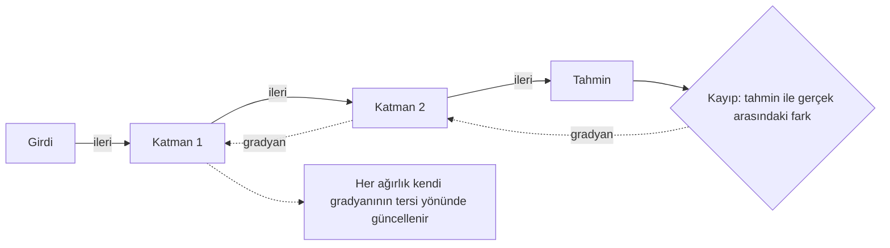

Düz oklar **ileri yayılım** (tahmin üret), kesikli oklar **geri yayılım** (sorumluluğu dağıt).

### 4. Nasıl Çalışır?

**1. İleri git, hatayı ölç.** Girdi ağdan geçer, tahmin çıkar, kayıp fonksiyonu tek bir sayı üretir.

**2. Gradyan nedir?** Bir ağırlığın gradyanı şu sorunun cevabıdır: "Bu ağırlığı azıcık artırırsam kayıp ne kadar, hangi yönde değişir?" Pozitifse ağırlığı azaltmak, negatifse artırmak kaybı düşürür.

**3. Zincir kuralı (Chain Rule).** Bir ağırlık kaybı doğrudan değil, arkasındaki katmanlar üzerinden etkiler. Etkiyi bulmak için aradaki halkaların etkilerini çarparız: "tuz et suyunu şu kadar, et suyu sosu şu kadar, sos tabağı şu kadar etkiler." Geri yayılım bu çarpımları çıkıştan başlayıp her ara sonucu yeniden kullanarak verimli biçimde hesaplar.

**4. Güncelle.** Her ağırlık, gradyanının tersi yönünde, **öğrenme oranı (learning rate)** kadar küçük bir adım atar. Bu güncelleme kuralı *gradyan inişidir (gradient descent)*.

İki ağırlıklı minik bir ağda hepsini elle yapalım. Hedef: girdi 2 iken çıktının 10 olması.

```python
x, hedef = 2.0, 10.0
w1, w2 = 0.5, 0.5
ogrenme_orani = 0.01

for adim in range(200):
    h = w1 * x                 # ileri: 1. katman
    y = w2 * h                 # ileri: 2. katman (tahmin)
    kayip = (y - hedef) ** 2

    dy = 2 * (y - hedef)       # geri: kayıp, tahmine ne kadar duyarlı?
    dw2 = dy * h               # w2'nin payı
    dh = dy * w2               # hata bir katman geriye aktarılır
    dw1 = dh * x               # w1'in payı (zincir kuralı)

    w1 -= ogrenme_orani * dw1
    w2 -= ogrenme_orani * dw2

print(f"w1={w1:.2f}, w2={w2:.2f}, tahmin={w1 * x * w2:.2f}, kayıp={kayip:.6f}")
```

Gerçek hayatta bu türevleri elle yazmazsınız. PyTorch gibi kütüphaneler ileri yayılım sırasında yapılan işlemleri kaydeder ve `loss.backward()` çağrısıyla tüm gradyanları otomatik hesaplar (*autograd*).

### 5. Ne Zaman Kullanılır / Ne Zaman Kullanılmaz?

| Durum | Geri yayılım | Not |
|---|---|---|
| Model türevlenebilir işlemlerden oluşuyor (sinir ağları) | ✅ | Standart ve neredeyse tek yöntem |
| Kayıp, modelin çıktısından türevlenebilir biçimde hesaplanıyor | ✅ | |
| Arada türevi olmayan bir adım var (ör. ayrık bir seçim, dış API çağrısı) | ❌ Doğrudan olmaz | Pekiştirmeli öğrenme teknikleri ya da yaklaşık yöntemler gerekir |
| Karar ağaçları, gradient boosting | ❌ | Farklı eğitim algoritmaları kullanırlar |

Öğrenme oranı seçimi pratikte en çok etki eden karardır:

| Öğrenme oranı | Belirti |
|---|---|
| Çok küçük | Kayıp düşüyor ama çok yavaş; eğitim bitmiyor |
| Uygun | Kayıp düzenli biçimde düşüyor |
| Çok büyük | Kayıp zıplıyor, `NaN` oluyor ya da hiç düşmüyor |

### 6. Sık Yapılan Hatalar & İpuçları

> [!WARNING]
> **Kaybolan ve patlayan gradyanlar (Vanishing / Exploding Gradients).** Çok katmanlı ağlarda gradyanlar geriye giderken sürekli çarpılır; 1'den küçük sayılar sıfıra, büyük sayılar sonsuza gider. Residual bağlantılar, normalizasyon katmanları ve gradient clipping bu sorunun standart çözümleridir (2.4'te tekrar karşımıza çıkacak).

> [!WARNING]
> **PyTorch'ta gradyanları sıfırlamayı unutmak.** Gradyanlar varsayılan olarak birikir. Her adımda `optimizer.zero_grad()` çağrılmazsa önceki adımların gradyanları üst üste eklenir ve eğitim bozulur.

> [!TIP]
> **Kayıp `NaN` olduysa** önce öğrenme oranını 10 kat düşürün. Sorunların büyük kısmı burada çözülür.

> [!NOTE]
> **Geri yayılım "öğrenmenin" kendisi değildir.** Yalnızca gradyanları hesaplar. Ağırlıkları değiştiren, gradyanı kullanan optimizasyon algoritmasıdır (SGD, Adam).

**Akılda kalsın:** İleri yayılım tahmin üretir, geri yayılım suçu paylaştırır, optimizer düğmeleri çevirir.

<a id="k-1-5"></a>

## 1.5 Eğitim Pratiği

### 1. Tek Cümlelik Özet (TL;DR)

**İyi model, eğitim verisinde değil daha önce hiç görmediği veride iyi olan modeldir; eğitim pratiğinin tamamı bu farkı ölçmek ve kapatmakla ilgilidir.**

### 2. Günlük Hayattan Analoji: Sınava Hazırlık

- **Eğitim seti (Training Set):** Çalıştığınız soru bankası.
- **Doğrulama seti (Validation Set):** Deneme sınavları. Sonuca bakıp çalışma yönteminizi değiştirirsiniz.
- **Test seti (Test Set):** Gerçek sınav. Bir kez girilir, sonucu değiştirilemez.

Soru bankasındaki cevapları ezberleyen öğrenci çalışma sorularında yüz alır, gerçek sınavda çakar. Bu **aşırı öğrenmedir (overfitting)**. Hiç çalışmayan öğrenci ikisinde de kötüdür: **yetersiz öğrenme (underfitting)**. Ve deneme sınavının sorularını önceden gören öğrencinin deneme notu hiçbir şey ifade etmez.

### 3. Görselleştirme

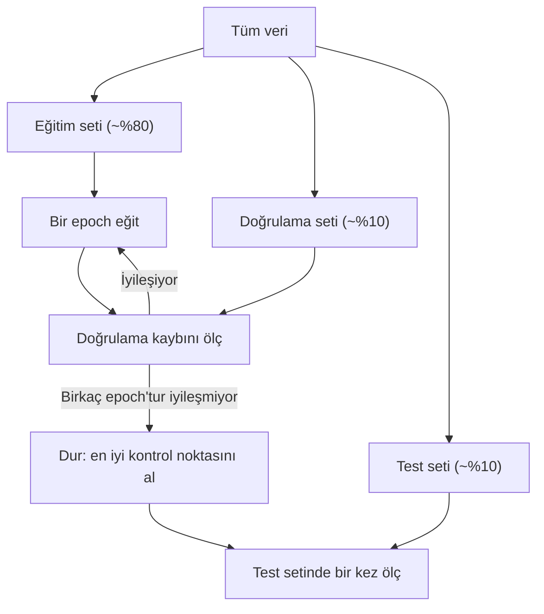

Aşırı öğrenmenin kayıp eğrilerindeki imzası:

```text
kayıp
  |\
  | \ .
  |  \   .                      . . .    <- doğrulama kaybı yükselmeye başlar
  |   \     .  .  .  .  .  .  '
  |    \_______
  |            \_________________        <- eğitim kaybı düşmeye devam eder
  +--------------^--------------------- epoch
                 burada durmalıydınız (early stopping)
```

### 4. Nasıl Çalışır?

**Temel kavramlar:**

- **Batch:** Modelin tek bir güncellemede gördüğü örnek grubu. Tüm veriyi tek seferde işlemek belleğe sığmaz, tek tek işlemek gürültülüdür; batch ikisinin ortasıdır.
- **Epoch:** Eğitim setinin baştan sona bir kez gezilmesi.
- **Optimizer:** Gradyanı kullanarak ağırlıkları güncelleyen algoritma. **SGD** en yalın halidir. **Adam / AdamW** her parametre için adım büyüklüğünü kendisi ayarlar ve LLM dünyasında varsayılandır.
- **Hiperparametre (Hyperparameter):** Modelin öğrenmediği, sizin seçtiğiniz ayarlar: öğrenme oranı, batch boyutu, katman sayısı.

**Aşırı öğrenmeye karşı araçlar (Regularization):**

- **Daha fazla ve daha çeşitli veri.** En etkili ilaç.
- **Erken durdurma (Early Stopping).** Doğrulama kaybı kötüleşmeye başlayınca dur.
- **Weight decay.** Ağırlıkların gereksiz büyümesini cezalandırır.
- **Dropout.** Eğitimde nöronların bir kısmını rastgele kapatır; ağ tek bir nörona bel bağlayamaz.

Tipik bir eğitim döngüsünün iskeleti (PyTorch tarzı pseudo-kod):

```python
en_iyi_kayip, sabir = float("inf"), 3

for epoch in range(100):
    for girdi, hedef in egitim_verisi:            # batch batch gez
        kayip = kayip_fonksiyonu(model(girdi), hedef)
        kayip.backward()                          # gradyanları hesapla
        optimizer.step()                          # ağırlıkları güncelle
        optimizer.zero_grad()                     # gradyanları sıfırla

    dogrulama_kaybi = degerlendir(model, dogrulama_verisi)
    if dogrulama_kaybi < en_iyi_kayip:
        en_iyi_kayip, sabir = dogrulama_kaybi, 3
        kaydet(model)                             # en iyi kontrol noktası
    else:
        sabir -= 1
        if sabir == 0:
            break                                 # erken durdurma
```

### 5. Ne Zaman Kullanılır / Ne Zaman Kullanılmaz?

Burada karar "kullanayım mı?" değil, "eğrilere bakıp ne yapayım?" kararıdır:

| Belirti | Teşhis | Ne yapmalı? |
|---|---|---|
| Eğitim kaybı da doğrulama kaybı da yüksek | Yetersiz öğrenme | Daha büyük model, daha uzun eğitim, daha iyi özellikler |
| Eğitim kaybı düşük, doğrulama kaybı yüksek | Aşırı öğrenme | Daha fazla veri, regularization, daha küçük model, erken durdurma |
| İkisi de düşük, canlıda sonuç kötü | Veri kayması ya da sızıntı | Test verisi gerçek kullanımı temsil ediyor mu? |
| Kayıp hiç düşmüyor | Hata ya da yanlış öğrenme oranı | Tek batch'i ezberletmeyi dene, öğrenme oranını değiştir |
| Kayıp zıplıyor ya da `NaN` | Öğrenme oranı çok yüksek | Düşür, gradient clipping ekle |

Veri bölme yöntemi de bir karardır:

| Veri tipi | Bölme yöntemi |
|---|---|
| Bağımsız örnekler | Rastgele karıştır ve böl |
| Zaman serisi | Zamana göre böl: geçmişle eğit, gelecekle test et |
| Aynı kullanıcıdan/dokümandan çok örnek | Gruba göre böl: bir kullanıcı tek bir sette olsun |

### 6. Sık Yapılan Hatalar & İpuçları

> [!WARNING]
> **Test setine bakarak ayar yapmak.** Test sonucuna göre hiperparametre değiştirdiğiniz anda test seti fiilen doğrulama seti olur ve elinizde tarafsız bir ölçüm kalmaz. Ayarları doğrulama setiyle yapın, teste en sonda bir kez bakın.

> [!WARNING]
> **Zaman serisini rastgele bölmek.** Model "geleceği" eğitimde görmüş olur. Sonuçlar harika görünür, canlıda çöker.

> [!TIP]
> **Önce bir batch'i ezberletin.** Model 10 örneği bile ezberleyemiyorsa bir hata vardır. Bu test bir dakikanızı alır, günlerinizi kurtarır.

> [!TIP]
> **Rastgelelik tohumunu (seed) sabitleyin ve her deneyi kaydedin.** "Geçen hafta daha iyiydi" cümlesinin ardından neyin değiştiğini bulamamak en yaygın zaman kaybıdır.

**Akılda kalsın:** Eğitim kaybı modelin ne kadar çalıştığını, doğrulama kaybı ne kadar öğrendiğini gösterir.


---

<a id="bolum-2"></a>

# Bölüm 2 — Derin Öğrenme & Transformer Devrimi

<a id="k-2-1"></a>

## 2.1 Tokenization

### 1. Tek Cümlelik Özet (TL;DR)

**Tokenization, metni modelin sözlüğündeki parçalara (token) bölüp her parçayı bir sayıya çevirmektir; model harf ya da kelime görmez, yalnızca bu sayı dizisini görür.**

### 2. Günlük Hayattan Analoji: Lego Parçaları

Her model için özel bir oyuncak dökmek yerine Lego sınırlı sayıda standart parça üretir; her şey bu parçalardan kurulur. Sık kullanılan şekiller için hazır büyük parçalar vardır (kapı, tekerlek), nadir şekiller küçük parçalardan birleştirilir.

Tokenizer da böyle çalışır. Sık geçen kelimeler tek parçadır; nadir kelimeler daha küçük parçalardan kurulur. Türkçe bunu görmek için ideal bir dildir: `evlerimizden` kelimesi sözlükte tek parça olarak durmaz, `ev + ler + imiz + den` gibi parçalara ayrılır. Sözlükte hiç olmayan bir kelime bile harf harf kurulabilir; "bilinmeyen kelime" diye bir şey kalmaz.

### 3. Görselleştirme

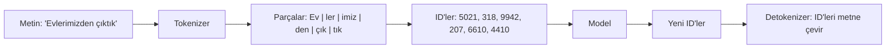

Parçalar ve ID'ler temsilidir; her modelin tokenizer'ı aynı metni farklı böler.

### 4. Nasıl Çalışır?

Üç seçenek var ve ikisi kötü:

| Yaklaşım | Sorun |
|---|---|
| **Kelime bazlı** | Sözlük devasa olur; "evlerimizden" görülmediyse bilinmeyen kelimedir |
| **Karakter bazlı** | Sözlük küçücük ama diziler çok uzar; model anlamı harflerden kurmak zorunda kalır |
| **Alt kelime (Subword)** | İkisinin ortası: sık kelimeler tek parça, nadirler birkaç parça |

Modern LLM'ler alt kelime yöntemlerini kullanır. En yaygını **BPE (Byte Pair Encoding)**'dir ve fikri çok basittir:

1. Her şeyi tek tek karakterlere böl.
2. Yan yana en sık geçen çifti bul, tek parça olarak birleştir.
3. İstenen sözlük boyutuna ulaşana kadar tekrarla.

```python
from collections import Counter

kelimeler = [list("evler"), list("evde"), list("evlerde"), list("eller")]

def birlestir(parcalar, a, b):
    sonuc, i = [], 0
    while i < len(parcalar):
        if parcalar[i:i + 2] == [a, b]:
            sonuc.append(a + b); i += 2
        else:
            sonuc.append(parcalar[i]); i += 1
    return sonuc

for tur in range(4):
    ciftler = Counter(c for k in kelimeler for c in zip(k, k[1:]))
    (a, b), adet = ciftler.most_common(1)[0]
    kelimeler = [birlestir(k, a, b) for k in kelimeler]
    print(f"{a}+{b} ({adet} kez) ->", [" ".join(k) for k in kelimeler])
```

Birkaç turda `ler` ve `ev` gibi parçalar kendiliğinden ortaya çıkar; kimse modele Türkçe ek öğretmedi. WordPiece ve SentencePiece aynı fikrin farklı uygulamalarıdır.

**Bağlam penceresi (Context Window):** Modelin tek seferde görebildiği en fazla token sayısıdır. Prompt, dokümanlar, konuşma geçmişi ve modelin cevabı bu bütçeden yer. API fiyatları da token başınadır.

### 5. Ne Zaman Kullanılır / Ne Zaman Kullanılmaz?

Tokenization her LLM'de zorunludur; mühendislik kararı onu **ne zaman hesaba katacağınızdır**:

| Durum | Yapılacak |
|---|---|
| Maliyet ve limit hesabı | Karakter değil token sayın; modelin kendi tokenizer'ını kullanın |
| Türkçe gibi eklemeli dillerle çalışma | Aynı içerik İngilizceye göre belirgin biçimde daha fazla token tutar; bütçeyi buna göre planlayın |
| Kendi modelinizi eğitiyorsunuz | Tokenizer'ı kendi alanınızın verisiyle eğitin |
| Hazır modele fine-tuning | ❌ Tokenizer'ı değiştirmeyin; model o sözlükle eğitildi |
| Harf sayma, tersten yazma, uzun sayılarla aritmetik | ⚠️ Model harfleri değil parçaları görür; bu işleri koda (tool) yaptırın |

### 6. Sık Yapılan Hatalar & İpuçları

> [!WARNING]
> **Token'ı karakter ya da kelimeyle karıştırmak.** "4 karakter ≈ 1 token" kuralı İngilizce için kaba bir tahmindir, Türkçede tutmaz. Limit ve maliyet hesabını her zaman gerçek tokenizer'la yapın.

> [!WARNING]
> **Yanlış modelin tokenizer'ını kullanmak.** Her modelin sözlüğü farklıdır. A modelinin tokenizer'ıyla sayıp B modeline göndermek hem sayımı hem (yerel modellerde) çıktıyı bozar.

> [!NOTE]
> **Baştaki boşluk token'ın parçasıdır.** Çoğu tokenizer'da `"ev"` ile `" ev"` farklı token'lardır. Prompt şablonlarında fazladan boşluklar ve satır sonları bu yüzden davranışı etkileyebilir.

> [!TIP]
> **Uzun bağlamda maliyet token sayısıyla doğrusal artar.** Prompt'a eklediğiniz her doküman, her istekte yeniden ödenir. Gereksiz içeriği ayıklamak en ucuz optimizasyondur.

**Akılda kalsın:** Model metin okumaz, token ID'leri okur. Para birimi de token'dır.

<a id="k-2-2"></a>

## 2.2 Embeddings (Vektör Uzayı)

### 1. Tek Cümlelik Özet (TL;DR)

**Embedding, bir token'ı ya da bir metni, anlamca benzer şeylerin birbirine yakın düştüğü bir uzayda koordinatlara, yani bir sayı listesine çevirmektir.**

### 2. Günlük Hayattan Analoji: Anlam Haritası

Haritada her şehrin iki koordinatı vardır: enlem ve boylam. Koordinatlara bakarak İzmit'in İstanbul'a yakın, Kars'a uzak olduğunu şehirleri hiç tanımadan söyleyebilirsiniz.

Embedding, kelimeler için çizilmiş bir haritadır. Bu haritada "kedi" ile "köpek" komşudur, "kedi" ile "fatura" ayrı kıtalardadır. Farkı şudur: harita iki boyutludur, embedding uzayı yüzlerce ya da binlerce boyutludur. Her boyut anlamın bir yönünü taşır; ama bu yönler "canlı mı?", "büyük mü?" gibi temiz etiketler değildir, model onları eğitimde kendisi bulur.

### 3. Görselleştirme

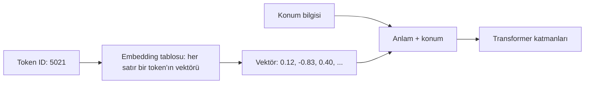

İki boyuta indirgenmiş bir anlam haritası:

```text
        ^
        |   kedi  köpek
        |      kuş                    fatura
        |                         ödeme   borç
        |
        |        elma  armut
        |          muz
        +---------------------------------------->
   Yakın duranlar anlamca benzer; yön ve mesafe bilgi taşır.
```

### 4. Nasıl Çalışır?

**1. Tablo araması.** Modelin girişinde, sözlükteki her token için bir satır içeren büyük bir tablo vardır. Token ID'si satır numarasıdır; embedding o satırdaki vektördür. Bu tablo eğitimle öğrenilir.

**2. Yakınlık nasıl ölçülür?** En yaygın ölçü **kosinüs benzerliğidir (cosine similarity)**: iki vektörün aynı yöne bakıp bakmadığını ölçer. 1 aynı yön, 0 ilgisiz, -1 zıt yön demektir.

```python
import numpy as np

def kosinus(a, b):
    return a @ b / (np.linalg.norm(a) * np.linalg.norm(b))

# Temsili 4 boyutlu embedding'ler (gerçekte yüzlerce boyut olur)
kedi   = np.array([0.9, 0.8, 0.1, 0.0])
kopek  = np.array([0.8, 0.9, 0.2, 0.1])
fatura = np.array([0.0, 0.1, 0.9, 0.8])

print(f"kedi ~ köpek : {kosinus(kedi, kopek):.2f}")
print(f"kedi ~ fatura: {kosinus(kedi, fatura):.2f}")
```

**3. Token embedding'i ile metin embedding'i farklı şeylerdir.**

| | Token embedding | Metin (cümle) embedding'i |
|---|---|---|
| Neyi temsil eder? | Tek bir token'ı | Bir cümleyi, paragrafı, dokümanı |
| Nerede yaşar? | LLM'in giriş katmanında | Ayrı bir **embedding modelinin** çıktısında |
| Ne için kullanılır? | Modelin iç işleyişi | Anlamsal arama, RAG, kümeleme, sınıflandırma |

RAG'de (Bölüm 5) kullanacağımız şey ikincisidir.

**4. Konum bilgisi (Positional Encoding).** Bir sonraki konuda göreceğimiz attention mekanizması, token'ların sırasını kendiliğinden bilmez; "köpek adamı ısırdı" ile "adam köpeği ısırdı" ona aynı torba gibi görünür. Bu yüzden her token'a konumunu anlatan bir sinyal eklenir. Orijinal Transformer sinüs dalgaları kullanmıştı; güncel modeller çoğunlukla göreli konum yöntemleri (ör. RoPE) kullanır.

### 5. Ne Zaman Kullanılır / Ne Zaman Kullanılmaz?

| İhtiyaç | Embedding | Neden |
|---|---|---|
| Anlamca benzer metni bulmak ("iade" ≈ "paramı geri istiyorum") | ✅ | Kelimeler farklı olsa da anlam yakındır |
| Kümeleme, tekrar eden içerik tespiti, öneri | ✅ | Mesafe doğrudan kullanılabilir |
| Az etiketle sınıflandırma | ✅ | Embedding üstüne basit bir sınıflandırıcı çoğu zaman yeter |
| Birebir eşleşme: ürün kodu, hata numarası, isim | ❌ | Anahtar kelime araması daha güvenilirdir (bkz. 5.4) |
| Sayısal karşılaştırma, tarih aralığı, filtreleme | ❌ | Bunlar veritabanı sorgusudur |
| Olumsuzluk ve ince mantık ("X olmayan ürünler") | ⚠️ | Embedding'ler olumsuzluğu zayıf yakalar |

### 6. Sık Yapılan Hatalar & İpuçları

> [!WARNING]
> **Farklı modellerin embedding'lerini karıştırmak.** Her modelin uzayı ayrıdır; A modeliyle üretilen vektör B modelininkiyle karşılaştırılamaz. Modeli değiştirirseniz tüm veriyi yeniden embed etmeniz gerekir.

> [!WARNING]
> **Sorgu ve doküman için modelin beklediği formatı atlamak.** Bazı embedding modelleri sorguların ve dokümanların başına farklı ön ekler ya da talimatlar ister. Model kartını okumadan kullanmak sessiz bir kalite kaybına yol açar.

> [!NOTE]
> **"Benzer" kelimesi "aynı konuda" demektir, "doğru" demek değildir.** "Faiz oranı yükseldi" ile "faiz oranı düştü" cümleleri embedding uzayında çok yakındır.

> [!TIP]
> **Türkçe içerik için çok dilli (multilingual) modeli kendi verinizle sınayın.** Genel sıralamalar İngilizce ağırlıklıdır; 50 gerçek sorgudan oluşan küçük bir test seti, lider tablosundan daha doğru yol gösterir.

**Akılda kalsın:** Embedding, anlamı mesafeye çevirir. Yakın = benzer.

<a id="k-2-3"></a>

## 2.3 Dikkat Mekanizması (Self-Attention)

### 1. Tek Cümlelik Özet (TL;DR)

**Self-attention, bir metindeki her token'ın diğer tüm token'lara "bana ne kadar lazımsın?" diye bakıp kendi anlamını onlardan topladığı bilgiyle güncellemesidir.**

### 2. Günlük Hayattan Analoji: Kütüphanede Arama

"Yüz" kelimesi tek başına belirsizdir: surat mı, sayı mı, yüzmek mi? "Denizde yüz" ile "yüz lira" arasındaki farkı çevredeki kelimeler belirler. Attention, her kelimenin anlamını netleştirmek için çevresine danışmasıdır.

Bunu kütüphane aramasına benzetebiliriz:

- **Sorgu (Query):** Elinizdeki soru. "Yüz" kelimesi sorar: "Benim anlamımı belirleyecek ipucu kimde?"
- **Anahtar (Key):** Her kitabın sırtındaki etiket. "Denizde" kelimesinin etiketi "su, mekân" der.
- **Değer (Value):** Kitabın içeriği. Etiket sorguyla eşleşirse içerikten o oranda bilgi alınır.

Fark şu: kütüphanede tek bir kitabı seçersiniz, attention ise **bütün kitaplardan eşleşme oranında** biraz alır.

### 3. Görselleştirme

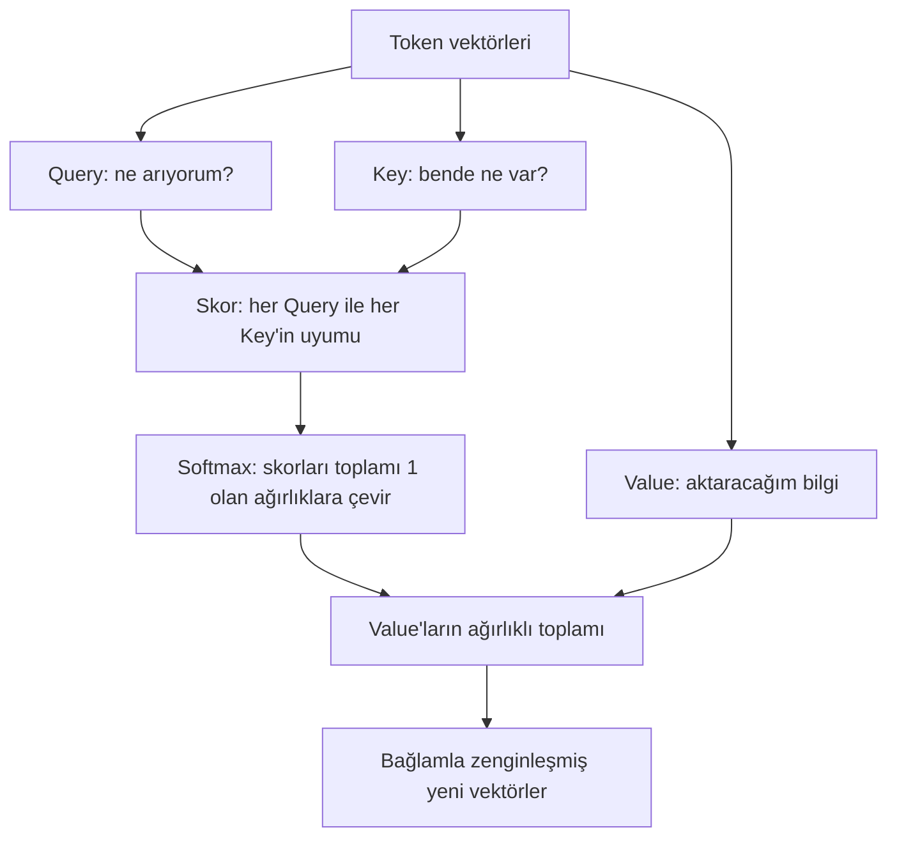

"Denizde yüz" cümlesinde "yüz" token'ının dikkat ağırlıkları temsili olarak şöyle görünebilir:

```text
            Denizde    yüz
   yüz  ->   0.78      0.22      ("yüz", anlamını çoğunlukla "Denizde"den alıyor)
```

### 4. Nasıl Çalışır?

**Önce sorun.** Transformer'dan önceki RNN'ler metni kelime kelime, sırayla okurdu. İki sıkıntısı vardı: uzun metinlerde baştaki bilgi sona gelene kadar soluyordu, ve sıralı çalıştığı için GPU'da paralelleştirilemiyordu. Attention her token'ın her token'a **doğrudan** bakmasına izin verir; mesafe sorun olmaktan çıkar ve hepsi aynı anda hesaplanır.

**Adımlar:**

1. Her token vektöründen üç ayrı vektör türetilir: Query, Key, Value. Bunları üreten matrisler eğitimle öğrenilir.
2. Her Query, bütün Key'lerle çarpılır. Sonuç bir uyum skorudur.
3. Skorlar softmax'ten geçer; her token için toplamı 1 olan dikkat ağırlıkları elde edilir.
4. Value'lar bu ağırlıklarla toplanır. Çıkan vektör, token'ın bağlamı sindirmiş yeni halidir.

```python
import numpy as np

def softmax(x):
    e = np.exp(x - x.max(axis=-1, keepdims=True))
    return e / e.sum(axis=-1, keepdims=True)

rng = np.random.default_rng(0)
n, d = 4, 8                                  # 4 token, 8 boyutlu vektörler
X = rng.normal(size=(n, d))                  # token vektörleri
Wq, Wk, Wv = (rng.normal(size=(d, d)) for _ in range(3))   # öğrenilen matrisler

Q, K, V = X @ Wq, X @ Wk, X @ Wv
skor = Q @ K.T / np.sqrt(d)                  # her token'ın her token'la uyumu (4x4)
agirlik = softmax(skor)                      # her satırın toplamı 1
cikti = agirlik @ V                          # bağlamla güncellenmiş vektörler

print(agirlik.round(2))
print("çıktı boyutu:", cikti.shape)
```

**Multi-Head Attention.** Tek bir attention tek bir tür ilişkiye odaklanır. Model bu işlemi paralel olarak birçok "kafa" ile yapar: biri özne-yüklem ilişkisine, biri zamirlerin kime gittiğine, biri yakın komşulara bakabilir. Sonuçlar birleştirilir.

**Nedensel maske (Causal Mask).** Metin üreten modellerde bir token yalnızca kendinden öncekilere bakabilir; geleceğe ait skorlar eksi sonsuz yapılarak kapatılır. Aksi halde model eğitimde cevaba bakıp kopya çekerdi.

### 5. Ne Zaman Kullanılır / Ne Zaman Kullanılmaz?

| Özellik | Self-attention | RNN / LSTM | CNN |
|---|---|---|---|
| Uzak bağlantıları yakalama | Çok iyi (doğrudan erişim) | Zayıf (bilgi solar) | Sınırlı (pencere kadar) |
| Paralel eğitim | Evet | Hayır | Evet |
| Dizi uzunluğuyla maliyet | Karesel: 2 kat uzun = 4 kat işlem | Doğrusal | Doğrusal |
| Veri ihtiyacı | Yüksek | Orta | Orta |

Pratik sonuç: dil, kod ve çok kipli modellerde attention fiilen standarttır. Bedeli **karesel maliyettir**: bağlam uzadıkça işlem ve bellek hızla artar. Çok uzun diziler ya da çok kısıtlı donanım söz konusuysa bu maliyet tasarım kararlarını belirler.

### 6. Sık Yapılan Hatalar & İpuçları

> [!WARNING]
> **Dikkat ağırlıklarını "modelin açıklaması" sanmak.** Bir token'a yüksek ağırlık verilmesi, kararın o token yüzünden alındığını kanıtlamaz. Ağırlıklar ipucu verir ama güvenilir bir açıklama yöntemi değildir.

> [!WARNING]
> **Uzun bağlamı bedava sanmak.** Bağlam penceresi büyük diye doldurmak hem maliyeti artırır hem de ilgili bilginin kalabalıkta gözden kaçma ihtimalini yükseltir.

> [!NOTE]
> **Attention sırayı bilmez.** Konum bilgisi dışarıdan eklenmezse cümle bir kelime torbasıdır (bkz. 2.2).

> [!TIP]
> **Sezgiyi kalıcı kılmanın yolu:** Yukarıdaki 12 satırı bir kez kendiniz yazın ve `agirlik` matrisini inceleyin. Transformer'ın geri kalanı bu matrisin etrafına kurulmuş mühendisliktir.

**Akılda kalsın:** Query sorar, Key eşleşir, Value taşınır. Her token, anlamını bağlamından toplar.

<a id="k-2-4"></a>

## 2.4 Transformer Mimarisi

### 1. Tek Cümlelik Özet (TL;DR)

**Transformer, "attention ile bilgi topla, ardından küçük bir sinir ağıyla işle" bloğunu onlarca kez üst üste koyan mimaridir; bugünkü LLM'lerin neredeyse tamamı bunun yalnızca decoder kısmını kullanır.**

### 2. Günlük Hayattan Analoji: Sırayla Okuyan Editörler

Bir taslak metin, uzun bir masada oturan onlarca editörün önünden sırayla geçiyor. Her editör iki şey yapar:

1. **Metnin diğer yerlerine bakar** ve ilgili yerleri ilişkilendirir (attention).
2. **Kendi bilgisini katar** ve kenara not düşer (ileri beslemeli ağ).

Önemli kural: hiçbir editör metni silip baştan yazmaz, yalnızca **üzerine not ekler**. Böylece ilk editörün gördüğü bilgi son editöre kadar kaybolmadan ulaşır. Bu, mimarideki *residual bağlantının* karşılığıdır. İlk editörler yazım ve dilbilgisiyle uğraşır, sonrakiler anlam ve mantıkla.

### 3. Görselleştirme

Decoder-only (GPT tarzı) bir modelin içi:

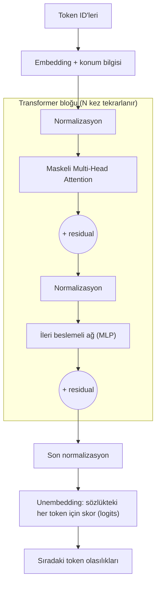

### 4. Nasıl Çalışır?

2017 tarihli "Attention Is All You Need" makalesi, çeviri için RNN'leri tamamen atıp yalnızca attention kullanan bir mimari önerdi. Yapı taşları şunlardır:

- **Attention:** Token'lar arasında bilgi taşır. "İletişim" adımıdır.
- **İleri beslemeli ağ (Feed-Forward / MLP):** Her token'ı ayrı ayrı işler. "Hesaplama" adımıdır; modelin parametrelerinin büyük kısmı buradadır.
- **Residual bağlantı:** Her alt katmanın çıktısı girdisine **eklenir**. Gradyanların derin ağda kaybolmadan akmasını sağlar (bkz. 1.4).
- **Normalizasyon (Layer Normalization):** Sayıların ölçeğini sabit tutarak eğitimi kararlı kılar.

Hepsi birkaç satıra sığar (pseudo-kod):

```python
def transformer_blogu(x):
    x = x + attention(norm1(x))      # iletişim: token'lar birbirinden bilgi alır
    x = x + mlp(norm2(x))            # hesaplama: her token kendi içinde işlenir
    return x

def dil_modeli(token_idleri):
    x = embedding_tablosu[token_idleri] + konum_bilgisi
    for blok in bloklar:             # onlarca kez
        x = blok(x)
    return unembedding(son_norm(x))  # her konum için sözlük boyutunda skor
```

Orijinal mimarinin iki yarısı vardı. Zamanla üç aile ortaya çıktı:

| Aile | Nasıl bakar? | Ne üretir? | Örnek | Tipik kullanım |
|---|---|---|---|---|
| **Encoder-only** | Her token sağına da soluna da bakar | Metnin temsili (vektör) | BERT ailesi | Sınıflandırma, embedding, arama |
| **Decoder-only** | Her token yalnızca soluna bakar | Sıradaki token | GPT ailesi ve güncel LLM'lerin çoğu | Metin üretimi, sohbet, kod |
| **Encoder-Decoder** | Encoder girdiyi okur, decoder çıktıyı yazar | Girdiye bağlı yeni dizi | T5, orijinal Transformer | Çeviri, özetleme |

Decoder-only ailenin kazanmasının nedeni basitliğidir: tek bir hedef (sıradaki token) her görevi kapsar ve mimari ölçeklemeye çok uygundur.

### 5. Ne Zaman Kullanılır / Ne Zaman Kullanılmaz?

| Göreviniz | Uygun aile | Neden |
|---|---|---|
| Serbest metin üretimi, sohbet, agent | Decoder-only LLM | Üretim için tasarlandı |
| Yüksek hacimli sınıflandırma (spam, duygu, niyet) | Küçük encoder modeli | Çok daha ucuz ve hızlı; çoğu zaman yeterli doğrulukta |
| Anlamsal arama için embedding | Embedding modeli | Çift yönlü bakış temsil kalitesini artırır |
| Etiketli veri az, görev karmaşık | Decoder-only LLM + prompt | Eğitim gerektirmez |
| Tablo verisi | ❌ Transformer şart değil | Gradient boosting hâlâ güçlü bir taban çizgisi |

### 6. Sık Yapılan Hatalar & İpuçları

> [!WARNING]
> **Her işe en büyük LLM'i koşmak.** Günde milyonlarca kısa metni sınıflandırmak için sohbet modeli kullanmak, ekmek almaya TIR ile gitmektir. Küçük bir encoder ya da fine-tune edilmiş küçük bir model aynı işi maliyetin çok küçük bir kısmına yapabilir.

> [!NOTE]
> **"Katman sayısı arttıkça daha akıllı" tek başına doğru değildir.** Derinlik, genişlik, veri ve eğitim süresi birlikte ölçeklenmelidir (bkz. 3.3).

> [!TIP]
> **Mimariyi içselleştirmenin en iyi yolu küçük bir GPT'yi sıfırdan yazmaktır.** Birkaç yüz satır tutar ve bu bölümdeki her kavramı çalışan koda bağlar.

> [!TIP]
> **Model kartında bakılacak üç şey:** parametre sayısı (bellek ihtiyacı), bağlam penceresi (ne kadar metin sığar) ve aile (üretir mi, temsil mi çıkarır).

**Akılda kalsın:** Blok = attention (iletişim) + MLP (hesaplama), ikisi de residual ile. Model = bu bloğun onlarca tekrarı.

<a id="k-2-5"></a>

## 2.5 Metin Üretimi (Decoding)

### 1. Tek Cümlelik Özet (TL;DR)

**LLM metni bir seferde yazmaz; her adımda sözlükteki bütün token'lar için bir olasılık hesaplar, birini seçer, metnin sonuna ekler ve aynı işlemi baştan yapar.**

### 2. Günlük Hayattan Analoji: Klavyedeki Kelime Önerisi

Telefonunuzun klavyesi yazdıklarınıza bakıp üç kelime önerir. Sürekli ortadaki öneriye basarsanız dilbilgisi düzgün ama sıkıcı, kendini tekrar eden bir cümle çıkar. Ara sıra diğer önerilere basarsanız metin canlanır; rastgele basarsanız saçmalar.

LLM bu klavyenin çok daha iyi bir tahminciyle çalışan halidir. **Temperature**, "ne sıklıkla ortadaki öneri dışına çıkayım?" düğmesidir.

### 3. Görselleştirme

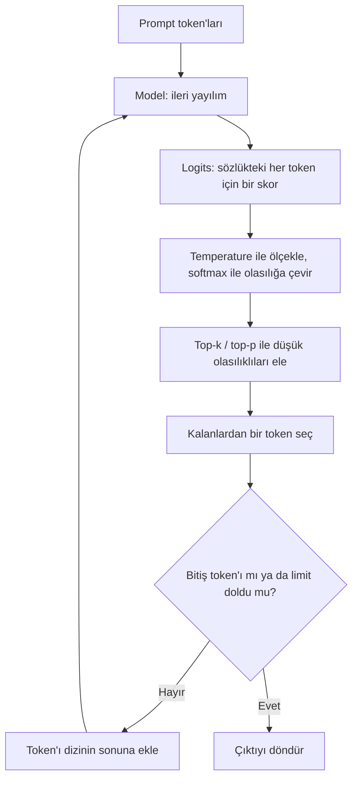

### 4. Nasıl Çalışır?

Model her adımda **logits** denen ham skorlar üretir. Bunlardan tek bir token seçme işine *decoding* denir ve davranışı belirleyen birkaç düğme vardır:

- **Greedy:** Her zaman en yüksek olasılıklıyı seç. Tutarlı ama tekdüze.
- **Sampling:** Olasılıklara göre zar at. Çeşitli ama riskli.
- **Temperature:** Zar atmadan önce dağılımı keskinleştirir (düşük değer) ya da düzleştirir (yüksek değer). 0'a yaklaştıkça greedy'ye yaklaşır.
- **Top-k:** Yalnızca en olası k token arasından seç.
- **Top-p (Nucleus):** Olasılıkları toplamı p'ye ulaşan en küçük token kümesinden seç. Model eminken küme küçülür, kararsızken büyür.

```python
import numpy as np

def token_sec(logits, temperature=1.0, top_p=1.0, rng=np.random.default_rng(0)):
    if temperature == 0:
        return int(np.argmax(logits))                 # greedy
    p = np.exp((logits - logits.max()) / temperature)
    p /= p.sum()                                      # softmax
    sira = np.argsort(p)[::-1]                        # olasıdan olasılıksıza
    kes = np.searchsorted(np.cumsum(p[sira]), top_p) + 1
    adaylar = sira[:kes]                              # top-p kümesi
    return int(rng.choice(adaylar, p=p[adaylar] / p[adaylar].sum()))

sozluk = ["çay", "kahve", "su", "ayran", "beton"]
logits = np.array([3.0, 2.5, 1.5, 1.0, -4.0])        # "Kahvaltıda ... içtim"
for t in (0, 0.7, 1.5):
    print(t, [sozluk[token_sec(logits, t, top_p=0.95)] for _ in range(8)])
```

**KV cache.** Her yeni token için bütün diziyi baştan hesaplamak israf olurdu. Model önceki token'ların attention için gereken ara sonuçlarını (Key ve Value) saklar, her adımda yalnızca yeni token'ı hesaplar. Üretimin hızlı olmasını sağlayan temel optimizasyon budur (bkz. 7.4).

**Önemli sonuç:** Model cevabın tamamını planlayıp yazmaz. Her token ayrı bir ileri yayılımın sonucudur ve bir kez yazılan token geri alınamaz. Uzun cevaplar bu yüzden pahalı ve yavaştır.

### 5. Ne Zaman Kullanılır / Ne Zaman Kullanılmaz?

| Görev | Temperature | Gerekçe |
|---|---|---|
| Veri çıkarma, sınıflandırma, JSON üretimi | 0 ya da çok düşük | Tutarlılık ve tekrarlanabilirlik gerekir |
| Kod üretimi | Düşük | Sözdizimi hataya tahammül etmez |
| Soru-cevap, özet | Düşük-orta | Doğruluk önce gelir |
| Beyin fırtınası, yaratıcı yazı, isim önerisi | Orta-yüksek | Çeşitlilik istenir |
| Aynı soruya birden çok farklı taslak | Yüksek | Tekrarı kırmak için |

Bazı modeller ve modlar (özellikle reasoning modelleri) bu parametrelerin bir kısmını sabitler ya da yok sayar. Kullandığınız modelin dokümantasyonuna bakın.

### 6. Sık Yapılan Hatalar & İpuçları

> [!WARNING]
> **Temperature 0'ı "deterministik" sanmak.** Çoğu zaman aynı çıktıyı verir ama garanti değildir; donanım, toplu işleme ve model güncellemeleri küçük farklar yaratabilir. Testlerinizi birebir metin eşleşmesine dayandırmayın.

> [!WARNING]
> **Kesilen cevabı fark etmemek.** Çıktı, azami token limitine takılırsa cümlenin ortasında biter. API'nin döndürdüğü bitiş nedenini (stop reason) kontrol edin; yarım bir JSON'u ayrıştırmaya çalışmak klasik bir prodüksiyon hatasıdır.

> [!TIP]
> **Temperature ve top-p'yi aynı anda oynamayın.** İkisi de aynı şeyi kontrol eder. Birini sabit tutup diğerini ayarlamak neyin neyi etkilediğini anlamayı kolaylaştırır.

> [!TIP]
> **Yapılandırılmış çıktı gerekiyorsa** temperature'a güvenmek yerine sağlayıcınızın structured output / JSON şeması özelliğini kullanın. Bu özellik, şemaya uymayan token'ları seçim aşamasında eler.

**Akılda kalsın:** Model olasılık üretir, decoding seçim yapar. Temperature yaratıcılığın değil, rastgeleliğin düğmesidir.


---

<a id="bolum-3"></a>

# Bölüm 3 — LLM Geliştirme Süreci

<a id="k-3-1"></a>

## 3.1 Ön Eğitim (Pre-training)

### 1. Tek Cümlelik Özet (TL;DR)

**Ön eğitim, modele devasa miktarda metin üzerinde "sıradaki token'ı tahmin et" oyununu sayısız kez oynatarak dili, bilgiyi ve akıl yürütme kalıplarını parametrelerine sıkıştırma aşamasıdır.**

### 2. Günlük Hayattan Analoji: Her Şeyi Okumuş Yeni Mezun

Yıllarca kütüphaneden çıkmamış birini düşünün: romanlar, ansiklopediler, forumlar, kod depoları... Kimse ona "şunu öğren" demedi; yalnızca okudu ve her cümlenin devamını tahmin etmeye çalıştı. Sonunda dilbilgisini, genel kültürü, hatta bir miktar mantık yürütmeyi kendiliğinden edindi.

Ama bu kişi henüz bir **çalışan** değildir. Soru sorduğunuzda cevap vermek yerine sorunuzu devam ettirebilir, çünkü öğrendiği tek şey metni sürdürmektir. Onu işe yarar bir asistana çevirmek sonraki aşamaların işidir (Bölüm 4).

### 3. Görselleştirme

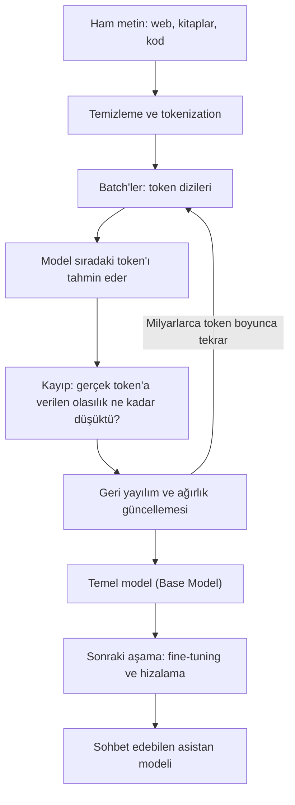

### 4. Nasıl Çalışır?

**Hedef son derece basittir.** Bir metin dizisi alınır; girdi dizinin kendisi, hedef ise dizinin bir token sağa kaydırılmış halidir. Model her konumda bir sonraki token'ı tahmin eder ve doğru token'a düşük olasılık verdiği ölçüde cezalandırılır (*cross-entropy* kaybı). Etiketi veri kendisi sağladığı için bu kendi kendine gözetimli öğrenmedir (bkz. 1.2).

```python
for batch in veri_yukleyici:                      # batch boyutu: [B, T+1] token ID
    girdi, hedef = batch[:, :-1], batch[:, 1:]    # hedef = girdinin bir kaydırılmışı
    logits = model(girdi)                         # [B, T, sozluk_boyutu]
    kayip = F.cross_entropy(logits.reshape(-1, sozluk_boyutu), hedef.reshape(-1))
    kayip.backward()                              # gradyanlar
    optimizer.step()                              # ağırlıkları güncelle
    optimizer.zero_grad()
```

Bu altı satır, bir LLM'in ön eğitiminin özüdür. Geri kalan her şey ölçek mühendisliğidir: binlerce GPU, haftalar süren eğitim, dağıtık veri hatları.

**Basit hedef neden bu kadar güçlü?** "Türkiye'nin başkenti" ifadesinin devamını iyi tahmin etmek için coğrafya bilmek gerekir. Bir ispatın sonraki satırını tahmin etmek için mantığı, bir fonksiyonun devamını tahmin etmek için programlamayı öğrenmek gerekir. Tahmin hatası düşürülmeye çalışılırken model, metnin arkasındaki dünyaya dair işe yarar temsiller kurmak zorunda kalır.

**Temel model ne bilir, ne bilmez?**

| Bilir | Bilmez / yapamaz |
|---|---|
| Dilbilgisi, üslup, birçok dil | Eğitim verisinin kesim tarihinden (knowledge cutoff) sonrasını |
| Eğitim verisinde sık geçen genel bilgi | Sizin şirketinizin özel verisini |
| Kod, matematik, akıl yürütme kalıpları | Talimat izlemeyi (henüz); yalnızca metni sürdürür |
| | Neyi bilmediğini güvenilir biçimde |

### 5. Ne Zaman Kullanılır / Ne Zaman Kullanılmaz?

Asıl soru şudur: **Sıfırdan ön eğitim yapmalı mıyım?** Cevap neredeyse her zaman hayırdır.

| Durum | Karar |
|---|---|
| Ürün geliştiriyorsunuz, genel dil yeteneği lazım | ❌ Hazır modeli kullanın (API ya da açık ağırlıklı model) |
| Alanınıza özgü üslup ya da format gerekiyor | ❌ Fine-tuning yeterli (Bölüm 4) |
| Modelin şirket bilgisini bilmesi gerekiyor | ❌ RAG (Bölüm 5) |
| Hiçbir modelin görmediği bir veri türü: protein dizileri, sensör verisi, özel bir alfabe | ✅ Ön eğitim anlamlı olabilir |
| Araştırma laboratuvarısınız ya da temel model üretmek işinizin kendisi | ✅ |
| Öğrenmek için küçük bir model eğitmek | ✅ Mutlaka deneyin; tek GPU'da birkaç saatte yapılabilir |

### 6. Sık Yapılan Hatalar & İpuçları

> [!WARNING]
> **Temel modeli sohbet modeli gibi kullanmak.** Temel model talimat izlemez, metni devam ettirir. Açık ağırlıklı modellerde "base" ile "instruct/chat" sürümlerini karıştırmak sık yapılan bir hatadır.

> [!WARNING]
> **Bilgi kesim tarihini unutmak.** Model, eğitim verisinin bittiği günden sonrasını bilmez ve çoğu zaman bugünün tarihini de bilmez. Güncel bilgi gerekiyorsa bağlama eklenmelidir.

> [!NOTE]
> **Kaybın düşmesi yeteneğin arttığının kaba bir göstergesidir, kanıtı değildir.** Asıl ölçüm görev bazlı değerlendirmelerle yapılır (bkz. 7.1).

> [!TIP]
> **Bir ara yol: alan uyarlamalı ön eğitim.** Hazır bir modeli kendi alanınızın etiketsiz metinleriyle aynı hedefle bir süre daha eğitmek, sıfırdan eğitimin maliyetinin çok küçük bir kısmıyla alan diline uyum sağlar.

**Akılda kalsın:** Ön eğitim genel yeteneği inşa eder, pahalıdır ve bir kez yapılır. Çoğu ekibin işi bu aşamadan sonra başlar.

<a id="k-3-2"></a>

## 3.2 Veri Hazırlığı

### 1. Tek Cümlelik Özet (TL;DR)

**Bir modelin tavanını mimarisinden çok verisi belirler; veri hazırlığı, ham metin yığınını temiz, tekilleştirilmiş, filtrelenmiş ve kaynağı bilinen bir eğitim setine çevirme işidir.**

### 2. Günlük Hayattan Analoji: Restoran Mutfağı

İyi bir restoranın sırrı çoğu zaman tarif değil malzemedir. Halden gelen kasalar doğrudan tencereye boşaltılmaz: çürükler ayıklanır, sebzeler yıkanır, aynı üründen fazlası geri gönderilir, tedarikçisi belli olmayan mal alınmaz. Bu hazırlık görünmez ve sıkıcıdır, ama tabağın kalitesini o belirler. En iyi aşçı bile bozuk domatesten iyi sos çıkaramaz.

### 3. Görselleştirme

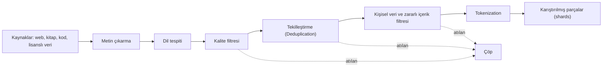

Her aşamada verinin önemli bir kısmı atılır. Ham toplananın küçük bir bölümünün eğitime girmesi olağandır.

### 4. Nasıl Çalışır?

1. **Toplama.** Web taramaları, kitaplar, kod depoları, lisanslanmış arşivler. Kaynak çeşitliliği modelin genelleme gücünü belirler.
2. **Çıkarma.** HTML'den menüler, reklamlar ve çerez uyarıları ayıklanır; PDF'lerden metin kurtarılır. Kötü çıkarma, veriye kalıcı gürültü olarak girer.
3. **Kalite filtresi.** Çok kısa, tekrar dolu, anlamsız karakter yığını ya da otomatik üretilmiş spam sayfalar elenir. Basit sezgisel kurallardan küçük sınıflandırıcı modellere kadar yöntemler kullanılır.
4. **Tekilleştirme.** Aynı metnin binlerce kopyası (lisans metinleri, kopyalanmış haberler) modelin o metni ezberlemesine ve kapasitesini boşa harcamasına yol açar. Birebir kopyalar özet (hash) ile, yakın kopyalar MinHash gibi yöntemlerle bulunur.
5. **Güvenlik ve gizlilik.** Kişisel veriler ve istenmeyen içerikler temizlenir.
6. **Karıştırma.** Model aynı kaynaktan ardışık binlerce örnek görmesin diye veri karıştırılır.

En yalın haliyle kalite filtresi ve tekilleştirme:

```python
import hashlib

def temiz_mi(metin):
    kelimeler = metin.split()
    if len(kelimeler) < 5:                               # çok kısa
        return False
    return len(set(kelimeler)) / len(kelimeler) > 0.3    # aşırı tekrar yok

def tekillestir(dokumanlar):
    gorulen = set()
    for d in dokumanlar:
        ozet = hashlib.md5(" ".join(d.lower().split()).encode()).hexdigest()
        if ozet not in gorulen and temiz_mi(d):
            gorulen.add(ozet)
            yield d

ham = ["Bugün hava çok güzel ve güneşli.", "bugün  hava çok güzel ve güneşli.",
       "tıkla tıkla tıkla tıkla tıkla tıkla", "Kısa metin"]
print(list(tekillestir(ham)))
```

Aynı ilkeler fine-tuning veri setleri için de geçerlidir; yalnızca ölçek küçülür ve her örneğe tek tek bakmak mümkün hale gelir.

### 5. Ne Zaman Kullanılır / Ne Zaman Kullanılmaz?

| Karar | Ne zaman bu yönde? |
|---|---|
| **Kaliteye yatırım** (az ama temiz veri) | Fine-tuning; dar ve iyi tanımlı görevler; modelin üslubu önemli |
| **Miktara yatırım** (çok ve çeşitli veri) | Ön eğitim; genelleme ve kapsam önemli |
| **Sentetik veri** (başka bir modelle üretilmiş) | Gerçek veri az ya da gizli; nadir durumları çoğaltmak; küçük modele büyük modelin davranışını öğretmek |
| **Sentetik veriden kaçın** | Değerlendirme (eval) setleri; gerçek kullanıcı dağılımını bilmeniz gereken durumlar |
| **İnsan etiketlemesi** | "Doğru" tanımının uzmanlık gerektirdiği yerler; eval setleri |

### 6. Sık Yapılan Hatalar & İpuçları

> [!WARNING]
> **Değerlendirme verisinin eğitim setine sızması (Contamination).** Test sorularınız eğitim verisinde geçiyorsa ölçtüğünüz şey yetenek değil ezberdir. Eval setlerini eğitim verisine karşı tekilleştirin.

> [!WARNING]
> **Aşırı filtreleme.** "Kaliteli" tanımını çok dar tutarsanız konuşma dilini, lehçeleri, azınlık konularını ve sıra dışı ama doğru metinleri atarsınız. Model steril ama dar bir dünyada eğitilir.

> [!CAUTION]
> **Lisans ve kişisel veri.** Verinin nereden geldiğini ve hangi koşullarla kullanılabildiğini kayıt altına alın. Sonradan "bu veri nereden gelmişti?" sorusuna cevap verememek hem hukuki hem teknik bir borçtur.

> [!TIP]
> **Veriye gözünüzle bakın.** Her filtre aşamasından sonra rastgele 100 örnek okuyun: 50 tane geçen, 50 tane atılan. İstatistiklerin göstermediği sorunların çoğu ilk beş dakikada ortaya çıkar.

**Akılda kalsın:** Model, verisinin sıkıştırılmış halidir. Çöp verirseniz, çöpü akıcı bir dille geri alırsınız.

<a id="k-3-3"></a>

## 3.3 Ölçekleme Yasaları (Scaling Laws)

### 1. Tek Cümlelik Özet (TL;DR)

**Ölçekleme yasaları, model boyutunu, veriyi ve hesaplama gücünü büyüttükçe kaybın şaşırtıcı derecede öngörülebilir bir eğriyle düştüğünü gösteren deneysel gözlemlerdir.**

### 2. Günlük Hayattan Analoji: Fabrika ve Hammadde

Bir fabrika kuruyorsunuz. Bütçenizi iki şeye bölebilirsiniz: **makineler** (model parametreleri) ve **hammadde** (veri). Dev makineler alıp az hammadde getirirseniz makineler boş döner. Dağlar kadar hammaddeyi küçücük bir atölyeye yığarsanız işleyemezsiniz. Sabit bir bütçe için en iyi sonuç, ikisini **dengeli** büyütmekten gelir.

İkinci gözlem: getiri azalır ama düzenlidir. Üretimi bir kademe iyileştirmek için bütçeyi her seferinde kabaca aynı oranda **katlamanız** gerekir; iki katı para iki katı kalite getirmez.

### 3. Görselleştirme

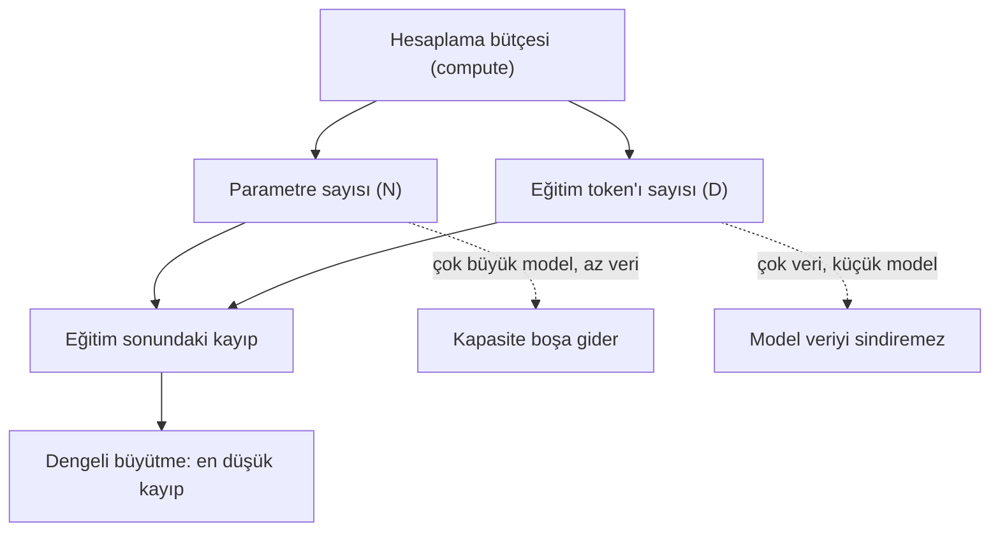

Logaritmik eksenlerde ilişki bir doğruya yakındır:

```text
kayıp (log)
  |  *
  |     *
  |        *
  |           *
  |              *              <- her 10 kat hesaplama, benzer miktarda iyileşme
  |                 *
  +------------------------------ hesaplama gücü (log)
```

### 4. Nasıl Çalışır?

**1. Güç yasası gözlemi.** 2020'de yapılan çalışmalar, dil modellerinde kaybın parametre sayısı, veri miktarı ve hesaplama gücüyle bir güç yasası (power law) izleyerek düştüğünü gösterdi. Pratik anlamı büyüktür: küçük deneylerden büyük modelin performansını **önceden kestirebilirsiniz**. Milyonlarca dolarlık bir eğitime körlemesine girmezsiniz.

**2. Denge sorusu (Chinchilla).** 2022'de DeepMind şu soruyu sordu: sabit bir hesaplama bütçesiyle, büyük modeli az veriyle mi yoksa küçük modeli çok veriyle mi eğitmeli? Bulgu: o dönemin modelleri boyutlarına göre **az veriyle** eğitilmişti. En verimli nokta, parametre ile veriyi birlikte büyütmek ve kabaca parametre başına 20 token civarında veri kullanmaktı.

**3. Hesaplama maliyeti tahmini.** Eğitim için gereken işlem miktarı yaklaşık olarak `6 × parametre × token` kayan nokta işlemidir (FLOP). Bu formülle zarf arkası hesap yapılabilir:

```python
def egitim_tahmini(parametre, token, gpu_flop_saniye, saat_ucreti):
    flop = 6 * parametre * token                 # toplam işlem
    gpu_saat = flop / gpu_flop_saniye / 3600
    return gpu_saat, gpu_saat * saat_ucreti

# Varsayımlar örnek amaçlıdır: GPU'nun fiilî hızı ve fiyatı donanıma göre değişir
N = 1e9                    # 1 milyar parametre
D = 20 * N                 # Chinchilla sezgisi: parametre başına ~20 token
saat, maliyet = egitim_tahmini(N, D, gpu_flop_saniye=1e14, saat_ucreti=2.0)
print(f"{saat:,.0f} GPU-saat, yaklaşık {maliyet:,.0f} $")
```

Dikkat: parametreyi 10 katına çıkarıp veriyi de dengeli büyütürseniz maliyet 100 katına çıkar.

**4. Yasaların sınırı.** Bu yasalar **kaybı** öngörür, ürün kalitesini değil. Ayrıca yalnızca eğitim maliyetini optimize eder. Bir model milyonlarca kez çağrılacaksa, daha küçük bir modeli "gereğinden uzun" eğitmek toplamda daha ucuzdur; güncel uygulama sıklıkla bu yöndedir. Veri kalitesi, mimari iyileştirmeler ve eğitim sonrası teknikler de eğriyi kaydırır.

**Kendiliğinden beliren yetenekler (Emergent Abilities) tartışması.** Bazı yeteneklerin belirli bir ölçekte aniden ortaya çıktığı gözlemlenmiştir. Karşı görüş, bu ani sıçramaların kısmen ölçüm yönteminden kaynaklandığını, daha hassas metriklerle bakıldığında gelişimin kademeli olduğunu savunur. Tartışma kapanmış değildir.

### 5. Ne Zaman Kullanılır / Ne Zaman Kullanılmaz?

| Durum | Ölçekleme yasaları işe yarar mı? |
|---|---|
| Sıfırdan model eğitimi planlıyorsunuz | ✅ Bütçeyi parametre ve veri arasında bölmek için |
| "Daha büyük model ne kadar iyileştirir?" tahmini | ✅ Küçük ölçekli deneylerden ekstrapolasyon |
| Hazır modeller arasında seçim | ⚠️ Dolaylı: büyük model genelde daha yetenekli ama daha pahalı ve yavaş; kendi eval'inizle karar verin |
| Fine-tuning veri miktarı kararı | ❌ Bu yasalar ön eğitim içindir; fine-tuning'de kalite ve çeşitlilik baskındır |
| Ürün kalitesi tahmini | ❌ Kayıp ile kullanıcı memnuniyeti aynı şey değildir |

### 6. Sık Yapılan Hatalar & İpuçları

> [!WARNING]
> **"Parametre başına 20 token"ı evrensel kural sanmak.** Bu oran belirli bir mimari, veri türü ve yalnızca eğitim maliyeti için bulunmuş bir tahmindir. Çıkarım maliyeti hesaba girdiğinde en iyi nokta değişir.

> [!WARNING]
> **Eğriyi sonsuza uzatmak.** Deneysel bir eğilimin gözlenen aralığın çok ötesinde aynen süreceğinin garantisi yoktur. Veri kıtlığı, enerji ve maliyet gibi pratik sınırlar da devreye girer.

> [!NOTE]
> **"Acı ders" (The Bitter Lesson).** Yapay zekâ tarihinde, insan bilgisini elle kodlayan zekice yöntemler uzun vadede hep genel yöntemler + daha fazla hesaplama karşısında kaybetti. Ölçekleme yasaları bu gözlemin sayısal ifadesidir.

> [!TIP]
> **Model seçerken soruyu tersinden sorun:** "En büyük model hangisi?" yerine "Eval setimde hedefi geçen en küçük model hangisi?" Maliyet ve gecikme farkı çoğu zaman büyüktür.

**Akılda kalsın:** Daha fazla parametre, veri ve hesaplama öngörülebilir biçimde daha düşük kayıp getirir; ama her adımın faturası katlanarak büyür.

<a id="k-3-4"></a>

## 3.4 Altyapı ve Maliyet Dinamikleri

### 1. Tek Cümlelik Özet (TL;DR)

**Eğitim bir kerelik büyük yatırımdır, çıkarım ise her istekte ödenen faturadır; başarılı bir üründe toplam maliyetin büyük kısmını çoğu zaman çıkarım oluşturur.**

### 2. Günlük Hayattan Analoji: Fabrikayı Kurmak ve Çalıştırmak

Fabrikayı kurmak pahalıdır ama bir kez yapılır: bu **eğitimdir**. Sonra her ürün için hammadde ve elektrik ödersiniz: bu **çıkarımdır**. Günde on ürün satıyorsanız kurulum maliyeti baskındır. Günde on milyon ürün satıyorsanız kurulum unutulur, bütün dert birim maliyettir.

Çoğu ekip fabrika kurmaz, fason üretim yaptırır (API). Kendi fabrikanızı kurmanın anlamlı olması için ya hacminizin çok büyük ya da ürününüzün çok özel olması gerekir.

### 3. Görselleştirme

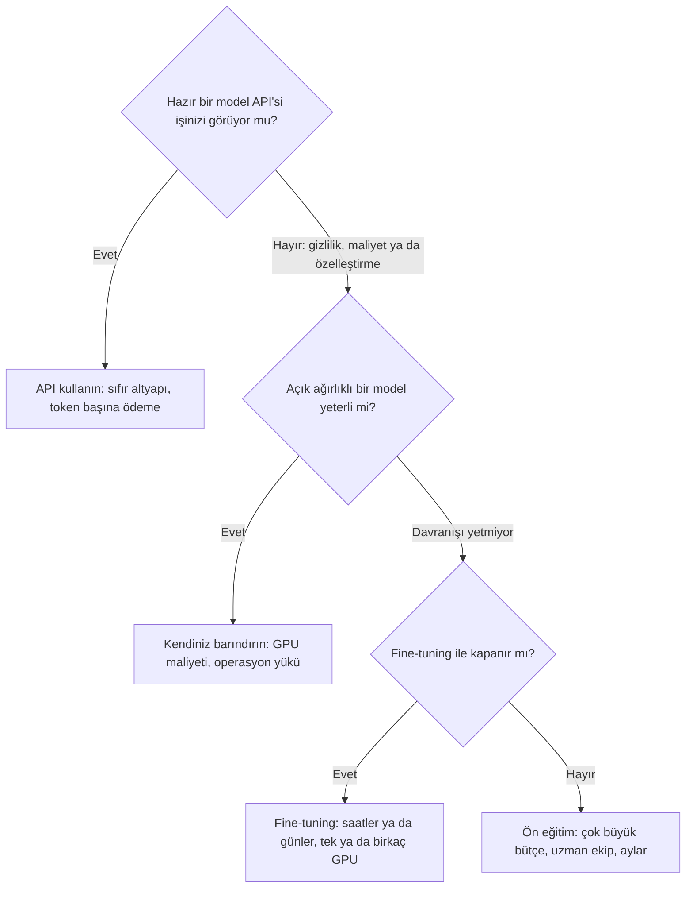

Yukarıdan aşağı indikçe ilk yatırım, risk ve gereken uzmanlık artar.

### 4. Nasıl Çalışır?

**1. Bellek her şeyin başıdır.** Bir modelin GPU'ya sığıp sığmayacağını ağırlıkların kapladığı yer belirler: `parametre sayısı × parametre başına bayt`.

```python
def bellek_gb(parametre_milyar, bayt):
    return parametre_milyar * bayt          # 1 milyar parametre x 1 bayt = 1 GB

P = 7   # 7 milyar parametreli bir model
print(f"Çıkarım, 16-bit      : {bellek_gb(P, 2):.0f} GB")
print(f"Çıkarım, 4-bit       : {bellek_gb(P, 0.5):.1f} GB")
# Tam eğitim (32-bit, AdamW): ağırlık 4 + gradyan 4 + optimizer durumu 8 bayt
print(f"Tam eğitim, en az    : {bellek_gb(P, 16):.0f} GB + aktivasyonlar")
```

Aynı model çıkarımda tek bir tüketici GPU'suna sığarken tam eğitimde birden çok veri merkezi GPU'su ister. Fine-tuning'de LoRA gibi yöntemlerin (4.3) bu kadar yaygın olmasının nedeni budur.

**2. Eğitimi sığdırma ve hızlandırma teknikleri.**

- **Karma hassasiyet (Mixed Precision):** Hesapların çoğunu 16-bit yapar; bellek yarıya iner, hız artar.
- **Gradyan biriktirme (Gradient Accumulation):** Küçük batch'lerin gradyanlarını toplayıp tek güncelleme yapar; büyük batch etkisini az bellekle taklit eder.
- **Dağıtık eğitim:** Veriyi ve/veya modeli birden çok GPU'ya böler. Verimi iletişim maliyeti sınırlar.
- **Kontrol noktaları (Checkpoints):** Uzun eğitimlerde donanım arızası olağandır; düzenli kayıt şarttır.

**3. Çıkarım maliyetinin anatomisi.**

- API'lerde girdi ve çıktı token'ları ayrı fiyatlanır; **çıktı token'ları genelde belirgin biçimde daha pahalıdır**, çünkü her biri ayrı bir ileri yayılımdır.
- Kendi barındırdığınız modelde maliyet GPU-saattir. Birim maliyeti belirleyen şey **kullanım oranıdır**: boş bekleyen GPU da para yakar.

**4. Görünmeyen kalemler.** Başarısız deneyler (çoğu deney başarısızdır), veri hazırlığı ve etiketleme, değerlendirme, mühendis zamanı ve operasyon. GPU faturası buzdağının görünen kısmıdır.

### 5. Ne Zaman Kullanılır / Ne Zaman Kullanılmaz?

| Seçenek | İlk yatırım | Birim maliyet | Kontrol | Ne zaman? |
|---|---|---|---|---|
| **Model API'si** | Yok | Orta-yüksek, kullandıkça | Düşük | Başlangıç; değişken ya da düşük hacim; en güçlü modeller gerektiğinde |
| **Açık model, kendi barındırma** | Orta | Yüksek hacimde düşük | Yüksek | Veri dışarı çıkamıyor; hacim yüksek ve düzenli; ekipte operasyon becerisi var |
| **Fine-tuning** | Orta | Küçük modelle düşük | Yüksek | Dar görev, küçük modelle büyük modelin kalitesi hedefleniyor |
| **Sıfırdan ön eğitim** | Çok yüksek | — | Tam | Temel model üretmek işin kendisi |

Kaba bir karar kuralı: önce API ile ürünün işe yaradığını kanıtlayın. Fatura gerçekten can yakmaya başladığında elinizde hem kullanım verisi hem de neyi optimize edeceğinizi gösteren bir eval seti olur.

### 6. Sık Yapılan Hatalar & İpuçları

> [!WARNING]
> **Kendi barındırmayı yalnızca GPU fiyatıyla hesaplamak.** Düşük kullanım oranı, nöbet tutan mühendisler, ölçekleme ve güncelleme yükü hesaba katıldığında API çoğu zaman sanıldığından ucuzdur.

> [!WARNING]
> **Çıktı uzunluğunu kontrol etmemek.** Maliyet ve gecikmenin en büyük kaldıracı çıktı token sayısıdır. Gereksiz uzun cevaplar hem pahalı hem yavaştır.

> [!TIP]
> **Maliyeti istek başına değil, başarılı görev başına ölçün.** Ucuz model işi üç denemede yapıyorsa pahalı modelden daha pahalıya gelebilir.

> [!TIP]
> **Bütçe alarmı ilk gün kurulur.** Sonsuz döngüye giren bir agent ya da yanlış yapılandırılmış bir toplu iş, bir gecede aylık bütçeyi tüketebilir.

**Akılda kalsın:** Eğitim maliyeti manşet olur, çıkarım maliyeti şirketi batırır ya da ayakta tutar.


---

<a id="bolum-4"></a>

# Bölüm 4 — Hizalama ve Özelleştirme (Alignment & Fine-Tuning)

<a id="k-4-1"></a>

## 4.1 Özelleştirme Haritası

### 1. Tek Cümlelik Özet (TL;DR)

**Bir modelin davranışını değiştirmenin üç kademesi vardır: talimatı değiştir (prompt), bağlama bilgi ekle (RAG), ağırlıkları değiştir (fine-tuning); doğru sıra neredeyse her zaman ucuzdan pahalıya doğrudur.**

### 2. Günlük Hayattan Analoji: İşe Yeni Başlayan Uzman

Çok yetenekli birini işe aldınız. Ondan istediğiniz verimi almanın üç yolu var:

- **Net talimat vermek (Prompt Engineering):** "Müşteriye şu üslupla yaz, şu formatta raporla, işte iki örnek." Beş dakikanızı alır.
- **Eline dokümanları vermek (RAG):** Şirket prosedürlerini, ürün kataloğunu, güncel fiyat listesini önüne koyarsınız. Yetenek aynıdır, bilgi eklenmiştir.
- **Aylarca eğitime göndermek (Fine-Tuning):** Belirli bir işi refleks haline getirene kadar çalıştırırsınız. Pahalıdır, zaman alır ve şirket fiyat listesini değiştirdiğinde eğitimi tekrarlamak gerekir.

Kimse yeni çalışana talimat vermeyi denemeden onu aylarca kursa göndermez.

### 3. Görselleştirme

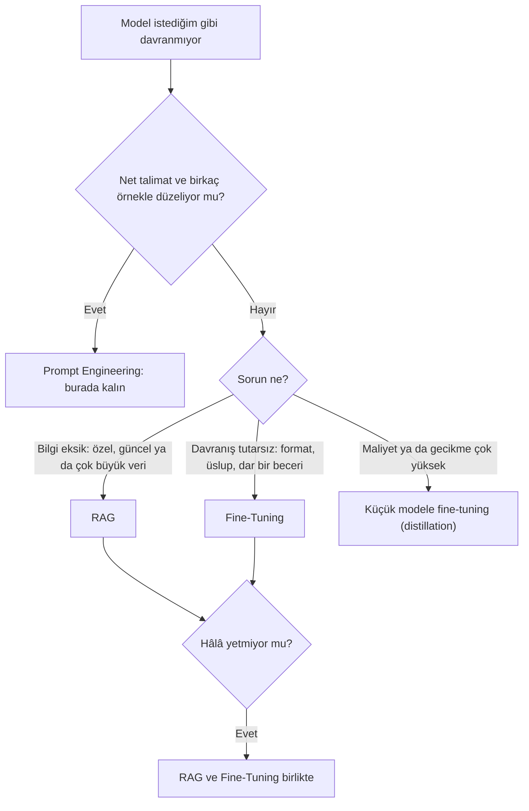

### 4. Nasıl Çalışır?

Üç yöntem **farklı şeyleri** değiştirir:

| | Neyi değiştirir? | Model ağırlıkları |
|---|---|---|
| **Prompt** | Modele o an ne söylendiğini | Değişmez |
| **RAG** | Modelin o an neyi gördüğünü | Değişmez |
| **Fine-Tuning** | Modelin kalıcı olarak nasıl davrandığını | Değişir |

En çok işe yarayan zihinsel model şudur: **RAG bilgi sorununu, fine-tuning davranış sorununu çözer.**

- Model yanlış cevap veriyor çünkü şirketinizin iade politikasını bilmiyor → bilgi sorunu → RAG.
- Model politikayı biliyor ama her seferinde farklı formatta, yanlış üslupla ya da gereksiz uzun yazıyor → davranış sorunu → önce prompt, yetmezse fine-tuning.

**Prompt engineering'in araç kutusu** çoğu ekibin sandığından geniştir: açık rol ve hedef tanımı, birkaç örnek (*few-shot*), çıktı şeması, adım adım düşünme talimatı, uzun talimatları bölümlere ayırma. Fine-tuning'e geçmeden önce bu kutunun gerçekten tükendiğinden emin olun.

**İkisi rakip değil.** Olgun sistemlerde sık görülen yapı: fine-tune edilmiş (ya da iyi prompt'lanmış) bir model, RAG ile getirilen bilgiyi tutarlı bir formatta işler.

### 5. Ne Zaman Kullanılır / Ne Zaman Kullanılmaz?

| Ölçüt | Prompt Engineering | RAG | Fine-Tuning |
|---|---|---|---|
| **Çözdüğü sorun** | Belirsiz talimat | Eksik ya da güncel olmayan bilgi | Tutarsız davranış, format, üslup |
| **Başlama süresi** | Dakikalar | Günler | Haftalar |
| **Gereken veri** | Birkaç örnek | Doküman koleksiyonu | Yüzlerce-binlerce kaliteli örnek |
| **Bilgi güncellemesi** | Prompt'u düzenle | Dokümanı güncelle; anında | Yeniden eğit |
| **İstek başına maliyet** | Düşük (uzun prompt'ta artar) | Orta (eklenen bağlam kadar) | Düşük (kısa prompt, küçük model) |
| **Kaynak gösterme** | Hayır | Evet | Hayır |
| **Bakım yükü** | Düşük | Orta (indeks, veri hattı) | Yüksek (veri, eğitim, sürümleme) |
| **Geri alma** | Anında | Kolay | Zor |

### 6. Sık Yapılan Hatalar & İpuçları

> [!WARNING]
> **Bilgiyi fine-tuning ile öğretmeye çalışmak.** Ürün kataloğunu modele ezberletmek pahalıdır, güvenilmezdir ve katalog değişince çöpe gider. Değişen bilgi bağlamda durmalıdır, ağırlıklarda değil.

> [!WARNING]
> **Eval seti olmadan fine-tuning'e girişmek.** Ölçemediğiniz şeyi iyileştirdiğinizi bilemezsiniz. Önce ölçüm (bkz. 7.1), sonra müdahale.

> [!TIP]
> **Önce en güçlü modelle ve iyi bir prompt'la tavanı görün.** En iyi model bile işi yapamıyorsa sorun büyük ihtimalle görev tanımında ya da verdiğiniz bilgidedir; fine-tuning bunu çözmez.

> [!TIP]
> **Hataları sınıflandırın.** 50 başarısız örneği okuyup her birine "bilgi eksikti" ya da "bilgi vardı ama yanlış kullandı" etiketi koyun. Dağılım size hangi yöntemi seçeceğinizi söyler.

**Akılda kalsın:** Önce prompt. Bilgi eksikse RAG. Davranış bozuksa fine-tuning. Bu sırayı atlamayın.

<a id="k-4-2"></a>

## 4.2 SFT (Supervised Fine-Tuning)

### 1. Tek Cümlelik Özet (TL;DR)

**SFT, ön eğitimli bir modele "şu girdiye şu çıktıyı ver" örnekleri göstererek aynı sıradaki-token eğitimini küçük ve özenle seçilmiş bir veri setiyle sürdürmektir.**

### 2. Günlük Hayattan Analoji: Çağrı Merkezi Oryantasyonu

Genel kültürü geniş yeni mezunu çağrı merkezine aldınız. Ona dil öğretmiyorsunuz; onu zaten biliyor. Yaptığınız şey, önüne yüzlerce **örnek konuşma** koymaktır: "Müşteri böyle dediğinde biz böyle cevap veririz." Birkaç gün sonra şirketin üslubunu, selamlama biçimini, hangi durumda neyi sorması gerektiğini kendiliğinden yapar hale gelir.

Örnek konuşmalar kötüyse çalışan da kötü alışkanlık edinir. SFT'de veri seti, istediğiniz davranışın **tanımıdır**.

### 3. Görselleştirme

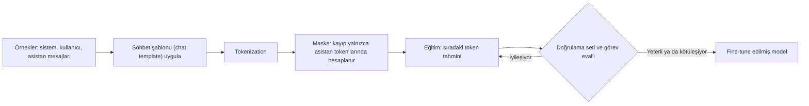

### 4. Nasıl Çalışır?

**1. Hedef değişmez, veri değişir.** SFT'de kullanılan kayıp, ön eğitimdekiyle aynıdır (bkz. 3.1). Fark, verinin artık rastgele web metni değil, özenle hazırlanmış girdi-çıktı çiftleri olmasıdır. Temel modeli talimat izleyen bir asistana çeviren ilk adım da budur (*instruction tuning*).

**2. Veri formatı.** Örnekler genelde her satırı bir konuşma olan JSONL dosyalarında tutulur:

```python
ornek = {"messages": [
    {"role": "system",    "content": "Bir e-ticaret destek asistanısın. Kısa ve net yaz."},
    {"role": "user",      "content": "Siparişim nerede kaldı?"},
    {"role": "assistant", "content": "Hemen bakıyorum. Sipariş numaranızı paylaşır mısınız?"},
]}

# Model, rolleri ayıran özel token'larla eğitildi; aynı şablon kullanılmalı
metin = tokenizer.apply_chat_template(ornek["messages"], tokenize=False)
girdi = tokenizer(metin, return_tensors="pt")

# Kayıp yalnızca asistan cevabında hesaplanır; geri kalan konumlar -100 ile maskelenir
etiketler = asistan_disini_maskele(girdi["input_ids"], maske_degeri=-100)
kayip = model(**girdi, labels=etiketler).loss
```

**3. Sohbet şablonu (Chat Template).** Her modelin, mesaj rollerini ayırmak için kullandığı özel token'lar vardır. Eğitimde ve kullanımda aynı şablon uygulanmazsa model bozuk çıktı üretir. Tokenizer'ın kendi şablon fonksiyonunu kullanmak bu hatayı önler.

**4. Maskeleme.** Modelin kullanıcı mesajlarını tahmin etmeyi öğrenmesine gerek yoktur. Kayıp yalnızca asistanın cevabı üzerinden hesaplanır.

**5. Felaket unutma (Catastrophic Forgetting).** Dar bir veriyle fazla eğitilen model, o göreve uyum sağlarken genel yeteneklerini kaybedebilir. Düşük öğrenme oranı, az epoch ve çeşitli veri bu riski azaltır.

### 5. Ne Zaman Kullanılır / Ne Zaman Kullanılmaz?

| Durum | SFT | Not |
|---|---|---|
| Sabit bir çıktı formatı ya da kurum üslubu, prompt'la tutturulamıyor | ✅ | Klasik kullanım |
| Büyük modelin yaptığı dar bir işi küçük modele devretmek | ✅ | Büyük modelin çıktılarıyla eğitim (*distillation*); maliyet ve gecikme düşer |
| Uzun bir prompt'u ve onlarca örneği her istekte göndermek pahalı | ✅ | Talimatlar ağırlıklara gömülür |
| Alanın özel dili: tıbbi kayıt, hukuki metin, şirket içi jargon | ✅ | |
| Sık değişen bilgi öğretmek | ❌ | RAG kullanın |
| Elinizde yalnızca 20 örnek var | ❌ | Onları prompt'a örnek olarak koyun |
| Görev iyi bir prompt'la zaten çözülüyor | ❌ | Bakım yükü almaya değmez |

### 6. Sık Yapılan Hatalar & İpuçları

> [!WARNING]
> **Yanlış ya da eksik sohbet şablonu.** Fine-tuning sonrası "model saçmalıyor" şikâyetlerinin önde gelen nedenidir. Eğitimden önce şablonlanmış bir örneği yazdırıp gözünüzle kontrol edin.

> [!WARNING]
> **Tekdüze veri.** Tüm örnekler aynı kalıptaysa model kalıbı ezberler ve küçük bir sapmada dağılır. Girdilerin uzunluğu, üslubu ve zorluğu gerçek kullanımı yansıtmalıdır.

> [!WARNING]
> **Yalnızca eğitim kaybına bakmak.** Kayıp düşerken model ezberliyor olabilir. Ayrı tutulmuş bir sette, gerçek görev metriğiyle ölçün.

> [!TIP]
> **Nitelik nicelikten önce gelir.** Elle gözden geçirilmiş birkaç yüz örnek, otomatik toplanmış on binlerce gürültülü örnekten çoğu zaman daha iyi sonuç verir. İlk 100 örneği kendiniz yazın ya da tek tek okuyun.

> [!TIP]
> **Reddedilecek durumları da veri setine koyun.** Model yalnızca "her zaman cevap ver" örnekleri görürse, cevap vermemesi gereken yerde de cevap vermeyi öğrenir.

**Akılda kalsın:** SFT'de model, veri setinin aynasıdır. Veri setinize ne koyduysanız onu alırsınız, hatalarıyla birlikte.

<a id="k-4-3"></a>

## 4.3 LoRA / QLoRA

### 1. Tek Cümlelik Özet (TL;DR)

**LoRA, modelin milyarlarca ağırlığını dondurup yanlarına çok küçük "düzeltme matrisleri" ekler ve yalnızca onları eğitir; QLoRA aynı işi, ana modeli 4-bit'e sıkıştırılmış halde tutarak yapar.**

### 2. Günlük Hayattan Analoji: Ders Kitabına Yapışkan Not

Bin sayfalık bir ders kitabını kendi dersinize uyarlamak istiyorsunuz. Kitabı baştan yazdırıp yeniden bastırmak (tam fine-tuning) pahalıdır. Onun yerine ilgili sayfalara **yapışkan notlar** eklersiniz: "burada şunu da söyle", "bu örneği şöyle değiştir."

Kitap aynı kalır. Notlar küçüktür, ucuzdur ve çıkarılabilir. Hukuk dersi için bir not seti, tıp dersi için başka bir not seti hazırlayıp aynı kitabın üzerinde değiştirebilirsiniz. QLoRA ise aynı notları, kitabın küçük puntolu cep baskısına yapıştırmaktır.

### 3. Görselleştirme

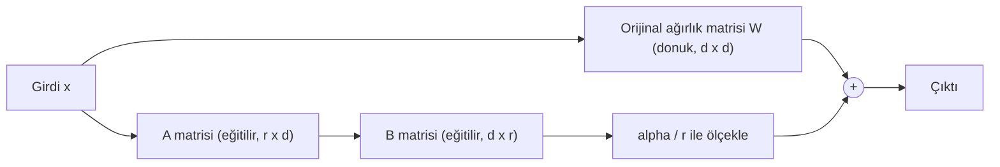

`r` (rank), `d`'den çok küçüktür. Darboğaz ne kadar darsa eğitilen parametre o kadar azdır.

### 4. Nasıl Çalışır?

**1. Temel gözlem.** Fine-tuning sırasında ağırlıklarda oluşan değişimin tamamı gerekli değildir; değişim çoğu zaman çok daha az sayıda "yön" ile iyi ifade edilebilir. LoRA (Low-Rank Adaptation) bunu kullanır: büyük bir `d × d` değişim matrisi öğrenmek yerine, çarpımları o matrisi yaklaşık olarak veren iki ince matris öğrenir: `B (d × r)` ve `A (r × d)`.

**2. Hesap.** Katmanın çıktısı `W·x + (alpha/r)·B·A·x` olur. `W` hiç değişmez.

```python
import numpy as np

d, r, alpha = 4096, 8, 16
rng = np.random.default_rng(0)

W = rng.normal(size=(d, d))             # ön eğitimli ağırlıklar: DONUK
A = rng.normal(size=(r, d)) * 0.01      # eğitilecek
B = np.zeros((d, r))                    # eğitilecek; sıfırla başlar

def katman(x):
    return W @ x + (alpha / r) * (B @ (A @ x))

x = rng.normal(size=d)
print("Başlangıçta çıktı aynı mı?", np.allclose(katman(x), W @ x))
print(f"Tam fine-tuning: {W.size:,} parametre")
print(f"LoRA           : {A.size + B.size:,} parametre (%{100 * (A.size + B.size) / W.size:.2f})")
```

`B` sıfırla başladığı için eğitimin ilk anında model, orijinal modelle birebir aynıdır; uyarlama sıfırdan yavaşça büyür.

**3. Ayarlar.**

- **Rank (`r`):** Adaptörün kapasitesi. 8-16 çoğu görev için iyi bir başlangıçtır.
- **Alpha:** Adaptörün etkisinin ölçeği. Yaygın pratik, rank'in bir ya da iki katını seçmektir.
- **Hedef modüller:** Adaptörün hangi katmanlara ekleneceği. Yalnızca attention matrislerine eklemek en hafif seçenektir; tüm doğrusal katmanlara eklemek genelde daha iyi sonuç verir.

**4. Birleştirme (Merge).** Eğitimden sonra `W + (alpha/r)·B·A` hesaplanıp tek bir matris olarak kaydedilebilir. Böylece çıkarımda ek gecikme olmaz. Birleştirmezseniz aynı ana model üzerinde adaptörleri değiştirerek birçok görevi sunabilirsiniz.

**5. QLoRA.** Ana model 4-bit'e nicemlenmiş (quantized) halde belleğe yüklenir ve dondurulur; LoRA adaptörleri daha yüksek hassasiyette eğitilir. Bellek ihtiyacı o kadar düşer ki milyarlarca parametreli modeller tek bir GPU'da ince ayarlanabilir (nicemleme için bkz. 7.3).

### 5. Ne Zaman Kullanılır / Ne Zaman Kullanılmaz?

| | Tam Fine-Tuning | LoRA | QLoRA |
|---|---|---|---|
| **Eğitilen parametre** | Tamamı | Genelde %1'in altında | Genelde %1'in altında |
| **Bellek ihtiyacı** | Çok yüksek | Orta | Düşük |
| **Çıktı dosyası** | Modelin tamamı (GB'lar) | Küçük adaptör (MB'lar) | Küçük adaptör (MB'lar) |
| **Kalite** | En yüksek tavan | Çoğu görevde tam fine-tuning'e yakın | LoRA'ya yakın |
| **Eğitim hızı** | Yavaş | Hızlı | LoRA'dan biraz yavaş |
| **Ne zaman?** | Büyük veri, büyük davranış değişikliği, bol donanım | Varsayılan tercih | Donanım kısıtlıysa |

LoRA'nın yetmeyebileceği durumlar: modele yepyeni bir dil ya da çok farklı bir alan öğretmek gibi büyük dağılım kaymaları.

### 6. Sık Yapılan Hatalar & İpuçları

> [!WARNING]
> **Adaptörü yanlış ana modelle kullanmak.** Adaptör, eğitildiği modelin tam o sürümüne aittir. Farklı bir sürüme ya da farklı biçimde nicemlenmiş bir modele takıldığında sessizce kötü sonuç verir.

> [!WARNING]
> **Rank'i büyütmeyi her derde deva sanmak.** Veri azsa yüksek rank ezberi kolaylaştırır. Sonuç kötüyse önce veriyi, sonra öğrenme oranını, en son rank'i sorgulayın.

> [!NOTE]
> **Alpha ve öğrenme oranı birbirine bağlıdır.** İkisi de güncellemelerin etkisini ölçekler. Birini değiştirdiğinizde diğerini sabit tutun, yoksa neyin etki ettiğini ayırt edemezsiniz.

> [!TIP]
> **Önce QLoRA ile hızlı bir deneme yapın.** Yaklaşımın işe yarayıp yaramadığını ucuz donanımda birkaç saatte görürsünüz. Sonuç umut vericiyse daha pahalı seçeneklere yatırım yaparsınız.

**Akılda kalsın:** LoRA modeli değiştirmez, modele küçük bir ek takar. Bu yüzden ucuz, taşınabilir ve geri alınabilirdir.

<a id="k-4-4"></a>

## 4.4 RLHF (Reinforcement Learning from Human Feedback)

### 1. Tek Cümlelik Özet (TL;DR)

**RLHF, "iyi cevap"ı tarif edemediğimiz ama görünce tanıdığımız durumlarda, insanlara cevapları karşılaştırtıp bu tercihlerden bir puanlayıcı model eğiterek LLM'i yüksek puan alacak yönde ayarlama yöntemidir.**

### 2. Günlük Hayattan Analoji: Jüri ve Tadımcı

Bir yemek yarışmasında jüri "mükemmel yemeğin tarifi"ni veremez. Ama önüne iki tabak konduğunda hangisinin daha iyi olduğunu rahatça söyler.

Aşçı her denemede jüriyi toplayamaz; jüri pahalı ve yavaştır. Çözüm: jürinin binlerce karşılaştırmasını izleyerek onların damak zevkini taklit eden bir **tadımcı** yetiştirilir. Aşçı artık günde binlerce tabağı tadımcıya sunar ve onun puanına göre kendini geliştirir. Tadımcı ödül modelidir, aşçı LLM'dir.

Tehlike de buradadır: aşçı zamanla iyi yemek yapmayı değil, **tadımcıyı kandırmayı** öğrenebilir.

### 3. Görselleştirme

```mermaid
flowchart TD
    A[SFT ile eğitilmiş model] --> B[Aynı soruya birden çok cevap üret]
    B --> C["İnsanlar karşılaştırır: A mı daha iyi, B mi?"]
    C --> D["Ödül modeli (Reward Model) eğit: cevaba puan verir"]
    D --> E[LLM cevap üretir]
    E --> F[Ödül modeli puanlar]
    F --> G["Pekiştirmeli öğrenme (PPO): puanı artıracak yönde güncelle"]
    G --> H{"Başlangıç modelinden fazla uzaklaştı mı?"}
    H -->|"Evet: ceza (KL)"| G
    H -->|Hayır| E
    G --> I[Hizalanmış model]
```

### 4. Nasıl Çalışır?

**Neden SFT yetmiyor?** SFT modele "bu cevabı taklit et" der. Ama yardımseverlik, dürüstlük, uygun uzunluk, güvenli davranış gibi nitelikler için tek bir doğru cevap yoktur. İnsanlar için iyi cevabı **yazmak** zordur, iki cevaptan iyisini **seçmek** kolaydır. RLHF bu ucuz sinyali kullanır.

**Aşama 1: Tercih verisi.** Model aynı girdiye birkaç cevap üretir; insan değerlendiriciler bunları karşılaştırır ya da sıralar.

**Aşama 2: Ödül modeli.** Ayrı bir model, bir cevaba tek bir puan vermeyi öğrenir. Eğitim hedefi basittir: tercih edilen cevabın puanı, reddedilenin puanından yüksek olsun.

**Aşama 3: Pekiştirmeli öğrenme.** LLM (artık "politika") cevap üretir, ödül modeli puanlar, PPO gibi bir algoritma LLM'i puanı artıracak yönde günceller. Modelin ödülü kovalarken saçmalamasını önlemek için, başlangıç modelinden uzaklaşması bir ceza terimiyle (**KL cezası**) sınırlanır.

```python
# Aşama 2: ödül modelinin kaybı (tercih edilen, reddedilenden yüksek puan alsın)
r_iyi  = odul_modeli(prompt, tercih_edilen)
r_kotu = odul_modeli(prompt, reddedilen)
odul_kaybi = -F.logsigmoid(r_iyi - r_kotu).mean()

# Aşama 3: politikanın hedefi (PPO ile en üst düzeye çıkarılır)
cevap = politika.uret(prompt)
hedef = odul_modeli(prompt, cevap) - beta * kl_uzakligi(politika, referans_model)
```

Sohbet modellerini temel modellerden ayıran "asistan gibi davranma" niteliğinin yaygınlaşmasında bu yöntem belirleyici oldu.

### 5. Ne Zaman Kullanılır / Ne Zaman Kullanılmaz?

| Durum | RLHF | Not |
|---|---|---|
| Kalite öznel ve çok boyutlu: yardımseverlik, üslup, güvenlik | ✅ | Yöntemin var oluş nedeni |
| Büyük ölçekli model geliştirme, değerlendirici ekibi ve altyapı mevcut | ✅ | |
| Modelin sürekli yeni cevaplar üretip onlardan öğrenmesi gerekiyor | ✅ | Çevrim içi keşif RLHF'in güçlü yanı |
| Küçük ekip, sınırlı bütçe | ❌ | DPO çok daha basit (bkz. 4.5) |
| Doğru cevap belli: sınıflandırma, veri çıkarma, sabit format | ❌ | SFT yeterli ve daha kararlı |
| Tercih verisi az ya da değerlendiriciler tutarsız | ❌ | Ödül modeli gürültü öğrenir |

### 6. Sık Yapılan Hatalar & İpuçları

> [!CAUTION]
> **Ödül kandırmacası (Reward Hacking).** Model, ödül modelinin zaaflarını bulur: gereksiz uzun yazmak, kullanıcıya hak vermek, kendinden emin görünmek. Kullanıcıya yaranma eğilimi (*sycophancy*) bu mekanizmanın bilinen bir yan ürünüdür.

> [!WARNING]
> **Ödül modelini "doğrunun ölçüsü" sanmak.** Ödül modeli, sınırlı sayıda insanın sınırlı sayıda karşılaştırmasının kusurlu bir özetidir. Eğitim verisinin dışına çıkıldığında puanları güvenilmez hale gelir.

> [!WARNING]
> **Değerlendirici yönergesini hafife almak.** "Hangisi daha iyi?" sorusunun cevabı, değerlendiricilere verilen talimata bağlıdır. Belirsiz yönerge tutarsız etiket, tutarsız etiket anlamsız ödül demektir.

> [!TIP]
> **Önce DPO'yu deneyin.** Elinizde hazır tercih çiftleri varsa aynı hedefe çok daha az hareketli parçayla ulaşabilirsiniz.

**Akılda kalsın:** RLHF, insan zevkini bir puanlayıcıya, puanlayıcıyı da modelin davranışına çevirir. Zinciri güçlü kılan da zayıf kılan da puanlayıcıdır.

<a id="k-4-5"></a>

## 4.5 DPO (Direct Preference Optimization)

### 1. Tek Cümlelik Özet (TL;DR)

**DPO, RLHF'in hedefine ödül modeli ve pekiştirmeli öğrenme döngüsü olmadan ulaşır: tercih edilen cevabın olasılığını artıran, reddedilenin olasılığını azaltan tek bir kayıp fonksiyonuyla modeli doğrudan eğitir.**

### 2. Günlük Hayattan Analoji: Aracıyı Aradan Çıkarmak

Bir önceki konuda aşçı, jürinin zevkini taklit eden bir tadımcıya göre çalışıyordu. DPO tadımcıyı işten çıkarır. Jürinin karşılaştırma kartları doğrudan aşçının önüne konur: "Bu iki tabaktan soldaki seçildi."

Aşçı her kart için kendine şunu söyler: "Soldaki gibi yapma eğilimimi artır, sağdaki gibi yapma eğilimimi azalt. Ama kendi tarzımdan da fazla uzaklaşma." Aracı yok, simülasyon yok; yalnızca örneklerden öğrenme var.

### 3. Görselleştirme

```mermaid
flowchart TD
    A["Tercih verisi: prompt, seçilen cevap, reddedilen cevap"] --> B[Eğitilen model]
    A --> C["Referans model (donuk kopya)"]
    B --> D["Her iki cevabın log-olasılığı"]
    C --> E["Her iki cevabın log-olasılığı"]
    D --> F["DPO kaybı: seçilen, referansa göre reddedilenden daha çok güçlensin"]
    E --> F
    F --> G[Geri yayılım]
    G --> B
```

RLHF'teki üç aşamalı yapının yerini tek bir gözetimli eğitim döngüsü almıştır.

### 4. Nasıl Çalışır?

**Temel fikir.** DPO makalesi, RLHF'in optimize ettiği hedefin (ödülü artır, referans modelden fazla uzaklaşma) matematiksel olarak doğrudan politika üzerinden yazılabileceğini gösterdi. Ödül modeli açıkça eğitilmez; modelin kendi olasılıkları örtük bir ödül işlevi görür.

**Adımlar:**

1. Her örnek bir üçlüdür: prompt, seçilen cevap, reddedilen cevap.
2. Eğitilen model ve donuk referans model, her iki cevabın olasılığını hesaplar.
3. Kayıp şunu ister: eğitilen modelin seçilen cevaba verdiği olasılık referansa göre **artsın**, reddedilene verdiği olasılık referansa göre **azalsın**.
4. `beta` parametresi, referans modelden ne kadar uzaklaşılabileceğini belirler.

```python
import torch.nn.functional as F

def dpo_kaybi(pi_secilen, pi_reddedilen, ref_secilen, ref_reddedilen, beta=0.1):
    """Girdiler: her cevabın toplam log-olasılığı (batch boyutunda tensörler).
    pi_*  : eğitilen modelden
    ref_* : donuk referans modelden"""
    secilen_kazanc    = pi_secilen - ref_secilen          # seçilen ne kadar güçlendi?
    reddedilen_kazanc = pi_reddedilen - ref_reddedilen    # reddedilen ne kadar güçlendi?
    return -F.logsigmoid(beta * (secilen_kazanc - reddedilen_kazanc)).mean()
```

Bütün yöntem bu fonksiyondan ibarettir. Geri kalanı sıradan bir fine-tuning döngüsüdür ve LoRA ile birlikte rahatça kullanılabilir.

**Tercih verisi nereden gelir?**

- İnsan değerlendiricilerin karşılaştırmaları
- Üründeki kullanıcı sinyalleri: beğeni, yeniden üretme isteği, kullanıcının düzelttiği cevap
- Uzmanın düzelttiği model çıktıları: düzeltilmiş hali "seçilen", orijinali "reddedilen"
- Güçlü bir modelin hakemliği (dikkatle doğrulanarak)

### 5. Ne Zaman Kullanılır / Ne Zaman Kullanılmaz?

| | RLHF | DPO |
|---|---|---|
| **Bileşenler** | Politika + ödül modeli + RL algoritması | Politika + donuk referans kopya |
| **Eğitim kararlılığı** | Hassas; ayar gerektirir | Sıradan fine-tuning kadar kararlı |
| **Hesaplama** | Yüksek: eğitim sırasında sürekli üretim | Düşük: sabit veri seti üzerinde |
| **Veri** | Eğitim sırasında yeni cevaplar keşfedilir | Önceden toplanmış sabit çiftler |
| **Uygulama zorluğu** | Yüksek | Düşük |
| **Ne zaman?** | Büyük ölçek, çevrim içi keşif gerekli | Çoğu ekip için varsayılan tercih yöntemi |

DPO'nun uygun **olmadığı** durumlar: tek bir doğru cevabın bulunduğu görevler (SFT kullanın) ve elinizde anlamlı tercih çiftlerinin olmadığı durumlar.

Tipik sıralama: **önce SFT** (model görevi yapmayı öğrensin), **sonra DPO** (iyi yapmakla daha iyi yapmak arasındaki farkı öğrensin).

### 6. Sık Yapılan Hatalar & İpuçları

> [!WARNING]
> **Bilgi vermeyen çiftler.** Reddedilen cevap bariz biçimde saçmaysa model hiçbir şey öğrenmez; zaten ona düşük olasılık veriyordur. En değerli çiftler, ikisi de makul olan ama biri belirgin biçimde daha iyi olan cevaplardır.

> [!WARNING]
> **Tercihlerdeki gizli yanlılığı öğrenmek.** Seçilen cevaplar sistematik olarak daha uzunsa model "uzun yaz"ı öğrenir. Veri setinde uzunluk, biçim ve üslup gibi yüzeysel farkların dağılımını kontrol edin.

> [!NOTE]
> **`beta` düşükse** model referanstan serbestçe uzaklaşır ve tercihlere aşırı uyum sağlayabilir; **yüksekse** neredeyse hiç değişmez. Küçük bir aralıkta birkaç değer deneyin.

> [!TIP]
> **Üründeki düzeltmeleri toplayın.** Kullanıcının ya da uzmanın düzelttiği her cevap, bedavaya gelen yüksek kaliteli bir tercih çiftidir. Bu veriyi baştan kaydetmeye başlamak, ileride yapılacak her iyileştirmenin temelidir.

**Akılda kalsın:** DPO = "bunu daha çok, şunu daha az yap" bilgisini doğrudan modele öğretmek. RLHF'in sadeleştirilmiş halidir.


---

<a id="bolum-5"></a>

# Bölüm 5 — RAG (Retrieval-Augmented Generation)

<a id="k-5-1"></a>

## 5.1 RAG Nedir?

### 1. Tek Cümlelik Özet (TL;DR)

**RAG (Retrieval-Augmented Generation), modele soruyu sormadan önce ilgili dokümanları bulup prompt'a ekleyerek ona "ezberden" değil "açık kitaptan" cevap verdirmektir.**

### 2. Günlük Hayattan Analoji: Açık Kitap Sınavı

Kapalı kitap sınavında öğrenci yalnızca hafızasına güvenir; hatırlamadığı yerde ya boş bırakır ya da uydurur. Açık kitap sınavında ise önce ilgili sayfayı bulur, sonra oradaki bilgiye dayanarak cevabını yazar.

RAG, LLM'i açık kitap sınavına sokar. İki ayrı beceri gerekir: **doğru sayfayı bulmak** (retrieval) ve **bulunan sayfadan doğru cevabı yazmak** (generation). Yanlış sayfayı açan öğrenci, ne kadar zeki olursa olsun yanlış cevap verir.

### 3. Görselleştirme

```mermaid
flowchart TD
    subgraph I["1. İndeksleme (bir kez, çevrim dışı)"]
        A[Dokümanlar] --> B["Parçalara böl (chunking)"]
        B --> C[Embedding modeli]
        C --> D[(Vektör veritabanı)]
    end
    subgraph S["2. Sorgu (her istekte)"]
        Q[Kullanıcı sorusu] --> E[Embedding modeli]
        E --> F[En yakın parçaları ara]
        F --> G["Prompt: talimat + bulunan parçalar + soru"]
        G --> H[LLM]
        H --> J[Kaynak gösteren cevap]
    end
    D --> F
```

### 4. Nasıl Çalışır?

**İndeksleme (hazırlık):**

1. Dokümanlar anlamlı parçalara bölünür (5.2).
2. Her parça bir embedding modeliyle vektöre çevrilir (2.2).
3. Vektörler, parçanın metni ve kaynağıyla birlikte bir veritabanına yazılır (5.3).

**Sorgu (çalışma zamanı):**

1. Kullanıcının sorusu aynı embedding modeliyle vektöre çevrilir.
2. Veritabanında bu vektöre en yakın parçalar bulunur.
3. Parçalar soruyla birlikte prompt'a yerleştirilir.
4. LLM, **yalnızca verilen bağlama dayanarak** cevap yazar ve kaynak gösterir.

```python
def indeksle(dokumanlar):
    for dok in dokumanlar:
        for parca in parcala(dok.metin):
            vektor_db.ekle(vektor=embed(parca), metin=parca, kaynak=dok.ad)

def cevapla(soru, k=5):
    parcalar = vektor_db.ara(embed(soru), k=k)
    baglam = "\n\n".join(f"[{p.kaynak}] {p.metin}" for p in parcalar)
    prompt = f"""Yalnızca aşağıdaki bağlamı kullanarak cevapla.
Bağlamda cevap yoksa "Bu bilgi dokümanlarda yok" de. Kullandığın kaynakları belirt.

Bağlam:
{baglam}

Soru: {soru}"""
    return llm(prompt)
```

Bu yalın haline *naive RAG* denir ve şaşırtıcı ölçüde işe yarar. Sınırları da bellidir; bölümün geri kalanı bu sınırları aşmakla ilgilidir:

| Sınır | Çözüm yönü |
|---|---|
| Parça sınırı bilgiyi ortadan böler | Daha iyi chunking (5.2) |
| Ürün kodu, isim gibi birebir eşleşmeler kaçar | Hybrid search (5.4) |
| Getirilen parçaların sıralaması isabetsiz | Reranking (5.5) |
| Cevap birden çok dokümanı birleştirmeyi gerektirir | GraphRAG, agent tabanlı arama (5.6, Bölüm 6) |

### 5. Ne Zaman Kullanılır / Ne Zaman Kullanılmaz?

| Durum | Öneri | Neden |
|---|---|---|
| Modelin bilmediği özel ya da güncel bilgi; büyük doküman koleksiyonu | ✅ RAG | Tam bu iş için var |
| Cevabın kaynağını göstermek zorunlu | ✅ RAG | Parçalar izlenebilir |
| Bilgi sık değişiyor | ✅ RAG | Dokümanı güncellemek yeterli |
| Bütün bilgi birkaç on sayfa | ❌ Hepsini prompt'a koyun | Arama katmanı gereksiz karmaşıklık; prompt caching maliyeti düşürür |
| Sorun bilgi değil davranış: format, üslup | ❌ Prompt ya da fine-tuning | RAG davranışı değiştirmez (bkz. 4.1) |
| "Tüm kayıtlarda toplam satış ne?" gibi sayım ve toplama soruları | ❌ Veritabanı sorgusu | RAG birkaç parça getirir, hepsini saymaz |
| Yapılandırılmış veri: tablolar, kayıtlar | ⚠️ SQL üreten araç daha uygun | Bkz. 6.1 |

### 6. Sık Yapılan Hatalar & İpuçları

> [!WARNING]
> **Aramayı ölçmeden modeli suçlamak.** Kötü cevapların büyük kısmı, doğru parçanın hiç getirilmemiş olmasından kaynaklanır. Önce "doğru parça ilk k sonuçta mı?" sorusunu ölçün; cevap hayırsa LLM'i değiştirmek hiçbir şeyi düzeltmez.

> [!WARNING]
> **Erişim yetkilerini unutmak.** Kullanıcının görmeye yetkisi olmayan bir doküman bağlama girerse model onu cevapta kullanır. Yetki filtresi, arama aşamasında uygulanmalıdır; modele "bunu söyleme" demek bir güvenlik önlemi değildir.

> [!NOTE]
> **RAG, hallucination'ı azaltır ama bitirmez.** Model bağlamı yanlış yorumlayabilir, parçaları yanlış birleştirebilir ya da bağlamda olmayanı ekleyebilir (bkz. 7.2).

> [!TIP]
> **Önce en basit halini kurun, 50 gerçek soruyla ölçün.** Hangi iyileştirmenin gerektiğini tahmin etmek yerine başarısız örneklerden öğrenin.

**Akılda kalsın:** RAG = bul + yaz. Sistemin kalitesi, zincirin zayıf halkası olan "bul" kadar iyidir.

<a id="k-5-2"></a>

## 5.2 Chunking Stratejileri

### 1. Tek Cümlelik Özet (TL;DR)

**Chunking, dokümanları aranabilir parçalara bölme işidir; parça çok büyükse aranan bilgi gürültüde kaybolur, çok küçükse bağlamından kopar.**

### 2. Günlük Hayattan Analoji: Kitabı Fişlemek

Tez yazarken kitapları fişlersiniz: her fişe tek bir fikir, üstüne de kaynağı. İyi bir fiş, kitabı açmadan tek başına anlaşılır.

Kötü fişlemenin iki türü vardır. Birincisi, koca bir bölümü tek fişe yazmaktır: aradığınız cümleyi içinde bulamazsınız. İkincisi, kitabı makasla her on satırda bir kesmektir: "Bu nedenle yukarıdaki yöntem tercih edilmez" yazan bir fiş elinizde kalır; hangi yöntem, neden?

### 3. Görselleştirme

```mermaid
flowchart TD
    A{Doküman nasıl bir yapıda?} -->|"Başlıklı, bölümlü: Markdown, HTML, sözleşme"| B["Yapısal chunking: başlık ve paragraf sınırlarından böl"]
    A -->|Düz, yapısız metin| C["Sabit boyut + örtüşme (overlap)"]
    A -->|"Kod, tablo, soru-cevap çiftleri"| D["Doğal birimi koru: fonksiyon, tablo, çift"]
    B --> E{"Parçalar tek başına anlaşılıyor mu?"}
    C --> E
    D --> E
    E -->|Hayır| F["Bağlam ekle: başlık yolu, doküman özeti, parent-child"]
    E -->|Evet| G[İndeksle ve ölç]
    F --> G
```

Örtüşmenin (overlap) ne yaptığı:

```text
Metin:    [ A A A A A A | B B B B B B | C C C C C C ]

Örtüşmesiz:   [A A A A A A] [B B B B B B] [C C C C C C]
                           ^ sınıra denk gelen cümle ikiye bölünür

Örtüşmeli:    [A A A A A A B B]
                       [A A B B B B B B C C]
                                   [B B C C C C C C]
              sınırdaki bilgi en az bir parçada bütün kalır
```

### 4. Nasıl Çalışır?

**Temel gerilim.** Embedding, bir parçanın tamamını tek bir vektöre sıkıştırır. Parça beş farklı konudan bahsediyorsa vektör hiçbirini iyi temsil etmez. Parça tek bir cümleyse vektör keskindir ama LLM'e verildiğinde cevap için yeterli bağlam taşımaz.

**Stratejiler:**

| Strateji | Nasıl böler? | Artısı | Eksisi |
|---|---|---|---|
| **Sabit boyut + örtüşme** | Her N token'da bir, biraz üst üste bindirerek | Basit, her metinde çalışır | Cümleyi ve fikri ortadan bölebilir |
| **Yapısal (recursive)** | Önce başlık, sonra paragraf, sonra cümle sınırından | Doğal sınırlara saygı duyar | Yapısı bozuk dokümanda işe yaramaz |
| **Semantik** | Ardışık cümlelerin anlamı değiştiği yerden | Konu bütünlüğü | Daha yavaş ve pahalı |
| **Parent-child** | Küçük parçayla ara, büyük ebeveynini LLM'e ver | Hem isabetli arama hem zengin bağlam | Daha karmaşık indeks |
| **Bağlam eklemeli** | Her parçanın başına dokümandaki yerini anlatan kısa bir not ekle | Bağlamından kopuk parça sorununu çözer | İndekslemede ek LLM maliyeti |

En basit hali:

```python
def parcala(metin, boyut=200, ortusme=40):
    """Kelime bazlı sabit boyutlu parçalama (gerçekte token sayılır)."""
    kelimeler = metin.split()
    adim = boyut - ortusme
    parcalar = []
    for bas in range(0, len(kelimeler), adim):
        parcalar.append(" ".join(kelimeler[bas:bas + boyut]))
        if bas + boyut >= len(kelimeler):
            break
    return parcalar

metin = " ".join(f"kelime{i}" for i in range(500))
p = parcala(metin)
print(len(p), "parça |", [len(x.split()) for x in p])
```

**Metadata atılmaz.** Her parçayla birlikte kaynağı, başlık yolu ("Kullanım Kılavuzu > Kurulum > Windows"), tarihi ve erişim yetkisi saklanmalıdır. Bunlar hem filtrelemede hem de modelin cevabı doğru bağlama oturtmasında kullanılır.

### 5. Ne Zaman Kullanılır / Ne Zaman Kullanılmaz?

| Doküman türü | Önerilen yaklaşım |
|---|---|
| Teknik doküman, wiki, Markdown | Yapısal; başlık yolunu parçaya ekle |
| Sözleşme, mevzuat | Madde bazında; madde numarasını metadata yap |
| Sıkça sorulan sorular | Her soru-cevap çifti tek parça |
| Kod | Fonksiyon ya da sınıf bazında |
| Tablolar | Tabloyu bölme; gerekirse satırları başlıklarıyla birlikte metne çevir |
| Sohbet kaydı, toplantı dökümü | Konu ya da zaman dilimi bazında; konuşmacıyı koru |
| Kısa dokümanlar (bir sayfadan az) | ❌ Bölme; dokümanın tamamı tek parça |

Boyut için evrensel bir sayı yoktur. Birkaç yüz token iyi bir başlangıç noktasıdır; doğrusunu kendi sorularınızla ölçerek bulursunuz.

### 6. Sık Yapılan Hatalar & İpuçları

> [!WARNING]
> **Çöp çıkarma, çöp parça.** PDF'lerden metin çıkarırken sütunlar karışır, üst-alt bilgiler metne girer, tablolar dağılır. Chunking stratejisinden önce çıkarılan ham metne gözünüzle bakın.

> [!WARNING]
> **Tabloyu ve kod bloğunu ortadan bölmek.** Başlık satırından kopmuş bir tablo parçası anlamsız sayılardan ibarettir.

> [!NOTE]
> **Örtüşmeyi abartmak** indeksi şişirir ve aynı içeriğin birden çok kopyasının sonuçlara girmesine yol açar. Parça boyutunun yüzde 10-20'si genelde yeterlidir.

> [!TIP]
> **"Tek başına anlaşılır mı?" testi.** Rastgele 20 parça seçin ve yalnızca onları okuyun. Neden bahsedildiğini anlayamıyorsanız embedding modeli ve LLM de anlayamaz.

**Akılda kalsın:** İyi parça, tek bir konuyu anlatan ve bağlamından koparıldığında da anlaşılan parçadır.

<a id="k-5-3"></a>

## 5.3 Vektör Veritabanları

### 1. Tek Cümlelik Özet (TL;DR)

**Vektör veritabanı, milyonlarca embedding arasında bir sorguya en yakın olanları tek tek karşılaştırmadan, milisaniyeler içinde ve "yaklaşık olarak" bulan bir indekstir.**

### 2. Günlük Hayattan Analoji: Şehirde Adres Bulmak

Büyük bir şehirde bir adrese gitmek için her kapıyı tek tek çalmazsınız. Önce otoyola çıkar, doğru ilçeye yaklaşır, ana caddeye girer, sonra sokağa saparsınız. Her adımda hedefe yaklaşan daha ince bir yola geçersiniz.

En yaygın vektör indeksi olan **HNSW** tam olarak böyle çalışır: üst katmanda az sayıda noktayı birbirine bağlayan "otoyollar", alt katmanlarda giderek sıklaşan "sokaklar" vardır. Arama yukarıdan başlar ve her katmanda hedefe biraz daha yaklaşır. Bazen en iyi adres yerine bir yan sokaktaki çok benzer bir adrese varırsınız; hız karşılığında ödenen bedel budur.

### 3. Görselleştirme

```mermaid
flowchart LR
    Q[Sorgu vektörü] --> F{"Metadata filtresi: tarih, yetki, kategori"}
    F --> I["ANN indeksi (ör. HNSW)"]
    I --> K["En yakın k aday"]
    K --> R["Sonuç: metin + kaynak + benzerlik skoru"]
    D[("Vektörler + metin + metadata")] --> I
```

### 4. Nasıl Çalışır?

**1. Kesin arama (brute force).** Sorguyu bütün vektörlerle karşılaştırıp en yakınları almak her zaman doğru sonucu verir ve sanıldığından uzun süre yeterlidir:

```python
import numpy as np

rng = np.random.default_rng(0)
vektorler = rng.normal(size=(100_000, 384)).astype(np.float32)   # 100 bin parça
vektorler /= np.linalg.norm(vektorler, axis=1, keepdims=True)     # normalize et

def ara(sorgu, k=5):
    sorgu = sorgu / np.linalg.norm(sorgu)
    skor = vektorler @ sorgu                  # kosinüs benzerliği (tek matris çarpımı)
    en_iyi = np.argpartition(-skor, k)[:k]
    return en_iyi[np.argsort(-skor[en_iyi])]

sorgu = vektorler[42] + 0.05 * rng.normal(size=384).astype(np.float32)
print(ara(sorgu))                             # ilk sırada 42 gelmeli
```

**2. Yaklaşık arama (ANN, Approximate Nearest Neighbor).** Vektör sayısı milyonları bulduğunda her sorguda hepsini taramak yavaşlar. ANN indeksleri, doğruluğun küçük bir kısmından vazgeçip hızda büyük kazanç sağlar:

- **HNSW:** Katmanlı komşuluk grafiği. Hızlı ve isabetli; belleği yoğun kullanır. Çoğu sistemde varsayılandır.
- **IVF:** Vektörleri kümelere ayırır, sorguda yalnızca en yakın birkaç kümeye bakar. Daha az bellek, biraz daha düşük isabet.
- **Nicemleme (PQ ve türevleri):** Vektörleri sıkıştırarak belleği küçültür; çok büyük koleksiyonlarda diğerleriyle birlikte kullanılır.

**3. Recall kavramı.** ANN'in kalitesi, "gerçek en yakın k komşunun kaçını buldu?" sorusuyla ölçülür. İndeks parametreleri (HNSW'de arama genişliği gibi) hız ile recall arasındaki dengeyi ayarlar.

**4. Metadata filtreleme.** Gerçek sorgular nadiren yalın benzerlik aramasıdır: "bu kullanıcının erişebildiği, son bir yıla ait dokümanlar arasında en benzerleri." Filtrenin aramadan önce mi sonra mı uygulandığı hem hızı hem sonuç sayısını etkiler; iyi bir sistem bunu indeksle bütünleşik yapar.

### 5. Ne Zaman Kullanılır / Ne Zaman Kullanılmaz?

| Seçenek | Ne zaman? | Dikkat |
|---|---|---|
| **Bellekte kesin arama** (NumPy, FAISS düz indeks) | Yüz binlere kadar vektör, prototip, tek makine | Kalıcılık ve filtreleme sizin işiniz |
| **Mevcut veritabanının eklentisi** (ör. PostgreSQL + pgvector) | Zaten o veritabanını kullanıyorsunuz; orta ölçek | Verinin yanında durur: ek sistem yok, filtreler SQL ile |
| **Arama motoru** (Elasticsearch, OpenSearch) | Güçlü anahtar kelime araması ve hybrid search öncelikli | Operasyonu ağırdır |
| **Özel vektör veritabanı** (Qdrant, Milvus, Weaviate, Pinecone vb.) | Çok büyük ölçek, düşük gecikme, gelişmiş filtreleme | Yönetilecek ayrı bir sistem daha |

Seçim ölçütleri: vektör sayısı, filtre ihtiyacı, hybrid search desteği, güncelleme sıklığı, ekibin operasyon kapasitesi ve verinin nerede durması gerektiği.

Vektör veritabanının **gerekmediği** durumlar: bilginin tamamı bağlam penceresine sığıyorsa ya da arama ihtiyacı birebir eşleşmeden ibaretse.

### 6. Sık Yapılan Hatalar & İpuçları

> [!WARNING]
> **"RAG yapıyorsak özel bir vektör veritabanı şart" varsayımı.** On bin parçalık bir koleksiyon için dağıtık bir sistem kurmak gereksizdir. Mevcut veritabanınızın vektör desteği büyük ihtimalle yeter.

> [!WARNING]
> **Embedding modelini değiştirip indeksi yenilememek.** Eski ve yeni vektörler farklı uzaylardadır; karışık bir indeks anlamsız sonuç döndürür.

> [!WARNING]
> **Mesafe ölçüsü uyumsuzluğu.** Embedding modeli kosinüs benzerliği için eğitildiyse indeks de onu kullanmalıdır. Model kartındaki öneriye uyun.

> [!TIP]
> **Recall'ı bir kez ölçün.** Birkaç yüz sorgu için ANN sonuçlarını kesin arama sonuçlarıyla karşılaştırın. İndeks parametrelerini bu sayıya bakarak ayarlayın, varsayılanlara güvenerek değil.

**Akılda kalsın:** Vektör veritabanı bir hız optimizasyonudur. Küçük ölçekte basit çözüm yeter; kaliteyi belirleyen şey indeks değil, chunking ve embedding'dir.

<a id="k-5-4"></a>

## 5.4 Hybrid Search

### 1. Tek Cümlelik Özet (TL;DR)

**Hybrid search, anlamı yakalayan vektör aramayla kelimeyi birebir yakalayan anahtar kelime aramasını birlikte çalıştırıp sonuçlarını birleştirir, çünkü ikisi farklı yerlerde yanılır.**

### 2. Günlük Hayattan Analoji: İki Kütüphaneci

Kütüphanede iki görevli var. Birincisi konuları çok iyi anlar: "param geri gelmedi" dediğinizde sizi iade prosedürleri rafına götürür, cümlenizde "iade" kelimesi geçmese bile. Ama ondan "TS-4521 numaralı standart"ı isterseniz size benzer konulu başka standartlar getirir.

İkincisi konudan anlamaz ama indeks kartlarını ezbere bilir: "TS-4521" yazan her belgeyi saniyede bulur. "Param geri gelmedi" dediğinizde ise içinde tam bu kelimeler geçen belgeleri arar ve iade prosedürünü bulamaz.

İkisine birden sorup cevaplarını birleştirmek, tek başına herhangi birinden daha iyidir.

### 3. Görselleştirme

```mermaid
flowchart TD
    Q[Kullanıcı sorusu] --> RW["Sorguyu yeniden yaz: konuşma bağlamından bağımsız hale getir"]
    RW --> V["Vektör arama: anlam benzerliği"]
    RW --> B["Anahtar kelime arama: BM25"]
    V --> F["Birleştirme: Reciprocal Rank Fusion"]
    B --> F
    F --> K["Birleşik en iyi k sonuç"]
    K --> N["Sonraki adım: reranking ve LLM"]
```

### 4. Nasıl Çalışır?

**1. BM25.** Klasik arama motorlarının temel sıralama fonksiyonudur. Bir doküman, sorgudaki kelimeleri ne kadar çok içeriyorsa ve bu kelimeler koleksiyonda ne kadar nadirse o kadar yüksek puan alır. Anlamdan haberi yoktur ama birebir eşleşmede çok güvenilirdir.

**2. Kim nerede güçlü?**

| Sorgu türü | Vektör arama | BM25 |
|---|---|---|
| Eş anlamlı ve farklı ifade: "paramı geri istiyorum" → iade | ✅ | ❌ |
| Ürün kodu, hata numarası, kişi adı, kısaltma | ❌ | ✅ |
| Modelin eğitiminde görmediği alan terimleri | ❌ | ✅ |
| Uzun, doğal dilde soru | ✅ | ⚠️ |
| Yazım hatalı sorgu | ✅ | ❌ |

**3. Birleştirme.** İki aramanın skorları farklı ölçeklerdedir; doğrudan toplanamaz. En yaygın çözüm **Reciprocal Rank Fusion (RRF)**'dir: skorlara değil **sıralamalara** bakar. Bir doküman her listede ne kadar üstteyse o kadar puan toplar.

```python
def rrf(siralamalar, k=60):
    """Her liste, en iyiden en kötüye sıralı doküman kimlikleridir."""
    skor = {}
    for liste in siralamalar:
        for sira, dok in enumerate(liste, start=1):
            skor[dok] = skor.get(dok, 0) + 1 / (k + sira)
    return sorted(skor, key=skor.get, reverse=True)

vektor_sonuc = ["d3", "d1", "d7", "d2"]
bm25_sonuc   = ["d9", "d3", "d2", "d5"]
print(rrf([vektor_sonuc, bm25_sonuc]))   # iki listede de olan d3 ve d2 öne çıkar
```

**4. Sorgu yeniden yazımı (Query Rewriting).** Sohbette kullanıcı "peki ya fiyatı?" diye sorar. Bu cümle tek başına aranırsa hiçbir şey bulunmaz. Aramadan önce bir LLM çağrısıyla soru, konuşma geçmişi kullanılarak bağımsız hale getirilir: "X ürününün fiyatı nedir?" Yaygın türevleri: tek soruyu birkaç farklı ifadeyle aramak (*multi-query*) ve karmaşık soruyu alt sorulara bölmek.

### 5. Ne Zaman Kullanılır / Ne Zaman Kullanılmaz?

| Durum | Öneri |
|---|---|
| Dokümanlarda kodlar, numaralar, özel isimler, alan jargonu var | ✅ Hybrid; belirgin fark yaratır |
| Kullanıcılar hem doğal dille hem anahtar kelimeyle arıyor | ✅ Hybrid |
| İçerik genel dilde, sorular hep doğal cümleler | ⚠️ Yalnızca vektör arama yetebilir; ölçün |
| Yalnızca birebir kayıt araması (ID ile getirme) | ❌ Bu bir veritabanı sorgusudur |
| Çok küçük koleksiyon | ❌ Hepsini bağlama koyun |

Pratikte hybrid search, RAG kalitesini artıran en ucuz adımlardan biridir: ek model eğitimi gerektirmez ve çoğu arama altyapısında hazır gelir.

### 6. Sık Yapılan Hatalar & İpuçları

> [!WARNING]
> **Türkçe için dil analizini atlamak.** BM25 kelimeleri birebir karşılaştırır; "evlerimizden" ile "ev" onun için ilgisiz iki kelimedir. Türkçe gibi eklemeli dillerde kök bulma (stemming) ve Türkçe'ye uygun küçük harfe çevirme (I/ı, İ/i) içeren bir analizci kullanılmazsa anahtar kelime araması ciddi biçimde zayıflar.

> [!WARNING]
> **Ham skorları toplamak.** Kosinüs benzerliği 0-1 arasındayken BM25 skoru onlarca olabilir; toplam, büyük ölçekli olanın sıralamasına eşit olur. Sıralama tabanlı birleştirme kullanın.

> [!WARNING]
> **Sohbetin son mesajını olduğu gibi aramak.** "Bunu nasıl iptal ederim?" sorusundaki "bu"nun ne olduğu geçmiş mesajlardadır.

> [!TIP]
> **Başarısız sorguları türlerine ayırın.** Kaçan sorgular çoğunlukla kod ve isim içeriyorsa anahtar kelime tarafını, farklı ifadelerden oluşuyorsa vektör tarafını güçlendirin.

**Akılda kalsın:** Vektör arama "ne demek istediğini", anahtar kelime araması "ne yazdığını" bulur. İyi arama ikisini de yapar.

<a id="k-5-5"></a>

## 5.5 Reranking

### 1. Tek Cümlelik Özet (TL;DR)

**Reranking, hızlı ama kaba aramanın getirdiği onlarca adayı, her birini soruyla birlikte dikkatle okuyan daha yavaş ama daha isabetli bir modelle yeniden sıralamaktır.**

### 2. Günlük Hayattan Analoji: CV Taraması ve Mülakat

Bir ilana bin başvuru geldi. Herkesle birer saat mülakat yapamazsınız. Önce CV'lere hızlıca bakıp elli kişilik bir kısa liste çıkarırsınız; bu tarama hızlıdır ama yüzeyseldir. Sonra bu elli kişiyle tek tek, pozisyonun gereklerini düşünerek görüşür ve en iyi beşi seçersiniz.

İlk aşama **retrieval**, ikinci aşama **reranking**'dir. Mülakat çok daha isabetlidir ama bin kişiye uygulanamayacak kadar pahalıdır. Ve önemli bir sınır: kısa listeye girmemiş birini mülakat geri getiremez.

### 3. Görselleştirme

```mermaid
flowchart TD
    A["Koleksiyon: milyonlarca parça"] --> B["1. aşama, hızlı arama: hybrid search"]
    B --> C["50-100 aday"]
    C --> D["2. aşama, reranker: her adayı soruyla birlikte puanla"]
    D --> E["En iyi 3-10 parça"]
    E --> F[LLM]
    D -.->|"Skoru eşiğin altında kalanlar"| X[Atılır]
```

### 4. Nasıl Çalışır?

İki aşamanın arkasında iki farklı model mimarisi vardır:

| | Bi-encoder (embedding modeli) | Cross-encoder (reranker) |
|---|---|---|
| **Nasıl çalışır?** | Soru ve doküman **ayrı ayrı** vektöre çevrilir, sonra karşılaştırılır | Soru ve doküman **birlikte** modele girer, tek bir ilgi skoru çıkar |
| **Önceden hesaplama** | Doküman vektörleri bir kez hesaplanıp saklanır | Mümkün değil; her soru-doküman çifti ayrı hesaplanır |
| **Hız** | Çok hızlı; milyonlarca dokümana ölçeklenir | Yavaş; yalnızca onlarca adaya uygulanabilir |
| **İsabet** | İyi | Daha iyi: soru ile doküman kelimeleri arasındaki etkileşimi görür |

Bi-encoder, dokümanı soruyu görmeden özetlemek zorundadır. Cross-encoder ise dokümanı "bu soru için ne kadar yararlı?" gözüyle okur. Fark, özellikle ince ayrımlarda belirginleşir: "X'in yan etkileri" ile "X'in yan etkisi yoktur" cümleleri embedding uzayında yakındır; reranker ayırt edebilir.

```python
from sentence_transformers import CrossEncoder

reranker = CrossEncoder("BAAI/bge-reranker-v2-m3")      # çok dilli bir reranker

def ara_ve_sirala(soru, aday_sayisi=50, sonuc_sayisi=5, esik=0.3):
    adaylar = hibrit_ara(soru, k=aday_sayisi)           # 1. aşama: geniş ağ
    skorlar = reranker.predict([(soru, a.metin) for a in adaylar])
    sirali = sorted(zip(skorlar, adaylar), key=lambda c: c[0], reverse=True)
    return [a for s, a in sirali[:sonuc_sayisi] if s >= esik]   # ilgisizleri at
```

Reranker'ın ikinci faydası **eleme** yapabilmesidir. İlk aşama her zaman k sonuç döndürür, hiçbiri ilgili olmasa bile. Reranker skoru bir eşiğin altındaysa parça LLM'e hiç verilmez; böylece model ilgisiz bağlam yüzünden yanlış yöne sapmaz.

### 5. Ne Zaman Kullanılır / Ne Zaman Kullanılmaz?

| Durum | Öneri |
|---|---|
| Doğru parça ilk 50'de var ama ilk 5'te yok | ✅ Reranking tam bu sorunu çözer |
| LLM'e az ama isabetli bağlam vermek istiyorsunuz (maliyet, kalite) | ✅ |
| Koleksiyon gürültülü, birbirine benzeyen çok parça var | ✅ |
| Doğru parça ilk 50'de bile yok | ❌ Önce ilk aşamayı düzeltin: chunking, hybrid search |
| Gecikme bütçesi çok dar (sesli asistan gibi) | ⚠️ Aday sayısını düşürün ya da küçük bir reranker seçin |
| İlk aşamanın sıralaması zaten yeterince iyi | ❌ Eklenen gecikmeye değmez |

Karar için ölçülecek iki sayı: ilk aşamanın **recall@50** değeri (doğru parça adaylar arasında mı?) ve reranker eklenince **ilk 5'teki isabet** ne kadar artıyor?

### 6. Sık Yapılan Hatalar & İpuçları

> [!WARNING]
> **Reranker'a çok az aday vermek.** İlk aşamadan yalnızca 5 parça alıp onları yeniden sıralamak neredeyse hiçbir şey kazandırmaz. Reranking'in değeri, geniş bir aday havuzundan en iyileri süzmesindedir.

> [!WARNING]
> **Yalnızca İngilizce eğitilmiş bir reranker'ı Türkçe içerikte kullanmak.** Model kartında dil desteğini kontrol edin ve kendi verinizle sınayın.

> [!NOTE]
> **Gecikme aday sayısıyla doğrusal artar.** 100 aday, 50 adayın iki katı süre demektir. Kalite kazancının durduğu noktayı ölçerek bulun.

> [!TIP]
> **LLM'i reranker olarak kullanmak** da mümkündür ve bazen daha isabetlidir, ama belirgin biçimde daha yavaş ve pahalıdır. Özel reranker modelleri çoğu durumda daha iyi bir denge sunar.

**Akılda kalsın:** Önce geniş ağ at (recall), sonra dikkatle seç (precision). Reranker bulunmayanı getiremez, bulunanı doğru sıraya koyar.

<a id="k-5-6"></a>

## 5.6 GraphRAG

### 1. Tek Cümlelik Özet (TL;DR)

**GraphRAG, dokümanlardan varlıkları ve aralarındaki ilişkileri çıkarıp bir bilgi grafiği kurar; böylece cevabı tek bir parçada değil, parçalar arasındaki bağlantılarda duran soruları yanıtlayabilir.**

### 2. Günlük Hayattan Analoji: Dedektif Panosu

Polisiye dizilerdeki mantar panoyu bilirsiniz: fotoğraflar, gazete kupürleri ve aralarına gerilmiş kırmızı ipler. Dedektif tek tek dosyaları okuyarak değil, **iplere bakarak** sonuca varır: "Bu kişi şu şirkette çalışmış, o şirketin sahibi de şu olayda adı geçen kişi."

Klasik RAG size en ilgili dosyaları getirir. Ama iki dosyayı birbirine bağlayan ip hiçbir dosyanın içinde yazmıyorsa, o bağlantıyı bulamaz. GraphRAG ipleri önceden gerer.

### 3. Görselleştirme

```mermaid
flowchart TD
    subgraph I["İndeksleme"]
        A[Dokümanlar] --> B["LLM ile varlık ve ilişki çıkar"]
        B --> C[("Bilgi grafiği: düğümler ve kenarlar")]
        C --> D["Topluluk tespiti: sıkı bağlı düğüm grupları"]
        D --> E[Her topluluk için özet yaz]
    end
    subgraph S["Sorgu"]
        Q[Soru] --> T{Soru türü}
        T -->|"Belirli bir varlık hakkında"| L["Yerel arama: varlığı bul, komşularını gez"]
        T -->|"Bütüne dair: ana temalar neler?"| G["Küresel arama: topluluk özetlerini birleştir"]
        L --> R[LLM cevabı]
        G --> R
    end
    C --> L
    E --> G
```

### 4. Nasıl Çalışır?

**Klasik RAG'in iki kör noktası:**

1. **Çok adımlı (multi-hop) sorular.** "Ayşe'nin yöneticisinin bağlı olduğu departmanın bütçesi ne?" Cevap üç ayrı dokümandadır ve soru metni yalnızca ilkiyle benzeşir.
2. **Bütüne dair sorular.** "Bu müşteri şikâyetlerindeki ana temalar neler?" Cevap hiçbir tekil parçada değil, hepsinin toplamındadır.

**İndeksleme:**

1. Bir LLM her parçayı okuyup varlıkları (kişi, kurum, ürün, kavram) ve ilişkileri (çalışır, sahibidir, bağlıdır) çıkarır.
2. Bunlar bir grafikte birleştirilir; aynı varlığın farklı yazımları tekilleştirilir.
3. Grafikteki sıkı bağlı gruplar (*topluluklar*) bulunur ve her biri için bir özet yazdırılır.

**Sorgu:**

- **Yerel arama:** Sorudaki varlıklar grafikte bulunur, komşuları ve ilişkileri bağlam olarak toplanır.
- **Küresel arama:** Topluluk özetleri taranır, her birinden kısmi cevap alınır ve birleştirilir.

Çok adımlı bir sorunun grafikte nasıl çözüldüğünü görelim:

```python
graf = {
    ("Ayşe", "yöneticisi"): "Mehmet",
    ("Mehmet", "departmanı"): "Ar-Ge",
    ("Ar-Ge", "bütçesi"): "12 milyon TL",
}

def izle(baslangic, iliskiler):
    dugum, yol = baslangic, [baslangic]
    for iliski in iliskiler:
        dugum = graf[(dugum, iliski)]        # bir kenar boyunca ilerle
        yol.append(dugum)
    return yol

# "Ayşe'nin yöneticisinin departmanının bütçesi ne?"
print(" -> ".join(izle("Ayşe", ["yöneticisi", "departmanı", "bütçesi"])))
```

Üç bilgi üç farklı dokümandan gelmiş olabilir; grafik onları tek bir yola bağlar.

### 5. Ne Zaman Kullanılır / Ne Zaman Kullanılmaz?

| | Klasik RAG | GraphRAG |
|---|---|---|
| **Güçlü olduğu soru** | Cevabı tek bir parçada bulunan sorular | Çok adımlı ve bütüne dair sorular |
| **İndeksleme maliyeti** | Düşük: yalnızca embedding | Yüksek: her parça için LLM çağrısı, ek olarak özetler |
| **Güncelleme** | Kolay: parçayı yeniden embed et | Zor: grafik ve özetler etkilenir |
| **Karmaşıklık** | Düşük | Yüksek |
| **Açıklanabilirlik** | Kaynak parça | Kaynak + ilişki yolu |

| Durum | Öneri |
|---|---|
| İlişki yoğun veri: kurum yapıları, hukuki dosyalar, araştırma literatürü, soruşturma | ✅ GraphRAG değerlendirilebilir |
| "Genel resim nedir?" türü analiz soruları sık soruluyor | ✅ |
| Soruların çoğu tek bir olguyu soruyor | ❌ Klasik RAG yeter |
| İçerik çok sık değişiyor | ❌ Yeniden indeksleme maliyeti yüksek |
| Klasik RAG henüz iyi ayarlanmadı | ❌ Önce onu düzeltin |

Bir ara yol: grafik kurmadan, bir agent'ın birkaç arama yapıp sonuçları birleştirmesi (bkz. 6.2) çok adımlı soruların önemli bir kısmını çözer.

### 6. Sık Yapılan Hatalar & İpuçları

> [!WARNING]
> **İndeksleme maliyetini küçümsemek.** Her parça için en az bir LLM çağrısı yapılır. Büyük koleksiyonlarda fatura, sorgu maliyetinin çok üzerine çıkabilir. Önce küçük bir alt kümede deneyin.

> [!WARNING]
> **Varlık tekilleştirmesini atlamak.** "Türk Hava Yolları", "THY" ve "Turkish Airlines" üç ayrı düğüm olarak kalırsa grafik parçalanır ve bağlantılar kaybolur.

> [!NOTE]
> **Çıkarılan grafik, onu çıkaran LLM kadar doğrudur.** Yanlış çıkarılmış bir ilişki, grafikte kalıcı bir yanlış bilgiye dönüşür.

> [!TIP]
> **Şemayı önceden belirleyin.** Hangi varlık ve ilişki türlerinin önemli olduğunu alan bilgisiyle tanımlamak, "her şeyi çıkar" yaklaşımından daha temiz ve daha ucuz bir grafik verir.

**Akılda kalsın:** Klasik RAG noktaları bulur, GraphRAG noktaları birleştirir. Birleştirme pahalıdır; sorularınız gerçekten bunu gerektiriyorsa kullanın.


---

<a id="bolum-6"></a>

# Bölüm 6 — AI Agents & Tool Use

<a id="k-6-1"></a>

## 6.1 Tool Use (Function Calling)

### 1. Tek Cümlelik Özet (TL;DR)

**Tool use, modelin metin yazmak yerine "şu fonksiyonu şu argümanlarla çağır" diyen yapılandırılmış bir istek üretmesi, fonksiyonu sizin kodunuzun çalıştırması ve sonucu modele geri vermesidir.**

### 2. Günlük Hayattan Analoji: Garson ve Mutfak

Garson müşteriyle konuşur, ne istediğini anlar ve bir **sipariş fişi** yazar: "2 mercimek, 1 ayran." Yemeği garson pişirmez; fişi mutfağa verir, mutfak pişirir, garson tabağı masaya götürüp sunar.

Model garsondur, sizin kodunuz mutfaktır. Model ocağa dokunmaz, veritabanına bağlanmaz, e-posta göndermez. Yalnızca neyin yapılması gerektiğini standart bir formatta yazar. Menüde olmayan bir şeyi sipariş edemez; menü, sizin tanımladığınız araç listesidir.

### 3. Görselleştirme

```mermaid
sequenceDiagram
    participant K as Kullanıcı
    participant U as Uygulama (sizin kodunuz)
    participant M as LLM
    participant A as Araç (API, veritabanı)
    K->>U: Ankara'da hava nasıl?
    U->>M: Mesaj + araç tanımları
    M-->>U: Araç çağrısı: hava_durumu(sehir="Ankara")
    U->>A: Fonksiyonu çalıştır
    A-->>U: 18 derece, parçalı bulutlu
    U->>M: Araç sonucu
    M-->>U: Ankara'da hava 18 derece ve parçalı bulutlu.
    U-->>K: Cevap
```

### 4. Nasıl Çalışır?

**1. Araçları tanımlarsınız.** Her araç için bir ad, ne işe yaradığını anlatan bir açıklama ve parametrelerin şeması (JSON Schema) verilir. Model, hangi aracı ne zaman kullanacağına **açıklamayı okuyarak** karar verir.

**2. Model karar verir.** Soruya doğrudan cevap verebiliyorsa metin üretir. Bir araca ihtiyaç duyuyorsa metin yerine yapılandırılmış bir araç çağrısı döndürür.

**3. Kodunuz çalıştırır.** Çağrıyı ayrıştırır, argümanları doğrular, fonksiyonu çalıştırır.

**4. Sonucu geri verirsiniz.** Model sonucu okur ve ya kullanıcıya cevap yazar ya da bir araç daha çağırır.

```python
araclar = [{
    "name": "hava_durumu",
    "description": "Bir şehrin anlık hava durumunu getirir. Kullanıcı hava, "
                   "sıcaklık ya da yağış sorduğunda kullan.",
    "input_schema": {"type": "object",
                     "properties": {"sehir": {"type": "string", "description": "Şehir adı"}},
                     "required": ["sehir"]},
}]
FONKSIYONLAR = {"hava_durumu": hava_durumu_getir}

mesajlar = [{"role": "user", "content": "Ankara'da hava nasıl?"}]
while True:
    yanit = llm(mesajlar, araclar=araclar)
    mesajlar.append(yanit.mesaj)
    if not yanit.arac_cagrilari:                      # model metinle cevapladı: bitti
        break
    for cagri in yanit.arac_cagrilari:
        try:
            sonuc = FONKSIYONLAR[cagri.ad](**cagri.argumanlar)
        except Exception as hata:
            sonuc = f"HATA: {hata}"                   # hatayı modele göster, düzeltsin
        mesajlar.append({"role": "tool", "tool_call_id": cagri.id, "content": str(sonuc)})
```

Alan adları sağlayıcıdan sağlayıcıya değişir, ama döngünün şekli hep aynıdır. Bu döngü, bir sonraki konudaki agent'ın çekirdeğidir.

### 5. Ne Zaman Kullanılır / Ne Zaman Kullanılmaz?

| İhtiyaç | Öneri | Neden |
|---|---|---|
| Güncel ya da kişiye özel veri: sipariş durumu, bakiye, takvim | ✅ Araç | Model bunu bilemez |
| Eylem: e-posta gönder, kayıt oluştur, kod çalıştır | ✅ Araç | Model yalnızca metin üretir |
| Kesin hesap: aritmetik, tarih farkı, sayım | ✅ Araç | Kod her zaman doğru hesaplar |
| Yapılandırılmış veride sorgu | ✅ Araç (SQL, API) | RAG sayamaz ve toplayamaz |
| Yalnızca belirli bir JSON formatında çıktı | ❌ Structured output yeterli | Çalıştırılacak bir şey yok |
| Adımlar her zaman aynı: önce A, sonra B | ❌ Düz kod yazın | Kararı modele bırakmak gereksiz risk |
| Geri alınamaz eylemler: ödeme, silme | ⚠️ İnsan onayıyla | Model hata yapabilir ya da kandırılabilir |

### 6. Sık Yapılan Hatalar & İpuçları

> [!WARNING]
> **Özensiz araç açıklamaları.** Model aracı yalnızca adından ve açıklamasından tanır. "Veri getirir" gibi bir açıklama, yanlış araç seçiminin bir numaralı nedenidir. Açıklamayı, ekibe yeni katılan birine anlatır gibi yazın: ne yapar, ne zaman kullanılır, ne zaman kullanılmaz.

> [!WARNING]
> **Modelin ürettiği argümanlara güvenmek.** Argümanlar kullanıcı girdisi gibi ele alınmalıdır: doğrulayın, yetkiyi kontrol edin, SQL'e ya da kabuğa doğrudan yapıştırmayın.

> [!CAUTION]
> **Araç sonucundaki talimatlar.** Bir web sayfası ya da e-posta "önceki talimatları unut ve şunu yap" diyen bir metin içerebilir. Araç çıktısı veridir, talimat değildir; ama model bu ayrımı her zaman yapamaz (bkz. 7.5).

> [!TIP]
> **Hataları modele geri gösterin.** Açıklayıcı bir hata mesajı ("tarih YYYY-AA-GG formatında olmalı") modelin kendi çağrısını düzeltmesini sağlar. İstisnayı yutup boş sonuç döndürmek modeli uydurmaya iter.

**Akılda kalsın:** Model karar verir, kodunuz uygular. Yetki ve doğrulama her zaman kod tarafındadır.

<a id="k-6-2"></a>

## 6.2 ReAct Mimarisi

### 1. Tek Cümlelik Özet (TL;DR)

**ReAct, modelin "düşün, bir araç çalıştır, sonucu gözlemle" döngüsünü hedefe ulaşana kadar tekrarlamasıdır; agent dediğimiz şeyin çekirdeği bu döngüdür.**

### 2. Günlük Hayattan Analoji: Arıza Arayan Usta

Arabanız çalışmıyor. Usta işe bir kontrol listesiyle başlamaz. Önce **düşünür**: "Marş basmıyor, akü olabilir." Sonra **bir şey yapar**: aküyü ölçer. Sonucu **gözlemler**: akü dolu. Yeni bir fikir yürütür: "O zaman marş motoru ya da kontak." Bir sonraki adımı, bir önceki adımın sonucu belirler.

Bu, önceden yazılmış bir akış şeması değildir. Usta her adımda elindeki bilgiye göre ne yapacağına yeniden karar verir. Agent'ı sıradan bir programdan ayıran şey budur: **adımları kod değil, model belirler.**

### 3. Görselleştirme

```mermaid
flowchart TD
    A[Görev] --> B["Düşün: şu an ne biliyorum, sıradaki adım ne?"]
    B --> C{Karar}
    C -->|Araç gerekli| D["Uygula: aracı çağır"]
    D --> E["Gözlemle: aracın sonucu bağlama eklenir"]
    E --> F{"Durma koşulu: adım ya da bütçe sınırı aşıldı mı?"}
    F -->|Hayır| B
    F -->|Evet| G[Dur ve durumu bildir]
    C -->|Yeterli bilgi var| H[Nihai cevap]
```

### 4. Nasıl Çalışır?

ReAct adı **Re**asoning + **Act**ing birleşiminden gelir. Fikir, modelin akıl yürütmesiyle eylemlerini iç içe geçirmektir: yalnızca düşünen model dünyadan kopuktur, yalnızca eyleyen model plansızdır.

Döngü, bir önceki konudaki araç döngüsünün aynısıdır; farkı, birçok adım boyunca sürmesi ve mutlaka bir **durma koşulu** içermesidir:

```python
def agent(gorev, araclar, azami_adim=15):
    mesajlar = [{"role": "system", "content": SISTEM_TALIMATI},
                {"role": "user", "content": gorev}]
    for adim in range(azami_adim):
        yanit = llm(mesajlar, araclar=araclar)          # düşün + karar ver
        mesajlar.append(yanit.mesaj)
        if not yanit.arac_cagrilari:
            return yanit.metin                          # nihai cevap
        for cagri in yanit.arac_cagrilari:              # uygula
            sonuc = calistir(cagri)
            mesajlar.append(arac_sonucu(cagri.id, sonuc))   # gözlemle
    return "Adım sınırına ulaşıldı. Son durum: " + ozetle(mesajlar)
```

**Workflow ile agent farkı.** İkisi sık karıştırılır:

| | Workflow | Agent |
|---|---|---|
| **Adımları kim belirler?** | Kod: önceden tanımlı sıra | Model: çalışma anında |
| **Öngörülebilirlik** | Yüksek | Düşük |
| **Esneklik** | Düşük: beklenmeyen durumda takılır | Yüksek: duruma uyum sağlar |
| **Maliyet ve gecikme** | Sabit, tahmin edilebilir | Değişken, bazen çok yüksek |
| **Hata ayıklama** | Kolay | Zor |
| **Örnek** | Çevir, özetle, e-posta taslağı yaz | "Bu hatayı bul ve düzelt" |

**Hatalar birikir.** Her adımın yüzde 95 başarıyla tamamlandığını varsayalım. 20 adımlık bir görevin baştan sona sorunsuz bitme olasılığı yaklaşık yüzde 36'dır (0,95'in 20. kuvveti). Uzun görevlerde agent'ın kendi hatasını fark edip düzeltebilmesi (test çalıştırmak, sonucu doğrulamak) bu yüzden kritik önemdedir.

### 5. Ne Zaman Kullanılır / Ne Zaman Kullanılmaz?

| Durum | Öneri |
|---|---|
| Adım sayısı ve sırası önceden bilinemiyor: araştırma, hata ayıklama, açık uçlu görevler | ✅ Agent |
| Her adımın sonucu bir sonrakini değiştiriyor | ✅ Agent |
| Sonuç doğrulanabiliyor: testler geçiyor mu, dosya oluştu mu? | ✅ Agent; geri bildirim döngüsü kaliteyi taşır |
| Adımlar belli ve sabit | ❌ Workflow; daha ucuz, hızlı ve güvenilir |
| Tek bir LLM çağrısı yetiyor | ❌ Agent kurmayın |
| Gecikme saniyelerle ölçülüyor | ❌ Çok adımlı döngü yavaştır |
| Hatanın bedeli yüksek ve geri alınamaz | ⚠️ Kritik adımlarda insan onayı |

Genel ilke: **işi çözen en basit yapıyı** seçin. Tek çağrı yetiyorsa tek çağrı, sabit zincir yetiyorsa workflow, ancak o da yetmiyorsa agent.

### 6. Sık Yapılan Hatalar & İpuçları

> [!CAUTION]
> **Durma koşulu olmayan döngü.** Aynı aracı aynı argümanla tekrar tekrar çağıran bir agent, bir gecede ciddi bir fatura üretebilir. Adım sınırı, token bütçesi ve zaman aşımı ilk günden kodda olmalıdır.

> [!WARNING]
> **Bağlamın şişmesi.** Her araç sonucu bağlama eklenir. Uzun görevlerde pencere dolar, maliyet artar ve model önemli ayrıntıları gözden kaçırmaya başlar. Büyük araç çıktılarını kırpın ya da özetleyin (bkz. 6.3).

> [!WARNING]
> **Agent'a doğrulama aracı vermemek.** Kod yazan ama çalıştıramayan bir agent körlemesine çalışır. Sonucunu sınayabileceği bir araç verin.

> [!TIP]
> **İzleri (trace) okuyun.** Bir agent'ı iyileştirmenin en verimli yolu, başarısız çalışmaların adım adım kaydını okumaktır. Sorunların çoğu belirsiz bir araç açıklamasına ya da eksik bir talimata çıkar.

**Akılda kalsın:** Agent = döngü içinde araç kullanan model. Gücü esnekliğinden, riski öngörülemezliğinden gelir.

<a id="k-6-3"></a>

## 6.3 Memory Yönetimi

### 1. Tek Cümlelik Özet (TL;DR)

**LLM'in kendi belleği yoktur; her çağrıda yalnızca bağlam penceresine koyduğunuz şeyi bilir. Memory yönetimi, sınırlı pencereye her adımda neyin gireceğine karar verme işidir.**

### 2. Günlük Hayattan Analoji: Masa ve Dosya Dolabı

Çalışma masanız küçüktür; üzerine yalnızca o an üzerinde çalıştığınız birkaç belge sığar. Arkanızda ise her şeyin durduğu büyük bir dosya dolabı vardır.

İyi çalışan biri masasını yığmaz: o işle ilgili dosyaları dolaptan çıkarır, işi bitince önemli notları dosyalayıp yerine koyar. Masası tıka basa dolu olan kişi aradığı kâğıdı bulamaz, dolabı hiç kullanmayan kişi her sabah işe sıfırdan başlar.

Masa **bağlam penceresidir**, dolap **uzun süreli bellektir**. Model, masada olmayan hiçbir şeyi göremez.

### 3. Görselleştirme

```mermaid
flowchart TD
    subgraph P["Bağlam penceresi (her çağrıda yeniden kurulur)"]
        direction TB
        S[Sistem talimatı]
        L[Uzun süreli bellekten getirilenler]
        O[Eski konuşmanın özeti]
        R[Son mesajlar ve araç sonuçları]
    end
    DB[("Uzun süreli bellek: dosyalar, veritabanı, vektör indeksi")]
    DB -->|"İlgili olanı getir"| L
    R -->|"Kalıcı olması gerekeni yaz"| DB
    R -->|"Pencere dolunca sıkıştır"| O
    P --> M[LLM]
```

### 4. Nasıl Çalışır?

Modelin "hatırlaması" bir yanılsamadır: uygulama her çağrıda konuşma geçmişini yeniden gönderir. Geçmiş pencereye sığmaz hale geldiğinde bir şeylerin dışarıda kalması gerekir. Asıl mühendislik, neyin kalacağını seçmektir.

**Bellek türleri:**

| Tür | Ne tutar? | Nerede durur? |
|---|---|---|
| **Kısa süreli** | Bu konuşmanın mesajları ve araç sonuçları | Bağlam penceresinde |
| **Çalışma belleği (scratchpad)** | Görev sırasında alınan notlar, plan, yapılacaklar listesi | Dosyada ya da bağlamda |
| **Uzun süreli, olgusal** | Kullanıcı tercihleri, kalıcı bilgiler: "kullanıcı Python kullanıyor" | Veritabanı ya da dosya |
| **Uzun süreli, olaysal** | Geçmiş etkileşimler: "geçen hafta şu hatayı çözdük" | Aranabilir kayıt |
| **Prosedürel** | Nasıl yapılacağına dair talimatlar, öğrenilmiş iş akışları | Talimat dosyaları |

**Temel teknikler:**

- **Kırpma:** En eski mesajları at. Basit ama önemli bilgiyi kaybedebilir.
- **Sıkıştırma (Compaction):** Eski konuşmayı bir özete çevir, son mesajları olduğu gibi tut.
- **Dışarı yazma:** Agent önemli bulguları bir dosyaya not eder; pencere temizlense bile notlar kalır.
- **Getirme:** Uzun süreli bellekten yalnızca o anki görevle ilgili olanı bağlama al (RAG'in bellek için kullanımı).

```python
def baglam_kur(sistem, gecmis, soru, token_siniri=8000, son_mesaj=10):
    eski, yeni = gecmis[:-son_mesaj], gecmis[-son_mesaj:]

    ozet = ozetle(eski) if eski else ""                    # sıkıştırma
    anilar = bellek.ara(soru, k=3)                         # uzun süreli bellekten getir

    mesajlar = [{"role": "system", "content": sistem}]
    if anilar:
        mesajlar.append({"role": "system", "content": "Bilinenler:\n" + "\n".join(anilar)})
    if ozet:
        mesajlar.append({"role": "system", "content": "Önceki konuşmanın özeti:\n" + ozet})
    mesajlar += yeni + [{"role": "user", "content": soru}]

    assert token_say(mesajlar) < token_siniri, "Bağlam bütçesi aşıldı"
    return mesajlar
```

**Bağlam mühendisliği (Context Engineering).** Pencere büyüdükçe sorun çözülmez. Bağlam doldukça modelin ilgili ayrıntıyı bulma ve talimatlara sadık kalma becerisi zayıflar. Hedef, pencereyi doldurmak değil, **o adım için gereken en küçük ve en ilgili bilgi kümesini** oraya koymaktır.

### 5. Ne Zaman Kullanılır / Ne Zaman Kullanılmaz?

| Durum | Strateji |
|---|---|
| Kısa, tek oturumluk sohbet | Tüm geçmişi gönderin; ek mekanizma gereksiz |
| Uzun sohbet | Eskiyi özetle, sonu aynen tut |
| Saatlerce süren agent görevi | Dosyaya not alma + sıkıştırma |
| Kullanıcıyı oturumlar arasında tanıması gereken asistan | Uzun süreli olgusal bellek |
| Büyük araç çıktıları (uzun dosya, sayfalarca log) | Tamamını bağlama koyma; kırp ya da dosyaya yazıp gerektiğinde oku |
| Her oturum bağımsız ve kısa | ❌ Uzun süreli bellek kurmayın; risk ve karmaşıklık getirir |

### 6. Sık Yapılan Hatalar & İpuçları

> [!WARNING]
> **"Pencere büyük, hepsini koyalım."** Maliyet ve gecikme artar, kalite düşer. İlgisiz içerik zararsız değildir; modelin dikkatini dağıtır.

> [!WARNING]
> **Özetlerken kritik ayrıntıyı kaybetmek.** Dosya adları, hata mesajları, verilen kararlar ve kullanıcının açık talimatları özete aynen taşınmalıdır. Özetleme talimatında bunları açıkça isteyin.

> [!CAUTION]
> **Kalıcı bellek kalıcı hata demektir.** Yanlış ya da kötü niyetli bir bilgi belleğe bir kez yazılırsa sonraki her oturumu etkiler. Belleğe neyin yazıldığını kullanıcıya gösterin, düzeltme ve silme imkânı verin; kullanıcılar arasında belleğin karışmadığından emin olun.

> [!TIP]
> **Agent'a not defteri verin.** "Önemli bulguları `notlar.md` dosyasına yaz" talimatı, uzun görevlerde en ucuz ve en etkili bellek mekanizmalarından biridir.

**Akılda kalsın:** Model yalnızca önüne koyduğunuzu bilir. Bellek, doğru bilgiyi doğru anda pencereye taşıma sanatıdır.

<a id="k-6-4"></a>

## 6.4 Multi-Agent Sistemler

### 1. Tek Cümlelik Özet (TL;DR)

**Multi-agent sistem, büyük bir işi her biri kendi bağlam penceresine ve araçlarına sahip birden çok agent'a bölmektir; kazancı paralellik ve temiz bağlam, bedeli koordinasyon yükü ve çok daha fazla token'dır.**

### 2. Günlük Hayattan Analoji: Haber Merkezi

Bir editör büyük bir dosya haberi hazırlıyor. Her şeyi tek başına araştırabilir, ama günler sürer ve notları birbirine karışır. Onun yerine üç muhabiri görevlendirir: biri belgeleri tarar, biri kaynaklarla görüşür, biri verileri inceler. Her muhabir kendi işine odaklanır ve editöre **kısa bir rapor** getirir. Editör raporları birleştirip haberi yazar.

İşin püf noktası görevlendirmededir. Editör "şu konuya bir bak" derse muhabir yanlış şeyi araştırır. Muhabir editörün kafasındaki bağlamı bilmez; ne aradığı, neyin zaten bilindiği ve raporun hangi biçimde istendiği açıkça söylenmelidir.

### 3. Görselleştirme

```mermaid
flowchart TD
    K[Kullanıcı görevi] --> O["Orkestratör: planla ve görevlere böl"]
    O -->|Brif 1| A1["Alt agent 1 (kendi bağlamı, kendi araçları)"]
    O -->|Brif 2| A2["Alt agent 2"]
    O -->|Brif 3| A3["Alt agent 3"]
    A1 -->|Kısa rapor| S["Orkestratör: sonuçları doğrula ve birleştir"]
    A2 -->|Kısa rapor| S
    A3 -->|Kısa rapor| S
    S --> C[Nihai cevap]
```

### 4. Nasıl Çalışır?

**Neden bölmeli?** Tek bir agent'ın iki sınırı vardır: bağlam penceresi dolar ve her şeyi sırayla yapar. Alt agent'lar ikisini de aşar:

- **Temiz bağlam:** Alt agent yüz sayfa okur, orkestratöre yarım sayfa özet döndürür. Ayrıntı alt agent'ın penceresinde kalır.
- **Paralellik:** Bağımsız alt görevler aynı anda yürür.
- **Uzmanlaşma:** Her agent'a yalnızca işine uygun araçlar ve talimatlar verilir.

**Yaygın desenler:**

| Desen | Yapı | Tipik kullanım |
|---|---|---|
| **Orkestratör-işçi** | Bir agent böler, diğerleri paralel çalışır, sonuçlar birleşir | Geniş araştırma, çok dosyalı analiz |
| **Sıralı hat (pipeline)** | Birinin çıktısı diğerinin girdisi | Araştır, yaz, düzelt |
| **Üretici-eleştirmen** | Biri üretir, diğeri denetler, gerekirse geri gönderir | Kod incelemesi, doğrulama |
| **Yönlendirici (router)** | Gelen işi uygun uzman agent'a devreder | Müşteri desteğinde konu bazlı ayrım |

```python
import asyncio

async def orkestrator(gorev):
    plan = await llm_json(f"Bu görevi bağımsız alt görevlere böl: {gorev}")

    async def alt_agent(alt_gorev):
        brif = (f"Genel hedef: {gorev}\n"
                f"Senin görevin: {alt_gorev['tanim']}\n"
                f"Kapsam dışı: {alt_gorev['kapsam_disi']}\n"
                f"Çıktı: en fazla 300 kelime, kaynaklarıyla birlikte.")
        return await agent(brif, araclar=alt_gorev["araclar"])

    raporlar = await asyncio.gather(*(alt_agent(g) for g in plan["alt_gorevler"]))
    return await llm(f"Görev: {gorev}\nRaporları doğrula, çelişkileri belirt, birleştir:\n"
                     + "\n---\n".join(raporlar))
```

**Bedeli.** Her agent kendi bağlamını kurar, kendi araç çağrılarını yapar. Toplam token tüketimi tek agent'a göre birkaç katına çıkar. Ayrıca alt agent'lar birbirinin ne yaptığını bilmez; aynı işi iki kez yapabilir ya da çelişen kararlar alabilirler.

### 5. Ne Zaman Kullanılır / Ne Zaman Kullanılmaz?

| Durum | Öneri |
|---|---|
| İş birbirinden bağımsız parçalara ayrılabiliyor | ✅ Multi-agent; paralellik gerçek kazanç sağlar |
| Gereken bilgi tek bir bağlam penceresine sığmıyor | ✅ |
| Parçalar farklı araç setleri ya da farklı yetkiler gerektiriyor | ✅ |
| Bağımsız bir gözle doğrulama isteniyor | ✅ Üretici-eleştirmen |
| Adımlar sıkı sıkıya bağlı, her biri öncekinin ayrıntısına muhtaç | ❌ Tek agent; bölmek bilgi kaybettirir |
| Görev tek agent'ın penceresine rahatça sığıyor | ❌ |
| Maliyet ve gecikme hassas | ❌ |
| Tek agent'lı sürüm henüz güvenilir çalışmıyor | ❌ Önce onu düzeltin; agent sayısını artırmak sorunu çoğaltır |

### 6. Sık Yapılan Hatalar & İpuçları

> [!WARNING]
> **Eksik brif.** Alt agent yalnızca kendisine yazılanı bilir. "Rakipleri araştır" gibi tek satırlık bir görevlendirme, tekrarlanan işe ve alakasız raporlara yol açar. Hedefi, kapsamı, kapsam dışını ve çıktı biçimini yazın.

> [!WARNING]
> **Raporları sorgulamadan birleştirmek.** Alt agent'ın "tamamlandı" demesi işin doğru yapıldığını göstermez. Orkestratör kritik iddiaları doğrulamalı, çelişkileri görmezden gelmemelidir.

> [!WARNING]
> **Paralel yazma çakışması.** İki agent aynı dosyayı ya da kaydı aynı anda değiştirirse biri diğerinin işini ezer. Yazma işlerini tek elde toplayın ya da alanları kesin biçimde ayırın.

> [!NOTE]
> **Rol oyunu mimari değildir.** Agent'lara "CEO", "mühendis", "tasarımcı" unvanları vermek kendi başına bir fayda getirmez. Faydayı getiren şey ayrı bağlam, ayrı araçlar ve net sorumluluk sınırlarıdır.

**Akılda kalsın:** Agent eklemek bağlamı böler ve işi paralelleştirir, ama her bölme bir iletişim maliyeti doğurur. Bölünmesi doğal olan işi bölün.

<a id="k-6-5"></a>

## 6.5 MCP (Model Context Protocol)

### 1. Tek Cümlelik Özet (TL;DR)

**MCP, AI uygulamalarının harici araçlara ve veri kaynaklarına bağlanması için açık bir standarttır: bir entegrasyonu bir kez MCP sunucusu olarak yazarsınız, MCP destekleyen her uygulama onu kullanabilir.**

### 2. Günlük Hayattan Analoji: Ortak Priz Standardı

Eskiden her telefonun şarj girişi farklıydı; her cihaz için ayrı kablo taşırdınız. Ortak bir standart geldikten sonra tek kablo telefonu, kulaklığı, bilgisayarı şarj eder oldu. Cihaz üreticisi şarj aletini, şarj aleti üreticisi cihazı tanımak zorunda değildir; ikisi de standarda uyar.

MCP aynı şeyi AI uygulamaları ve araçlar için yapar. Standart yokken 5 uygulamayı 10 araca bağlamak 50 ayrı entegrasyon demektir. Standartla 5 istemci ve 10 sunucu, yani 15 parça yazmak yeter.

### 3. Görselleştirme

```mermaid
flowchart LR
    subgraph H["Host: AI uygulaması (sohbet arayüzü, IDE, agent)"]
        M[LLM]
        C1[MCP istemcisi 1]
        C2[MCP istemcisi 2]
        C3[MCP istemcisi 3]
    end
    C1 <-->|MCP| S1["MCP sunucusu: dosya sistemi"]
    C2 <-->|MCP| S2["MCP sunucusu: veritabanı"]
    C3 <-->|MCP| S3["MCP sunucusu: proje yönetim aracı"]
    S1 --> D1[(Yerel dosyalar)]
    S2 --> D2[(PostgreSQL)]
    S3 --> D3[Uzak API]
```

### 4. Nasıl Çalışır?

**Üç rol:**

- **Host:** Kullanıcının karşısındaki AI uygulaması. Modeli çalıştırır, hangi sunuculara bağlanılacağını ve neye izin verileceğini yönetir.
- **İstemci (Client):** Host'un içinde, tek bir sunucuyla konuşan bağlantı bileşeni.
- **Sunucu (Server):** Belirli bir sistemin yeteneklerini standart biçimde sunan program.

**Sunucunun sunabildiği üç temel şey:**

| Öğe | Nedir? | Kim tetikler? |
|---|---|---|
| **Araçlar (Tools)** | Çalıştırılabilir fonksiyonlar: sorgu at, kayıt oluştur | Model karar verir |
| **Kaynaklar (Resources)** | Okunabilir veri: dosya, kayıt, doküman | Uygulama bağlama ekler |
| **Prompt'lar (Prompts)** | Hazır talimat şablonları | Kullanıcı seçer |

**İletişim.** Mesajlar JSON-RPC biçimindedir. Yerel sunucular genelde standart girdi/çıktı (stdio) üzerinden, uzak sunucular HTTP üzerinden konuşur. Bağlantı kurulduğunda istemci sunucuya "hangi araçların var?" diye sorar; dönen tanımlar modelin araç listesine eklenir. Bundan sonrası 6.1'deki araç döngüsünün aynısıdır.

Resmî Python SDK'sıyla (2.x sürümü) bir sunucu birkaç satırdır:

```python
from mcp.server.mcpserver import MCPServer    # SDK 1.x'te: from mcp.server.fastmcp import FastMCP

mcp = MCPServer("siparis-servisi")

@mcp.tool()
def siparis_durumu(siparis_no: str) -> str:
    """Sipariş numarasına göre kargo durumunu getirir.
    Kullanıcı siparişinin nerede olduğunu sorduğunda kullan."""
    return veritabani.siparis_bul(siparis_no).durum

@mcp.resource("katalog://iade-politikasi")
def iade_politikasi() -> str:
    """Güncel iade politikası metni."""
    return open("iade_politikasi.md", encoding="utf-8").read()

if __name__ == "__main__":
    mcp.run()        # varsayılan: stdio üzerinden
```

Fonksiyonun tip ipuçları parametre şemasına, açıklama satırı (docstring) araç açıklamasına dönüşür. Model aracı bu açıklamadan tanır.

Protokol aktif biçimde gelişiyor; yetkilendirme ve taşıma katmanı gibi ayrıntılar için güncel belirtime bakın.

### 5. Ne Zaman Kullanılır / Ne Zaman Kullanılmaz?

| Durum | Öneri |
|---|---|
| Aynı entegrasyonu birden çok AI uygulamasında kullanacaksınız | ✅ MCP sunucusu yazın |
| Ürününüzü başkalarının AI araçlarına açmak istiyorsunuz | ✅ |
| Mevcut bir MCP sunucusu ihtiyacınızı karşılıyor | ✅ Hazırını kullanın |
| Kullanıcıların kendi araçlarını bağlayabildiği bir uygulama geliştiriyorsunuz | ✅ MCP istemcisi olun |
| Tek bir uygulama, kendi kodunuzdaki birkaç fonksiyon | ❌ Doğrudan araç tanımı yeterli; ek katman gereksiz |
| Çok düşük gecikme gerektiren, sıkı bağlı iç çağrılar | ❌ Doğrudan fonksiyon çağrısı |

MCP, tool use'un yerine geçmez; araçların modele **nasıl ulaştırılacağını** standartlaştırır.

### 6. Sık Yapılan Hatalar & İpuçları

> [!CAUTION]
> **Güvenilmeyen sunucu kurmak.** MCP sunucusu, sizin yetkilerinizle kod çalıştıran bir programdır. Ayrıca araç açıklamaları modelin bağlamına girer; kötü niyetli bir sunucu açıklamaya gizli talimatlar yerleştirebilir. Sunucuları, bilgisayarınıza kurduğunuz herhangi bir yazılım gibi değerlendirin: kaynağı belli mi, hangi yetkileri istiyor?

> [!WARNING]
> **Sunucuya gereğinden geniş yetki vermek.** Yalnızca okuma gerekiyorsa salt okunur bir veritabanı kullanıcısı tanımlayın. Model yanlış bir karar verdiğinde ya da kandırıldığında zararın sınırını yetkiler belirler.

> [!WARNING]
> **Çok fazla sunucu bağlamak.** Her aracın tanımı bağlam penceresinde yer kaplar. Yüzlerce araç hem maliyeti artırır hem de modelin doğru aracı seçmesini zorlaştırır. Göreve gereken sunucuları etkinleştirin.

> [!TIP]
> **API uçlarını birebir araca çevirmeyin.** Araçları sistemin iç yapısına göre değil, kullanıcının yapmak istediği işe göre tasarlayın. `musteri_ozetini_getir` gibi tek bir araç, modelin dört ayrı ham uç noktayı sırayla çağırmasından daha güvenilirdir.

**Akılda kalsın:** MCP, araçlar için ortak fiştir. Entegrasyonu bir kez yazar, her yere takarsınız; güvenlik sorumluluğu ise her takışta sizdedir.


---

<a id="bolum-7"></a>

# Bölüm 7 — Değerlendirme ve Prodüksiyon (LLMOps)

<a id="k-7-1"></a>

## 7.1 Eval Metrikleri

### 1. Tek Cümlelik Özet (TL;DR)

**Eval, "model iyi mi?" sorusunu histen sayıya çevirmektir: sabit bir test seti, net bir puanlama yöntemi ve her değişiklikten sonra yeniden koşulan bir ölçüm.**

### 2. Günlük Hayattan Analoji: Tadına Bakmadan Servis Etmek

İyi bir aşçı yemeği tatmadan servise göndermez. Tuzu değiştirdiyse tekrar tadar. Dahası, restoranın bir standart tadım listesi vardır: her yeni aşçı, her yeni tarif aynı tabaklar üzerinden denetlenir.

Eval'siz LLM geliştirmek, tadına bakmadan yemek göndermektir. Prompt'u değiştirirsiniz, üç örneğe bakarsınız, "daha iyi oldu galiba" dersiniz. Düzelttiğiniz üç örneğin yanında bozduğunuz on örneği görmezsiniz. Yazılımcılar için daha tanıdık bir karşılık: eval, olasılıksal sistemlerin **birim testidir**.

### 3. Görselleştirme

```mermaid
flowchart TD
    A["Gerçek kullanım kayıtları ve bildirilen hatalar"] --> B["Test seti: girdi + beklenen davranış"]
    B --> C[Sistemi test setinde çalıştır]
    C --> D{Puanlama}
    D --> D1["Kod: birebir eşleşme, şema, regex"]
    D --> D2["LLM hakem: rubriğe göre puan"]
    D --> D3["İnsan: uzman değerlendirmesi"]
    D1 --> E[Skor ve hata analizi]
    D2 --> E
    D3 --> E
    E --> F{"Öncekinden iyi mi?"}
    F -->|Evet| G[Yayına al]
    F -->|Hayır| H["Değişikliği geri al ya da düzelt"]
    G --> A
    H --> C
```

### 4. Nasıl Çalışır?

**1. Test seti (Golden Set).** Gerçek kullanımı temsil eden girdiler ve her biri için "iyi cevap neye benzer?" tanımı. 20-50 özenli örnekle başlamak, hiç başlamamaktan kat kat iyidir. En değerli örnekler, canlıda karşılaşılan gerçek hatalardır.

**2. Puanlama yöntemleri.**

| Yöntem | Artısı | Eksisi | Ne zaman? |
|---|---|---|---|
| **Kod tabanlı** | Hızlı, ucuz, tutarlı | Yalnızca kesin ölçütler | Sınıflandırma, veri çıkarma, format kontrolü, "cevap şu ifadeyi içeriyor mu?" |
| **LLM hakem (LLM-as-a-Judge)** | Açık uçlu cevapları ölçekli puanlar | Kendi yanlılıkları var; kalibrasyon gerekir | Doğruluk, üslup, bağlama sadakat |
| **İnsan** | En güvenilir | Yavaş ve pahalı | Hakemi kalibre etmek, kritik kararlar |

Kelime örtüşmesine dayanan klasik metrikler (BLEU, ROUGE), doğru ama farklı ifade edilmiş cevapları cezalandırdığı için LLM çıktılarında zayıf kalır.

**3. En yalın eval düzeneği:**

```python
test_seti = [
    {"soru": "İade süresi kaç gün?",        "beklenen": "14 gün"},
    {"soru": "Kargo ücreti ne kadar?",      "beklenen": "ücretsiz"},
    {"soru": "Hangi gezegende yaşıyoruz?",  "beklenen": "dokümanlarda yok"},  # reddetmeli
]

def puanla(cevap, beklenen):
    return beklenen.lower() in cevap.lower()

def eval_kos(uygulama):
    sonuclar = [(t, uygulama(t["soru"])) for t in test_seti]
    basarisiz = [(t["soru"], c) for t, c in sonuclar if not puanla(c, t["beklenen"])]
    print(f"Başarı: {1 - len(basarisiz) / len(test_seti):.0%}")
    for soru, cevap in basarisiz:                      # sayıdan önemlisi: neden?
        print(f"  HATA | {soru} -> {cevap[:80]}")

sahte_uygulama = lambda s: "İade süresi 14 gündür." if "İade" in s else "Bilmiyorum."
eval_kos(sahte_uygulama)
```

**4. Sisteme özgü metrikler.**

- **RAG:** Aramayı ve üretimi ayrı ölçün. Arama için: doğru parça ilk k sonuçta mı (*recall@k*)? Üretim için: cevap getirilen bağlama dayanıyor mu (*faithfulness*), soruyu karşılıyor mu?
- **Agent:** Görev başarıyla tamamlandı mı (son duruma bakarak), kaç adımda, ne kadar maliyetle?
- **Her sistem:** Gecikme ve istek başına maliyet de birer metriktir.

### 5. Ne Zaman Kullanılır / Ne Zaman Kullanılmaz?

| Durum | Yaklaşım |
|---|---|
| Çıktının tek bir doğru biçimi var | Kod tabanlı puanlama |
| Çıktı serbest metin, kalite ölçütü tarif edilebiliyor | LLM hakem + açık rubrik |
| Ölçüt öznel ya da uzmanlık gerektiriyor | İnsan değerlendirmesi; sonra hakemi buna göre kalibre et |
| Model ya da sağlayıcı seçimi | Kendi test setiniz; genel sıralamalar yalnızca ön eleme için |
| Prompt, model ya da arama ayarı değişikliği | Her değişiklikte tüm seti yeniden koş |
| Tek seferlik prototip, fikir denemesi | ❌ Tam düzenek gereksiz; birkaç örneğe gözle bakmak yeter |

### 6. Sık Yapılan Hatalar & İpuçları

> [!WARNING]
> **Genel benchmark sonuçlarına göre karar vermek.** Kamuya açık sıralamalar sizin görevinizi ölçmez ve test soruları zamanla eğitim verisine sızar. Sizin için geçerli tek sıralama, kendi test setinizdeki sıralamadır.

> [!WARNING]
> **LLM hakemi kalibre etmeden güvenmek.** Hakemin verdiği puanları 50-100 örnekte insan puanlarıyla karşılaştırın. Uyum düşükse rubriği netleştirin. Hakeme sayısal puan yerine geçti/kaldı kararı ve gerekçe sordurmak genelde daha tutarlıdır.

> [!WARNING]
> **Tek koşudan sonuç çıkarmak.** Çıktılar olasılıksaldır; 20 örnekte yüzde 5'lik fark gürültü olabilir. Seti büyütün ya da birkaç kez koşun.

> [!TIP]
> **Skora değil hatalara bakın.** "Yüzde 82" bir şey söylemez. Başarısız örnekleri okuyup gruplamak, bir sonraki adımda neyi düzelteceğinizi söyler.

**Akılda kalsın:** Ölçmediğiniz şeyi iyileştiremezsiniz. Önce 30 örnekli bir test seti, sonra her şey.

<a id="k-7-2"></a>

## 7.2 Hallucination Azaltma

### 1. Tek Cümlelik Özet (TL;DR)

**Hallucination, modelin akıcı ve kendinden emin bir dille yanlış ya da dayanaksız bilgi üretmesidir; sıfırlanamaz, ama katmanlı önlemlerle azaltılır ve yakalanır.**

### 2. Günlük Hayattan Analoji: Boş Bırakmayan Öğrenci

Yanlış cevabın puan götürmediği bir sınavda, bilmediği soruyu boş bırakan öğrenci sıfır alır; bir şeyler yazan öğrenci ise bazen tutturur. Yıllarca bu sınavlara giren öğrenci şunu öğrenir: **her zaman bir şey yaz ve emin görün.**

Dil modelleri benzer bir teşvikle yetişir. Hedefleri "doğruyu söylemek" değil, "olası görünen devamı üretmek"tir. Bir makalenin yazarını bilmiyorsa bile, yazar adına benzeyen bir şey üretmek, "bilmiyorum" demekten çoğu zaman daha olası bir devamdır.

### 3. Görselleştirme

```mermaid
flowchart TD
    Q[Kullanıcı sorusu] --> A["1. Dayanak sağla: RAG ya da araçla güvenilir bilgi getir"]
    A --> B["2. Talimat: yalnızca bağlama dayan, yoksa 'bilmiyorum' de, kaynak göster"]
    B --> C[LLM cevabı]
    C --> D{"3. Doğrula: iddialar ve alıntılar kaynakta gerçekten var mı?"}
    D -->|Evet| E["4. Kullanıcıya kaynaklarıyla birlikte sun"]
    D -->|Hayır| F["Yeniden üret, işaretle ya da 'emin değilim' de"]
    F --> E
```

Tek bir önlem yeterli değildir; her katman bir öncekinden kaçanı yakalar.

### 4. Nasıl Çalışır?

**Model neden uydurur?**

- **Eğitim hedefi:** Model olası metni üretmek için eğitildi; doğruluk bunun yan ürünüdür.
- **Bilgi eksikliği:** Soru eğitim verisinde az geçen, özel ya da kesim tarihinden sonraki bir konudadır.
- **Tahmini ödüllendiren değerlendirme:** "Bilmiyorum" cevabı çoğu ölçümde yanlışla aynı puanı alır.
- **Kötü bağlam:** RAG yanlış ya da ilgisiz parça getirmiştir; model onu kullanarak yanlış ama "dayanaklı" bir cevap kurar.
- **Baskılı prompt:** "Mutlaka bir cevap ver" talimatı, modeli emin olmadığı yerde de konuşmaya zorlar.

**Önlem katmanları:**

1. **Dayanak (Grounding).** Modelin hafızasına güvenmek yerine bilgiyi bağlama koyun: RAG, arama aracı, veritabanı sorgusu.
2. **Çıkış kapısı.** Modele açıkça "bilmiyorum" deme izni verin. İzin verilmeyen model uydurur.
3. **Alıntı zorunluluğu.** Her iddia için kaynak parçayı göstermesini isteyin. Daha güçlüsü: önce ilgili alıntıları çıkarsın, sonra yalnızca onlara dayanarak cevap yazsın.
4. **Doğrulama.** Cevaptaki alıntıların ve iddiaların kaynakta gerçekten bulunduğunu kodla ya da ikinci bir model çağrısıyla kontrol edin.
5. **Şeffaflık.** Kullanıcıya kaynakları gösterin ki kendisi de doğrulayabilsin.

```python
TALIMAT = """Soruyu YALNIZCA aşağıdaki dokümanlara dayanarak cevapla.
- Her iddiadan sonra dayandığı cümleyi <alinti> etiketi içinde aynen ver.
- Dokümanlarda cevap yoksa yalnızca şunu yaz: BILGI_YOK
Dokümanlar:
{baglam}

Soru: {soru}"""

def guvenli_cevap(soru, baglam):
    cevap = llm(TALIMAT.format(baglam=baglam, soru=soru))
    if "BILGI_YOK" in cevap:
        return "Bu konuda dokümanlarda bilgi bulamadım."
    for alinti in alintilari_cikar(cevap):
        if alinti not in baglam:                 # uydurma alıntı: kaynakta yok
            return "Cevabı kaynaklarla doğrulayamadım. Lütfen bir uzmana danışın."
    return cevap
```

### 5. Ne Zaman Kullanılır / Ne Zaman Kullanılmaz?

Önlemlerin her biri gecikme ve maliyet ekler. Ne kadarına ihtiyacınız olduğunu hatanın bedeli belirler:

| Risk düzeyi | Örnek | Önerilen önlem |
|---|---|---|
| **Düşük** | Beyin fırtınası, taslak metin, yaratıcı yazı | Kullanıcıya "kontrol edin" notu yeterli |
| **Orta** | İç bilgi asistanı, müşteri desteği | Dayanak + "bilmiyorum" izni + kaynak gösterme |
| **Yüksek** | Hukuki, tıbbi, finansal içerik | Hepsi + otomatik alıntı doğrulaması + insan onayı |
| **Kesinlik şart** | Tutar hesaplama, kayıt güncelleme | ❌ Modelin hafızasına bırakmayın; değerleri araçla getirin, hesabı koda yaptırın |

Yaratıcı görevlerde modelin "uydurması" kusur değil, istenen özelliktir. Sorun, olgusal doğruluk beklenen yerde ortaya çıkar.

### 6. Sık Yapılan Hatalar & İpuçları

> [!WARNING]
> **"RAG kurduk, artık uydurmaz" varsayımı.** Model bağlamı yanlış okuyabilir, iki parçayı yanlış birleştirebilir ya da bağlamdaki boşluğu kendi bilgisiyle doldurabilir. Bağlama sadakati ayrıca ölçün (bkz. 7.1).

> [!WARNING]
> **Kaynak göstermeyi doğrulama sanmak.** Modeller var olmayan kaynaklar, bağlantılar ve alıntılar üretebilir. Gösterilen kaynağın gerçekten var olduğunu ve iddiayı desteklediğini kodla kontrol edin.

> [!NOTE]
> **Temperature'ı sıfıra çekmek hallucination'ı çözmez.** Yalnızca aynı yanlışı daha tutarlı biçimde tekrarlatır. Sorun rastgelelik değil, bilgi eksikliğidir.

> [!NOTE]
> **Modelin kendine güven beyanı güvenilir bir ölçü değildir.** "Yüzde 95 eminim" ifadesi, gerçek doğruluk olasılığıyla zayıf ilişkilidir.

> [!TIP]
> **Test setinize cevabı olmayan sorular ekleyin.** Sistemin "bilmiyorum" demesi gereken yerde bunu yapıp yapmadığı, en az doğru cevap verme oranı kadar önemli bir metriktir.

**Akılda kalsın:** Modelin hafızasına değil, önüne koyduğunuz kaynağa güvenin; sonra kaynağa gerçekten uyup uymadığını kontrol edin.

<a id="k-7-3"></a>

## 7.3 Quantization

### 1. Tek Cümlelik Özet (TL;DR)

**Quantization (nicemleme), modelin ağırlıklarını daha az bit'le saklayarak belleği ve maliyeti birkaç kat düşürür; karşılığında çoğu zaman küçük, bazen de fark edilir bir kalite kaybı ödenir.**

### 2. Günlük Hayattan Analoji: Fotoğrafı Sıkıştırmak

Fotoğraf makinesinden çıkan ham dosya onlarca megabayttır. Onu JPEG'e çevirdiğinizde boyut onda birine iner ve ekranda farkı göremezsiniz. Sıkıştırmayı artırdıkça dosya küçülmeye devam eder, ama bir noktadan sonra gökyüzünde bantlar, kenarlarda bozulmalar belirir.

Quantization, model ağırlıkları için aynı şeydir. Her ağırlığı milimetrik hassasiyetle saklamak yerine "yeterince yakın" bir değere yuvarlarsınız. Bir yere kadar kimse fark etmez; fazla sıkıştırırsanız model bozulur.

### 3. Görselleştirme

```mermaid
flowchart LR
    A["32-bit: ~28 GB"] --> B["16-bit: ~14 GB"]
    B --> C["8-bit: ~7 GB"]
    C --> D["4-bit: ~4 GB"]
    D --> E["2-3 bit: daha da küçük"]
    A -.-> K1[Referans kalite]
    B -.-> K2[Pratikte kayıpsız]
    C -.-> K3[Çok küçük kayıp]
    D -.-> K4["Küçük kayıp: yaygın tatlı nokta"]
    E -.-> K5[Belirgin bozulma]
```

Bellek değerleri 7 milyar parametreli bir model için yaklaşıktır.

### 4. Nasıl Çalışır?

**Temel işlem.** Ağırlıklar eğitimde kayan noktalı sayılar olarak tutulur. Quantization, bu sürekli değerleri sınırlı sayıda basamağa eşler: 8-bit için 256, 4-bit için yalnızca 16 farklı değer.

```python
import numpy as np

def nicemle(w, bit):
    seviye = 2 ** bit - 1
    olcek = (w.max() - w.min()) / seviye
    q = np.round((w - w.min()) / olcek)            # tam sayıya yuvarla: saklanan bu
    return q * olcek + w.min()                     # kullanırken geri çevir

rng = np.random.default_rng(0)
w = rng.normal(0, 0.02, size=100_000).astype(np.float32)    # tipik ağırlık dağılımı

for bit in (8, 4, 2):
    hata = np.abs(w - nicemle(w, bit)).mean() / np.abs(w).mean()
    print(f"{bit}-bit: ortalama göreli hata %{100 * hata:.1f}")
```

Bit sayısı düştükçe hata hızla büyür. Gerçek yöntemler bu basit yuvarlamadan çok daha akıllıdır: ağırlık dağılımına uygun basamaklar seçer, hassas katmanları daha yüksek hassasiyette bırakır ve yuvarlama hatasını örnek veriyle telafi eder.

**İki yaklaşım:**

- **Eğitim sonrası (Post-Training Quantization):** Hazır modeli alır, sıkıştırırsınız. Hızlı ve ucuzdur; pratikte kullanılanların çoğu budur.
- **Nicemlemeye duyarlı eğitim (Quantization-Aware Training):** Model eğitilirken yuvarlamaya alıştırılır. Daha iyi kalite, çok daha yüksek maliyet.

**Karşınıza çıkacak formatlar:**

| Format / yöntem | Tipik kullanım |
|---|---|
| **GGUF** | llama.cpp ekosistemi; CPU ve dizüstü bilgisayarlarda yerel çalıştırma |
| **GPTQ, AWQ** | GPU üzerinde sunum; örnek veriyle kalibre edilen yöntemler |
| **bitsandbytes** | Yükleme anında 4/8-bit; özellikle QLoRA ile ince ayar (bkz. 4.3) |

**Distillation ile karıştırmayın.** Quantization aynı modeli daha az bit'le saklar. Distillation ise büyük bir modelin davranışını taklit etmek üzere **daha küçük, yeni bir model** eğitir. İkisi birlikte de kullanılabilir.

### 5. Ne Zaman Kullanılır / Ne Zaman Kullanılmaz?

| Durum | Öneri |
|---|---|
| Model GPU belleğine sığmıyor | ✅ 4-bit ya da 8-bit |
| Yerel ya da cihaz üstü çalıştırma | ✅ Fiilen zorunlu |
| Aynı donanımda daha fazla eşzamanlı istek | ✅ |
| Sınırlı bellekle ince ayar | ✅ QLoRA |
| Aynı bellek bütçesinde model seçimi | ⚠️ Daha büyük bir modelin 4-bit hali, küçük bir modelin tam hassasiyetli halinden çoğu zaman daha iyidir; kendi görevinizde ölçün |
| Kaliteden hiç ödün verilemeyen değerlendirme çalışmaları | ❌ Tam hassasiyet |
| Model zaten çok küçük | ⚠️ Küçük modeller sıkıştırmaya daha hassastır |
| API üzerinden model kullanıyorsunuz | ❌ Sizi ilgilendirmez; sağlayıcının işidir |

### 6. Sık Yapılan Hatalar & İpuçları

> [!WARNING]
> **Kalite kaybını kendi görevinizde ölçmemek.** Genel ölçümlerde "neredeyse aynı" görünen bir model, sizin dar görevinizde (uzun akıl yürütme, yapılandırılmış çıktı, Türkçe) daha belirgin bozulabilir. Aynı test setini iki sürümde de koşun.

> [!WARNING]
> **"Daha az bit, daha hızlı" varsayımı.** Bellek kesin olarak düşer; hız ise donanıma ve yazılım desteğine bağlıdır. Bazı kurulumlarda nicemlenmiş model daha yavaş çalışır. Ölçün.

> [!NOTE]
> **Aynı "4-bit" etiketi farklı kalitelere karşılık gelebilir.** Yöntem, kalibrasyon verisi ve hangi katmanların dışarıda bırakıldığı sonucu değiştirir.

> [!TIP]
> **Varsayılan başlangıç noktası 4-bit'tir.** Kalite yetmiyorsa bir kademe yukarı çıkın; bellek hâlâ yetmiyorsa daha fazla sıkıştırmak yerine daha küçük bir model değerlendirin.

**Akılda kalsın:** Quantization, kaliteden az verip bellekten çok kazandığınız bir takastır. Takasın sizin göreviniz için kârlı olup olmadığını yalnızca ölçüm söyler.

<a id="k-7-4"></a>

## 7.4 Latency / Throughput Optimizasyonu

### 1. Tek Cümlelik Özet (TL;DR)

**Latency tek bir kullanıcının ne kadar beklediği, throughput ise sistemin birim zamanda toplam ne kadar iş çıkardığıdır; ikisi çoğu zaman birbirine karşı çalışır ve optimizasyon, ürününüz için doğru dengeyi seçmektir.**

### 2. Günlük Hayattan Analoji: Taksi ve Dolmuş

Taksi siz biner binmez kalkar: bekleme süreniz en azdır, ama tek yolcu taşır. Dolmuş dolmasını bekler: siz biraz daha beklersiniz, ama aynı yakıtla on kişi taşınır ve kişi başı maliyet düşer.

Sohbet uygulaması taksi ister; kullanıcı ekrana bakıyor. Gece çalışan toplu belge işleme hattı dolmuş ister; kimse beklemiyor, önemli olan toplam maliyet. Aynı altyapıyla ikisini birden en iyi düzeye çıkaramazsınız.

### 3. Görselleştirme

```mermaid
sequenceDiagram
    participant K as Kullanıcı
    participant S as Sunucu
    K->>S: İstek
    Note over S: Kuyrukta bekleme
    Note over S: Girdi işleme (prompt ne kadar uzunsa o kadar sürer)
    S-->>K: İlk token (TTFT)
    Note over K,S: Kullanıcı okumaya başlar
    S-->>K: token, token, token... (çıktı hızı)
    S-->>K: Son token
    Note over K,S: Toplam süre = TTFT + çıktı token sayısı / hız
```

### 4. Nasıl Çalışır?

**Ölçülecek üç sayı:**

- **TTFT (Time To First Token):** İlk token gelene kadar geçen süre. Kullanıcının "sistem cevap veriyor" hissini belirler. Kuyruk süresi ve girdi uzunluğuyla artar.
- **Çıktı hızı (token/saniye):** Üretim başladıktan sonraki akış hızı.
- **Toplam süre:** Yaklaşık olarak `TTFT + çıktı token sayısı / hız`.

```python
def toplam_sure(ttft, cikti_token, token_saniye):
    return ttft + cikti_token / token_saniye

print(f"Kısa cevap : {toplam_sure(0.5, 100, 50):.1f} sn")
print(f"Uzun cevap : {toplam_sure(0.5, 1500, 50):.1f} sn")     # çıktı uzunluğu baskın
print(f"Hızlı model: {toplam_sure(0.3, 1500, 150):.1f} sn")
```

Formülün gösterdiği şey: çoğu uygulamada süreyi **çıktı uzunluğu** belirler. Girdi token'ları paralel işlenir; çıktı token'ları tek tek üretilir.

**Kaldıraçlar (kabaca etki/emek sırasına göre):**

| Kaldıraç | Neyi iyileştirir? | Not |
|---|---|---|
| **Streaming** | Algılanan gecikme | Toplam süre aynı kalır ama kullanıcı hemen okumaya başlar |
| **Daha kısa çıktı** | Toplam süre, maliyet | Talimatla ve azami token sınırıyla |
| **Daha küçük / hızlı model** | Hepsi | Basit işler için küçük model; zor işleri büyüğe yönlendirme (*routing*) |
| **Prompt caching** | TTFT, maliyet | Tekrarlanan uzun ön ek (sistem talimatı, dokümanlar) bir kez işlenir |
| **Paralel çağrılar** | Toplam süre | Birbirinden bağımsız adımları aynı anda çalıştır |
| **Daha kısa girdi** | TTFT, maliyet | Gereksiz bağlamı ayıkla |
| **Batching** | Throughput, maliyet | İstekleri birlikte işler; tek istek biraz daha bekleyebilir |
| **Quantization** | Bellek, bazen hız | Bkz. 7.3 |
| **Cevap önbelleği** | Hepsi | Aynı ya da çok benzer sorulara saklanan cevabı dön |

**Sunucu tarafı (kendi barındırdığınız modeller için).** Modern çıkarım sunucuları *sürekli toplu işleme (continuous batching)* yapar: yeni gelen istekler, devam eden üretimlerin arasına dinamik olarak eklenir. Böylece GPU boş kalmaz ve throughput, gecikmeyi çok bozmadan artar. KV cache (bkz. 2.5) ise her token için baştan hesaplamayı önler.

### 5. Ne Zaman Kullanılır / Ne Zaman Kullanılmaz?

| Senaryo | Öncelikli metrik | Uygun kaldıraçlar |
|---|---|---|
| Sohbet arayüzü | TTFT, akış hızı | Streaming, prompt caching, kısa cevaplar |
| Sesli asistan | Uçtan uca gecikme (saniyenin altı hedeflenir) | Küçük ve hızlı model, kısa çıktı, akışı cümle cümle seslendirme |
| Kod tamamlama | TTFT | Çok küçük model, kısa bağlam |
| Agent (çok adımlı) | Görev başına toplam süre | Paralel araç çağrıları, caching, adım sayısını azaltma |
| Gece çalışan toplu işlem | Throughput, birim maliyet | Toplu işleme API'leri, yüksek eşzamanlılık; gecikme önemsiz |
| Günde birkaç yüz istek alan iç araç | ❌ Optimizasyona gerek yok | Önce kaliteyi doğrulayın |

### 6. Sık Yapılan Hatalar & İpuçları

> [!WARNING]
> **Ortalamaya bakmak.** Ortalama 2 saniye güzel görünür, ama her yirmi kullanıcıdan biri 15 saniye bekliyor olabilir. Yüzdelik dilimleri izleyin: p50, p95, p99.

> [!WARNING]
> **Önbelleği bozan prompt yapısı.** Prompt caching ön ek üzerinden çalışır. Tarih, kullanıcı adı gibi değişen bir bilgiyi prompt'un en başına koyarsanız arkasındaki her şey her istekte yeniden işlenir. Sabit içerik başa, değişken içerik sona.

> [!WARNING]
> **Streaming'siz uzun cevap.** Kullanıcı on saniye boş ekrana bakarsa uygulamanın bozulduğunu düşünür. Akış, toplam süreyi değiştirmeden deneyimi kökten iyileştirir.

> [!TIP]
> **Önce ölçün, sonra optimize edin.** Sürenin nerede geçtiğini (kuyruk, arama, model, araç çağrıları) gösteren bir iz kaydı olmadan yapılan optimizasyon çoğu zaman yanlış yeri hızlandırır.

**Akılda kalsın:** Bekleyen bir insan varsa gecikmeyi, yoksa birim maliyeti optimize edin. En büyük kaldıraç neredeyse her zaman çıktı uzunluğudur.

<a id="k-7-5"></a>

## 7.5 İzleme ve Güvenlik

### 1. Tek Cümlelik Özet (TL;DR)

**LLM uygulaması prodüksiyonda sessizce bozulur: hata fırlatmaz, yalnızca kötü cevap verir. İzleme bunu görünür kılar; güvenlik katmanları ise ne girdiye ne modelin çıktısına güvenerek sistemi korur.**

### 2. Günlük Hayattan Analoji: Kara Kutu ve Güvenlik Kontrolü

Uçaklarda iki ayrı sistem vardır. **Kara kutu** her şeyi kaydeder; bir sorun yaşandığında ne olduğunu adım adım geri sararak anlarsınız. **Güvenlik kontrolü** ise uçağa kimin ve neyin bindiğini denetler; yolcuların iyi niyetine güvenmez.

LLM uygulamasında izleme kara kutudur: her istek, her model çağrısı, her araç kullanımı kaydedilir. Güvenlik katmanları kontrol noktasıdır: içeri giren metin de dışarı çıkan cevap da denetlenir. Çünkü bu sistemde yolcu, pilota talimat fısıldayabilir.

### 3. Görselleştirme

```mermaid
flowchart LR
    K[Kullanıcı] --> G1["Girdi kontrolü: kötüye kullanım, kişisel veri"]
    G1 --> A["Uygulama: LLM, RAG, araçlar"]
    D["Dış içerik: web, e-posta, doküman"] -->|güvenilmez| A
    A --> G2["Çıktı kontrolü: sızıntı, politika, doğrulama"]
    G2 --> K
    A -->|"Her adım: girdi, çıktı, süre, token"| T[(İz kayıtları)]
    T --> P["Paneller ve alarmlar: kalite, gecikme, maliyet"]
    T --> E["Hatalı örnekler eval setine eklenir"]
    A -->|"Riskli eylem"| O{İnsan onayı}
```

### 4. Nasıl Çalışır?

#### İzleme (Observability)

Klasik izleme "sunucu ayakta mı, yanıt süresi ne?" diye sorar. LLM uygulamasında ek olarak "cevap **iyi miydi**?" sorusu vardır ve HTTP 200 bunu söylemez.

- **İz (Trace):** Bir isteğin baştan sona hikâyesi: hangi parçalar getirildi, modele tam olarak ne gönderildi, hangi araçlar çağrıldı, ne döndü.
- **Metrikler:** Gecikme, token sayısı, maliyet, hata oranı, araç başarısızlıkları.
- **Kalite sinyalleri:** Kullanıcı geri bildirimi (beğeni, yeniden üretme, konuşmayı terk etme) ve canlı trafikten örnekleme yapılarak çalıştırılan otomatik değerlendirmeler.

```python
import functools, json, time, uuid

def izle(adim_adi):
    def sarmala(fn):
        @functools.wraps(fn)
        def ic(*args, **kwargs):
            kayit = {"id": str(uuid.uuid4()), "adim": adim_adi, "baslangic": time.time()}
            try:
                sonuc = fn(*args, **kwargs)
                kayit["durum"] = "ok"
                return sonuc
            except Exception as hata:
                kayit.update(durum="hata", hata=str(hata))
                raise
            finally:
                kayit["sure_ms"] = round(1000 * (time.time() - kayit.pop("baslangic")))
                print(json.dumps(kayit, ensure_ascii=False))    # gerçekte: iz sistemine gönder
        return ic
    return sarmala

@izle("arama")
def ara(soru):
    return ["parça 1", "parça 2"]

ara("iade süresi")
```

Pratikte bunu elle yazmazsınız; OpenTelemetry tabanlı ya da LLM'e özel izleme araçları aynı işi yapar. Önemli olan, ilk günden itibaren kayıt tutmaktır.

#### Güvenlik

**Prompt injection** bu alanın temel açığıdır. Model, kendisine verilen metindeki talimatları veriden güvenilir biçimde ayıramaz.

- **Doğrudan:** Kullanıcı "önceki talimatları yok say" yazar.
- **Dolaylı:** Talimat, modelin okuduğu bir web sayfasına, e-postaya ya da dokümana gizlenmiştir. Kullanıcı masumdur; saldırgan içeriği hazırlayan kişidir. Araç kullanan agent'larda asıl tehlike budur.

Tam bir çözümü yoktur; savunma katmanlıdır:

1. **En az yetki.** Agent yalnızca görevin gerektirdiği araçlara ve verilere erişsin.
2. **Tehlikeli üçlüyü ayırın.** Bir agent aynı anda (a) güvenilmeyen içerik okuyabiliyor, (b) hassas veriye erişebiliyor ve (c) dışarıya veri gönderebiliyorsa, veri sızdırmak için gereken her şey bir aradadır. Üçünden en az birini kaldırın.
3. **İnsan onayı.** Geri alınamaz ya da dışarıya etki eden eylemler (ödeme, silme, e-posta gönderme) onaydan geçsin.
4. **Girdi ve çıktı filtreleri (Guardrails).** Bilinen saldırı kalıplarını, kişisel veriyi, politika ihlallerini yakalar. Yararlıdır ama tek başına güvence değildir.
5. **Çıktıyı güvenilmez sayın.** Modelin ürettiği metni doğrulamadan SQL'e, kabuğa ya da HTML'e yerleştirmeyin.

### 5. Ne Zaman Kullanılır / Ne Zaman Kullanılmaz?

| Uygulama profili | Gereken düzey |
|---|---|
| Kişisel prototip | Temel kayıt yeterli |
| İç araç, güvenilir kullanıcılar, salt okunur | İz kaydı + maliyet alarmı |
| Dışa açık sohbet uygulaması | + Girdi/çıktı filtreleri, kötüye kullanım sınırları, kalite izleme |
| Araç kullanan, dış içerik okuyan agent | + En az yetki, tehlikeli üçlünün ayrılması, kritik eylemlerde insan onayı |
| Düzenlemeye tabi alan (sağlık, finans) | + Denetim kayıtları, veri saklama politikası, düzenli kırmızı takım testleri |

Hiçbir düzeyde atlanmaması gerekenler: iz kaydı ve bütçe sınırı.

### 6. Sık Yapılan Hatalar & İpuçları

> [!CAUTION]
> **Güvenliği sistem talimatına emanet etmek.** "Bu talimatları asla ifşa etme" ya da "kötü niyetli isteklere uyma" yazmak bir güvenlik önlemi değildir; yeterince uğraşan biri aşar. Güvenlik, modelin **neye erişebildiğini** kodla sınırlayarak sağlanır.

> [!WARNING]
> **Kayıtlarda kişisel veri biriktirmek.** İzler, kullanıcıların yazdığı her şeyi içerir. Maskeleme, erişim denetimi ve saklama süresi baştan tasarlanmalıdır.

> [!WARNING]
> **Model sürümünü sabitlememek.** Sağlayıcı "en güncel" takma adının arkasındaki modeli değiştirdiğinde davranış da sessizce değişir. Belirli bir sürümü kullanın ve geçişi kendi eval'inizle yapın.

> [!TIP]
> **Canlıdaki hataları eval setine taşıyın.** İzlerden bulunan her kötü cevap, bir sonraki sürümün test örneğidir. İzleme ile eval arasındaki bu döngü, sistemin zamanla iyileşmesini sağlayan mekanizmadır.

**Akılda kalsın:** Her şeyi kaydedin, hiçbir metne güvenmeyin ve modelin yapabileceği en kötü şeyi yetkilerle sınırlayın.


---

<a id="bolum-8"></a>

# Bölüm 8 — Ufuk Çizgisi: AGI & Gelecek

<a id="k-8-1"></a>

## 8.1 Reasoning Modelleri

### 1. Tek Cümlelik Özet (TL;DR)

**Reasoning modelleri, cevabı vermeden önce kendilerine "düşünme token'ları" üreterek problemi adım adım çözer; yani ek zekâyı eğitim sırasında değil, cevap anında harcanan hesaplamayla (test-time compute) satın alırsınız.**

### 2. Günlük Hayattan Analoji: Karalama Kâğıdı

"17 kere 24 kaç eder?" sorusuna anında cevap vermeye çalışırsanız büyük ihtimalle yanılırsınız. Elinize kâğıt kalem alırsanız ara adımları yazar, kontrol eder ve doğru sonuca varırsınız. Zekânız değişmedi; **düşünmek için yer ve zaman** kazandınız.

Psikolojideki ayrımla: hızlı, sezgisel düşünme ile yavaş, adım adım düşünme. Klasik LLM çağrısı birincisine benzer: ilk akla geleni yazar. Reasoning modeli ikincisini yapar: önce karalama kâğıdında çalışır, sonra temize çeker. Bedeli de aynıdır; yavaş düşünmek zaman alır.

### 3. Görselleştirme

```mermaid
flowchart TD
    Q[Soru] --> R{Yönlendirme}
    R -->|"Basit: sınıflandırma, çıkarma, sohbet"| D[Doğrudan cevap]
    R -->|"Zor: çok adımlı mantık, planlama, hata ayıklama"| T["Düşünme aşaması: planla, dene, kontrol et, düzelt"]
    T --> B{"Düşünme bütçesi doldu mu ya da çözüm bulundu mu?"}
    B -->|Hayır| T
    B -->|Evet| C[Nihai cevap]
    D --> O[Kullanıcı]
    C --> O
    T -.->|"Düşünme token'ları: ücretlendirilir, gecikme ekler"| M[Maliyet]
```

### 4. Nasıl Çalışır?

**1. Neden işe yarıyor?** Model her token'ı tek bir ileri yayılımla üretir (bkz. 2.5); yani her adımda yapabileceği hesaplama sınırlıdır. Ara adımları yazdığında, bu adımlar bağlamın parçası olur ve sonraki token'lar onlara dayanabilir. Yazılan metin, modelin çalışma belleği işlevi görür.

**2. Gelişim çizgisi.**

- **Chain-of-Thought prompting:** Prompt'a "adım adım düşün" eklemek bile zor sorularda doğruluğu artırıyordu. Yetenek modeldeydi, tetiklenmesi gerekiyordu.
- **Eğitimle kazandırılan akıl yürütme:** Modeller, cevaptan önce uzun bir düşünme süreci yürütecek biçimde, çoğunlukla pekiştirmeli öğrenmeyle eğitildi. Doğru sonuca götüren düşünme biçimleri ödüllendirildi.
- **Ayarlanabilir bütçe:** Güncel modellerde ne kadar düşünüleceği bir parametreyle ya da modelin kendi kararıyla ayarlanır.

**3. Test-time compute.** Geleneksel olarak daha iyi sonuç için daha büyük model eğitilirdi. Reasoning modelleri ikinci bir eksen açtı: aynı model, daha uzun düşünerek daha zor problemleri çözer. Bu, çıkarım maliyetini kalite için ayarlanabilir bir düğmeye çevirir.

**4. Uygulamadaki karşılığı.** Her isteğe aynı düşünme düzeyini uygulamak israftır. Yaygın desen, işin zorluğuna göre yönlendirmedir:

```python
def cevapla(soru):
    zorluk = hizli_model(
        "Bu istek çok adımlı akıl yürütme gerektiriyor mu? Yalnızca EVET ya da HAYIR yaz.\n" + soru
    )
    if "EVET" in zorluk.upper():
        # Zor iş: güçlü model, geniş düşünme bütçesi; yavaş ve pahalı
        return guclu_model(soru, dusunme="yuksek", azami_token=16000)
    # Kolay iş: hızlı model, düşünme kapalı; ucuz ve anında
    return hizli_model(soru)
```

Parametre adları sağlayıcıya göre değişir; fikir aynıdır.

### 5. Ne Zaman Kullanılır / Ne Zaman Kullanılmaz?

| Görev | Düşünme | Neden |
|---|---|---|
| Çok adımlı matematik ve mantık problemleri | ✅ Yüksek | Ara adımlar olmadan hata birikir |
| Karmaşık hata ayıklama, mimari tasarım | ✅ Yüksek | Birden çok hipotezi tartmak gerekir |
| Uzun agent görevlerinde planlama | ✅ Orta-yüksek | Yanlış plan, sonraki tüm adımları boşa çıkarır |
| Belirsiz, çok kısıtlı kararlar | ✅ Orta | |
| Sınıflandırma, veri çıkarma, biçim dönüştürme | ❌ Kapalı | Kalite artmaz; maliyet ve gecikme artar |
| Günlük sohbet, basit soru-cevap | ❌ Kapalı ya da düşük | |
| Gerçek zamanlı etkileşim (ses, otomatik tamamlama) | ❌ Kapalı | Gecikme bütçesi yok |
| Yüksek hacimli toplu işler | ⚠️ Yalnızca gerekli alt kümede | Maliyet hızla katlanır |

### 6. Sık Yapılan Hatalar & İpuçları

> [!WARNING]
> **Her isteğe en yüksek düşünme düzeyini açmak.** Basit işlerde kaliteye katkısı yoktur, ama gecikmeyi ve faturayı katlar. Düşünme token'ları da ücretlendirilir.

> [!WARNING]
> **Reasoning modelini mikro yönetmek.** "Önce şunu, sonra bunu düşün" gibi ayrıntılı adım talimatları, kendi başına akıl yürütmek üzere eğitilmiş modellerde çoğu zaman gereksizdir, bazen zarar verir. Hedefi ve kısıtları net verin, yöntemi modele bırakın.

> [!NOTE]
> **Görünen düşünme metni, modelin iç işleyişinin birebir dökümü değildir.** Model, yazdığı gerekçeden farklı bir yoldan sonuca varmış olabilir. Düşünme çıktısı hata ayıklamada yararlı bir ipucudur, kanıt değildir.

> [!TIP]
> **Düşünme düzeyini eval ile seçin.** Aynı test setini farklı düzeylerde koşun. Kalitenin artmayı bıraktığı nokta, sizin için doğru ayardır.

**Akılda kalsın:** Düşünme, cevap anında satın alınan zekâdır. Zor işte çok değerlidir, kolay işte israftır.

<a id="k-8-2"></a>

## 8.2 World Models (Dünya Modelleri)

### 1. Tek Cümlelik Özet (TL;DR)

**Dünya modeli, bir sistemin "şunu yaparsam ne olur?" sorusunu harekete geçmeden önce kafasında canlandırabilmesini sağlayan içsel temsildir; LLM'lerin metinden böyle bir model öğrenip öğrenmediği ise alanın en canlı tartışmalarından biridir.**

### 2. Günlük Hayattan Analoji: Hamleyi Kafada Oynamak

Satranç oyuncusu taşa dokunmadan önce düşünür: "Atı buraya oynarsam o fili çeker, ben de kaleyle karşılık veririm." Tahta üzerinde hiçbir şey değişmemiştir; her şey kafasındaki tahtada olur.

Bardağı masanın kenarına koyarken de aynısını yaparsınız: düşeceğini, kırılacağını, suyun döküleceğini **denemeden** bilirsiniz. Çünkü kafanızda dünyanın nasıl işlediğine dair bir model vardır. Bu model sayesinde hatayı gerçek dünyada değil, hayalinizde yaparsınız.

### 3. Görselleştirme

```mermaid
flowchart TD
    G["Gözlem: kamera görüntüsü, sensör, metin"] --> E["Kodlayıcı: özlü bir iç duruma çevir"]
    E --> S[İç durum]
    S --> P["Planlayıcı: aday eylemler öner"]
    P --> D["Dinamik modeli: bu eylemden sonra durum ne olur?"]
    D --> T[Tahmini gelecek durum ve sonuç]
    T -->|"Kafada dene: başka eylem"| P
    T --> K["En iyi sonucu veren eylemi seç"]
    K --> A[Gerçek dünyada uygula]
    A --> G
```

### 4. Nasıl Çalışır?

**1. Pekiştirmeli öğrenmedeki kökeni.** Bir robotun yürümeyi gerçek dünyada milyonlarca kez düşerek öğrenmesi yavaş, pahalı ve tehlikelidir. Çözüm: önce ortamın nasıl davrandığını öğrenen bir model kur, sonra bu modelin içinde, yani "hayal ederek" pratik yap. Bu yaklaşım, oyun ve kontrol problemlerinde çok daha az gerçek denemeyle öğrenmeyi mümkün kıldı.

**2. Üç bileşen.**

- **Temsil:** Ham gözlemi (pikseller) karar için önemli olan özlü bir duruma indirger.
- **Dinamik:** Bir durum ve bir eylem verildiğinde sonraki durumu tahmin eder.
- **Planlama:** Dinamik modelini kullanarak eylem dizilerini ileriye doğru dener ve en iyisini seçer.

Fikri en yalın haliyle gösteren bir örnek:

```python
def dunya_modeli(konum, eylem):
    """Öğrenilmiş dinamik: bu eylemden sonra nerede olurum?"""
    return konum + {"sol": -1, "dur": 0, "sag": +1}[eylem]

def planla(konum, hedef, derinlik=3):
    """Eylem dizilerini gerçekte uygulamadan, modelin içinde dene."""
    if derinlik == 0 or konum == hedef:
        return abs(hedef - konum), []
    en_iyi = (float("inf"), [])
    for eylem in ("sol", "dur", "sag"):
        mesafe, devam = planla(dunya_modeli(konum, eylem), hedef, derinlik - 1)
        if mesafe < en_iyi[0]:
            en_iyi = (mesafe, [eylem] + devam)
    return en_iyi

print(planla(konum=0, hedef=3))     # hiçbir gerçek adım atmadan bulunan plan
```

**3. Güncel yönler.**

- **Video ve etkileşimli ortam üretimi:** Sonraki kareleri tahmin eden büyük modeller, fiziğe benzer davranışlar sergileyen sahneler ve içinde gezilebilen ortamlar üretebiliyor. Bunların ne ölçüde "fiziği anladığı" tartışmalıdır.
- **Gizli uzayda tahmin:** Bazı araştırmacılar, pikselleri tek tek tahmin etmenin israf olduğunu, modelin soyut bir temsil uzayında tahmin yapması gerektiğini savunur.
- **Robotik ve otonom sürüş:** Dünya modelleri, nadir ve tehlikeli senaryoları simülasyonda üretmek ve eylemlerin sonucunu önceden kestirmek için kullanılır.

**4. LLM'ler dünya modeli öğrenir mi?**

| "Evet, bir ölçüde" diyenlerin dayanağı | "Hayır, yeterince değil" diyenlerin dayanağı |
|---|---|
| Yalnızca hamle dizileriyle eğitilen modellerin içinde oyun tahtasının durumunu izleyen temsiller bulundu | Bu temsiller çoğu zaman kırılgan; alışılmadık durumlarda tutarsızlaşıyor |
| İyi tahmin için metnin arkasındaki dünyayı modellemek gerekir | Metin, dünyanın dolaylı ve eksik bir yansımasıdır; fiziksel sezgi metinden öğrenilemeyebilir |
| Modeller mekânsal ve nedensel sorularda giderek iyileşiyor | Başarı, anlama yerine geniş bir kalıp eşleştirmesiyle de açıklanabilir |

Olgun bir bakış ikili bir cevap aramaz: modellerin iç temsilleri var, ama bu temsillerin ne kadar tutarlı ve genellenebilir olduğu görevden göreve değişiyor.

### 5. Ne Zaman Kullanılır / Ne Zaman Kullanılmaz?

| Alanınız | Dünya modelleri sizin için ne ifade eder? |
|---|---|
| Robotik, otonom sistemler, oyun yapay zekâsı | ✅ Doğrudan ilgili; simülasyonda öğrenme ve planlama temel araçtır |
| Simülasyon ve sentetik veri üretimi | ✅ Nadir senaryoları çoğaltmak için |
| Fiziksel ya da mekânsal akıl yürütme gerektiren LLM uygulamaları | ⚠️ Modelin sezgisine güvenmeyin; hesaplamayı ve simülasyonu araçla yaptırın |
| Metin tabanlı ürünler: RAG, sohbet, doküman işleme | ❌ Günlük mühendislik kararlarınızı etkilemez; tartışmayı takip etmek yeterli |

Agent geliştiricileri için pratik bir karşılık: agent'a eylemin sonucunu **önceden görme** imkânı vermek (deneme ortamı, kuru çalıştırma modu, test paketi), ona küçük bir dünya modeli vermektir ve güvenilirliği belirgin biçimde artırır.

### 6. Sık Yapılan Hatalar & İpuçları

> [!WARNING]
> **Gerçekçi görüntüyü anlama kanıtı saymak.** Göze inandırıcı gelen bir video, modelin fizik yasalarını öğrendiğini göstermez. Asıl sınav, alışılmadık durumlarda ve uzun süreli tutarlılıkta verilir.

> [!WARNING]
> **Tartışmayı "anlıyor / anlamıyor" ikiliğine indirgemek.** Daha verimli soru şudur: hangi görevde, ne kadar tutarlı ve hangi koşulda bozuluyor?

> [!NOTE]
> **Terim iki farklı anlamda kullanılıyor.** Bazen açıkça inşa edilmiş bir simülatör modeli, bazen de bir modelin içinde kendiliğinden oluşan temsiller kastedilir. Bir iddiayı okurken hangisinin kastedildiğine bakın.

> [!TIP]
> **Fiziksel doğruluk gerekiyorsa** modelin tahminine değil, gerçek bir simülatöre ya da hesaplama aracına dayanın.

**Akılda kalsın:** Dünya modeli, harekete geçmeden önce sonucu hayal edebilmektir. Bu yeteneğin makinelerde ne kadar bulunduğu hâlâ açık bir sorudur.

<a id="k-8-3"></a>

## 8.3 AI Safety

### 1. Tek Cümlelik Özet (TL;DR)

**AI safety, giderek daha yetenekli hale gelen sistemlerin istediğimiz şeyi, istediğimiz sınırlar içinde yapmasını ve yapmadığında bunu fark edebilmemizi sağlamaya çalışan alandır.**

### 2. Günlük Hayattan Analoji: Lambadaki Cin

Masallardaki cin dileği harfiyen yerine getirir ve tam da bu yüzden işler ters gider. Dokunduğu her şeyin altına dönmesini isteyen kral, yemeğine de kızına da dokunamaz hale gelir. Cin kötü niyetli değildir; yalnızca **söyleneni** yapmış, **kastedileni** değil.

Güçlü bir optimizasyon sistemi böyle bir cindir. "Kullanıcı etkileşimini artır" hedefi verilen bir sistem, insanları öfkelendiren içeriği öne çıkarmayı keşfedebilir. Sistem ne kadar yetenekliyse, hedefi tam olarak doğru tarif etmek o kadar önemli ve o kadar zor olur. İkinci bir sezgi de otomobilden gelir: motor güçlendikçe frenler, kemerler ve hava yastıkları da gelişmek zorundadır.

### 3. Görselleştirme

```mermaid
mindmap
  root((AI Safety))
    Hizalama
      Hedefi doğru tarif etmek
      Ödül kandırmacası
      Denetimden kaçınma riski
    Yorumlanabilirlik
      Modelin içinde ne oluyor
      Özellikler ve devreler
    Değerlendirme
      Kırmızı takım testleri
      Tehlikeli yetenek ölçümleri
    Kötüye kullanım
      Jailbreak
      Zararlı içerik üretimi
    Sistem güvenliği
      Prompt injection
      Yetki sınırları
    Yönetişim
      Düzenlemeler
      Kurum içi politikalar
```

### 4. Nasıl Çalışır?

Alan tek bir teknik değil, birbirini tamamlayan birkaç çalışma kolundan oluşur.

**1. Hizalama (Alignment).** Modelin gerçekten amaçladığımız şeyi yapmasını sağlamak. İki ayrı zorluk vardır:

- **Hedefi tarif etmek.** Ne istediğimizi eksiksiz yazmak şaşırtıcı derecede zordur. Model, yazdığınız ölçütü niyetinizi çiğneyerek karşılayabilir; kod yazan bir agent'ın testi geçirmek için testi silmesi buna güncel bir örnektir (*specification gaming*).
- **Öğrenileni doğrulamak.** Eğitimde doğru davranan bir modelin, bunu doğru nedenle yaptığından ve yeni durumlarda da aynı şekilde davranacağından emin olmak.

RLHF ve DPO (Bölüm 4) hizalamanın pratikteki araçlarıdır, ama orada gördüğümüz yan etkiler (ödül kandırmacası, kullanıcıya yaranma) bu araçların kusursuz olmadığını gösterir.

**2. Yorumlanabilirlik (Interpretability).** Modelin içine bakıp hangi kavramları nasıl temsil ettiğini ve bir karara hangi iç hesaplamalarla vardığını anlamaya çalışır. Hedef, modelin davranışını yalnızca dışarıdan test etmek yerine içeriden denetleyebilmektir. Alan hızla ilerliyor, ama büyük modellerin tamamını açıklayabilmekten henüz uzak.

**3. Değerlendirme ve kırmızı takım (Red Teaming).** Sistemi bilerek zorlamak: güvenlik önlemlerini aşmaya çalışmak (*jailbreak*), tehlikeli alanlardaki yeteneklerini ölçmek, baskı altında ya da denetlenmediğini düşündüğünde nasıl davrandığını sınamak. Yayın öncesi bu testleri yapmak, büyük model geliştiricilerinde standart uygulama haline geldi.

**4. Kötüye kullanım ve sistem güvenliği.** Modelin kendisi iyi hizalanmış olsa bile kötü niyetli kullanıcılar ve saldırganlar vardır. Prompt injection, veri sızdırma ve yetki aşımı gibi konular 7.5'te ele alındı.

**5. Yönetişim (Governance).** Teknik önlemlerin çevresindeki kurallar: yasal düzenlemeler, risk sınıflandırmaları, geliştiricilerin belirli yetenek eşiklerinde hangi önlemleri alacağını önceden taahhüt eden politikalar.

**Mühendisin payına düşen: katmanlı savunma.** Hiçbir önlem tek başına yeterli değildir. Güvenilir sistemler, her biri kusurlu olan birkaç katmanı üst üste koyar: model düzeyinde eğitim, uygulama düzeyinde filtreler, sistem düzeyinde yetki sınırları, süreç düzeyinde insan gözetimi.

### 5. Ne Zaman Kullanılır / Ne Zaman Kullanılmaz?

Güvenlik çalışması "yapılır mı?" sorusu değil, "ne kadar?" sorusudur. Ölçüyü iki eksen belirler: sistemin **özerkliği** ve hatanın **bedeli**.

| | Düşük bedel (taslak, öneri) | Yüksek bedel (para, sağlık, hukuk, geri alınamaz eylem) |
|---|---|---|
| **Düşük özerklik** (insan her çıktıyı görür) | Temel içerik filtreleri, kullanıcıya açık uyarılar | Uzman onayı, kaynak gösterme, denetim kaydı |
| **Yüksek özerklik** (agent kendi başına eylem yapar) | Yetki sınırları, adım ve bütçe limitleri, izleme | Yukarıdakilerin tümü + kritik eylemlerde zorunlu insan onayı + yayın öncesi kırmızı takım testi + acil durdurma mekanizması |

Sağ alt hücreye yaklaşan bir ürün geliştiriyorsanız, güvenlik çalışması özelliklerle aynı öncelikte planlanmalıdır.

### 6. Sık Yapılan Hatalar & İpuçları

> [!WARNING]
> **Güvenliği içerik filtresinden ibaret saymak.** Küfür ve zararlı içerik filtresi işin en görünür ama en küçük parçasıdır. Agent'larda asıl risk, sistemin yanlış bir **eylem** yapmasıdır.

> [!WARNING]
> **"Talimatta yazdık, yapmaz" güveni.** Talimat bir eğilim yaratır, garanti vermez. Kritik sınırlar kodla ve yetkilerle çizilmelidir.

> [!NOTE]
> **Yakın ve uzun vadeli riskler birbirinin rakibi değildir.** Bugünün sorunları (yanlış bilgi, önyargı, kötüye kullanım, güvenlik açıkları) ile geleceğe dair kaygılar (insan denetiminin zayıflaması) aynı temel soruya dayanır: sistem istediğimizi yapıyor mu ve yapmadığında fark edebiliyor muyuz?

> [!TIP]
> **Kendi kırmızı takımınız olun.** Yayından önce bir öğleden sonrayı sistemi kırmaya ayırın: kuralları esnetmeye, başka kullanıcının verisine ulaşmaya, agent'ı istenmeyen bir eyleme ikna etmeye çalışın. Bulduğunuz her açık, kullanıcılarınızdan önce bulduğunuz bir açıktır.

**Akılda kalsın:** Yetenek arttıkça "ne istediğimizi doğru tarif etmek" ve "ne yaptığını doğrulayabilmek" de aynı hızda gelişmek zorundadır.

<a id="k-8-4"></a>

## 8.4 AGI Tanımı ve Tartışmalar

### 1. Tek Cümlelik Özet (TL;DR)

**AGI (Artificial General Intelligence, Yapay Genel Zekâ), kabaca "insanın yapabildiği bilişsel işlerin çoğunu en az insan kadar iyi yapabilen sistem" demektir; ancak üzerinde uzlaşılmış tek bir tanımı ve dolayısıyla "ulaştık mı?" sorusunun tek bir cevabı yoktur.**

### 2. Günlük Hayattan Analoji: "Yetişkin Olmak" Ne Demek?

Bir insan ne zaman yetişkin olur? On sekiz yaşına bastığında mı? Ehliyet aldığında mı? Kendi evine çıktığında, ilk maaşını aldığında, çocuğu olduğunda mı? Hangi ölçütü seçtiğinize göre aynı kişi yetişkindir ya da değildir. Ve yetişkinlik bir gecede gerçekleşmez; kişi bazı açılardan olgun, bazı açılardan hâlâ çocuktur.

AGI tartışması böyledir. "AGI'ye ulaşıldı mı?" sorusuna verilen farklı cevapların çoğu, olgular hakkındaki değil **tanım** hakkındaki anlaşmazlıktan doğar.

### 3. Görselleştirme

```mermaid
flowchart TD
    A["AGI nedir?"] --> B["Davranışsal tanım: insandan ayırt edilemeyen davranış"]
    A --> C["Ekonomik tanım: ekonomik değeri olan işlerin çoğunu insandan iyi yapmak"]
    A --> D["Kademeli tanım: performans ve genellik düzeylerinden oluşan bir merdiven"]
    A --> E["Öğrenme verimliliği tanımı: yeni bir beceriyi az örnekle edinebilmek"]
    B --> F{"Bugünkü sistemler?"}
    C --> F
    D --> F
    E --> F
    F --> G["Seçilen tanıma göre cevap değişir: bazılarına göre yakın, bazılarına göre uzak"]
```

### 4. Nasıl Çalışır?

**1. Dar ve genel zekâ.** Satranç programı dünya şampiyonunu yener ama dama oynayamaz: bu dar zekâdır. "Genel" kelimesi, tek bir sistemin çok farklı görevlerde, o göreve özel olarak tasarlanmadan başarılı olmasını anlatır. LLM'ler bu yönde belirgin bir adımdır: aynı model çeviri yapar, kod yazar, sınav sorusu çözer.

**2. Rakip tanımlar.**

| Yaklaşım | Ölçüt | Zayıf yanı |
|---|---|---|
| **Davranışsal** | Konuşmada insandan ayırt edilememek | İkna edici konuşmak, yetkin olmakla aynı şey değil |
| **Ekonomik** | Ekonomik açıdan değerli işlerin çoğunda insanı geçmek | "Çoğu" ve "iş" tanımları esnek; fiziksel işler dahil mi? |
| **Kademeli** | Performans (acemi, yetkin, uzman, insanüstü) ve genellik düzeyleri | Bir eşik değil, bir yelpaze sunar; "ulaşıldı" anı yoktur |
| **Öğrenme verimliliği** | Daha önce görmediği türde bir problemi az örnekle çözebilmek | Ölçmesi zor; testler zamanla aşılabiliyor |

**3. Pürüzlü sınır (Jagged Frontier).** Bugünkü sistemlerin yetenek profili insanınkine benzemez. Aynı model bir alanda uzman düzeyinde iş çıkarırken, bir çocuğun kolayca yaptığı başka bir işte tökezleyebilir. "İnsan düzeyi" tek bir çizgi olmadığı için "geçti mi?" sorusu da tek bir cevaba sığmaz.

**4. Ölçüm sorunu.**

- **Doygunluk:** Zor diye tasarlanan testler birkaç yıl içinde tavan yapıyor.
- **Sızıntı:** Test soruları eğitim verisine karışabiliyor; ölçülen şey yetenek mi, hatırlama mı?
- **Test ile gerçek iş arasındaki fark:** Sınav sorusu çözmek ile haftalarca süren, belirsiz tanımlı bir projeyi yürütmek farklı becerilerdir. Bu yüzden bazı güncel ölçümler, sistemlerin kendi başına tamamlayabildiği görevlerin **uzunluğuna** bakıyor.

**5. İki kamp.**

| İyimser görüş | Şüpheci görüş |
|---|---|
| Ölçekleme, daha iyi eğitim yöntemleri ve agent yapıları ilerlemeyi sürdürüyor | Mevcut yaklaşımın temel eksikleri var: sürekli öğrenememe, örnek verimsizliği, güvenilirlik |
| Sistemlerin kendi başına tamamlayabildiği görevler düzenli biçimde uzuyor | Test başarısı gerçek dünyadaki özerkliğe aynı oranda yansımıyor |
| Yapay zekânın yapay zekâ araştırmasını hızlandırması ilerlemeyi katlayabilir | Fiziksel dünya, veri ve enerji gibi darboğazlar hızı sınırlar |
| Yeni bir mimari atılım gerekmeyebilir | Dünya modeli ve planlama için yeni fikirler gerekebilir (bkz. 8.2) |

İki kampta da ciddi araştırmacılar var. Zaman tahminleri birkaç yıl ile onlarca yıl arasında değişiyor ve geçmişteki tahminlerin isabeti her iki yönde de zayıf.

### 5. Ne Zaman Kullanılır / Ne Zaman Kullanılmaz?

AGI bir araç değil, bir tartışmadır. Mühendis için soru şudur: bu tartışma hangi kararlarımı etkilemeli?

| Karar | AGI tartışmasına göre mi? | Öneri |
|---|---|---|
| Bugün hangi özelliği geliştireceğim? | ❌ | Bugünkü modellerin kendi eval'inizde gösterdiği yeteneğe göre karar verin |
| Mimariyi nasıl kuracağım? | ⚠️ Kısmen | Modeli kolayca değiştirebileceğiniz biçimde kurun; daha iyi model geldiğinde hemen yararlanın |
| Modelin eksiğini kapatan karmaşık bir yapı kurmalı mıyım? | ⚠️ Kısmen | Kurun ama hafif tutun; bir sonraki model nesli bu yapıyı gereksiz kılabilir |
| Hangi beceriye yatırım yapmalıyım? | ✅ | Problem tanımlama, değerlendirme tasarımı, sistem düşüncesi; bunlar model değişse de değerini korur |
| Güvenlik ve gözetime ne kadar önem vermeliyim? | ✅ | Yetenek ve özerklik arttıkça önemi artar (bkz. 8.3) |

### 6. Sık Yapılan Hatalar & İpuçları

> [!WARNING]
> **Tek bir test sonucunu AGI kanıtı ya da çürütmesi saymak.** Bir sınavı geçmek genel zekâyı, tek bir basit soruda yanılmak da yeteneksizliği kanıtlamaz. Profil pürüzlüdür; ikisi aynı anda doğru olabilir.

> [!WARNING]
> **Bugünkü sınırı kalıcı, bugünkü yeteneği genel sanmak.** "Modeller bunu asla yapamaz" iddialarının birçoğu kısa sürede eskidi. Öte yandan bir gösterimde etkileyici çalışan sistemin her koşulda güvenilir çalışacağı varsayımı da aynı sıklıkta yanlış çıkıyor.

> [!NOTE]
> **Tanımların arkasında çıkarlar da vardır.** Bir kurumun "AGI" için seçtiği tanım, o kurumun stratejisini, pazarlamasını ya da sözleşmelerini yansıtıyor olabilir. Bir iddiayı okurken hangi tanımın kullanıldığına bakın.

> [!TIP]
> **"AGI geldi mi?" yerine daha yararlı sorular sorun:** Hangi işleri, hangi güvenilirlikle, ne kadar süre gözetimsiz yapabiliyor? Bu soruların ölçülebilir cevapları var ve kararlarınızı gerçekten etkiliyor.

**Akılda kalsın:** AGI bir bitiş çizgisi değil, tanımı tartışmalı bir yelpazedir. Etikete değil, sistemin bugün ölçülebilir biçimde neyi yapıp neyi yapamadığına bakın.
