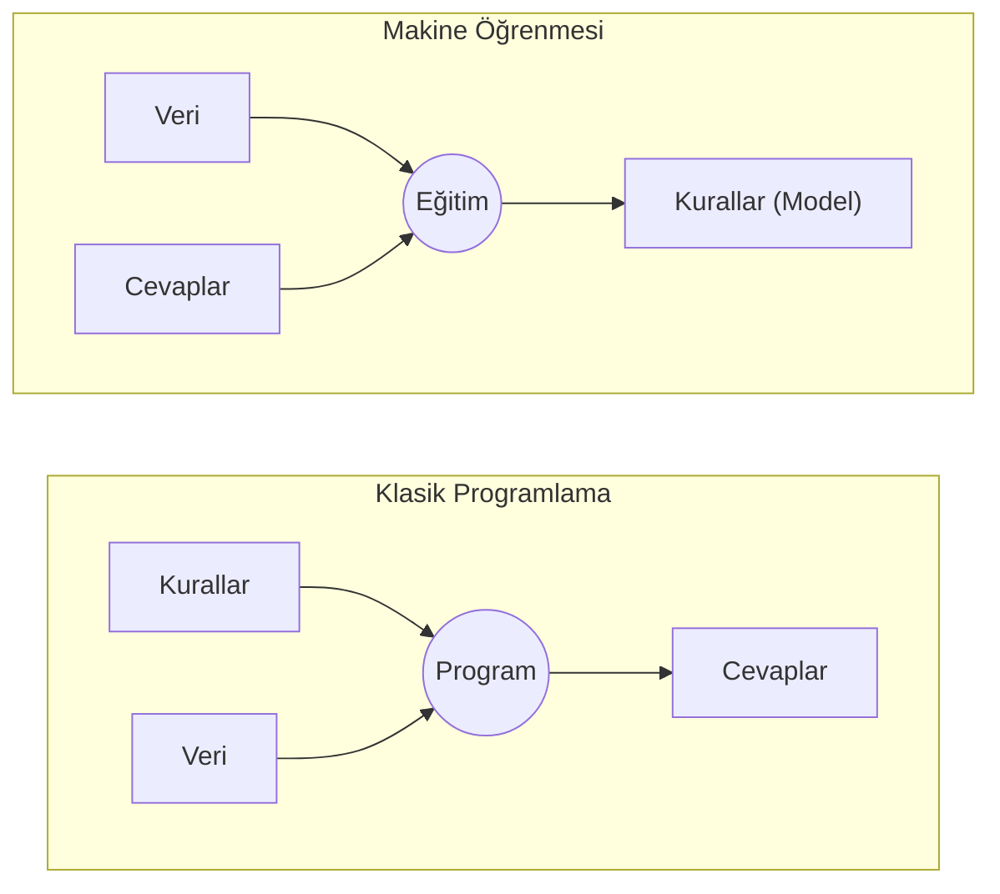
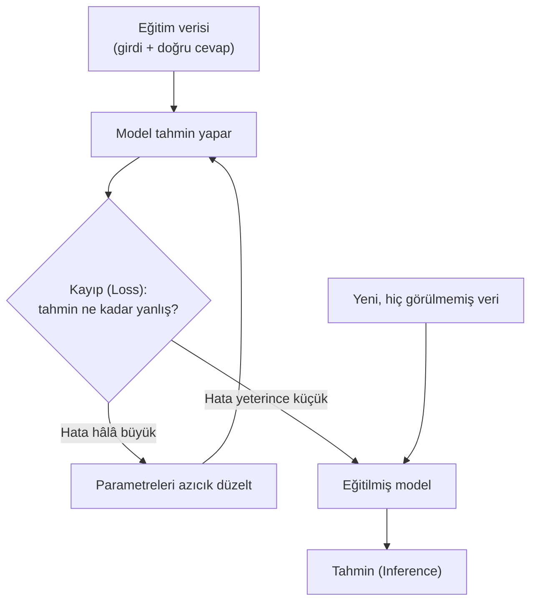
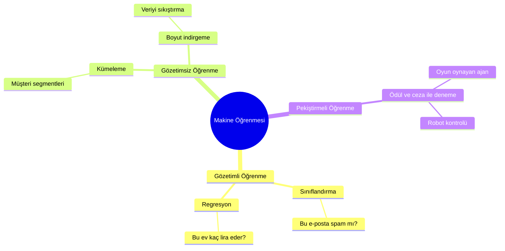

# 1.1 Makine Öğrenmesi Nedir?


## 1. Tek Cümlelik Özet (TL;DR)

**Makine öğrenmesi (Machine Learning, ML), bilgisayara kuralları tek tek yazmak yerine ona örnekler gösterip kuralları kendisinin bulmasını sağlamaktır.**

## 2. Günlük Hayattan Analoji: Karpuzcu Çırağı

İyi bir karpuzcu, karpuza iki kez vurur ve "bu tam olmuş" der. Ona *nasıl* anladığını sorarsanız net bir kural veremez: "Sesi tok olacak, sapı kurumuş olacak, altındaki sarı leke belirgin olacak... ama duruma göre değişir."

Bu bilgiyi çırağına bir kural listesiyle aktaramaz. Onun yerine şunu yapar: çırak yüzlerce karpuza vurur, tahminini söyler, karpuz kesilir ve **doğru cevap** ortaya çıkar. Her yanlış tahminde çırağın sezgisi biraz düzelir. Bir yaz sonra çırak da karpuza vurup "olmuş" diyebilir ve o da nedenini tam açıklayamaz.

Makine öğrenmesi tam olarak budur. Tek fark, çırağın bir program olmasıdır:

| Karpuzcu dünyası | ML terimi |
|---|---|
| Karpuzun sesi, sapı, lekesi, ağırlığı | **Özellikler (Features)** — modelin girdisi |
| Kesince görülen sonuç: olmuş / ham | **Etiket (Label)** — doğru cevap |
| Çırağın kafasındaki sezgi | **Model** — girdiyi tahmine çeviren fonksiyon |
| Sezgiyi oluşturan "ayarlar" | **Parametreler (Parameters / Weights)** |
| Yüzlerce karpuz kesip yanıldıkça düzelmek | **Eğitim (Training)** |
| "Ne kadar yanıldım?" hissi | **Kayıp (Loss)** |
| Müşteriye yeni bir karpuz seçmek | **Çıkarım (Inference)** |
| Sadece o tarlanın karpuzlarını ezberlemiş olmak | **Aşırı öğrenme (Overfitting)** |

Analojinin sınırı: çırak birkaç yüz karpuzla öğrenir, modeller genelde çok daha fazla örneğe ihtiyaç duyar. Ayrıca çırak "neden"i sezebilir; model yalnızca verideki örüntüyü (pattern) yakalar.

## 3. Görselleştirme

### Klasik programlama ile farkı

Klasik programlamada kuralı siz yazarsınız, program cevabı üretir. ML'de cevapları siz verirsiniz, **kuralı program üretir**.



### Öğrenme döngüsü

Bütün ML sistemleri, en küçük regresyon modelinden en büyük LLM'e kadar, aynı döngüyle öğrenir: **tahmin et → hatayı ölç → düzelt → tekrarla.**



Üstteki döngü **eğitim**, alttaki tek yönlü akış **çıkarım** aşamasıdır. Eğitim pahalıdır ve bir kez (ya da arada bir) yapılır; çıkarım ucuzdur ve her kullanıcı isteğinde çalışır.

### Üç ana öğrenme türü



| Tür | Elinizde ne var? | Model ne öğrenir? | Örnek |
|---|---|---|---|
| **Gözetimli (Supervised)** | Girdi + doğru cevap | Girdiden cevabı tahmin etmeyi | Spam filtresi, fiyat tahmini |
| **Gözetimsiz (Unsupervised)** | Sadece girdi | Verideki gizli yapıyı | Müşteri segmentasyonu, anomali tespiti |
| **Pekiştirmeli (Reinforcement)** | Bir ortam + ödül sinyali | Ödülü en çok artıran davranışı | Satranç oynayan ajan, robotik |

> [!NOTE]
> **LLM'ler bu tablonun neresinde?** LLM'ler *kendi kendine gözetimli (Self-Supervised)* öğrenir: etiketi insan vermez, metnin kendisi verir. Cümlenin sonraki kelimesini gizleyip modele tahmin ettirirsiniz; doğru cevap zaten metindedir. Teknik olarak gözetimli öğrenmenin, etiketleme maliyeti sıfıra inmiş halidir. Ayrıntısı 1.2 Öğrenme Türleri sayfasında.

## 4. Nasıl Çalışır?

Her ML projesinde dört bileşen vardır. Somut olsun diye tek bir örnek üzerinden gidelim: **evin metrekaresinden fiyatını tahmin etmek.**

**1. Veri (Data).** Elimizde geçmiş satışlar var: `(metrekare, fiyat)` çiftleri. Metrekare *özellik*, fiyat *etiket*.

**2. Model.** Model, içinde ayarlanabilir düğmeler olan bir fonksiyondur. En basitini seçelim: `fiyat = w × m² + b`. Buradaki `w` ve `b` iki **parametredir**. "Öğrenmek" dediğimiz şey, bu iki sayı için iyi değerler bulmaktan ibarettir. (Bir LLM'de aynı düğmelerden milyarlarca vardır; fikir değişmez.)

**3. Kayıp fonksiyonu (Loss Function).** Modelin ne kadar yanıldığını tek bir sayıya indirger. Tahmin 3,0 milyon, gerçek 3,5 milyonsa hata −0,5'tir. Kayıp küçüldükçe model iyileşiyor demektir.

**4. Optimizasyon (Optimization).** Her hatadan sonra parametreleri, **hatayı azaltacak yönde azıcık** oynatırız. Bu yönteme *gradyan inişi (Gradient Descent)* denir; sisli bir dağda ayağınızla eğimi yoklayıp her adımda aşağı doğru yürümeye benzer. Adımın büyüklüğünü *öğrenme oranı (Learning Rate)* belirler.

Hepsi bir arada, hiçbir kütüphane kullanmadan:

```python
# Veri: evin metrekaresi -> fiyatı (milyon TL)
evler = [(50, 1.6), (80, 2.3), (100, 3.1), (120, 3.5), (150, 4.6)]

w, b = 0.0, 0.0            # Model: fiyat = w * m2 + b  (başta hiçbir şey bilmiyor)
ogrenme_orani = 0.00005    # Her hatada ne kadar düzeltme yapacağız?

for tur in range(1000):                    # Veriyi 1000 kez baştan sona gez
    for m2, gercek_fiyat in evler:
        tahmin = w * m2 + b                # 1) Tahmin et
        hata = tahmin - gercek_fiyat       # 2) Ne kadar yanıldın?
        w -= ogrenme_orani * hata * m2     # 3) Parametreleri hatayı
        b -= ogrenme_orani * hata          #    azaltacak yönde düzelt

print(f"Öğrenilen kural: fiyat = {w:.3f} * m2 {b:+.3f}")
print(f"110 m2 ev için tahmin: {w * 110 + b:.2f} milyon TL")
```

```text
Öğrenilen kural: fiyat = 0.031 * m2 -0.002
110 m2 ev için tahmin: 3.39 milyon TL
```

Dikkat edin: koda "metrekaresi 31 bin TL" diye bir kural **yazmadık**. Model bunu beş örnekten kendisi buldu ve daha önce hiç görmediği 110 m²'lik ev için makul bir tahmin üretti. Buna **genelleme (Generalization)** denir ve ML'in asıl amacı budur: eğitim verisini ezberlemek değil, yeni veride doğru çıkmak.

```text
fiyat
 4.6 |                          x
     |                      .
 3.5 |                  x .
 3.1 |              x .
     |            .
 2.3 |        x .              x = gerçek satışlar
 1.6 |  x  .                   . = modelin öğrendiği doğru
     +------------------------------ m2
        50   80  100  120   150
```

**Peki bu LLM'e nasıl bağlanıyor?** Aynı döngü, üç şey büyütülerek:

| | Bu örnek | Bir LLM |
|---|---|---|
| Parametre sayısı | 2 | Milyarlarca |
| Girdi → çıktı | Metrekare → fiyat | Önceki token'lar → sıradaki token |
| Eğitim verisi | 5 ev | İnternet ölçeğinde metin |

Döngünün kendisi (tahmin et, hatayı ölç, düzelt) aynıdır. Kitabın geri kalanı büyük ölçüde bu üç satırın nasıl büyütüldüğünün hikâyesidir.

## 5. Ne Zaman Kullanılır / Ne Zaman Kullanılmaz?

Temel soru şudur: **Kuralı yazabiliyor musunuz?** Yazabiliyorsanız yazın. ML, kuralı tarif edemediğiniz ama örneklerini gösterebildiğiniz problemler içindir.

| Durum | Öneri | Neden |
|---|---|---|
| Kural açık ve az: "18 yaşından küçükse reddet" | ❌ ML kullanma | `if` daha ucuz, hatasız ve açıklanabilir |
| Kuralı tarif edemiyorsunuz ama örnek çok: fotoğrafta kedi var mı? | ✅ ML kullan | Örüntü var, kuralı elle yazmak imkânsız |
| Kurallar sürekli değişiyor: dolandırıcılık, spam | ✅ ML kullan | Yeni veriyle yeniden eğitmek, kural yazmaktan hızlı |
| Kişiye göre değişen sonuç: öneri sistemleri | ✅ ML kullan | Milyonlarca kullanıcı için elle kural yazılamaz |
| Veri yok ya da çok az | ❌ Önce veri topla | Model, görmediği örüntüyü öğrenemez |
| Hata kabul edilemez ve gerekçe şart: vergi hesabı | ❌ ML kullanma | ML olasılıksaldır; %100 doğruluk garanti edemez |
| Her kararın nedeni denetlenmeli: kredi reddi | ⚠️ Dikkatli kullan | Basit, yorumlanabilir modeller ya da kural + ML karması |

ML'e karar verdiyseniz, hangi seviye?

| | Kural tabanlı | Klasik ML (ağaçlar, regresyon) | Derin öğrenme / LLM |
|---|---|---|---|
| **En iyi olduğu veri** | — | Tablo verisi | Metin, görsel, ses |
| **Veri ihtiyacı** | Yok | Yüzler – binler | Çok büyük (ya da hazır model) |
| **Geliştirme maliyeti** | Düşük | Orta | Yüksek (API ile düşer) |
| **Çalıştırma maliyeti** | Çok düşük | Düşük | Yüksek |
| **Açıklanabilirlik** | Tam | İyi | Zayıf |
| **Davranış** | Deterministik | Olasılıksal | Olasılıksal |

Pratik kural: **işe yarayan en basit çözümle başlayın.** Tablo verisinde bir karar ağacı modeli çoğu zaman sinir ağından hem daha iyi hem daha ucuzdur.

## 6. Sık Yapılan Hatalar & İpuçları

> [!WARNING]
> **Modeli eğittiği veriyle sınamak.** Öğrenciye sınavda, çalıştığı soruların aynısını sormak gibidir; ezberi ölçer, öğrenmeyi değil. Verinin bir kısmını (*test seti*) baştan ayırın ve eğitimde hiç kullanmayın.

> [!WARNING]
> **Veri sızıntısı (Data Leakage).** Modele, gerçek hayatta tahmin anında elinizde olmayacak bir bilgiyi yanlışlıkla vermek. Örnek: "müşteri aboneliği iptal edecek mi?" tahmininde `iptal_tarihi` sütununu girdide bırakmak. Belirtisi: gerçek olamayacak kadar iyi sonuçlar.

> [!WARNING]
> **Dengesiz veride doğruluk (Accuracy) oranına güvenmek.** İşlemlerin %99'u temizse, her şeye "temiz" diyen model %99 doğrudur ve tek bir dolandırıcılığı bile yakalamaz. Böyle durumlarda precision ve recall'a bakın.

> [!CAUTION]
> **"Çöp girerse çöp çıkar" (Garbage In, Garbage Out).** Model verideki hatayı ve önyargıyı da öğrenir. Zamanınızın çoğunu model seçimine değil veriyi anlamaya ve temizlemeye harcamanız normaldir.

> [!TIP]
> **Önce baseline kurun.** Modelden önce en aptalca çözümü ölçün: "her zaman ortalamayı tahmin et" ya da üç satırlık bir kural. Modeliniz bunu geçemiyorsa sorun modelde değil, veride ya da problem tanımındadır.

> [!TIP]
> **Önce metriği tanımlayın.** "İyi model" ne demek? Kod yazmadan önce başarıyı ölçecek sayıyı ve kabul eşiğini belirleyin; yoksa ne zaman bittiğinizi bilemezsiniz.

**Akılda kalsın:** Model = ayarlanabilir düğmeleri olan bir fonksiyon. Öğrenmek = düğmeleri hatayı azaltacak yönde çevirmek. Amaç = görülmemiş veride doğru çıkmak.

---

[1.2 Öğrenme Türleri →](02-ogrenme-turleri.md)
