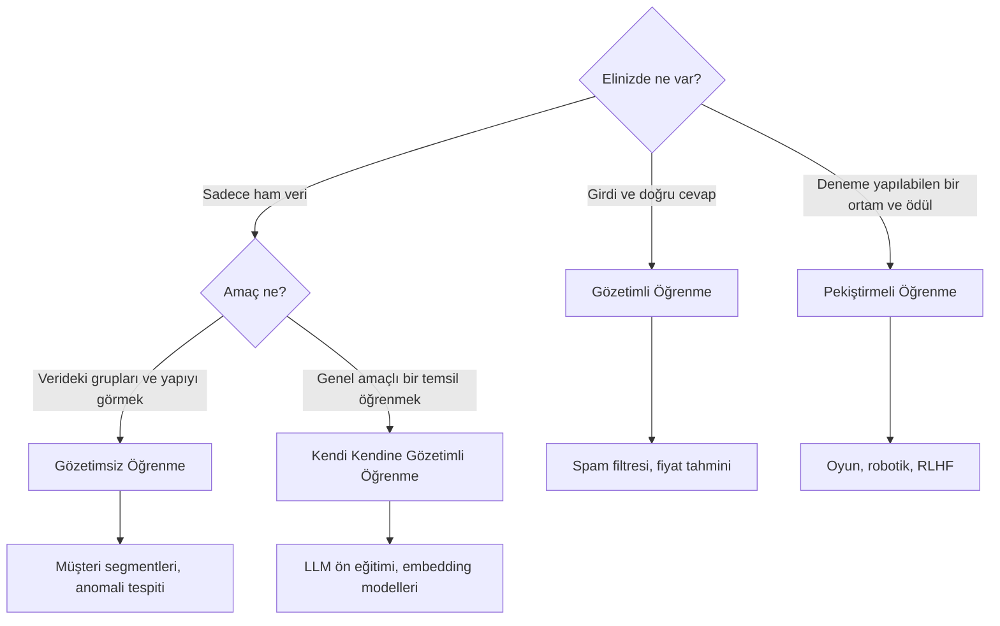

# 1.2 Öğrenme Türleri

## 1. Tek Cümlelik Özet (TL;DR)

**Öğrenme türünü, modele verdiğiniz geri bildirimin cinsi belirler: doğru cevap (gözetimli), hiçbir şey (gözetimsiz), ödül (pekiştirmeli) ya da verinin kendisi (kendi kendine gözetimli).**

## 2. Günlük Hayattan Analoji: Yemek Yapmayı Öğrenmenin Dört Yolu

- **Gözetimli (Supervised):** Ustanın yanında pişirirsiniz. Her tabaktan sonra usta "doğrusu şuydu" der. Doğru cevap her örnekte elinizdedir.
- **Gözetimsiz (Unsupervised):** Kimse bir şey söylemez. Dolaptaki malzemelere bakıp kendiniz gruplarsınız: "bunlar baharat, bunlar bakliyat." Etiket yok, yalnızca yapı var.
- **Pekiştirmeli (Reinforcement):** Tarif yok. Dener, misafirlerin yüzüne bakarsınız. Beğendilerse o yöne devam, beğenmedilerse değiştirirsiniz. Geri bildirim gecikmeli ve tek bir sayıdır: iyi ya da kötü.
- **Kendi kendine gözetimli (Self-Supervised):** Binlerce tarif okursunuz, her tarifin bir satırını elinizle kapatıp ne yazdığını tahmin edersiniz, sonra elinizi çekip bakarsınız. Öğretmen yoktur; doğru cevabı metnin kendisi verir.

## 3. Görselleştirme



## 4. Nasıl Çalışır?

Dört türde de döngü aynıdır (tahmin et, hatayı ölç, düzelt). Değişen tek şey **hatanın neye göre ölçüldüğüdür**:

| Tür | "Hata" neye göre hesaplanır? | Tipik maliyet kalemi |
|---|---|---|
| Gözetimli | İnsan eliyle verilmiş etikete göre | Etiketleme |
| Gözetimsiz | Verinin kendi iç tutarlılığına göre (ör. küme içi mesafe) | Sonucu yorumlamak |
| Pekiştirmeli | Ortamdan gelen ödüle göre | Deneme sayısı, ödül tasarımı |
| Kendi kendine gözetimli | Verinin gizlenen parçasına göre | Hesaplama gücü |

LLM'leri mümkün kılan sıçrama dördüncü türdür. İnsan etiketi gerekmediği için internetteki bütün metin bir anda eğitim verisine dönüşür. Tek bir cümleden kaç eğitim örneği çıktığına bakın:

```python
cumle = "kedi sütü içti ve uyudu"
kelimeler = cumle.split()

# Her konum için: önceki kelimeler girdi, sıradaki kelime "etiket"
for i in range(1, len(kelimeler)):
    girdi = " ".join(kelimeler[:i])
    etiket = kelimeler[i]
    print(f"{girdi!r:28} -> {etiket!r}")
```

```text
'kedi'                       -> 'sütü'
'kedi sütü'                  -> 'içti'
'kedi sütü içti'             -> 've'
'kedi sütü içti ve'          -> 'uyudu'
```

Kimse etiketlemedi, ama dört adet (girdi, doğru cevap) çifti elde ettik. Modern bir LLM'in hayatında bu türlerin birkaçı sırayla görev alır: **kendi kendine gözetimli** ön eğitim (Bölüm 3), **gözetimli** ince ayar (SFT, 4.2) ve **pekiştirmeli** öğrenmeyle hizalama (RLHF, 4.4).

## 5. Ne Zaman Kullanılır / Ne Zaman Kullanılmaz?

| Durum | Tür | Not |
|---|---|---|
| Net bir hedef değişken var ve etiketli örnek bulunuyor | ✅ Gözetimli | Çoğu iş probleminde ilk tercih |
| Etiket yok, veriyi tanımak istiyorsunuz | ✅ Gözetimsiz | Çıktıyı bir insanın yorumlaması gerekir |
| Kararlar birbirini etkiliyor, sonuç gecikmeli geliyor | ✅ Pekiştirmeli | Simülatör ya da ucuz deneme şart |
| Çok büyük etiketsiz veri var, genel bir temel model istiyorsunuz | ✅ Kendi kendine gözetimli | Pahalı; çoğu ekip hazır modeli kullanır |
| Etiketli veriyle çözülebilen bir problem | ❌ Pekiştirmeli | Gereksiz karmaşıklık ve kararsızlık |
| "Doğru küme sayısı kaç?" gibi kesin bir cevap bekliyorsunuz | ❌ Gözetimsiz | Tek bir doğru cevabı yoktur |

## 6. Sık Yapılan Hatalar & İpuçları

> [!WARNING]
> **Etiket kalitesini sorgulamamak.** Gözetimli modelin tavanı etiketlerin kalitesidir. İki insanın aynı örneğe aynı etiketi verme oranını ölçün; insanlar anlaşamıyorsa model de öğrenemez.

> [!WARNING]
> **Kümeleme çıktısını "gerçek" sanmak.** Algoritma ona kaç küme isterseniz o kadar küme bulur. Kümeler bir hipotezdir; iş bilgisiyle doğrulanmaları gerekir.

> [!CAUTION]
> **Ödül kandırmacası (Reward Hacking).** Pekiştirmeli öğrenmede model, niyetinizi değil yazdığınız ödülü en üst düzeye çıkarır. "Tıklanmayı artır" ödülü, tık tuzağı başlık üreten bir sistemle sonuçlanabilir.

> [!TIP]
> **Etiket azsa önce hazır modele bakın.** Kendi kendine gözetimle eğitilmiş bir modelin üzerine birkaç yüz etiketli örnekle ince ayar yapmak, sıfırdan gözetimli eğitimden neredeyse her zaman daha iyi sonuç verir.

**Akılda kalsın:** Türler arasındaki fark algoritmada değil, geri bildirimin kaynağındadır. LLM'ler etiketi metnin kendisinden aldığı için bu kadar büyüyebildi.

---

[← 1.1 Makine Öğrenmesi Nedir?](01-ml-nedir.md) · [1.3 Sinir Ağları (Neural Networks) →](03-sinir-aglari.md)
