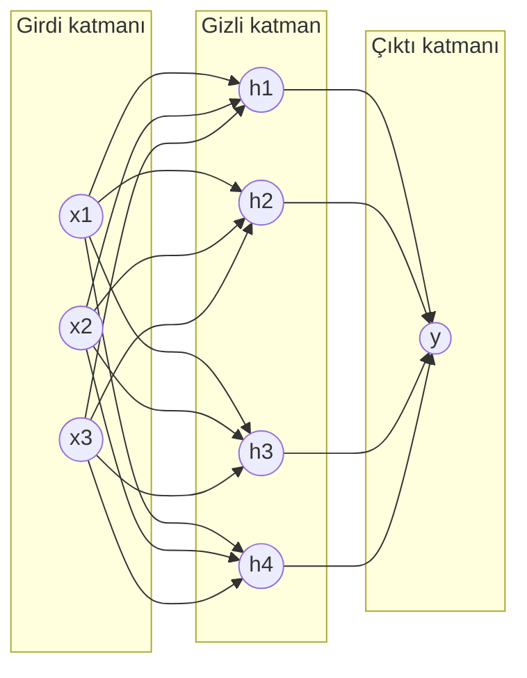

# 1.3 Sinir Ağları (Neural Networks)

## 1. Tek Cümlelik Özet (TL;DR)

**Sinir ağı, her biri "girdileri ağırlıklarıyla çarp, topla, bir eşikten geçir" kadar basit bir hesap yapan nöronların katman katman dizilmesiyle, çok karmaşık fonksiyonları taklit edebilen bir modeldir.**

## 2. Günlük Hayattan Analoji: Ses Mikseri

Bir ses masası düşünün. Her kanalın bir düğmesi vardır: vokali aç, bası kıs, gitarı biraz yükselt. Çıkan ses, kanalların **ağırlıklı toplamıdır**.

Bir nöron tam olarak böyle bir mikserdir: girdiler kanallar, **ağırlıklar (weights)** düğmelerdir. Sinir ağı ise birbirine bağlı binlerce mikserdir: birinci sıradaki mikserlerin çıkışı, ikinci sıradakilerin girişidir. Eğitim, milyonlarca düğmeyi doğru ses çıkana kadar azar azar çevirmektir. Düğmeleri çeviren el, bir sonraki konuda göreceğimiz geri yayılımdır.

## 3. Görselleştirme

Tek bir nöron:

```text
 x1 --(w1)--\
 x2 --(w2)---[ topla: w1*x1 + w2*x2 + w3*x3 + b ]--[ aktivasyon ]--> çıktı
 x3 --(w3)--/
```

Nöronlardan oluşan bir ağ:



Her ok bir ağırlıktır, yani öğrenilecek bir sayıdır.

## 4. Nasıl Çalışır?

**1. Ağırlıklı toplam.** Nöron her girdiyi kendi ağırlığıyla çarpar, toplar ve bir sabit ekler: `z = w·x + b`. Ağırlık "bu girdi ne kadar önemli?", **bias** (`b`) ise "nöron ne kadar kolay ateşlensin?" sorusunun cevabıdır.

**2. Aktivasyon fonksiyonu (Activation Function).** Toplam, doğrusal olmayan bir fonksiyondan geçer. En yaygını **ReLU**'dur: negatifse sıfır yap, pozitifse aynen bırak. Bu adım kritiktir: aktivasyon olmazsa yüz katmanlı ağ bile matematiksel olarak tek bir doğrusal denkleme çöker ve eğri hiçbir şeyi öğrenemez.

**3. Katmanlar.** İlk katman ham girdiden basit örüntüler çıkarır, sonraki katmanlar bunları birleştirerek daha soyut kavramlar kurar. Görüntüde bu kabaca kenar → şekil → nesne sırasıdır. "Derin" öğrenmedeki derinlik, katman sayısıdır.

**4. İleri yayılım (Forward Pass).** Verinin girdiden çıktıya katman katman akmasıdır. Aşağıdaki kod, yukarıdaki diyagramdaki ağın tamamıdır:

```python
import numpy as np

def relu(z):
    return np.maximum(0, z)

rng = np.random.default_rng(0)
W1, b1 = rng.normal(size=(4, 3)), np.zeros(4)   # 3 girdi -> 4 gizli nöron
W2, b2 = rng.normal(size=(1, 4)), np.zeros(1)   # 4 gizli nöron -> 1 çıktı

x = np.array([0.5, -1.2, 3.0])                  # tek bir örnek

h = relu(W1 @ x + b1)      # gizli katman: ağırlıklı toplam + aktivasyon
y = W2 @ h + b2            # çıktı katmanı
print("gizli katman:", h.round(2), "| çıktı:", y.round(2))
print("öğrenilecek parametre sayısı:", W1.size + b1.size + W2.size + b2.size)
```

Bu ağda 21 parametre var. Bir LLM aynı yapı taşlarından (matris çarpımı + doğrusal olmayan fonksiyon) milyarlarcasını kullanır.

## 5. Ne Zaman Kullanılır / Ne Zaman Kullanılmaz?

| Durum | Öneri | Neden |
|---|---|---|
| Metin, görsel, ses gibi yapısız veri | ✅ Sinir ağı | Özellikleri elle çıkarmak yerine kendisi öğrenir |
| Çok büyük veri ve karmaşık örüntü | ✅ Sinir ağı | Veri arttıkça iyileşmeye devam eder |
| Tablo verisi (satır/sütun), birkaç bin örnek | ❌ Önce gradient boosting | XGBoost/LightGBM genelde daha iyi ve çok daha ucuz |
| Kararın gerekçesi açıklanmak zorunda | ⚠️ Dikkat | Ağırlıklar insan tarafından okunamaz |
| Küçük veri, sıfırdan eğitim | ❌ Kullanma | Ezberler; hazır modelden başlayın |

## 6. Sık Yapılan Hatalar & İpuçları

> [!WARNING]
> **Girdileri ölçeklememek.** Bir özellik 0-1, diğeri 0-1.000.000 aralığındaysa büyük olan eğitimi domine eder. Girdileri benzer ölçeğe getirin (normalizasyon).

> [!WARNING]
> **Dev bir ağla başlamak.** Önce küçük bir ağın tek bir veri yığınını (batch) ezberleyebildiğini görün. Ezberleyemiyorsa sorun boyutta değil, kodda ya da veridedir.

> [!NOTE]
> **"Beyin gibi çalışır" benzetmesine fazla yaslanmayın.** İsim biyolojiden esinlenmiştir ama yapay nöron, gerçek nöronun çok kaba bir karikatürüdür. Sinir ağını "ayarlanabilir, çok esnek bir fonksiyon" olarak düşünmek daha doğrudur.

> [!TIP]
> **Boyutları (shape) yazarak ilerleyin.** Sinir ağı hatalarının büyük kısmı boyut uyuşmazlığıdır. Her satırın yanına tensör boyutunu yorum olarak yazmak en ucuz hata ayıklama yöntemidir.

**Akılda kalsın:** Nöron = ağırlıklı toplam + aktivasyon. Ağ = bunların katmanları. Bilgi = ağırlıkların değerleri.

---

[← 1.2 Öğrenme Türleri](02-ogrenme-turleri.md) · [1.4 Geri Yayılım (Backpropagation) →](04-geri-yayilim.md)
