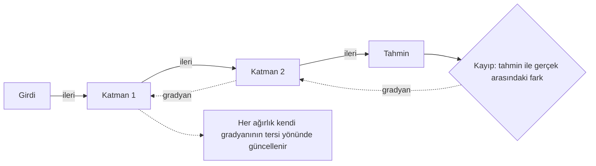

# 1.4 Geri Yayılım (Backpropagation)

## 1. Tek Cümlelik Özet (TL;DR)

**Geri yayılım, çıktıdaki hatanın sorumluluğunu çıkıştan girişe doğru her ağırlığa paylaştıran ve böylece her ağırlığın hangi yöne, ne kadar çevrilmesi gerektiğini söyleyen algoritmadır.**

## 2. Günlük Hayattan Analoji: Tuzlu Çıkan Yemek

Restoranda bir tabak geri döndü: çok tuzlu. Şef sorumluyu geriye doğru arar. Tabağı birleştiren aşçı "ben sosu olduğu gibi koydum" der. Sosçu "et suyunu hazır aldım" der. Et suyunu yapan çırak tuzu fazla kaçırmıştır.

Herkes hatadaki **kendi payı kadar** düzeltme yapar: çırak tuzu belirgin biçimde azaltır, sosçu biraz, tabağı birleştiren neredeyse hiç. Sorumluluk zincirin sonundan başına doğru aktarılır. Geri yayılım bu "kim ne kadar sorumlu?" hesabının matematiksel halidir. Makine öğrenmesinde buna *kredi atama (credit assignment)* problemi denir.

## 3. Görselleştirme



Düz oklar **ileri yayılım** (tahmin üret), kesikli oklar **geri yayılım** (sorumluluğu dağıt).

## 4. Nasıl Çalışır?

**1. İleri git, hatayı ölç.** Girdi ağdan geçer, tahmin çıkar, kayıp fonksiyonu tek bir sayı üretir.

**2. Gradyan nedir?** Bir ağırlığın gradyanı şu sorunun cevabıdır: "Bu ağırlığı azıcık artırırsam kayıp ne kadar, hangi yönde değişir?" Pozitifse ağırlığı azaltmak, negatifse artırmak kaybı düşürür.

**3. Zincir kuralı (Chain Rule).** Bir ağırlık kaybı doğrudan değil, arkasındaki katmanlar üzerinden etkiler. Etkiyi bulmak için aradaki halkaların etkilerini çarparız: "tuz et suyunu şu kadar, et suyu sosu şu kadar, sos tabağı şu kadar etkiler." Geri yayılım bu çarpımları çıkıştan başlayıp her ara sonucu yeniden kullanarak verimli biçimde hesaplar.

**4. Güncelle.** Her ağırlık, gradyanının tersi yönünde, **öğrenme oranı (learning rate)** kadar küçük bir adım atar. Bu güncelleme kuralı *gradyan inişidir (gradient descent)*.

İki ağırlıklı minik bir ağda hepsini elle yapalım. Hedef: girdi 2 iken çıktının 10 olması.

```python
x, hedef = 2.0, 10.0
w1, w2 = 0.5, 0.5
ogrenme_orani = 0.01

for adim in range(200):
    h = w1 * x                 # ileri: 1. katman
    y = w2 * h                 # ileri: 2. katman (tahmin)
    kayip = (y - hedef) ** 2

    dy = 2 * (y - hedef)       # geri: kayıp, tahmine ne kadar duyarlı?
    dw2 = dy * h               # w2'nin payı
    dh = dy * w2               # hata bir katman geriye aktarılır
    dw1 = dh * x               # w1'in payı (zincir kuralı)

    w1 -= ogrenme_orani * dw1
    w2 -= ogrenme_orani * dw2

print(f"w1={w1:.2f}, w2={w2:.2f}, tahmin={w1 * x * w2:.2f}, kayıp={kayip:.6f}")
```

Gerçek hayatta bu türevleri elle yazmazsınız. PyTorch gibi kütüphaneler ileri yayılım sırasında yapılan işlemleri kaydeder ve `loss.backward()` çağrısıyla tüm gradyanları otomatik hesaplar (*autograd*).

## 5. Ne Zaman Kullanılır / Ne Zaman Kullanılmaz?

| Durum | Geri yayılım | Not |
|---|---|---|
| Model türevlenebilir işlemlerden oluşuyor (sinir ağları) | ✅ | Standart ve neredeyse tek yöntem |
| Kayıp, modelin çıktısından türevlenebilir biçimde hesaplanıyor | ✅ | |
| Arada türevi olmayan bir adım var (ör. ayrık bir seçim, dış API çağrısı) | ❌ Doğrudan olmaz | Pekiştirmeli öğrenme teknikleri ya da yaklaşık yöntemler gerekir |
| Karar ağaçları, gradient boosting | ❌ | Farklı eğitim algoritmaları kullanırlar |

Öğrenme oranı seçimi pratikte en çok etki eden karardır:

| Öğrenme oranı | Belirti |
|---|---|
| Çok küçük | Kayıp düşüyor ama çok yavaş; eğitim bitmiyor |
| Uygun | Kayıp düzenli biçimde düşüyor |
| Çok büyük | Kayıp zıplıyor, `NaN` oluyor ya da hiç düşmüyor |

## 6. Sık Yapılan Hatalar & İpuçları

> [!WARNING]
> **Kaybolan ve patlayan gradyanlar (Vanishing / Exploding Gradients).** Çok katmanlı ağlarda gradyanlar geriye giderken sürekli çarpılır; 1'den küçük sayılar sıfıra, büyük sayılar sonsuza gider. Residual bağlantılar, normalizasyon katmanları ve gradient clipping bu sorunun standart çözümleridir (2.4'te tekrar karşımıza çıkacak).

> [!WARNING]
> **PyTorch'ta gradyanları sıfırlamayı unutmak.** Gradyanlar varsayılan olarak birikir. Her adımda `optimizer.zero_grad()` çağrılmazsa önceki adımların gradyanları üst üste eklenir ve eğitim bozulur.

> [!TIP]
> **Kayıp `NaN` olduysa** önce öğrenme oranını 10 kat düşürün. Sorunların büyük kısmı burada çözülür.

> [!NOTE]
> **Geri yayılım "öğrenmenin" kendisi değildir.** Yalnızca gradyanları hesaplar. Ağırlıkları değiştiren, gradyanı kullanan optimizasyon algoritmasıdır (SGD, Adam).

**Akılda kalsın:** İleri yayılım tahmin üretir, geri yayılım suçu paylaştırır, optimizer düğmeleri çevirir.

---

[← 1.3 Sinir Ağları (Neural Networks)](03-sinir-aglari.md) · [1.5 Eğitim Pratiği →](05-egitim-pratigi.md)
