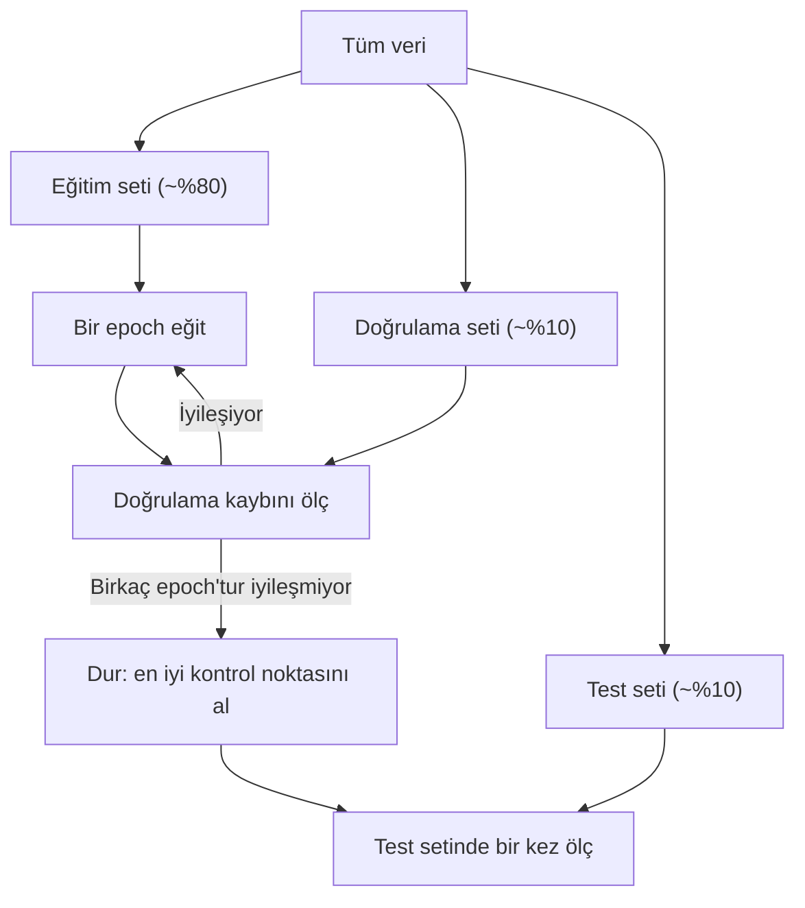

# 1.5 Eğitim Pratiği

## 1. Tek Cümlelik Özet (TL;DR)

**İyi model, eğitim verisinde değil daha önce hiç görmediği veride iyi olan modeldir; eğitim pratiğinin tamamı bu farkı ölçmek ve kapatmakla ilgilidir.**

## 2. Günlük Hayattan Analoji: Sınava Hazırlık

- **Eğitim seti (Training Set):** Çalıştığınız soru bankası.
- **Doğrulama seti (Validation Set):** Deneme sınavları. Sonuca bakıp çalışma yönteminizi değiştirirsiniz.
- **Test seti (Test Set):** Gerçek sınav. Bir kez girilir, sonucu değiştirilemez.

Soru bankasındaki cevapları ezberleyen öğrenci çalışma sorularında yüz alır, gerçek sınavda çakar. Bu **aşırı öğrenmedir (overfitting)**. Hiç çalışmayan öğrenci ikisinde de kötüdür: **yetersiz öğrenme (underfitting)**. Ve deneme sınavının sorularını önceden gören öğrencinin deneme notu hiçbir şey ifade etmez.

## 3. Görselleştirme



Aşırı öğrenmenin kayıp eğrilerindeki imzası:

```text
kayıp
  |\
  | \ .
  |  \   .                      . . .    <- doğrulama kaybı yükselmeye başlar
  |   \     .  .  .  .  .  .  '
  |    \_______
  |            \_________________        <- eğitim kaybı düşmeye devam eder
  +--------------^--------------------- epoch
                 burada durmalıydınız (early stopping)
```

## 4. Nasıl Çalışır?

**Temel kavramlar:**

- **Batch:** Modelin tek bir güncellemede gördüğü örnek grubu. Tüm veriyi tek seferde işlemek belleğe sığmaz, tek tek işlemek gürültülüdür; batch ikisinin ortasıdır.
- **Epoch:** Eğitim setinin baştan sona bir kez gezilmesi.
- **Optimizer:** Gradyanı kullanarak ağırlıkları güncelleyen algoritma. **SGD** en yalın halidir. **Adam / AdamW** her parametre için adım büyüklüğünü kendisi ayarlar ve LLM dünyasında varsayılandır.
- **Hiperparametre (Hyperparameter):** Modelin öğrenmediği, sizin seçtiğiniz ayarlar: öğrenme oranı, batch boyutu, katman sayısı.

**Aşırı öğrenmeye karşı araçlar (Regularization):**

- **Daha fazla ve daha çeşitli veri.** En etkili ilaç.
- **Erken durdurma (Early Stopping).** Doğrulama kaybı kötüleşmeye başlayınca dur.
- **Weight decay.** Ağırlıkların gereksiz büyümesini cezalandırır.
- **Dropout.** Eğitimde nöronların bir kısmını rastgele kapatır; ağ tek bir nörona bel bağlayamaz.

Tipik bir eğitim döngüsünün iskeleti (PyTorch tarzı pseudo-kod):

```python
en_iyi_kayip, sabir = float("inf"), 3

for epoch in range(100):
    for girdi, hedef in egitim_verisi:            # batch batch gez
        kayip = kayip_fonksiyonu(model(girdi), hedef)
        kayip.backward()                          # gradyanları hesapla
        optimizer.step()                          # ağırlıkları güncelle
        optimizer.zero_grad()                     # gradyanları sıfırla

    dogrulama_kaybi = degerlendir(model, dogrulama_verisi)
    if dogrulama_kaybi < en_iyi_kayip:
        en_iyi_kayip, sabir = dogrulama_kaybi, 3
        kaydet(model)                             # en iyi kontrol noktası
    else:
        sabir -= 1
        if sabir == 0:
            break                                 # erken durdurma
```

## 5. Ne Zaman Kullanılır / Ne Zaman Kullanılmaz?

Burada karar "kullanayım mı?" değil, "eğrilere bakıp ne yapayım?" kararıdır:

| Belirti | Teşhis | Ne yapmalı? |
|---|---|---|
| Eğitim kaybı da doğrulama kaybı da yüksek | Yetersiz öğrenme | Daha büyük model, daha uzun eğitim, daha iyi özellikler |
| Eğitim kaybı düşük, doğrulama kaybı yüksek | Aşırı öğrenme | Daha fazla veri, regularization, daha küçük model, erken durdurma |
| İkisi de düşük, canlıda sonuç kötü | Veri kayması ya da sızıntı | Test verisi gerçek kullanımı temsil ediyor mu? |
| Kayıp hiç düşmüyor | Hata ya da yanlış öğrenme oranı | Tek batch'i ezberletmeyi dene, öğrenme oranını değiştir |
| Kayıp zıplıyor ya da `NaN` | Öğrenme oranı çok yüksek | Düşür, gradient clipping ekle |

Veri bölme yöntemi de bir karardır:

| Veri tipi | Bölme yöntemi |
|---|---|
| Bağımsız örnekler | Rastgele karıştır ve böl |
| Zaman serisi | Zamana göre böl: geçmişle eğit, gelecekle test et |
| Aynı kullanıcıdan/dokümandan çok örnek | Gruba göre böl: bir kullanıcı tek bir sette olsun |

## 6. Sık Yapılan Hatalar & İpuçları

> [!WARNING]
> **Test setine bakarak ayar yapmak.** Test sonucuna göre hiperparametre değiştirdiğiniz anda test seti fiilen doğrulama seti olur ve elinizde tarafsız bir ölçüm kalmaz. Ayarları doğrulama setiyle yapın, teste en sonda bir kez bakın.

> [!WARNING]
> **Zaman serisini rastgele bölmek.** Model "geleceği" eğitimde görmüş olur. Sonuçlar harika görünür, canlıda çöker.

> [!TIP]
> **Önce bir batch'i ezberletin.** Model 10 örneği bile ezberleyemiyorsa bir hata vardır. Bu test bir dakikanızı alır, günlerinizi kurtarır.

> [!TIP]
> **Rastgelelik tohumunu (seed) sabitleyin ve her deneyi kaydedin.** "Geçen hafta daha iyiydi" cümlesinin ardından neyin değiştiğini bulamamak en yaygın zaman kaybıdır.

**Akılda kalsın:** Eğitim kaybı modelin ne kadar çalıştığını, doğrulama kaybı ne kadar öğrendiğini gösterir.

---

[← 1.4 Geri Yayılım (Backpropagation)](04-geri-yayilim.md) · [2.1 Tokenization →](../02-transformer/01-tokenization.md)
