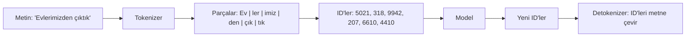

# 2.1 Tokenization

## 1. Tek Cümlelik Özet (TL;DR)

**Tokenization, metni modelin sözlüğündeki parçalara (token) bölüp her parçayı bir sayıya çevirmektir; model harf ya da kelime görmez, yalnızca bu sayı dizisini görür.**

## 2. Günlük Hayattan Analoji: Lego Parçaları

Her model için özel bir oyuncak dökmek yerine Lego sınırlı sayıda standart parça üretir; her şey bu parçalardan kurulur. Sık kullanılan şekiller için hazır büyük parçalar vardır (kapı, tekerlek), nadir şekiller küçük parçalardan birleştirilir.

Tokenizer da böyle çalışır. Sık geçen kelimeler tek parçadır; nadir kelimeler daha küçük parçalardan kurulur. Türkçe bunu görmek için ideal bir dildir: `evlerimizden` kelimesi sözlükte tek parça olarak durmaz, `ev + ler + imiz + den` gibi parçalara ayrılır. Sözlükte hiç olmayan bir kelime bile harf harf kurulabilir; "bilinmeyen kelime" diye bir şey kalmaz.

## 3. Görselleştirme



Parçalar ve ID'ler temsilidir; her modelin tokenizer'ı aynı metni farklı böler.

## 4. Nasıl Çalışır?

Üç seçenek var ve ikisi kötü:

| Yaklaşım | Sorun |
|---|---|
| **Kelime bazlı** | Sözlük devasa olur; "evlerimizden" görülmediyse bilinmeyen kelimedir |
| **Karakter bazlı** | Sözlük küçücük ama diziler çok uzar; model anlamı harflerden kurmak zorunda kalır |
| **Alt kelime (Subword)** | İkisinin ortası: sık kelimeler tek parça, nadirler birkaç parça |

Modern LLM'ler alt kelime yöntemlerini kullanır. En yaygını **BPE (Byte Pair Encoding)**'dir ve fikri çok basittir:

1. Her şeyi tek tek karakterlere böl.
2. Yan yana en sık geçen çifti bul, tek parça olarak birleştir.
3. İstenen sözlük boyutuna ulaşana kadar tekrarla.

```python
from collections import Counter

kelimeler = [list("evler"), list("evde"), list("evlerde"), list("eller")]

def birlestir(parcalar, a, b):
    sonuc, i = [], 0
    while i < len(parcalar):
        if parcalar[i:i + 2] == [a, b]:
            sonuc.append(a + b); i += 2
        else:
            sonuc.append(parcalar[i]); i += 1
    return sonuc

for tur in range(4):
    ciftler = Counter(c for k in kelimeler for c in zip(k, k[1:]))
    (a, b), adet = ciftler.most_common(1)[0]
    kelimeler = [birlestir(k, a, b) for k in kelimeler]
    print(f"{a}+{b} ({adet} kez) ->", [" ".join(k) for k in kelimeler])
```

Birkaç turda `ler` ve `ev` gibi parçalar kendiliğinden ortaya çıkar; kimse modele Türkçe ek öğretmedi. WordPiece ve SentencePiece aynı fikrin farklı uygulamalarıdır.

**Bağlam penceresi (Context Window):** Modelin tek seferde görebildiği en fazla token sayısıdır. Prompt, dokümanlar, konuşma geçmişi ve modelin cevabı bu bütçeden yer. API fiyatları da token başınadır.

## 5. Ne Zaman Kullanılır / Ne Zaman Kullanılmaz?

Tokenization her LLM'de zorunludur; mühendislik kararı onu **ne zaman hesaba katacağınızdır**:

| Durum | Yapılacak |
|---|---|
| Maliyet ve limit hesabı | Karakter değil token sayın; modelin kendi tokenizer'ını kullanın |
| Türkçe gibi eklemeli dillerle çalışma | Aynı içerik İngilizceye göre belirgin biçimde daha fazla token tutar; bütçeyi buna göre planlayın |
| Kendi modelinizi eğitiyorsunuz | Tokenizer'ı kendi alanınızın verisiyle eğitin |
| Hazır modele fine-tuning | ❌ Tokenizer'ı değiştirmeyin; model o sözlükle eğitildi |
| Harf sayma, tersten yazma, uzun sayılarla aritmetik | ⚠️ Model harfleri değil parçaları görür; bu işleri koda (tool) yaptırın |

## 6. Sık Yapılan Hatalar & İpuçları

> [!WARNING]
> **Token'ı karakter ya da kelimeyle karıştırmak.** "4 karakter ≈ 1 token" kuralı İngilizce için kaba bir tahmindir, Türkçede tutmaz. Limit ve maliyet hesabını her zaman gerçek tokenizer'la yapın.

> [!WARNING]
> **Yanlış modelin tokenizer'ını kullanmak.** Her modelin sözlüğü farklıdır. A modelinin tokenizer'ıyla sayıp B modeline göndermek hem sayımı hem (yerel modellerde) çıktıyı bozar.

> [!NOTE]
> **Baştaki boşluk token'ın parçasıdır.** Çoğu tokenizer'da `"ev"` ile `" ev"` farklı token'lardır. Prompt şablonlarında fazladan boşluklar ve satır sonları bu yüzden davranışı etkileyebilir.

> [!TIP]
> **Uzun bağlamda maliyet token sayısıyla doğrusal artar.** Prompt'a eklediğiniz her doküman, her istekte yeniden ödenir. Gereksiz içeriği ayıklamak en ucuz optimizasyondur.

**Akılda kalsın:** Model metin okumaz, token ID'leri okur. Para birimi de token'dır.

---

[← 1.5 Eğitim Pratiği](../01-temeller/05-egitim-pratigi.md) · [2.2 Embeddings (Vektör Uzayı) →](02-embeddings.md)
