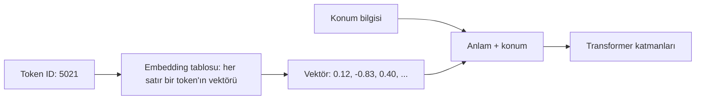

# 2.2 Embeddings (Vektör Uzayı)

## 1. Tek Cümlelik Özet (TL;DR)

**Embedding, bir token'ı ya da bir metni, anlamca benzer şeylerin birbirine yakın düştüğü bir uzayda koordinatlara, yani bir sayı listesine çevirmektir.**

## 2. Günlük Hayattan Analoji: Anlam Haritası

Haritada her şehrin iki koordinatı vardır: enlem ve boylam. Koordinatlara bakarak İzmit'in İstanbul'a yakın, Kars'a uzak olduğunu şehirleri hiç tanımadan söyleyebilirsiniz.

Embedding, kelimeler için çizilmiş bir haritadır. Bu haritada "kedi" ile "köpek" komşudur, "kedi" ile "fatura" ayrı kıtalardadır. Farkı şudur: harita iki boyutludur, embedding uzayı yüzlerce ya da binlerce boyutludur. Her boyut anlamın bir yönünü taşır; ama bu yönler "canlı mı?", "büyük mü?" gibi temiz etiketler değildir, model onları eğitimde kendisi bulur.

## 3. Görselleştirme



İki boyuta indirgenmiş bir anlam haritası:

```text
        ^
        |   kedi  köpek
        |      kuş                    fatura
        |                         ödeme   borç
        |
        |        elma  armut
        |          muz
        +---------------------------------------->
   Yakın duranlar anlamca benzer; yön ve mesafe bilgi taşır.
```

## 4. Nasıl Çalışır?

**1. Tablo araması.** Modelin girişinde, sözlükteki her token için bir satır içeren büyük bir tablo vardır. Token ID'si satır numarasıdır; embedding o satırdaki vektördür. Bu tablo eğitimle öğrenilir.

**2. Yakınlık nasıl ölçülür?** En yaygın ölçü **kosinüs benzerliğidir (cosine similarity)**: iki vektörün aynı yöne bakıp bakmadığını ölçer. 1 aynı yön, 0 ilgisiz, -1 zıt yön demektir.

```python
import numpy as np

def kosinus(a, b):
    return a @ b / (np.linalg.norm(a) * np.linalg.norm(b))

# Temsili 4 boyutlu embedding'ler (gerçekte yüzlerce boyut olur)
kedi   = np.array([0.9, 0.8, 0.1, 0.0])
kopek  = np.array([0.8, 0.9, 0.2, 0.1])
fatura = np.array([0.0, 0.1, 0.9, 0.8])

print(f"kedi ~ köpek : {kosinus(kedi, kopek):.2f}")
print(f"kedi ~ fatura: {kosinus(kedi, fatura):.2f}")
```

**3. Token embedding'i ile metin embedding'i farklı şeylerdir.**

| | Token embedding | Metin (cümle) embedding'i |
|---|---|---|
| Neyi temsil eder? | Tek bir token'ı | Bir cümleyi, paragrafı, dokümanı |
| Nerede yaşar? | LLM'in giriş katmanında | Ayrı bir **embedding modelinin** çıktısında |
| Ne için kullanılır? | Modelin iç işleyişi | Anlamsal arama, RAG, kümeleme, sınıflandırma |

RAG'de (Bölüm 5) kullanacağımız şey ikincisidir.

**4. Konum bilgisi (Positional Encoding).** Bir sonraki konuda göreceğimiz attention mekanizması, token'ların sırasını kendiliğinden bilmez; "köpek adamı ısırdı" ile "adam köpeği ısırdı" ona aynı torba gibi görünür. Bu yüzden her token'a konumunu anlatan bir sinyal eklenir. Orijinal Transformer sinüs dalgaları kullanmıştı; güncel modeller çoğunlukla göreli konum yöntemleri (ör. RoPE) kullanır.

## 5. Ne Zaman Kullanılır / Ne Zaman Kullanılmaz?

| İhtiyaç | Embedding | Neden |
|---|---|---|
| Anlamca benzer metni bulmak ("iade" ≈ "paramı geri istiyorum") | ✅ | Kelimeler farklı olsa da anlam yakındır |
| Kümeleme, tekrar eden içerik tespiti, öneri | ✅ | Mesafe doğrudan kullanılabilir |
| Az etiketle sınıflandırma | ✅ | Embedding üstüne basit bir sınıflandırıcı çoğu zaman yeter |
| Birebir eşleşme: ürün kodu, hata numarası, isim | ❌ | Anahtar kelime araması daha güvenilirdir (bkz. 5.4) |
| Sayısal karşılaştırma, tarih aralığı, filtreleme | ❌ | Bunlar veritabanı sorgusudur |
| Olumsuzluk ve ince mantık ("X olmayan ürünler") | ⚠️ | Embedding'ler olumsuzluğu zayıf yakalar |

## 6. Sık Yapılan Hatalar & İpuçları

> [!WARNING]
> **Farklı modellerin embedding'lerini karıştırmak.** Her modelin uzayı ayrıdır; A modeliyle üretilen vektör B modelininkiyle karşılaştırılamaz. Modeli değiştirirseniz tüm veriyi yeniden embed etmeniz gerekir.

> [!WARNING]
> **Sorgu ve doküman için modelin beklediği formatı atlamak.** Bazı embedding modelleri sorguların ve dokümanların başına farklı ön ekler ya da talimatlar ister. Model kartını okumadan kullanmak sessiz bir kalite kaybına yol açar.

> [!NOTE]
> **"Benzer" kelimesi "aynı konuda" demektir, "doğru" demek değildir.** "Faiz oranı yükseldi" ile "faiz oranı düştü" cümleleri embedding uzayında çok yakındır.

> [!TIP]
> **Türkçe içerik için çok dilli (multilingual) modeli kendi verinizle sınayın.** Genel sıralamalar İngilizce ağırlıklıdır; 50 gerçek sorgudan oluşan küçük bir test seti, lider tablosundan daha doğru yol gösterir.

**Akılda kalsın:** Embedding, anlamı mesafeye çevirir. Yakın = benzer.

---

[← 2.1 Tokenization](01-tokenization.md) · [2.3 Dikkat Mekanizması (Self-Attention) →](03-self-attention.md)
