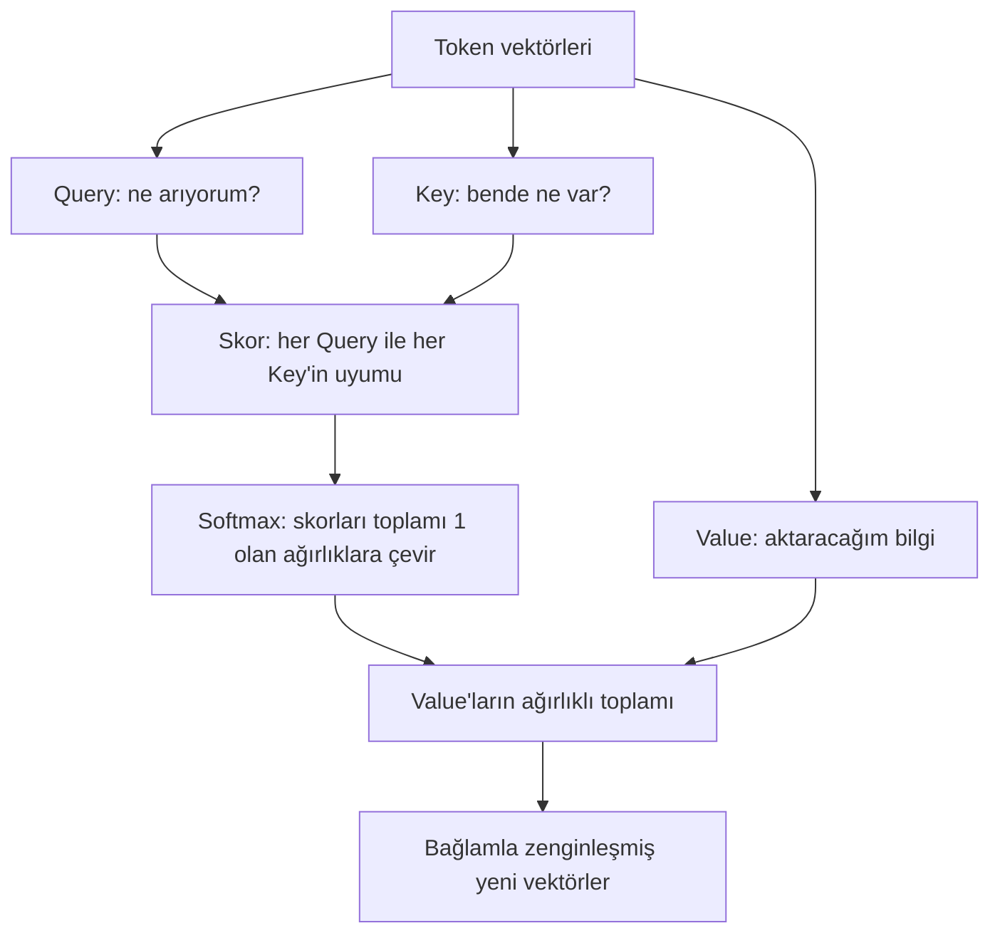

# 2.3 Dikkat Mekanizması (Self-Attention)

## 1. Tek Cümlelik Özet (TL;DR)

**Self-attention, bir metindeki her token'ın diğer tüm token'lara "bana ne kadar lazımsın?" diye bakıp kendi anlamını onlardan topladığı bilgiyle güncellemesidir.**

## 2. Günlük Hayattan Analoji: Kütüphanede Arama

"Yüz" kelimesi tek başına belirsizdir: surat mı, sayı mı, yüzmek mi? "Denizde yüz" ile "yüz lira" arasındaki farkı çevredeki kelimeler belirler. Attention, her kelimenin anlamını netleştirmek için çevresine danışmasıdır.

Bunu kütüphane aramasına benzetebiliriz:

- **Sorgu (Query):** Elinizdeki soru. "Yüz" kelimesi sorar: "Benim anlamımı belirleyecek ipucu kimde?"
- **Anahtar (Key):** Her kitabın sırtındaki etiket. "Denizde" kelimesinin etiketi "su, mekân" der.
- **Değer (Value):** Kitabın içeriği. Etiket sorguyla eşleşirse içerikten o oranda bilgi alınır.

Fark şu: kütüphanede tek bir kitabı seçersiniz, attention ise **bütün kitaplardan eşleşme oranında** biraz alır.

## 3. Görselleştirme



"Denizde yüz" cümlesinde "yüz" token'ının dikkat ağırlıkları temsili olarak şöyle görünebilir:

```text
            Denizde    yüz
   yüz  ->   0.78      0.22      ("yüz", anlamını çoğunlukla "Denizde"den alıyor)
```

## 4. Nasıl Çalışır?

**Önce sorun.** Transformer'dan önceki RNN'ler metni kelime kelime, sırayla okurdu. İki sıkıntısı vardı: uzun metinlerde baştaki bilgi sona gelene kadar soluyordu, ve sıralı çalıştığı için GPU'da paralelleştirilemiyordu. Attention her token'ın her token'a **doğrudan** bakmasına izin verir; mesafe sorun olmaktan çıkar ve hepsi aynı anda hesaplanır.

**Adımlar:**

1. Her token vektöründen üç ayrı vektör türetilir: Query, Key, Value. Bunları üreten matrisler eğitimle öğrenilir.
2. Her Query, bütün Key'lerle çarpılır. Sonuç bir uyum skorudur.
3. Skorlar softmax'ten geçer; her token için toplamı 1 olan dikkat ağırlıkları elde edilir.
4. Value'lar bu ağırlıklarla toplanır. Çıkan vektör, token'ın bağlamı sindirmiş yeni halidir.

```python
import numpy as np

def softmax(x):
    e = np.exp(x - x.max(axis=-1, keepdims=True))
    return e / e.sum(axis=-1, keepdims=True)

rng = np.random.default_rng(0)
n, d = 4, 8                                  # 4 token, 8 boyutlu vektörler
X = rng.normal(size=(n, d))                  # token vektörleri
Wq, Wk, Wv = (rng.normal(size=(d, d)) for _ in range(3))   # öğrenilen matrisler

Q, K, V = X @ Wq, X @ Wk, X @ Wv
skor = Q @ K.T / np.sqrt(d)                  # her token'ın her token'la uyumu (4x4)
agirlik = softmax(skor)                      # her satırın toplamı 1
cikti = agirlik @ V                          # bağlamla güncellenmiş vektörler

print(agirlik.round(2))
print("çıktı boyutu:", cikti.shape)
```

**Multi-Head Attention.** Tek bir attention tek bir tür ilişkiye odaklanır. Model bu işlemi paralel olarak birçok "kafa" ile yapar: biri özne-yüklem ilişkisine, biri zamirlerin kime gittiğine, biri yakın komşulara bakabilir. Sonuçlar birleştirilir.

**Nedensel maske (Causal Mask).** Metin üreten modellerde bir token yalnızca kendinden öncekilere bakabilir; geleceğe ait skorlar eksi sonsuz yapılarak kapatılır. Aksi halde model eğitimde cevaba bakıp kopya çekerdi.

## 5. Ne Zaman Kullanılır / Ne Zaman Kullanılmaz?

| Özellik | Self-attention | RNN / LSTM | CNN |
|---|---|---|---|
| Uzak bağlantıları yakalama | Çok iyi (doğrudan erişim) | Zayıf (bilgi solar) | Sınırlı (pencere kadar) |
| Paralel eğitim | Evet | Hayır | Evet |
| Dizi uzunluğuyla maliyet | Karesel: 2 kat uzun = 4 kat işlem | Doğrusal | Doğrusal |
| Veri ihtiyacı | Yüksek | Orta | Orta |

Pratik sonuç: dil, kod ve çok kipli modellerde attention fiilen standarttır. Bedeli **karesel maliyettir**: bağlam uzadıkça işlem ve bellek hızla artar. Çok uzun diziler ya da çok kısıtlı donanım söz konusuysa bu maliyet tasarım kararlarını belirler.

## 6. Sık Yapılan Hatalar & İpuçları

> [!WARNING]
> **Dikkat ağırlıklarını "modelin açıklaması" sanmak.** Bir token'a yüksek ağırlık verilmesi, kararın o token yüzünden alındığını kanıtlamaz. Ağırlıklar ipucu verir ama güvenilir bir açıklama yöntemi değildir.

> [!WARNING]
> **Uzun bağlamı bedava sanmak.** Bağlam penceresi büyük diye doldurmak hem maliyeti artırır hem de ilgili bilginin kalabalıkta gözden kaçma ihtimalini yükseltir.

> [!NOTE]
> **Attention sırayı bilmez.** Konum bilgisi dışarıdan eklenmezse cümle bir kelime torbasıdır (bkz. 2.2).

> [!TIP]
> **Sezgiyi kalıcı kılmanın yolu:** Yukarıdaki 12 satırı bir kez kendiniz yazın ve `agirlik` matrisini inceleyin. Transformer'ın geri kalanı bu matrisin etrafına kurulmuş mühendisliktir.

**Akılda kalsın:** Query sorar, Key eşleşir, Value taşınır. Her token, anlamını bağlamından toplar.

---

[← 2.2 Embeddings (Vektör Uzayı)](02-embeddings.md) · [2.4 Transformer Mimarisi →](04-transformer-mimarisi.md)
