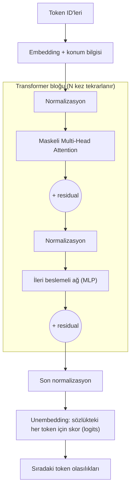

# 2.4 Transformer Mimarisi

## 1. Tek Cümlelik Özet (TL;DR)

**Transformer, "attention ile bilgi topla, ardından küçük bir sinir ağıyla işle" bloğunu onlarca kez üst üste koyan mimaridir; bugünkü LLM'lerin neredeyse tamamı bunun yalnızca decoder kısmını kullanır.**

## 2. Günlük Hayattan Analoji: Sırayla Okuyan Editörler

Bir taslak metin, uzun bir masada oturan onlarca editörün önünden sırayla geçiyor. Her editör iki şey yapar:

1. **Metnin diğer yerlerine bakar** ve ilgili yerleri ilişkilendirir (attention).
2. **Kendi bilgisini katar** ve kenara not düşer (ileri beslemeli ağ).

Önemli kural: hiçbir editör metni silip baştan yazmaz, yalnızca **üzerine not ekler**. Böylece ilk editörün gördüğü bilgi son editöre kadar kaybolmadan ulaşır. Bu, mimarideki *residual bağlantının* karşılığıdır. İlk editörler yazım ve dilbilgisiyle uğraşır, sonrakiler anlam ve mantıkla.

## 3. Görselleştirme

Decoder-only (GPT tarzı) bir modelin içi:



## 4. Nasıl Çalışır?

2017 tarihli "Attention Is All You Need" makalesi, çeviri için RNN'leri tamamen atıp yalnızca attention kullanan bir mimari önerdi. Yapı taşları şunlardır:

- **Attention:** Token'lar arasında bilgi taşır. "İletişim" adımıdır.
- **İleri beslemeli ağ (Feed-Forward / MLP):** Her token'ı ayrı ayrı işler. "Hesaplama" adımıdır; modelin parametrelerinin büyük kısmı buradadır.
- **Residual bağlantı:** Her alt katmanın çıktısı girdisine **eklenir**. Gradyanların derin ağda kaybolmadan akmasını sağlar (bkz. 1.4).
- **Normalizasyon (Layer Normalization):** Sayıların ölçeğini sabit tutarak eğitimi kararlı kılar.

Hepsi birkaç satıra sığar (pseudo-kod):

```python
def transformer_blogu(x):
    x = x + attention(norm1(x))      # iletişim: token'lar birbirinden bilgi alır
    x = x + mlp(norm2(x))            # hesaplama: her token kendi içinde işlenir
    return x

def dil_modeli(token_idleri):
    x = embedding_tablosu[token_idleri] + konum_bilgisi
    for blok in bloklar:             # onlarca kez
        x = blok(x)
    return unembedding(son_norm(x))  # her konum için sözlük boyutunda skor
```

Orijinal mimarinin iki yarısı vardı. Zamanla üç aile ortaya çıktı:

| Aile | Nasıl bakar? | Ne üretir? | Örnek | Tipik kullanım |
|---|---|---|---|---|
| **Encoder-only** | Her token sağına da soluna da bakar | Metnin temsili (vektör) | BERT ailesi | Sınıflandırma, embedding, arama |
| **Decoder-only** | Her token yalnızca soluna bakar | Sıradaki token | GPT ailesi ve güncel LLM'lerin çoğu | Metin üretimi, sohbet, kod |
| **Encoder-Decoder** | Encoder girdiyi okur, decoder çıktıyı yazar | Girdiye bağlı yeni dizi | T5, orijinal Transformer | Çeviri, özetleme |

Decoder-only ailenin kazanmasının nedeni basitliğidir: tek bir hedef (sıradaki token) her görevi kapsar ve mimari ölçeklemeye çok uygundur.

## 5. Ne Zaman Kullanılır / Ne Zaman Kullanılmaz?

| Göreviniz | Uygun aile | Neden |
|---|---|---|
| Serbest metin üretimi, sohbet, agent | Decoder-only LLM | Üretim için tasarlandı |
| Yüksek hacimli sınıflandırma (spam, duygu, niyet) | Küçük encoder modeli | Çok daha ucuz ve hızlı; çoğu zaman yeterli doğrulukta |
| Anlamsal arama için embedding | Embedding modeli | Çift yönlü bakış temsil kalitesini artırır |
| Etiketli veri az, görev karmaşık | Decoder-only LLM + prompt | Eğitim gerektirmez |
| Tablo verisi | ❌ Transformer şart değil | Gradient boosting hâlâ güçlü bir taban çizgisi |

## 6. Sık Yapılan Hatalar & İpuçları

> [!WARNING]
> **Her işe en büyük LLM'i koşmak.** Günde milyonlarca kısa metni sınıflandırmak için sohbet modeli kullanmak, ekmek almaya TIR ile gitmektir. Küçük bir encoder ya da fine-tune edilmiş küçük bir model aynı işi maliyetin çok küçük bir kısmına yapabilir.

> [!NOTE]
> **"Katman sayısı arttıkça daha akıllı" tek başına doğru değildir.** Derinlik, genişlik, veri ve eğitim süresi birlikte ölçeklenmelidir (bkz. 3.3).

> [!TIP]
> **Mimariyi içselleştirmenin en iyi yolu küçük bir GPT'yi sıfırdan yazmaktır.** Birkaç yüz satır tutar ve bu bölümdeki her kavramı çalışan koda bağlar.

> [!TIP]
> **Model kartında bakılacak üç şey:** parametre sayısı (bellek ihtiyacı), bağlam penceresi (ne kadar metin sığar) ve aile (üretir mi, temsil mi çıkarır).

**Akılda kalsın:** Blok = attention (iletişim) + MLP (hesaplama), ikisi de residual ile. Model = bu bloğun onlarca tekrarı.

---

[← 2.3 Dikkat Mekanizması (Self-Attention)](03-self-attention.md) · [2.5 Metin Üretimi (Decoding) →](05-metin-uretimi.md)
