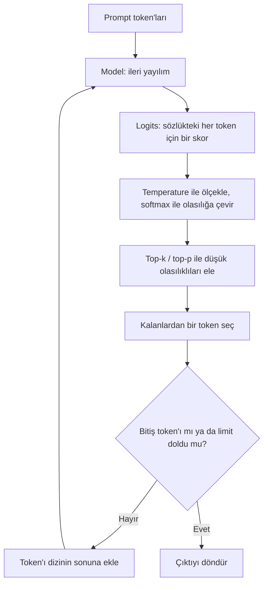

# 2.5 Metin Üretimi (Decoding)

## 1. Tek Cümlelik Özet (TL;DR)

**LLM metni bir seferde yazmaz; her adımda sözlükteki bütün token'lar için bir olasılık hesaplar, birini seçer, metnin sonuna ekler ve aynı işlemi baştan yapar.**

## 2. Günlük Hayattan Analoji: Klavyedeki Kelime Önerisi

Telefonunuzun klavyesi yazdıklarınıza bakıp üç kelime önerir. Sürekli ortadaki öneriye basarsanız dilbilgisi düzgün ama sıkıcı, kendini tekrar eden bir cümle çıkar. Ara sıra diğer önerilere basarsanız metin canlanır; rastgele basarsanız saçmalar.

LLM bu klavyenin çok daha iyi bir tahminciyle çalışan halidir. **Temperature**, "ne sıklıkla ortadaki öneri dışına çıkayım?" düğmesidir.

## 3. Görselleştirme



## 4. Nasıl Çalışır?

Model her adımda **logits** denen ham skorlar üretir. Bunlardan tek bir token seçme işine *decoding* denir ve davranışı belirleyen birkaç düğme vardır:

- **Greedy:** Her zaman en yüksek olasılıklıyı seç. Tutarlı ama tekdüze.
- **Sampling:** Olasılıklara göre zar at. Çeşitli ama riskli.
- **Temperature:** Zar atmadan önce dağılımı keskinleştirir (düşük değer) ya da düzleştirir (yüksek değer). 0'a yaklaştıkça greedy'ye yaklaşır.
- **Top-k:** Yalnızca en olası k token arasından seç.
- **Top-p (Nucleus):** Olasılıkları toplamı p'ye ulaşan en küçük token kümesinden seç. Model eminken küme küçülür, kararsızken büyür.

```python
import numpy as np

def token_sec(logits, temperature=1.0, top_p=1.0, rng=np.random.default_rng(0)):
    if temperature == 0:
        return int(np.argmax(logits))                 # greedy
    p = np.exp((logits - logits.max()) / temperature)
    p /= p.sum()                                      # softmax
    sira = np.argsort(p)[::-1]                        # olasıdan olasılıksıza
    kes = np.searchsorted(np.cumsum(p[sira]), top_p) + 1
    adaylar = sira[:kes]                              # top-p kümesi
    return int(rng.choice(adaylar, p=p[adaylar] / p[adaylar].sum()))

sozluk = ["çay", "kahve", "su", "ayran", "beton"]
logits = np.array([3.0, 2.5, 1.5, 1.0, -4.0])        # "Kahvaltıda ... içtim"
for t in (0, 0.7, 1.5):
    print(t, [sozluk[token_sec(logits, t, top_p=0.95)] for _ in range(8)])
```

**KV cache.** Her yeni token için bütün diziyi baştan hesaplamak israf olurdu. Model önceki token'ların attention için gereken ara sonuçlarını (Key ve Value) saklar, her adımda yalnızca yeni token'ı hesaplar. Üretimin hızlı olmasını sağlayan temel optimizasyon budur (bkz. 7.4).

**Önemli sonuç:** Model cevabın tamamını planlayıp yazmaz. Her token ayrı bir ileri yayılımın sonucudur ve bir kez yazılan token geri alınamaz. Uzun cevaplar bu yüzden pahalı ve yavaştır.

## 5. Ne Zaman Kullanılır / Ne Zaman Kullanılmaz?

| Görev | Temperature | Gerekçe |
|---|---|---|
| Veri çıkarma, sınıflandırma, JSON üretimi | 0 ya da çok düşük | Tutarlılık ve tekrarlanabilirlik gerekir |
| Kod üretimi | Düşük | Sözdizimi hataya tahammül etmez |
| Soru-cevap, özet | Düşük-orta | Doğruluk önce gelir |
| Beyin fırtınası, yaratıcı yazı, isim önerisi | Orta-yüksek | Çeşitlilik istenir |
| Aynı soruya birden çok farklı taslak | Yüksek | Tekrarı kırmak için |

Bazı modeller ve modlar (özellikle reasoning modelleri) bu parametrelerin bir kısmını sabitler ya da yok sayar. Kullandığınız modelin dokümantasyonuna bakın.

## 6. Sık Yapılan Hatalar & İpuçları

> [!WARNING]
> **Temperature 0'ı "deterministik" sanmak.** Çoğu zaman aynı çıktıyı verir ama garanti değildir; donanım, toplu işleme ve model güncellemeleri küçük farklar yaratabilir. Testlerinizi birebir metin eşleşmesine dayandırmayın.

> [!WARNING]
> **Kesilen cevabı fark etmemek.** Çıktı, azami token limitine takılırsa cümlenin ortasında biter. API'nin döndürdüğü bitiş nedenini (stop reason) kontrol edin; yarım bir JSON'u ayrıştırmaya çalışmak klasik bir prodüksiyon hatasıdır.

> [!TIP]
> **Temperature ve top-p'yi aynı anda oynamayın.** İkisi de aynı şeyi kontrol eder. Birini sabit tutup diğerini ayarlamak neyin neyi etkilediğini anlamayı kolaylaştırır.

> [!TIP]
> **Yapılandırılmış çıktı gerekiyorsa** temperature'a güvenmek yerine sağlayıcınızın structured output / JSON şeması özelliğini kullanın. Bu özellik, şemaya uymayan token'ları seçim aşamasında eler.

**Akılda kalsın:** Model olasılık üretir, decoding seçim yapar. Temperature yaratıcılığın değil, rastgeleliğin düğmesidir.

---

[← 2.4 Transformer Mimarisi](04-transformer-mimarisi.md) · [3.1 Ön Eğitim (Pre-training) →](../03-llm-gelistirme/01-pre-training.md)
