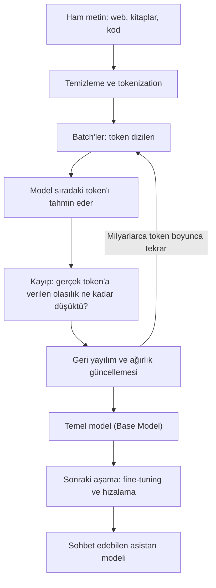

# 3.1 Ön Eğitim (Pre-training)

## 1. Tek Cümlelik Özet (TL;DR)

**Ön eğitim, modele devasa miktarda metin üzerinde "sıradaki token'ı tahmin et" oyununu sayısız kez oynatarak dili, bilgiyi ve akıl yürütme kalıplarını parametrelerine sıkıştırma aşamasıdır.**

## 2. Günlük Hayattan Analoji: Her Şeyi Okumuş Yeni Mezun

Yıllarca kütüphaneden çıkmamış birini düşünün: romanlar, ansiklopediler, forumlar, kod depoları... Kimse ona "şunu öğren" demedi; yalnızca okudu ve her cümlenin devamını tahmin etmeye çalıştı. Sonunda dilbilgisini, genel kültürü, hatta bir miktar mantık yürütmeyi kendiliğinden edindi.

Ama bu kişi henüz bir **çalışan** değildir. Soru sorduğunuzda cevap vermek yerine sorunuzu devam ettirebilir, çünkü öğrendiği tek şey metni sürdürmektir. Onu işe yarar bir asistana çevirmek sonraki aşamaların işidir (Bölüm 4).

## 3. Görselleştirme



## 4. Nasıl Çalışır?

**Hedef son derece basittir.** Bir metin dizisi alınır; girdi dizinin kendisi, hedef ise dizinin bir token sağa kaydırılmış halidir. Model her konumda bir sonraki token'ı tahmin eder ve doğru token'a düşük olasılık verdiği ölçüde cezalandırılır (*cross-entropy* kaybı). Etiketi veri kendisi sağladığı için bu kendi kendine gözetimli öğrenmedir (bkz. 1.2).

```python
for batch in veri_yukleyici:                      # batch boyutu: [B, T+1] token ID
    girdi, hedef = batch[:, :-1], batch[:, 1:]    # hedef = girdinin bir kaydırılmışı
    logits = model(girdi)                         # [B, T, sozluk_boyutu]
    kayip = F.cross_entropy(logits.reshape(-1, sozluk_boyutu), hedef.reshape(-1))
    kayip.backward()                              # gradyanlar
    optimizer.step()                              # ağırlıkları güncelle
    optimizer.zero_grad()
```

Bu altı satır, bir LLM'in ön eğitiminin özüdür. Geri kalan her şey ölçek mühendisliğidir: binlerce GPU, haftalar süren eğitim, dağıtık veri hatları.

**Basit hedef neden bu kadar güçlü?** "Türkiye'nin başkenti" ifadesinin devamını iyi tahmin etmek için coğrafya bilmek gerekir. Bir ispatın sonraki satırını tahmin etmek için mantığı, bir fonksiyonun devamını tahmin etmek için programlamayı öğrenmek gerekir. Tahmin hatası düşürülmeye çalışılırken model, metnin arkasındaki dünyaya dair işe yarar temsiller kurmak zorunda kalır.

**Temel model ne bilir, ne bilmez?**

| Bilir | Bilmez / yapamaz |
|---|---|
| Dilbilgisi, üslup, birçok dil | Eğitim verisinin kesim tarihinden (knowledge cutoff) sonrasını |
| Eğitim verisinde sık geçen genel bilgi | Sizin şirketinizin özel verisini |
| Kod, matematik, akıl yürütme kalıpları | Talimat izlemeyi (henüz); yalnızca metni sürdürür |
| | Neyi bilmediğini güvenilir biçimde |

## 5. Ne Zaman Kullanılır / Ne Zaman Kullanılmaz?

Asıl soru şudur: **Sıfırdan ön eğitim yapmalı mıyım?** Cevap neredeyse her zaman hayırdır.

| Durum | Karar |
|---|---|
| Ürün geliştiriyorsunuz, genel dil yeteneği lazım | ❌ Hazır modeli kullanın (API ya da açık ağırlıklı model) |
| Alanınıza özgü üslup ya da format gerekiyor | ❌ Fine-tuning yeterli (Bölüm 4) |
| Modelin şirket bilgisini bilmesi gerekiyor | ❌ RAG (Bölüm 5) |
| Hiçbir modelin görmediği bir veri türü: protein dizileri, sensör verisi, özel bir alfabe | ✅ Ön eğitim anlamlı olabilir |
| Araştırma laboratuvarısınız ya da temel model üretmek işinizin kendisi | ✅ |
| Öğrenmek için küçük bir model eğitmek | ✅ Mutlaka deneyin; tek GPU'da birkaç saatte yapılabilir |

## 6. Sık Yapılan Hatalar & İpuçları

> [!WARNING]
> **Temel modeli sohbet modeli gibi kullanmak.** Temel model talimat izlemez, metni devam ettirir. Açık ağırlıklı modellerde "base" ile "instruct/chat" sürümlerini karıştırmak sık yapılan bir hatadır.

> [!WARNING]
> **Bilgi kesim tarihini unutmak.** Model, eğitim verisinin bittiği günden sonrasını bilmez ve çoğu zaman bugünün tarihini de bilmez. Güncel bilgi gerekiyorsa bağlama eklenmelidir.

> [!NOTE]
> **Kaybın düşmesi yeteneğin arttığının kaba bir göstergesidir, kanıtı değildir.** Asıl ölçüm görev bazlı değerlendirmelerle yapılır (bkz. 7.1).

> [!TIP]
> **Bir ara yol: alan uyarlamalı ön eğitim.** Hazır bir modeli kendi alanınızın etiketsiz metinleriyle aynı hedefle bir süre daha eğitmek, sıfırdan eğitimin maliyetinin çok küçük bir kısmıyla alan diline uyum sağlar.

**Akılda kalsın:** Ön eğitim genel yeteneği inşa eder, pahalıdır ve bir kez yapılır. Çoğu ekibin işi bu aşamadan sonra başlar.

---

[← 2.5 Metin Üretimi (Decoding)](../02-transformer/05-metin-uretimi.md) · [3.2 Veri Hazırlığı →](02-veri-hazirligi.md)
