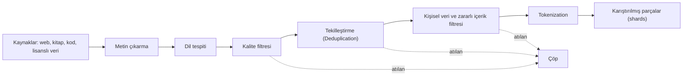

# 3.2 Veri Hazırlığı

## 1. Tek Cümlelik Özet (TL;DR)

**Bir modelin tavanını mimarisinden çok verisi belirler; veri hazırlığı, ham metin yığınını temiz, tekilleştirilmiş, filtrelenmiş ve kaynağı bilinen bir eğitim setine çevirme işidir.**

## 2. Günlük Hayattan Analoji: Restoran Mutfağı

İyi bir restoranın sırrı çoğu zaman tarif değil malzemedir. Halden gelen kasalar doğrudan tencereye boşaltılmaz: çürükler ayıklanır, sebzeler yıkanır, aynı üründen fazlası geri gönderilir, tedarikçisi belli olmayan mal alınmaz. Bu hazırlık görünmez ve sıkıcıdır, ama tabağın kalitesini o belirler. En iyi aşçı bile bozuk domatesten iyi sos çıkaramaz.

## 3. Görselleştirme



Her aşamada verinin önemli bir kısmı atılır. Ham toplananın küçük bir bölümünün eğitime girmesi olağandır.

## 4. Nasıl Çalışır?

1. **Toplama.** Web taramaları, kitaplar, kod depoları, lisanslanmış arşivler. Kaynak çeşitliliği modelin genelleme gücünü belirler.
2. **Çıkarma.** HTML'den menüler, reklamlar ve çerez uyarıları ayıklanır; PDF'lerden metin kurtarılır. Kötü çıkarma, veriye kalıcı gürültü olarak girer.
3. **Kalite filtresi.** Çok kısa, tekrar dolu, anlamsız karakter yığını ya da otomatik üretilmiş spam sayfalar elenir. Basit sezgisel kurallardan küçük sınıflandırıcı modellere kadar yöntemler kullanılır.
4. **Tekilleştirme.** Aynı metnin binlerce kopyası (lisans metinleri, kopyalanmış haberler) modelin o metni ezberlemesine ve kapasitesini boşa harcamasına yol açar. Birebir kopyalar özet (hash) ile, yakın kopyalar MinHash gibi yöntemlerle bulunur.
5. **Güvenlik ve gizlilik.** Kişisel veriler ve istenmeyen içerikler temizlenir.
6. **Karıştırma.** Model aynı kaynaktan ardışık binlerce örnek görmesin diye veri karıştırılır.

En yalın haliyle kalite filtresi ve tekilleştirme:

```python
import hashlib

def temiz_mi(metin):
    kelimeler = metin.split()
    if len(kelimeler) < 5:                               # çok kısa
        return False
    return len(set(kelimeler)) / len(kelimeler) > 0.3    # aşırı tekrar yok

def tekillestir(dokumanlar):
    gorulen = set()
    for d in dokumanlar:
        ozet = hashlib.md5(" ".join(d.lower().split()).encode()).hexdigest()
        if ozet not in gorulen and temiz_mi(d):
            gorulen.add(ozet)
            yield d

ham = ["Bugün hava çok güzel ve güneşli.", "bugün  hava çok güzel ve güneşli.",
       "tıkla tıkla tıkla tıkla tıkla tıkla", "Kısa metin"]
print(list(tekillestir(ham)))
```

Aynı ilkeler fine-tuning veri setleri için de geçerlidir; yalnızca ölçek küçülür ve her örneğe tek tek bakmak mümkün hale gelir.

## 5. Ne Zaman Kullanılır / Ne Zaman Kullanılmaz?

| Karar | Ne zaman bu yönde? |
|---|---|
| **Kaliteye yatırım** (az ama temiz veri) | Fine-tuning; dar ve iyi tanımlı görevler; modelin üslubu önemli |
| **Miktara yatırım** (çok ve çeşitli veri) | Ön eğitim; genelleme ve kapsam önemli |
| **Sentetik veri** (başka bir modelle üretilmiş) | Gerçek veri az ya da gizli; nadir durumları çoğaltmak; küçük modele büyük modelin davranışını öğretmek |
| **Sentetik veriden kaçın** | Değerlendirme (eval) setleri; gerçek kullanıcı dağılımını bilmeniz gereken durumlar |
| **İnsan etiketlemesi** | "Doğru" tanımının uzmanlık gerektirdiği yerler; eval setleri |

## 6. Sık Yapılan Hatalar & İpuçları

> [!WARNING]
> **Değerlendirme verisinin eğitim setine sızması (Contamination).** Test sorularınız eğitim verisinde geçiyorsa ölçtüğünüz şey yetenek değil ezberdir. Eval setlerini eğitim verisine karşı tekilleştirin.

> [!WARNING]
> **Aşırı filtreleme.** "Kaliteli" tanımını çok dar tutarsanız konuşma dilini, lehçeleri, azınlık konularını ve sıra dışı ama doğru metinleri atarsınız. Model steril ama dar bir dünyada eğitilir.

> [!CAUTION]
> **Lisans ve kişisel veri.** Verinin nereden geldiğini ve hangi koşullarla kullanılabildiğini kayıt altına alın. Sonradan "bu veri nereden gelmişti?" sorusuna cevap verememek hem hukuki hem teknik bir borçtur.

> [!TIP]
> **Veriye gözünüzle bakın.** Her filtre aşamasından sonra rastgele 100 örnek okuyun: 50 tane geçen, 50 tane atılan. İstatistiklerin göstermediği sorunların çoğu ilk beş dakikada ortaya çıkar.

**Akılda kalsın:** Model, verisinin sıkıştırılmış halidir. Çöp verirseniz, çöpü akıcı bir dille geri alırsınız.

---

[← 3.1 Ön Eğitim (Pre-training)](01-pre-training.md) · [3.3 Ölçekleme Yasaları (Scaling Laws) →](03-scaling-laws.md)
