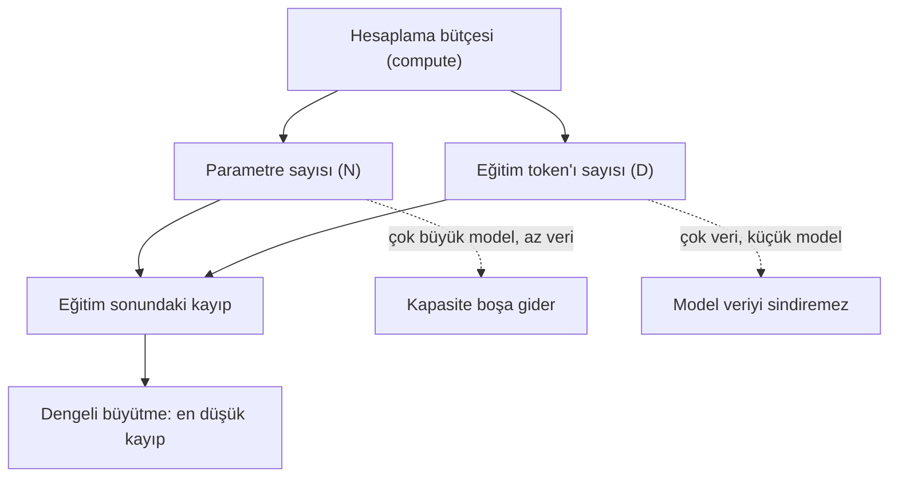

# 3.3 Ölçekleme Yasaları (Scaling Laws)

## 1. Tek Cümlelik Özet (TL;DR)

**Ölçekleme yasaları, model boyutunu, veriyi ve hesaplama gücünü büyüttükçe kaybın şaşırtıcı derecede öngörülebilir bir eğriyle düştüğünü gösteren deneysel gözlemlerdir.**

## 2. Günlük Hayattan Analoji: Fabrika ve Hammadde

Bir fabrika kuruyorsunuz. Bütçenizi iki şeye bölebilirsiniz: **makineler** (model parametreleri) ve **hammadde** (veri). Dev makineler alıp az hammadde getirirseniz makineler boş döner. Dağlar kadar hammaddeyi küçücük bir atölyeye yığarsanız işleyemezsiniz. Sabit bir bütçe için en iyi sonuç, ikisini **dengeli** büyütmekten gelir.

İkinci gözlem: getiri azalır ama düzenlidir. Üretimi bir kademe iyileştirmek için bütçeyi her seferinde kabaca aynı oranda **katlamanız** gerekir; iki katı para iki katı kalite getirmez.

## 3. Görselleştirme



Logaritmik eksenlerde ilişki bir doğruya yakındır:

```text
kayıp (log)
  |  *
  |     *
  |        *
  |           *
  |              *              <- her 10 kat hesaplama, benzer miktarda iyileşme
  |                 *
  +------------------------------ hesaplama gücü (log)
```

## 4. Nasıl Çalışır?

**1. Güç yasası gözlemi.** 2020'de yapılan çalışmalar, dil modellerinde kaybın parametre sayısı, veri miktarı ve hesaplama gücüyle bir güç yasası (power law) izleyerek düştüğünü gösterdi. Pratik anlamı büyüktür: küçük deneylerden büyük modelin performansını **önceden kestirebilirsiniz**. Milyonlarca dolarlık bir eğitime körlemesine girmezsiniz.

**2. Denge sorusu (Chinchilla).** 2022'de DeepMind şu soruyu sordu: sabit bir hesaplama bütçesiyle, büyük modeli az veriyle mi yoksa küçük modeli çok veriyle mi eğitmeli? Bulgu: o dönemin modelleri boyutlarına göre **az veriyle** eğitilmişti. En verimli nokta, parametre ile veriyi birlikte büyütmek ve kabaca parametre başına 20 token civarında veri kullanmaktı.

**3. Hesaplama maliyeti tahmini.** Eğitim için gereken işlem miktarı yaklaşık olarak `6 × parametre × token` kayan nokta işlemidir (FLOP). Bu formülle zarf arkası hesap yapılabilir:

```python
def egitim_tahmini(parametre, token, gpu_flop_saniye, saat_ucreti):
    flop = 6 * parametre * token                 # toplam işlem
    gpu_saat = flop / gpu_flop_saniye / 3600
    return gpu_saat, gpu_saat * saat_ucreti

# Varsayımlar örnek amaçlıdır: GPU'nun fiilî hızı ve fiyatı donanıma göre değişir
N = 1e9                    # 1 milyar parametre
D = 20 * N                 # Chinchilla sezgisi: parametre başına ~20 token
saat, maliyet = egitim_tahmini(N, D, gpu_flop_saniye=1e14, saat_ucreti=2.0)
print(f"{saat:,.0f} GPU-saat, yaklaşık {maliyet:,.0f} $")
```

Dikkat: parametreyi 10 katına çıkarıp veriyi de dengeli büyütürseniz maliyet 100 katına çıkar.

**4. Yasaların sınırı.** Bu yasalar **kaybı** öngörür, ürün kalitesini değil. Ayrıca yalnızca eğitim maliyetini optimize eder. Bir model milyonlarca kez çağrılacaksa, daha küçük bir modeli "gereğinden uzun" eğitmek toplamda daha ucuzdur; güncel uygulama sıklıkla bu yöndedir. Veri kalitesi, mimari iyileştirmeler ve eğitim sonrası teknikler de eğriyi kaydırır.

**Kendiliğinden beliren yetenekler (Emergent Abilities) tartışması.** Bazı yeteneklerin belirli bir ölçekte aniden ortaya çıktığı gözlemlenmiştir. Karşı görüş, bu ani sıçramaların kısmen ölçüm yönteminden kaynaklandığını, daha hassas metriklerle bakıldığında gelişimin kademeli olduğunu savunur. Tartışma kapanmış değildir.

## 5. Ne Zaman Kullanılır / Ne Zaman Kullanılmaz?

| Durum | Ölçekleme yasaları işe yarar mı? |
|---|---|
| Sıfırdan model eğitimi planlıyorsunuz | ✅ Bütçeyi parametre ve veri arasında bölmek için |
| "Daha büyük model ne kadar iyileştirir?" tahmini | ✅ Küçük ölçekli deneylerden ekstrapolasyon |
| Hazır modeller arasında seçim | ⚠️ Dolaylı: büyük model genelde daha yetenekli ama daha pahalı ve yavaş; kendi eval'inizle karar verin |
| Fine-tuning veri miktarı kararı | ❌ Bu yasalar ön eğitim içindir; fine-tuning'de kalite ve çeşitlilik baskındır |
| Ürün kalitesi tahmini | ❌ Kayıp ile kullanıcı memnuniyeti aynı şey değildir |

## 6. Sık Yapılan Hatalar & İpuçları

> [!WARNING]
> **"Parametre başına 20 token"ı evrensel kural sanmak.** Bu oran belirli bir mimari, veri türü ve yalnızca eğitim maliyeti için bulunmuş bir tahmindir. Çıkarım maliyeti hesaba girdiğinde en iyi nokta değişir.

> [!WARNING]
> **Eğriyi sonsuza uzatmak.** Deneysel bir eğilimin gözlenen aralığın çok ötesinde aynen süreceğinin garantisi yoktur. Veri kıtlığı, enerji ve maliyet gibi pratik sınırlar da devreye girer.

> [!NOTE]
> **"Acı ders" (The Bitter Lesson).** Yapay zekâ tarihinde, insan bilgisini elle kodlayan zekice yöntemler uzun vadede hep genel yöntemler + daha fazla hesaplama karşısında kaybetti. Ölçekleme yasaları bu gözlemin sayısal ifadesidir.

> [!TIP]
> **Model seçerken soruyu tersinden sorun:** "En büyük model hangisi?" yerine "Eval setimde hedefi geçen en küçük model hangisi?" Maliyet ve gecikme farkı çoğu zaman büyüktür.

**Akılda kalsın:** Daha fazla parametre, veri ve hesaplama öngörülebilir biçimde daha düşük kayıp getirir; ama her adımın faturası katlanarak büyür.

---

[← 3.2 Veri Hazırlığı](02-veri-hazirligi.md) · [3.4 Altyapı ve Maliyet Dinamikleri →](04-maliyet-dinamikleri.md)
