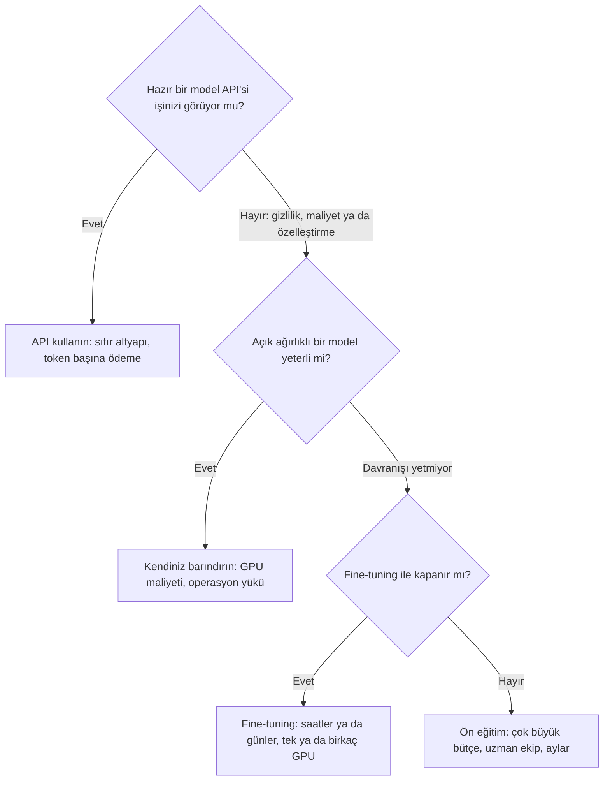

# 3.4 Altyapı ve Maliyet Dinamikleri

## 1. Tek Cümlelik Özet (TL;DR)

**Eğitim bir kerelik büyük yatırımdır, çıkarım ise her istekte ödenen faturadır; başarılı bir üründe toplam maliyetin büyük kısmını çoğu zaman çıkarım oluşturur.**

## 2. Günlük Hayattan Analoji: Fabrikayı Kurmak ve Çalıştırmak

Fabrikayı kurmak pahalıdır ama bir kez yapılır: bu **eğitimdir**. Sonra her ürün için hammadde ve elektrik ödersiniz: bu **çıkarımdır**. Günde on ürün satıyorsanız kurulum maliyeti baskındır. Günde on milyon ürün satıyorsanız kurulum unutulur, bütün dert birim maliyettir.

Çoğu ekip fabrika kurmaz, fason üretim yaptırır (API). Kendi fabrikanızı kurmanın anlamlı olması için ya hacminizin çok büyük ya da ürününüzün çok özel olması gerekir.

## 3. Görselleştirme



Yukarıdan aşağı indikçe ilk yatırım, risk ve gereken uzmanlık artar.

## 4. Nasıl Çalışır?

**1. Bellek her şeyin başıdır.** Bir modelin GPU'ya sığıp sığmayacağını ağırlıkların kapladığı yer belirler: `parametre sayısı × parametre başına bayt`.

```python
def bellek_gb(parametre_milyar, bayt):
    return parametre_milyar * bayt          # 1 milyar parametre x 1 bayt = 1 GB

P = 7   # 7 milyar parametreli bir model
print(f"Çıkarım, 16-bit      : {bellek_gb(P, 2):.0f} GB")
print(f"Çıkarım, 4-bit       : {bellek_gb(P, 0.5):.1f} GB")
# Tam eğitim (32-bit, AdamW): ağırlık 4 + gradyan 4 + optimizer durumu 8 bayt
print(f"Tam eğitim, en az    : {bellek_gb(P, 16):.0f} GB + aktivasyonlar")
```

Aynı model çıkarımda tek bir tüketici GPU'suna sığarken tam eğitimde birden çok veri merkezi GPU'su ister. Fine-tuning'de LoRA gibi yöntemlerin (4.3) bu kadar yaygın olmasının nedeni budur.

**2. Eğitimi sığdırma ve hızlandırma teknikleri.**

- **Karma hassasiyet (Mixed Precision):** Hesapların çoğunu 16-bit yapar; bellek yarıya iner, hız artar.
- **Gradyan biriktirme (Gradient Accumulation):** Küçük batch'lerin gradyanlarını toplayıp tek güncelleme yapar; büyük batch etkisini az bellekle taklit eder.
- **Dağıtık eğitim:** Veriyi ve/veya modeli birden çok GPU'ya böler. Verimi iletişim maliyeti sınırlar.
- **Kontrol noktaları (Checkpoints):** Uzun eğitimlerde donanım arızası olağandır; düzenli kayıt şarttır.

**3. Çıkarım maliyetinin anatomisi.**

- API'lerde girdi ve çıktı token'ları ayrı fiyatlanır; **çıktı token'ları genelde belirgin biçimde daha pahalıdır**, çünkü her biri ayrı bir ileri yayılımdır.
- Kendi barındırdığınız modelde maliyet GPU-saattir. Birim maliyeti belirleyen şey **kullanım oranıdır**: boş bekleyen GPU da para yakar.

**4. Görünmeyen kalemler.** Başarısız deneyler (çoğu deney başarısızdır), veri hazırlığı ve etiketleme, değerlendirme, mühendis zamanı ve operasyon. GPU faturası buzdağının görünen kısmıdır.

## 5. Ne Zaman Kullanılır / Ne Zaman Kullanılmaz?

| Seçenek | İlk yatırım | Birim maliyet | Kontrol | Ne zaman? |
|---|---|---|---|---|
| **Model API'si** | Yok | Orta-yüksek, kullandıkça | Düşük | Başlangıç; değişken ya da düşük hacim; en güçlü modeller gerektiğinde |
| **Açık model, kendi barındırma** | Orta | Yüksek hacimde düşük | Yüksek | Veri dışarı çıkamıyor; hacim yüksek ve düzenli; ekipte operasyon becerisi var |
| **Fine-tuning** | Orta | Küçük modelle düşük | Yüksek | Dar görev, küçük modelle büyük modelin kalitesi hedefleniyor |
| **Sıfırdan ön eğitim** | Çok yüksek | — | Tam | Temel model üretmek işin kendisi |

Kaba bir karar kuralı: önce API ile ürünün işe yaradığını kanıtlayın. Fatura gerçekten can yakmaya başladığında elinizde hem kullanım verisi hem de neyi optimize edeceğinizi gösteren bir eval seti olur.

## 6. Sık Yapılan Hatalar & İpuçları

> [!WARNING]
> **Kendi barındırmayı yalnızca GPU fiyatıyla hesaplamak.** Düşük kullanım oranı, nöbet tutan mühendisler, ölçekleme ve güncelleme yükü hesaba katıldığında API çoğu zaman sanıldığından ucuzdur.

> [!WARNING]
> **Çıktı uzunluğunu kontrol etmemek.** Maliyet ve gecikmenin en büyük kaldıracı çıktı token sayısıdır. Gereksiz uzun cevaplar hem pahalı hem yavaştır.

> [!TIP]
> **Maliyeti istek başına değil, başarılı görev başına ölçün.** Ucuz model işi üç denemede yapıyorsa pahalı modelden daha pahalıya gelebilir.

> [!TIP]
> **Bütçe alarmı ilk gün kurulur.** Sonsuz döngüye giren bir agent ya da yanlış yapılandırılmış bir toplu iş, bir gecede aylık bütçeyi tüketebilir.

**Akılda kalsın:** Eğitim maliyeti manşet olur, çıkarım maliyeti şirketi batırır ya da ayakta tutar.

---

[← 3.3 Ölçekleme Yasaları (Scaling Laws)](03-scaling-laws.md) · [4.1 Özelleştirme Haritası →](../04-hizalama-ve-fine-tuning/01-ozellestirme-haritasi.md)
