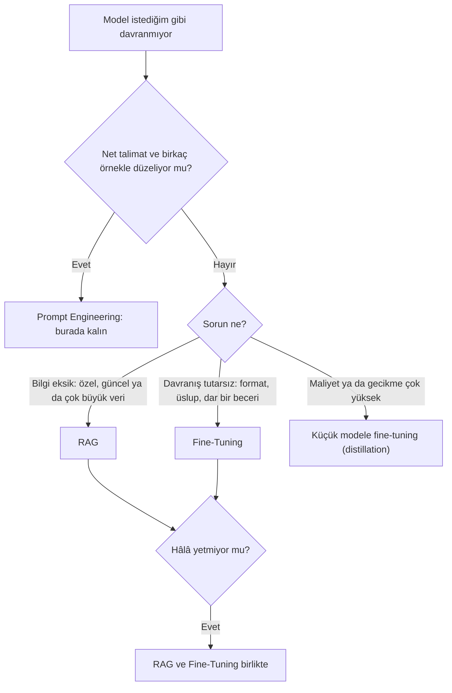

# 4.1 Özelleştirme Haritası

## 1. Tek Cümlelik Özet (TL;DR)

**Bir modelin davranışını değiştirmenin üç kademesi vardır: talimatı değiştir (prompt), bağlama bilgi ekle (RAG), ağırlıkları değiştir (fine-tuning); doğru sıra neredeyse her zaman ucuzdan pahalıya doğrudur.**

## 2. Günlük Hayattan Analoji: İşe Yeni Başlayan Uzman

Çok yetenekli birini işe aldınız. Ondan istediğiniz verimi almanın üç yolu var:

- **Net talimat vermek (Prompt Engineering):** "Müşteriye şu üslupla yaz, şu formatta raporla, işte iki örnek." Beş dakikanızı alır.
- **Eline dokümanları vermek (RAG):** Şirket prosedürlerini, ürün kataloğunu, güncel fiyat listesini önüne koyarsınız. Yetenek aynıdır, bilgi eklenmiştir.
- **Aylarca eğitime göndermek (Fine-Tuning):** Belirli bir işi refleks haline getirene kadar çalıştırırsınız. Pahalıdır, zaman alır ve şirket fiyat listesini değiştirdiğinde eğitimi tekrarlamak gerekir.

Kimse yeni çalışana talimat vermeyi denemeden onu aylarca kursa göndermez.

## 3. Görselleştirme

## 4. Nasıl Çalışır?

Üç yöntem **farklı şeyleri** değiştirir:

| | Neyi değiştirir? | Model ağırlıkları |
|---|---|---|
| **Prompt** | Modele o an ne söylendiğini | Değişmez |
| **RAG** | Modelin o an neyi gördüğünü | Değişmez |
| **Fine-Tuning** | Modelin kalıcı olarak nasıl davrandığını | Değişir |

En çok işe yarayan zihinsel model şudur: **RAG bilgi sorununu, fine-tuning davranış sorununu çözer.**

- Model yanlış cevap veriyor çünkü şirketinizin iade politikasını bilmiyor → bilgi sorunu → RAG.
- Model politikayı biliyor ama her seferinde farklı formatta, yanlış üslupla ya da gereksiz uzun yazıyor → davranış sorunu → önce prompt, yetmezse fine-tuning.

**Prompt engineering'in araç kutusu** çoğu ekibin sandığından geniştir: açık rol ve hedef tanımı, birkaç örnek (*few-shot*), çıktı şeması, adım adım düşünme talimatı, uzun talimatları bölümlere ayırma. Fine-tuning'e geçmeden önce bu kutunun gerçekten tükendiğinden emin olun.

**İkisi rakip değil.** Olgun sistemlerde sık görülen yapı: fine-tune edilmiş (ya da iyi prompt'lanmış) bir model, RAG ile getirilen bilgiyi tutarlı bir formatta işler.

## 5. Ne Zaman Kullanılır / Ne Zaman Kullanılmaz?

| Ölçüt | Prompt Engineering | RAG | Fine-Tuning |
|---|---|---|---|
| **Çözdüğü sorun** | Belirsiz talimat | Eksik ya da güncel olmayan bilgi | Tutarsız davranış, format, üslup |
| **Başlama süresi** | Dakikalar | Günler | Haftalar |
| **Gereken veri** | Birkaç örnek | Doküman koleksiyonu | Yüzlerce-binlerce kaliteli örnek |
| **Bilgi güncellemesi** | Prompt'u düzenle | Dokümanı güncelle; anında | Yeniden eğit |
| **İstek başına maliyet** | Düşük (uzun prompt'ta artar) | Orta (eklenen bağlam kadar) | Düşük (kısa prompt, küçük model) |
| **Kaynak gösterme** | Hayır | Evet | Hayır |
| **Bakım yükü** | Düşük | Orta (indeks, veri hattı) | Yüksek (veri, eğitim, sürümleme) |
| **Geri alma** | Anında | Kolay | Zor |

## 6. Sık Yapılan Hatalar & İpuçları

> [!WARNING]
> **Bilgiyi fine-tuning ile öğretmeye çalışmak.** Ürün kataloğunu modele ezberletmek pahalıdır, güvenilmezdir ve katalog değişince çöpe gider. Değişen bilgi bağlamda durmalıdır, ağırlıklarda değil.

> [!WARNING]
> **Eval seti olmadan fine-tuning'e girişmek.** Ölçemediğiniz şeyi iyileştirdiğinizi bilemezsiniz. Önce ölçüm (bkz. 7.1), sonra müdahale.

> [!TIP]
> **Önce en güçlü modelle ve iyi bir prompt'la tavanı görün.** En iyi model bile işi yapamıyorsa sorun büyük ihtimalle görev tanımında ya da verdiğiniz bilgidedir; fine-tuning bunu çözmez.

> [!TIP]
> **Hataları sınıflandırın.** 50 başarısız örneği okuyup her birine "bilgi eksikti" ya da "bilgi vardı ama yanlış kullandı" etiketi koyun. Dağılım size hangi yöntemi seçeceğinizi söyler.

**Akılda kalsın:** Önce prompt. Bilgi eksikse RAG. Davranış bozuksa fine-tuning. Bu sırayı atlamayın.

---

[← 3.4 Altyapı ve Maliyet Dinamikleri](../03-llm-gelistirme/04-maliyet-dinamikleri.md) · [4.2 SFT (Supervised Fine-Tuning) →](02-sft.md)
