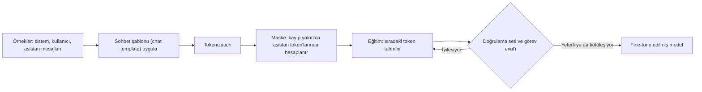

# 4.2 SFT (Supervised Fine-Tuning)

## 1. Tek Cümlelik Özet (TL;DR)

**SFT, ön eğitimli bir modele "şu girdiye şu çıktıyı ver" örnekleri göstererek aynı sıradaki-token eğitimini küçük ve özenle seçilmiş bir veri setiyle sürdürmektir.**

## 2. Günlük Hayattan Analoji: Çağrı Merkezi Oryantasyonu

Genel kültürü geniş yeni mezunu çağrı merkezine aldınız. Ona dil öğretmiyorsunuz; onu zaten biliyor. Yaptığınız şey, önüne yüzlerce **örnek konuşma** koymaktır: "Müşteri böyle dediğinde biz böyle cevap veririz." Birkaç gün sonra şirketin üslubunu, selamlama biçimini, hangi durumda neyi sorması gerektiğini kendiliğinden yapar hale gelir.

Örnek konuşmalar kötüyse çalışan da kötü alışkanlık edinir. SFT'de veri seti, istediğiniz davranışın **tanımıdır**.

## 3. Görselleştirme



## 4. Nasıl Çalışır?

**1. Hedef değişmez, veri değişir.** SFT'de kullanılan kayıp, ön eğitimdekiyle aynıdır (bkz. 3.1). Fark, verinin artık rastgele web metni değil, özenle hazırlanmış girdi-çıktı çiftleri olmasıdır. Temel modeli talimat izleyen bir asistana çeviren ilk adım da budur (*instruction tuning*).

**2. Veri formatı.** Örnekler genelde her satırı bir konuşma olan JSONL dosyalarında tutulur:

```python
ornek = {"messages": [
    {"role": "system",    "content": "Bir e-ticaret destek asistanısın. Kısa ve net yaz."},
    {"role": "user",      "content": "Siparişim nerede kaldı?"},
    {"role": "assistant", "content": "Hemen bakıyorum. Sipariş numaranızı paylaşır mısınız?"},
]}

# Model, rolleri ayıran özel token'larla eğitildi; aynı şablon kullanılmalı
metin = tokenizer.apply_chat_template(ornek["messages"], tokenize=False)
girdi = tokenizer(metin, return_tensors="pt")

# Kayıp yalnızca asistan cevabında hesaplanır; geri kalan konumlar -100 ile maskelenir
etiketler = asistan_disini_maskele(girdi["input_ids"], maske_degeri=-100)
kayip = model(**girdi, labels=etiketler).loss
```

**3. Sohbet şablonu (Chat Template).** Her modelin, mesaj rollerini ayırmak için kullandığı özel token'lar vardır. Eğitimde ve kullanımda aynı şablon uygulanmazsa model bozuk çıktı üretir. Tokenizer'ın kendi şablon fonksiyonunu kullanmak bu hatayı önler.

**4. Maskeleme.** Modelin kullanıcı mesajlarını tahmin etmeyi öğrenmesine gerek yoktur. Kayıp yalnızca asistanın cevabı üzerinden hesaplanır.

**5. Felaket unutma (Catastrophic Forgetting).** Dar bir veriyle fazla eğitilen model, o göreve uyum sağlarken genel yeteneklerini kaybedebilir. Düşük öğrenme oranı, az epoch ve çeşitli veri bu riski azaltır.

## 5. Ne Zaman Kullanılır / Ne Zaman Kullanılmaz?

| Durum | SFT | Not |
|---|---|---|
| Sabit bir çıktı formatı ya da kurum üslubu, prompt'la tutturulamıyor | ✅ | Klasik kullanım |
| Büyük modelin yaptığı dar bir işi küçük modele devretmek | ✅ | Büyük modelin çıktılarıyla eğitim (*distillation*); maliyet ve gecikme düşer |
| Uzun bir prompt'u ve onlarca örneği her istekte göndermek pahalı | ✅ | Talimatlar ağırlıklara gömülür |
| Alanın özel dili: tıbbi kayıt, hukuki metin, şirket içi jargon | ✅ | |
| Sık değişen bilgi öğretmek | ❌ | RAG kullanın |
| Elinizde yalnızca 20 örnek var | ❌ | Onları prompt'a örnek olarak koyun |
| Görev iyi bir prompt'la zaten çözülüyor | ❌ | Bakım yükü almaya değmez |

## 6. Sık Yapılan Hatalar & İpuçları

> [!WARNING]
> **Yanlış ya da eksik sohbet şablonu.** Fine-tuning sonrası "model saçmalıyor" şikâyetlerinin önde gelen nedenidir. Eğitimden önce şablonlanmış bir örneği yazdırıp gözünüzle kontrol edin.

> [!WARNING]
> **Tekdüze veri.** Tüm örnekler aynı kalıptaysa model kalıbı ezberler ve küçük bir sapmada dağılır. Girdilerin uzunluğu, üslubu ve zorluğu gerçek kullanımı yansıtmalıdır.

> [!WARNING]
> **Yalnızca eğitim kaybına bakmak.** Kayıp düşerken model ezberliyor olabilir. Ayrı tutulmuş bir sette, gerçek görev metriğiyle ölçün.

> [!TIP]
> **Nitelik nicelikten önce gelir.** Elle gözden geçirilmiş birkaç yüz örnek, otomatik toplanmış on binlerce gürültülü örnekten çoğu zaman daha iyi sonuç verir. İlk 100 örneği kendiniz yazın ya da tek tek okuyun.

> [!TIP]
> **Reddedilecek durumları da veri setine koyun.** Model yalnızca "her zaman cevap ver" örnekleri görürse, cevap vermemesi gereken yerde de cevap vermeyi öğrenir.

**Akılda kalsın:** SFT'de model, veri setinin aynasıdır. Veri setinize ne koyduysanız onu alırsınız, hatalarıyla birlikte.

---

[← 4.1 Özelleştirme Haritası](01-ozellestirme-haritasi.md) · [4.3 LoRA / QLoRA →](03-lora-qlora.md)
