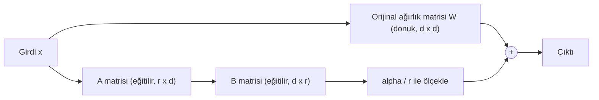

# 4.3 LoRA / QLoRA

## 1. Tek Cümlelik Özet (TL;DR)

**LoRA, modelin milyarlarca ağırlığını dondurup yanlarına çok küçük "düzeltme matrisleri" ekler ve yalnızca onları eğitir; QLoRA aynı işi, ana modeli 4-bit'e sıkıştırılmış halde tutarak yapar.**

## 2. Günlük Hayattan Analoji: Ders Kitabına Yapışkan Not

Bin sayfalık bir ders kitabını kendi dersinize uyarlamak istiyorsunuz. Kitabı baştan yazdırıp yeniden bastırmak (tam fine-tuning) pahalıdır. Onun yerine ilgili sayfalara **yapışkan notlar** eklersiniz: "burada şunu da söyle", "bu örneği şöyle değiştir."

Kitap aynı kalır. Notlar küçüktür, ucuzdur ve çıkarılabilir. Hukuk dersi için bir not seti, tıp dersi için başka bir not seti hazırlayıp aynı kitabın üzerinde değiştirebilirsiniz. QLoRA ise aynı notları, kitabın küçük puntolu cep baskısına yapıştırmaktır.

## 3. Görselleştirme



`r` (rank), `d`'den çok küçüktür. Darboğaz ne kadar darsa eğitilen parametre o kadar azdır.

## 4. Nasıl Çalışır?

**1. Temel gözlem.** Fine-tuning sırasında ağırlıklarda oluşan değişimin tamamı gerekli değildir; değişim çoğu zaman çok daha az sayıda "yön" ile iyi ifade edilebilir. LoRA (Low-Rank Adaptation) bunu kullanır: büyük bir `d × d` değişim matrisi öğrenmek yerine, çarpımları o matrisi yaklaşık olarak veren iki ince matris öğrenir: `B (d × r)` ve `A (r × d)`.

**2. Hesap.** Katmanın çıktısı `W·x + (alpha/r)·B·A·x` olur. `W` hiç değişmez.

```python
import numpy as np

d, r, alpha = 4096, 8, 16
rng = np.random.default_rng(0)

W = rng.normal(size=(d, d))             # ön eğitimli ağırlıklar: DONUK
A = rng.normal(size=(r, d)) * 0.01      # eğitilecek
B = np.zeros((d, r))                    # eğitilecek; sıfırla başlar

def katman(x):
    return W @ x + (alpha / r) * (B @ (A @ x))

x = rng.normal(size=d)
print("Başlangıçta çıktı aynı mı?", np.allclose(katman(x), W @ x))
print(f"Tam fine-tuning: {W.size:,} parametre")
print(f"LoRA           : {A.size + B.size:,} parametre (%{100 * (A.size + B.size) / W.size:.2f})")
```

`B` sıfırla başladığı için eğitimin ilk anında model, orijinal modelle birebir aynıdır; uyarlama sıfırdan yavaşça büyür.

**3. Ayarlar.**

- **Rank (`r`):** Adaptörün kapasitesi. 8-16 çoğu görev için iyi bir başlangıçtır.
- **Alpha:** Adaptörün etkisinin ölçeği. Yaygın pratik, rank'in bir ya da iki katını seçmektir.
- **Hedef modüller:** Adaptörün hangi katmanlara ekleneceği. Yalnızca attention matrislerine eklemek en hafif seçenektir; tüm doğrusal katmanlara eklemek genelde daha iyi sonuç verir.

**4. Birleştirme (Merge).** Eğitimden sonra `W + (alpha/r)·B·A` hesaplanıp tek bir matris olarak kaydedilebilir. Böylece çıkarımda ek gecikme olmaz. Birleştirmezseniz aynı ana model üzerinde adaptörleri değiştirerek birçok görevi sunabilirsiniz.

**5. QLoRA.** Ana model 4-bit'e nicemlenmiş (quantized) halde belleğe yüklenir ve dondurulur; LoRA adaptörleri daha yüksek hassasiyette eğitilir. Bellek ihtiyacı o kadar düşer ki milyarlarca parametreli modeller tek bir GPU'da ince ayarlanabilir (nicemleme için bkz. 7.3).

## 5. Ne Zaman Kullanılır / Ne Zaman Kullanılmaz?

| | Tam Fine-Tuning | LoRA | QLoRA |
|---|---|---|---|
| **Eğitilen parametre** | Tamamı | Genelde %1'in altında | Genelde %1'in altında |
| **Bellek ihtiyacı** | Çok yüksek | Orta | Düşük |
| **Çıktı dosyası** | Modelin tamamı (GB'lar) | Küçük adaptör (MB'lar) | Küçük adaptör (MB'lar) |
| **Kalite** | En yüksek tavan | Çoğu görevde tam fine-tuning'e yakın | LoRA'ya yakın |
| **Eğitim hızı** | Yavaş | Hızlı | LoRA'dan biraz yavaş |
| **Ne zaman?** | Büyük veri, büyük davranış değişikliği, bol donanım | Varsayılan tercih | Donanım kısıtlıysa |

LoRA'nın yetmeyebileceği durumlar: modele yepyeni bir dil ya da çok farklı bir alan öğretmek gibi büyük dağılım kaymaları.

## 6. Sık Yapılan Hatalar & İpuçları

> [!WARNING]
> **Adaptörü yanlış ana modelle kullanmak.** Adaptör, eğitildiği modelin tam o sürümüne aittir. Farklı bir sürüme ya da farklı biçimde nicemlenmiş bir modele takıldığında sessizce kötü sonuç verir.

> [!WARNING]
> **Rank'i büyütmeyi her derde deva sanmak.** Veri azsa yüksek rank ezberi kolaylaştırır. Sonuç kötüyse önce veriyi, sonra öğrenme oranını, en son rank'i sorgulayın.

> [!NOTE]
> **Alpha ve öğrenme oranı birbirine bağlıdır.** İkisi de güncellemelerin etkisini ölçekler. Birini değiştirdiğinizde diğerini sabit tutun, yoksa neyin etki ettiğini ayırt edemezsiniz.

> [!TIP]
> **Önce QLoRA ile hızlı bir deneme yapın.** Yaklaşımın işe yarayıp yaramadığını ucuz donanımda birkaç saatte görürsünüz. Sonuç umut vericiyse daha pahalı seçeneklere yatırım yaparsınız.

**Akılda kalsın:** LoRA modeli değiştirmez, modele küçük bir ek takar. Bu yüzden ucuz, taşınabilir ve geri alınabilirdir.

---

[← 4.2 SFT (Supervised Fine-Tuning)](02-sft.md) · [4.4 RLHF (Reinforcement Learning from Human Feedback) →](04-rlhf.md)
