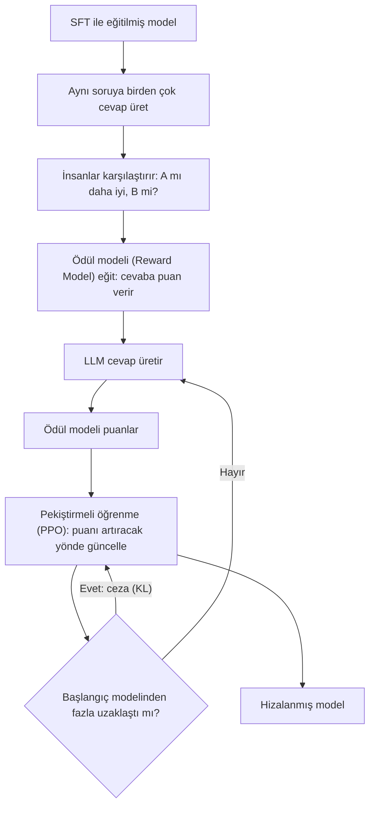

# 4.4 RLHF (Reinforcement Learning from Human Feedback)

## 1. Tek Cümlelik Özet (TL;DR)

**RLHF, "iyi cevap"ı tarif edemediğimiz ama görünce tanıdığımız durumlarda, insanlara cevapları karşılaştırtıp bu tercihlerden bir puanlayıcı model eğiterek LLM'i yüksek puan alacak yönde ayarlama yöntemidir.**

## 2. Günlük Hayattan Analoji: Jüri ve Tadımcı

Bir yemek yarışmasında jüri "mükemmel yemeğin tarifi"ni veremez. Ama önüne iki tabak konduğunda hangisinin daha iyi olduğunu rahatça söyler.

Aşçı her denemede jüriyi toplayamaz; jüri pahalı ve yavaştır. Çözüm: jürinin binlerce karşılaştırmasını izleyerek onların damak zevkini taklit eden bir **tadımcı** yetiştirilir. Aşçı artık günde binlerce tabağı tadımcıya sunar ve onun puanına göre kendini geliştirir. Tadımcı ödül modelidir, aşçı LLM'dir.

Tehlike de buradadır: aşçı zamanla iyi yemek yapmayı değil, **tadımcıyı kandırmayı** öğrenebilir.

## 3. Görselleştirme



## 4. Nasıl Çalışır?

**Neden SFT yetmiyor?** SFT modele "bu cevabı taklit et" der. Ama yardımseverlik, dürüstlük, uygun uzunluk, güvenli davranış gibi nitelikler için tek bir doğru cevap yoktur. İnsanlar için iyi cevabı **yazmak** zordur, iki cevaptan iyisini **seçmek** kolaydır. RLHF bu ucuz sinyali kullanır.

**Aşama 1: Tercih verisi.** Model aynı girdiye birkaç cevap üretir; insan değerlendiriciler bunları karşılaştırır ya da sıralar.

**Aşama 2: Ödül modeli.** Ayrı bir model, bir cevaba tek bir puan vermeyi öğrenir. Eğitim hedefi basittir: tercih edilen cevabın puanı, reddedilenin puanından yüksek olsun.

**Aşama 3: Pekiştirmeli öğrenme.** LLM (artık "politika") cevap üretir, ödül modeli puanlar, PPO gibi bir algoritma LLM'i puanı artıracak yönde günceller. Modelin ödülü kovalarken saçmalamasını önlemek için, başlangıç modelinden uzaklaşması bir ceza terimiyle (**KL cezası**) sınırlanır.

```python
# Aşama 2: ödül modelinin kaybı (tercih edilen, reddedilenden yüksek puan alsın)
r_iyi  = odul_modeli(prompt, tercih_edilen)
r_kotu = odul_modeli(prompt, reddedilen)
odul_kaybi = -F.logsigmoid(r_iyi - r_kotu).mean()

# Aşama 3: politikanın hedefi (PPO ile en üst düzeye çıkarılır)
cevap = politika.uret(prompt)
hedef = odul_modeli(prompt, cevap) - beta * kl_uzakligi(politika, referans_model)
```

Sohbet modellerini temel modellerden ayıran "asistan gibi davranma" niteliğinin yaygınlaşmasında bu yöntem belirleyici oldu.

## 5. Ne Zaman Kullanılır / Ne Zaman Kullanılmaz?

| Durum | RLHF | Not |
|---|---|---|
| Kalite öznel ve çok boyutlu: yardımseverlik, üslup, güvenlik | ✅ | Yöntemin var oluş nedeni |
| Büyük ölçekli model geliştirme, değerlendirici ekibi ve altyapı mevcut | ✅ | |
| Modelin sürekli yeni cevaplar üretip onlardan öğrenmesi gerekiyor | ✅ | Çevrim içi keşif RLHF'in güçlü yanı |
| Küçük ekip, sınırlı bütçe | ❌ | DPO çok daha basit (bkz. 4.5) |
| Doğru cevap belli: sınıflandırma, veri çıkarma, sabit format | ❌ | SFT yeterli ve daha kararlı |
| Tercih verisi az ya da değerlendiriciler tutarsız | ❌ | Ödül modeli gürültü öğrenir |

## 6. Sık Yapılan Hatalar & İpuçları

> [!CAUTION]
> **Ödül kandırmacası (Reward Hacking).** Model, ödül modelinin zaaflarını bulur: gereksiz uzun yazmak, kullanıcıya hak vermek, kendinden emin görünmek. Kullanıcıya yaranma eğilimi (*sycophancy*) bu mekanizmanın bilinen bir yan ürünüdür.

> [!WARNING]
> **Ödül modelini "doğrunun ölçüsü" sanmak.** Ödül modeli, sınırlı sayıda insanın sınırlı sayıda karşılaştırmasının kusurlu bir özetidir. Eğitim verisinin dışına çıkıldığında puanları güvenilmez hale gelir.

> [!WARNING]
> **Değerlendirici yönergesini hafife almak.** "Hangisi daha iyi?" sorusunun cevabı, değerlendiricilere verilen talimata bağlıdır. Belirsiz yönerge tutarsız etiket, tutarsız etiket anlamsız ödül demektir.

> [!TIP]
> **Önce DPO'yu deneyin.** Elinizde hazır tercih çiftleri varsa aynı hedefe çok daha az hareketli parçayla ulaşabilirsiniz.

**Akılda kalsın:** RLHF, insan zevkini bir puanlayıcıya, puanlayıcıyı da modelin davranışına çevirir. Zinciri güçlü kılan da zayıf kılan da puanlayıcıdır.

---

[← 4.3 LoRA / QLoRA](03-lora-qlora.md) · [4.5 DPO (Direct Preference Optimization) →](05-dpo.md)
