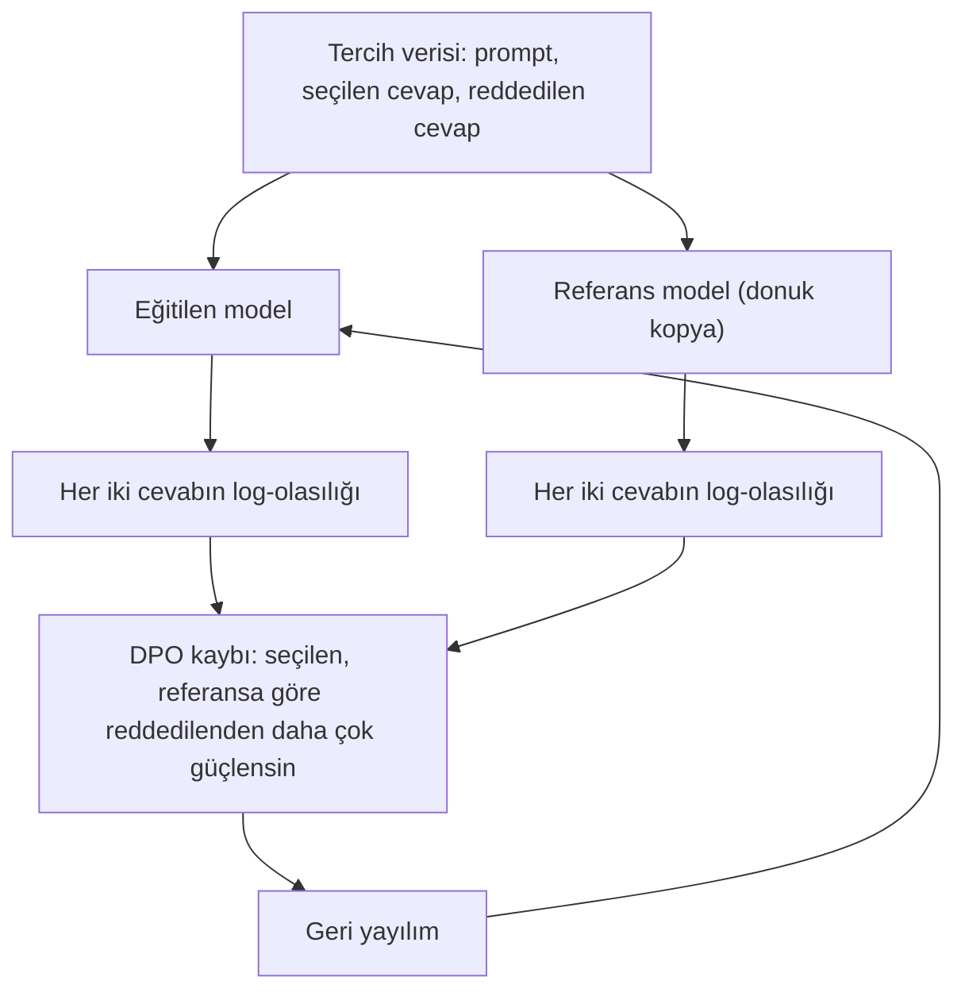

# 4.5 DPO (Direct Preference Optimization)

## 1. Tek Cümlelik Özet (TL;DR)

**DPO, RLHF'in hedefine ödül modeli ve pekiştirmeli öğrenme döngüsü olmadan ulaşır: tercih edilen cevabın olasılığını artıran, reddedilenin olasılığını azaltan tek bir kayıp fonksiyonuyla modeli doğrudan eğitir.**

## 2. Günlük Hayattan Analoji: Aracıyı Aradan Çıkarmak

Bir önceki konuda aşçı, jürinin zevkini taklit eden bir tadımcıya göre çalışıyordu. DPO tadımcıyı işten çıkarır. Jürinin karşılaştırma kartları doğrudan aşçının önüne konur: "Bu iki tabaktan soldaki seçildi."

Aşçı her kart için kendine şunu söyler: "Soldaki gibi yapma eğilimimi artır, sağdaki gibi yapma eğilimimi azalt. Ama kendi tarzımdan da fazla uzaklaşma." Aracı yok, simülasyon yok; yalnızca örneklerden öğrenme var.

## 3. Görselleştirme



RLHF'teki üç aşamalı yapının yerini tek bir gözetimli eğitim döngüsü almıştır.

## 4. Nasıl Çalışır?

**Temel fikir.** DPO makalesi, RLHF'in optimize ettiği hedefin (ödülü artır, referans modelden fazla uzaklaşma) matematiksel olarak doğrudan politika üzerinden yazılabileceğini gösterdi. Ödül modeli açıkça eğitilmez; modelin kendi olasılıkları örtük bir ödül işlevi görür.

**Adımlar:**

1. Her örnek bir üçlüdür: prompt, seçilen cevap, reddedilen cevap.
2. Eğitilen model ve donuk referans model, her iki cevabın olasılığını hesaplar.
3. Kayıp şunu ister: eğitilen modelin seçilen cevaba verdiği olasılık referansa göre **artsın**, reddedilene verdiği olasılık referansa göre **azalsın**.
4. `beta` parametresi, referans modelden ne kadar uzaklaşılabileceğini belirler.

```python
import torch.nn.functional as F

def dpo_kaybi(pi_secilen, pi_reddedilen, ref_secilen, ref_reddedilen, beta=0.1):
    """Girdiler: her cevabın toplam log-olasılığı (batch boyutunda tensörler).
    pi_*  : eğitilen modelden
    ref_* : donuk referans modelden"""
    secilen_kazanc    = pi_secilen - ref_secilen          # seçilen ne kadar güçlendi?
    reddedilen_kazanc = pi_reddedilen - ref_reddedilen    # reddedilen ne kadar güçlendi?
    return -F.logsigmoid(beta * (secilen_kazanc - reddedilen_kazanc)).mean()
```

Bütün yöntem bu fonksiyondan ibarettir. Geri kalanı sıradan bir fine-tuning döngüsüdür ve LoRA ile birlikte rahatça kullanılabilir.

**Tercih verisi nereden gelir?**

- İnsan değerlendiricilerin karşılaştırmaları
- Üründeki kullanıcı sinyalleri: beğeni, yeniden üretme isteği, kullanıcının düzelttiği cevap
- Uzmanın düzelttiği model çıktıları: düzeltilmiş hali "seçilen", orijinali "reddedilen"
- Güçlü bir modelin hakemliği (dikkatle doğrulanarak)

## 5. Ne Zaman Kullanılır / Ne Zaman Kullanılmaz?

| | RLHF | DPO |
|---|---|---|
| **Bileşenler** | Politika + ödül modeli + RL algoritması | Politika + donuk referans kopya |
| **Eğitim kararlılığı** | Hassas; ayar gerektirir | Sıradan fine-tuning kadar kararlı |
| **Hesaplama** | Yüksek: eğitim sırasında sürekli üretim | Düşük: sabit veri seti üzerinde |
| **Veri** | Eğitim sırasında yeni cevaplar keşfedilir | Önceden toplanmış sabit çiftler |
| **Uygulama zorluğu** | Yüksek | Düşük |
| **Ne zaman?** | Büyük ölçek, çevrim içi keşif gerekli | Çoğu ekip için varsayılan tercih yöntemi |

DPO'nun uygun **olmadığı** durumlar: tek bir doğru cevabın bulunduğu görevler (SFT kullanın) ve elinizde anlamlı tercih çiftlerinin olmadığı durumlar.

Tipik sıralama: **önce SFT** (model görevi yapmayı öğrensin), **sonra DPO** (iyi yapmakla daha iyi yapmak arasındaki farkı öğrensin).

## 6. Sık Yapılan Hatalar & İpuçları

> [!WARNING]
> **Bilgi vermeyen çiftler.** Reddedilen cevap bariz biçimde saçmaysa model hiçbir şey öğrenmez; zaten ona düşük olasılık veriyordur. En değerli çiftler, ikisi de makul olan ama biri belirgin biçimde daha iyi olan cevaplardır.

> [!WARNING]
> **Tercihlerdeki gizli yanlılığı öğrenmek.** Seçilen cevaplar sistematik olarak daha uzunsa model "uzun yaz"ı öğrenir. Veri setinde uzunluk, biçim ve üslup gibi yüzeysel farkların dağılımını kontrol edin.

> [!NOTE]
> **`beta` düşükse** model referanstan serbestçe uzaklaşır ve tercihlere aşırı uyum sağlayabilir; **yüksekse** neredeyse hiç değişmez. Küçük bir aralıkta birkaç değer deneyin.

> [!TIP]
> **Üründeki düzeltmeleri toplayın.** Kullanıcının ya da uzmanın düzelttiği her cevap, bedavaya gelen yüksek kaliteli bir tercih çiftidir. Bu veriyi baştan kaydetmeye başlamak, ileride yapılacak her iyileştirmenin temelidir.

**Akılda kalsın:** DPO = "bunu daha çok, şunu daha az yap" bilgisini doğrudan modele öğretmek. RLHF'in sadeleştirilmiş halidir.

---

[← 4.4 RLHF (Reinforcement Learning from Human Feedback)](04-rlhf.md) · [5.1 RAG Nedir? →](../05-rag/01-rag-nedir.md)
