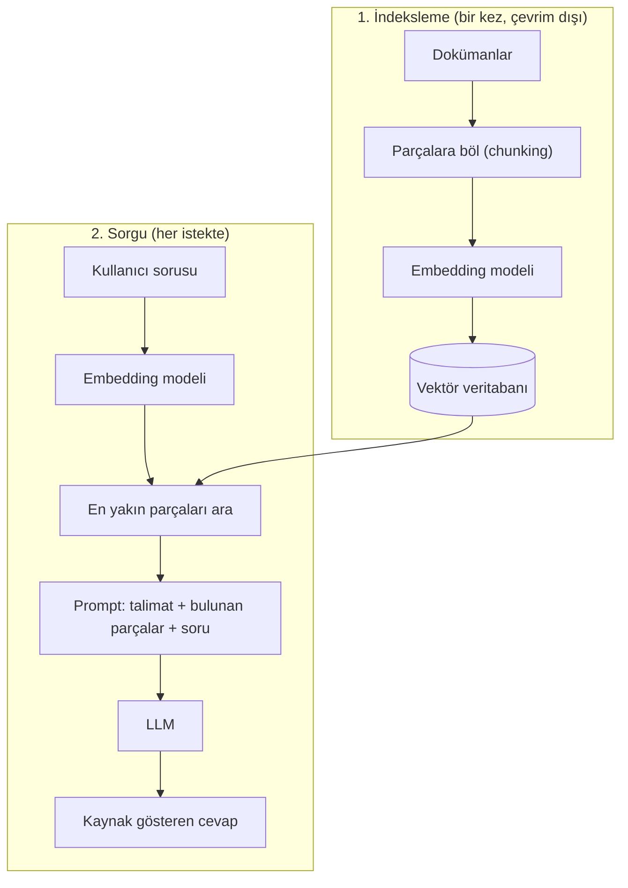

# 5.1 RAG Nedir?

## 1. Tek Cümlelik Özet (TL;DR)

**RAG (Retrieval-Augmented Generation), modele soruyu sormadan önce ilgili dokümanları bulup prompt'a ekleyerek ona "ezberden" değil "açık kitaptan" cevap verdirmektir.**

## 2. Günlük Hayattan Analoji: Açık Kitap Sınavı

Kapalı kitap sınavında öğrenci yalnızca hafızasına güvenir; hatırlamadığı yerde ya boş bırakır ya da uydurur. Açık kitap sınavında ise önce ilgili sayfayı bulur, sonra oradaki bilgiye dayanarak cevabını yazar.

RAG, LLM'i açık kitap sınavına sokar. İki ayrı beceri gerekir: **doğru sayfayı bulmak** (retrieval) ve **bulunan sayfadan doğru cevabı yazmak** (generation). Yanlış sayfayı açan öğrenci, ne kadar zeki olursa olsun yanlış cevap verir.

## 3. Görselleştirme



## 4. Nasıl Çalışır?

**İndeksleme (hazırlık):**

1. Dokümanlar anlamlı parçalara bölünür (5.2).
2. Her parça bir embedding modeliyle vektöre çevrilir (2.2).
3. Vektörler, parçanın metni ve kaynağıyla birlikte bir veritabanına yazılır (5.3).

**Sorgu (çalışma zamanı):**

1. Kullanıcının sorusu aynı embedding modeliyle vektöre çevrilir.
2. Veritabanında bu vektöre en yakın parçalar bulunur.
3. Parçalar soruyla birlikte prompt'a yerleştirilir.
4. LLM, **yalnızca verilen bağlama dayanarak** cevap yazar ve kaynak gösterir.

```python
def indeksle(dokumanlar):
    for dok in dokumanlar:
        for parca in parcala(dok.metin):
            vektor_db.ekle(vektor=embed(parca), metin=parca, kaynak=dok.ad)

def cevapla(soru, k=5):
    parcalar = vektor_db.ara(embed(soru), k=k)
    baglam = "\n\n".join(f"[{p.kaynak}] {p.metin}" for p in parcalar)
    prompt = f"""Yalnızca aşağıdaki bağlamı kullanarak cevapla.
Bağlamda cevap yoksa "Bu bilgi dokümanlarda yok" de. Kullandığın kaynakları belirt.

Bağlam:
{baglam}

Soru: {soru}"""
    return llm(prompt)
```

Bu yalın haline *naive RAG* denir ve şaşırtıcı ölçüde işe yarar. Sınırları da bellidir; bölümün geri kalanı bu sınırları aşmakla ilgilidir:

| Sınır | Çözüm yönü |
|---|---|
| Parça sınırı bilgiyi ortadan böler | Daha iyi chunking (5.2) |
| Ürün kodu, isim gibi birebir eşleşmeler kaçar | Hybrid search (5.4) |
| Getirilen parçaların sıralaması isabetsiz | Reranking (5.5) |
| Cevap birden çok dokümanı birleştirmeyi gerektirir | GraphRAG, agent tabanlı arama (5.6, Bölüm 6) |

## 5. Ne Zaman Kullanılır / Ne Zaman Kullanılmaz?

| Durum | Öneri | Neden |
|---|---|---|
| Modelin bilmediği özel ya da güncel bilgi; büyük doküman koleksiyonu | ✅ RAG | Tam bu iş için var |
| Cevabın kaynağını göstermek zorunlu | ✅ RAG | Parçalar izlenebilir |
| Bilgi sık değişiyor | ✅ RAG | Dokümanı güncellemek yeterli |
| Bütün bilgi birkaç on sayfa | ❌ Hepsini prompt'a koyun | Arama katmanı gereksiz karmaşıklık; prompt caching maliyeti düşürür |
| Sorun bilgi değil davranış: format, üslup | ❌ Prompt ya da fine-tuning | RAG davranışı değiştirmez (bkz. 4.1) |
| "Tüm kayıtlarda toplam satış ne?" gibi sayım ve toplama soruları | ❌ Veritabanı sorgusu | RAG birkaç parça getirir, hepsini saymaz |
| Yapılandırılmış veri: tablolar, kayıtlar | ⚠️ SQL üreten araç daha uygun | Bkz. 6.1 |

## 6. Sık Yapılan Hatalar & İpuçları

> [!WARNING]
> **Aramayı ölçmeden modeli suçlamak.** Kötü cevapların büyük kısmı, doğru parçanın hiç getirilmemiş olmasından kaynaklanır. Önce "doğru parça ilk k sonuçta mı?" sorusunu ölçün; cevap hayırsa LLM'i değiştirmek hiçbir şeyi düzeltmez.

> [!WARNING]
> **Erişim yetkilerini unutmak.** Kullanıcının görmeye yetkisi olmayan bir doküman bağlama girerse model onu cevapta kullanır. Yetki filtresi, arama aşamasında uygulanmalıdır; modele "bunu söyleme" demek bir güvenlik önlemi değildir.

> [!NOTE]
> **RAG, hallucination'ı azaltır ama bitirmez.** Model bağlamı yanlış yorumlayabilir, parçaları yanlış birleştirebilir ya da bağlamda olmayanı ekleyebilir (bkz. 7.2).

> [!TIP]
> **Önce en basit halini kurun, 50 gerçek soruyla ölçün.** Hangi iyileştirmenin gerektiğini tahmin etmek yerine başarısız örneklerden öğrenin.

**Akılda kalsın:** RAG = bul + yaz. Sistemin kalitesi, zincirin zayıf halkası olan "bul" kadar iyidir.

---

[← 4.5 DPO (Direct Preference Optimization)](../04-hizalama-ve-fine-tuning/05-dpo.md) · [5.2 Chunking Stratejileri →](02-chunking.md)
