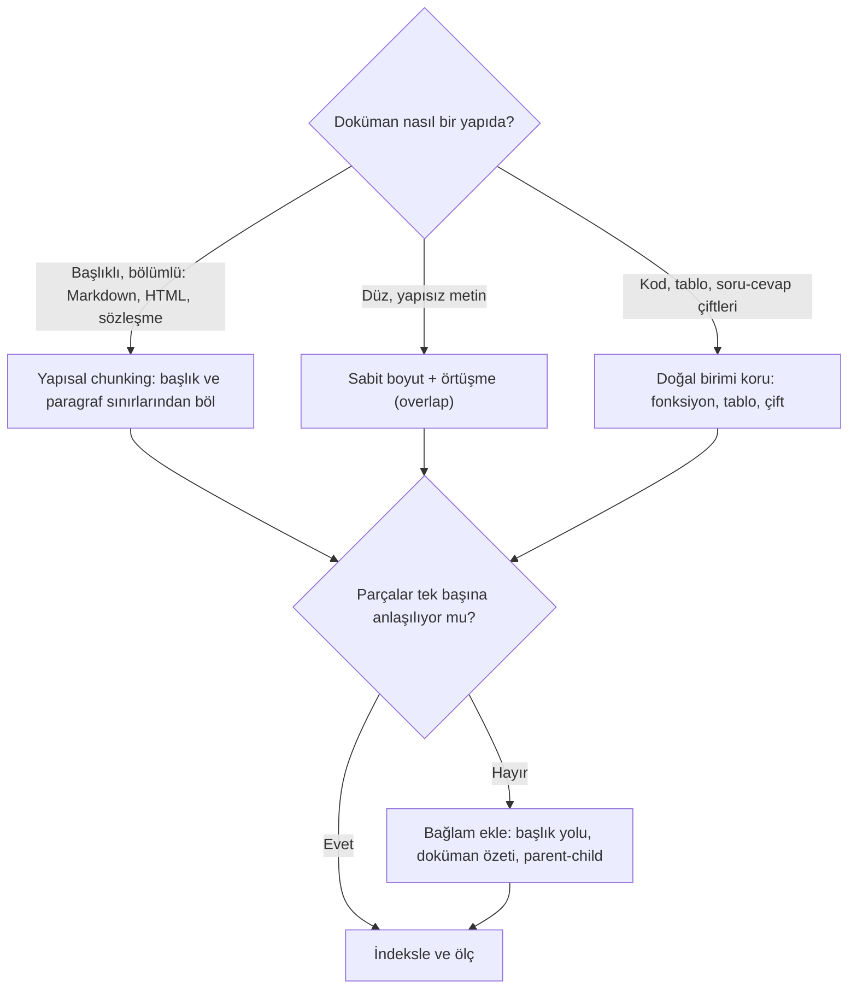

# 5.2 Chunking Stratejileri

## 1. Tek Cümlelik Özet (TL;DR)

**Chunking, dokümanları aranabilir parçalara bölme işidir; parça çok büyükse aranan bilgi gürültüde kaybolur, çok küçükse bağlamından kopar.**

## 2. Günlük Hayattan Analoji: Kitabı Fişlemek

Tez yazarken kitapları fişlersiniz: her fişe tek bir fikir, üstüne de kaynağı. İyi bir fiş, kitabı açmadan tek başına anlaşılır.

Kötü fişlemenin iki türü vardır. Birincisi, koca bir bölümü tek fişe yazmaktır: aradığınız cümleyi içinde bulamazsınız. İkincisi, kitabı makasla her on satırda bir kesmektir: "Bu nedenle yukarıdaki yöntem tercih edilmez" yazan bir fiş elinizde kalır; hangi yöntem, neden?

## 3. Görselleştirme



Örtüşmenin (overlap) ne yaptığı:

```text
Metin:    [ A A A A A A | B B B B B B | C C C C C C ]

Örtüşmesiz:   [A A A A A A] [B B B B B B] [C C C C C C]
                           ^ sınıra denk gelen cümle ikiye bölünür

Örtüşmeli:    [A A A A A A B B]
                       [A A B B B B B B C C]
                                   [B B C C C C C C]
              sınırdaki bilgi en az bir parçada bütün kalır
```

## 4. Nasıl Çalışır?

**Temel gerilim.** Embedding, bir parçanın tamamını tek bir vektöre sıkıştırır. Parça beş farklı konudan bahsediyorsa vektör hiçbirini iyi temsil etmez. Parça tek bir cümleyse vektör keskindir ama LLM'e verildiğinde cevap için yeterli bağlam taşımaz.

**Stratejiler:**

| Strateji | Nasıl böler? | Artısı | Eksisi |
|---|---|---|---|
| **Sabit boyut + örtüşme** | Her N token'da bir, biraz üst üste bindirerek | Basit, her metinde çalışır | Cümleyi ve fikri ortadan bölebilir |
| **Yapısal (recursive)** | Önce başlık, sonra paragraf, sonra cümle sınırından | Doğal sınırlara saygı duyar | Yapısı bozuk dokümanda işe yaramaz |
| **Semantik** | Ardışık cümlelerin anlamı değiştiği yerden | Konu bütünlüğü | Daha yavaş ve pahalı |
| **Parent-child** | Küçük parçayla ara, büyük ebeveynini LLM'e ver | Hem isabetli arama hem zengin bağlam | Daha karmaşık indeks |
| **Bağlam eklemeli** | Her parçanın başına dokümandaki yerini anlatan kısa bir not ekle | Bağlamından kopuk parça sorununu çözer | İndekslemede ek LLM maliyeti |

En basit hali:

```python
def parcala(metin, boyut=200, ortusme=40):
    """Kelime bazlı sabit boyutlu parçalama (gerçekte token sayılır)."""
    kelimeler = metin.split()
    adim = boyut - ortusme
    parcalar = []
    for bas in range(0, len(kelimeler), adim):
        parcalar.append(" ".join(kelimeler[bas:bas + boyut]))
        if bas + boyut >= len(kelimeler):
            break
    return parcalar

metin = " ".join(f"kelime{i}" for i in range(500))
p = parcala(metin)
print(len(p), "parça |", [len(x.split()) for x in p])
```

**Metadata atılmaz.** Her parçayla birlikte kaynağı, başlık yolu ("Kullanım Kılavuzu > Kurulum > Windows"), tarihi ve erişim yetkisi saklanmalıdır. Bunlar hem filtrelemede hem de modelin cevabı doğru bağlama oturtmasında kullanılır.

## 5. Ne Zaman Kullanılır / Ne Zaman Kullanılmaz?

| Doküman türü | Önerilen yaklaşım |
|---|---|
| Teknik doküman, wiki, Markdown | Yapısal; başlık yolunu parçaya ekle |
| Sözleşme, mevzuat | Madde bazında; madde numarasını metadata yap |
| Sıkça sorulan sorular | Her soru-cevap çifti tek parça |
| Kod | Fonksiyon ya da sınıf bazında |
| Tablolar | Tabloyu bölme; gerekirse satırları başlıklarıyla birlikte metne çevir |
| Sohbet kaydı, toplantı dökümü | Konu ya da zaman dilimi bazında; konuşmacıyı koru |
| Kısa dokümanlar (bir sayfadan az) | ❌ Bölme; dokümanın tamamı tek parça |

Boyut için evrensel bir sayı yoktur. Birkaç yüz token iyi bir başlangıç noktasıdır; doğrusunu kendi sorularınızla ölçerek bulursunuz.

## 6. Sık Yapılan Hatalar & İpuçları

> [!WARNING]
> **Çöp çıkarma, çöp parça.** PDF'lerden metin çıkarırken sütunlar karışır, üst-alt bilgiler metne girer, tablolar dağılır. Chunking stratejisinden önce çıkarılan ham metne gözünüzle bakın.

> [!WARNING]
> **Tabloyu ve kod bloğunu ortadan bölmek.** Başlık satırından kopmuş bir tablo parçası anlamsız sayılardan ibarettir.

> [!NOTE]
> **Örtüşmeyi abartmak** indeksi şişirir ve aynı içeriğin birden çok kopyasının sonuçlara girmesine yol açar. Parça boyutunun yüzde 10-20'si genelde yeterlidir.

> [!TIP]
> **"Tek başına anlaşılır mı?" testi.** Rastgele 20 parça seçin ve yalnızca onları okuyun. Neden bahsedildiğini anlayamıyorsanız embedding modeli ve LLM de anlayamaz.

**Akılda kalsın:** İyi parça, tek bir konuyu anlatan ve bağlamından koparıldığında da anlaşılan parçadır.

---

[← 5.1 RAG Nedir?](01-rag-nedir.md) · [5.3 Vektör Veritabanları →](03-vektor-veritabanlari.md)
