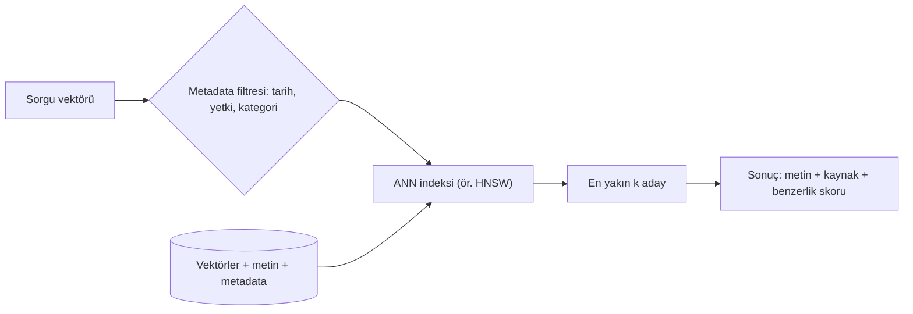

# 5.3 Vektör Veritabanları

## 1. Tek Cümlelik Özet (TL;DR)

**Vektör veritabanı, milyonlarca embedding arasında bir sorguya en yakın olanları tek tek karşılaştırmadan, milisaniyeler içinde ve "yaklaşık olarak" bulan bir indekstir.**

## 2. Günlük Hayattan Analoji: Şehirde Adres Bulmak

Büyük bir şehirde bir adrese gitmek için her kapıyı tek tek çalmazsınız. Önce otoyola çıkar, doğru ilçeye yaklaşır, ana caddeye girer, sonra sokağa saparsınız. Her adımda hedefe yaklaşan daha ince bir yola geçersiniz.

En yaygın vektör indeksi olan **HNSW** tam olarak böyle çalışır: üst katmanda az sayıda noktayı birbirine bağlayan "otoyollar", alt katmanlarda giderek sıklaşan "sokaklar" vardır. Arama yukarıdan başlar ve her katmanda hedefe biraz daha yaklaşır. Bazen en iyi adres yerine bir yan sokaktaki çok benzer bir adrese varırsınız; hız karşılığında ödenen bedel budur.

## 3. Görselleştirme



## 4. Nasıl Çalışır?

**1. Kesin arama (brute force).** Sorguyu bütün vektörlerle karşılaştırıp en yakınları almak her zaman doğru sonucu verir ve sanıldığından uzun süre yeterlidir:

```python
import numpy as np

rng = np.random.default_rng(0)
vektorler = rng.normal(size=(100_000, 384)).astype(np.float32)   # 100 bin parça
vektorler /= np.linalg.norm(vektorler, axis=1, keepdims=True)     # normalize et

def ara(sorgu, k=5):
    sorgu = sorgu / np.linalg.norm(sorgu)
    skor = vektorler @ sorgu                  # kosinüs benzerliği (tek matris çarpımı)
    en_iyi = np.argpartition(-skor, k)[:k]
    return en_iyi[np.argsort(-skor[en_iyi])]

sorgu = vektorler[42] + 0.05 * rng.normal(size=384).astype(np.float32)
print(ara(sorgu))                             # ilk sırada 42 gelmeli
```

**2. Yaklaşık arama (ANN, Approximate Nearest Neighbor).** Vektör sayısı milyonları bulduğunda her sorguda hepsini taramak yavaşlar. ANN indeksleri, doğruluğun küçük bir kısmından vazgeçip hızda büyük kazanç sağlar:

- **HNSW:** Katmanlı komşuluk grafiği. Hızlı ve isabetli; belleği yoğun kullanır. Çoğu sistemde varsayılandır.
- **IVF:** Vektörleri kümelere ayırır, sorguda yalnızca en yakın birkaç kümeye bakar. Daha az bellek, biraz daha düşük isabet.
- **Nicemleme (PQ ve türevleri):** Vektörleri sıkıştırarak belleği küçültür; çok büyük koleksiyonlarda diğerleriyle birlikte kullanılır.

**3. Recall kavramı.** ANN'in kalitesi, "gerçek en yakın k komşunun kaçını buldu?" sorusuyla ölçülür. İndeks parametreleri (HNSW'de arama genişliği gibi) hız ile recall arasındaki dengeyi ayarlar.

**4. Metadata filtreleme.** Gerçek sorgular nadiren yalın benzerlik aramasıdır: "bu kullanıcının erişebildiği, son bir yıla ait dokümanlar arasında en benzerleri." Filtrenin aramadan önce mi sonra mı uygulandığı hem hızı hem sonuç sayısını etkiler; iyi bir sistem bunu indeksle bütünleşik yapar.

## 5. Ne Zaman Kullanılır / Ne Zaman Kullanılmaz?

| Seçenek | Ne zaman? | Dikkat |
|---|---|---|
| **Bellekte kesin arama** (NumPy, FAISS düz indeks) | Yüz binlere kadar vektör, prototip, tek makine | Kalıcılık ve filtreleme sizin işiniz |
| **Mevcut veritabanının eklentisi** (ör. PostgreSQL + pgvector) | Zaten o veritabanını kullanıyorsunuz; orta ölçek | Verinin yanında durur: ek sistem yok, filtreler SQL ile |
| **Arama motoru** (Elasticsearch, OpenSearch) | Güçlü anahtar kelime araması ve hybrid search öncelikli | Operasyonu ağırdır |
| **Özel vektör veritabanı** (Qdrant, Milvus, Weaviate, Pinecone vb.) | Çok büyük ölçek, düşük gecikme, gelişmiş filtreleme | Yönetilecek ayrı bir sistem daha |

Seçim ölçütleri: vektör sayısı, filtre ihtiyacı, hybrid search desteği, güncelleme sıklığı, ekibin operasyon kapasitesi ve verinin nerede durması gerektiği.

Vektör veritabanının **gerekmediği** durumlar: bilginin tamamı bağlam penceresine sığıyorsa ya da arama ihtiyacı birebir eşleşmeden ibaretse.

## 6. Sık Yapılan Hatalar & İpuçları

> [!WARNING]
> **"RAG yapıyorsak özel bir vektör veritabanı şart" varsayımı.** On bin parçalık bir koleksiyon için dağıtık bir sistem kurmak gereksizdir. Mevcut veritabanınızın vektör desteği büyük ihtimalle yeter.

> [!WARNING]
> **Embedding modelini değiştirip indeksi yenilememek.** Eski ve yeni vektörler farklı uzaylardadır; karışık bir indeks anlamsız sonuç döndürür.

> [!WARNING]
> **Mesafe ölçüsü uyumsuzluğu.** Embedding modeli kosinüs benzerliği için eğitildiyse indeks de onu kullanmalıdır. Model kartındaki öneriye uyun.

> [!TIP]
> **Recall'ı bir kez ölçün.** Birkaç yüz sorgu için ANN sonuçlarını kesin arama sonuçlarıyla karşılaştırın. İndeks parametrelerini bu sayıya bakarak ayarlayın, varsayılanlara güvenerek değil.

**Akılda kalsın:** Vektör veritabanı bir hız optimizasyonudur. Küçük ölçekte basit çözüm yeter; kaliteyi belirleyen şey indeks değil, chunking ve embedding'dir.

---

[← 5.2 Chunking Stratejileri](02-chunking.md) · [5.4 Hybrid Search →](04-hybrid-search.md)
