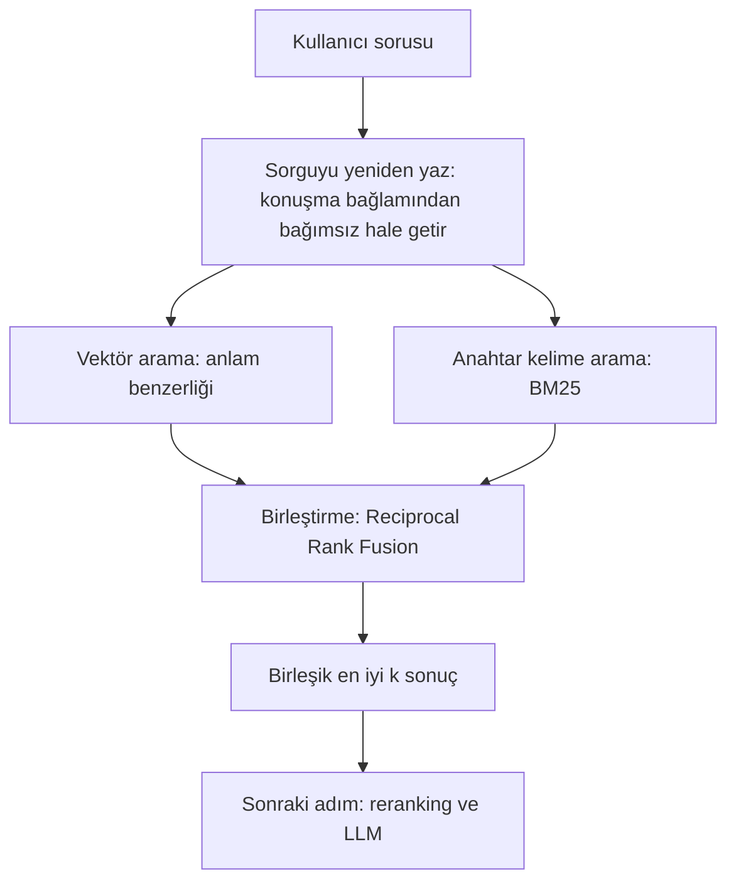

# 5.4 Hybrid Search

## 1. Tek Cümlelik Özet (TL;DR)

**Hybrid search, anlamı yakalayan vektör aramayla kelimeyi birebir yakalayan anahtar kelime aramasını birlikte çalıştırıp sonuçlarını birleştirir, çünkü ikisi farklı yerlerde yanılır.**

## 2. Günlük Hayattan Analoji: İki Kütüphaneci

Kütüphanede iki görevli var. Birincisi konuları çok iyi anlar: "param geri gelmedi" dediğinizde sizi iade prosedürleri rafına götürür, cümlenizde "iade" kelimesi geçmese bile. Ama ondan "TS-4521 numaralı standart"ı isterseniz size benzer konulu başka standartlar getirir.

İkincisi konudan anlamaz ama indeks kartlarını ezbere bilir: "TS-4521" yazan her belgeyi saniyede bulur. "Param geri gelmedi" dediğinizde ise içinde tam bu kelimeler geçen belgeleri arar ve iade prosedürünü bulamaz.

İkisine birden sorup cevaplarını birleştirmek, tek başına herhangi birinden daha iyidir.

## 3. Görselleştirme



## 4. Nasıl Çalışır?

**1. BM25.** Klasik arama motorlarının temel sıralama fonksiyonudur. Bir doküman, sorgudaki kelimeleri ne kadar çok içeriyorsa ve bu kelimeler koleksiyonda ne kadar nadirse o kadar yüksek puan alır. Anlamdan haberi yoktur ama birebir eşleşmede çok güvenilirdir.

**2. Kim nerede güçlü?**

| Sorgu türü | Vektör arama | BM25 |
|---|---|---|
| Eş anlamlı ve farklı ifade: "paramı geri istiyorum" → iade | ✅ | ❌ |
| Ürün kodu, hata numarası, kişi adı, kısaltma | ❌ | ✅ |
| Modelin eğitiminde görmediği alan terimleri | ❌ | ✅ |
| Uzun, doğal dilde soru | ✅ | ⚠️ |
| Yazım hatalı sorgu | ✅ | ❌ |

**3. Birleştirme.** İki aramanın skorları farklı ölçeklerdedir; doğrudan toplanamaz. En yaygın çözüm **Reciprocal Rank Fusion (RRF)**'dir: skorlara değil **sıralamalara** bakar. Bir doküman her listede ne kadar üstteyse o kadar puan toplar.

```python
def rrf(siralamalar, k=60):
    """Her liste, en iyiden en kötüye sıralı doküman kimlikleridir."""
    skor = {}
    for liste in siralamalar:
        for sira, dok in enumerate(liste, start=1):
            skor[dok] = skor.get(dok, 0) + 1 / (k + sira)
    return sorted(skor, key=skor.get, reverse=True)

vektor_sonuc = ["d3", "d1", "d7", "d2"]
bm25_sonuc   = ["d9", "d3", "d2", "d5"]
print(rrf([vektor_sonuc, bm25_sonuc]))   # iki listede de olan d3 ve d2 öne çıkar
```

**4. Sorgu yeniden yazımı (Query Rewriting).** Sohbette kullanıcı "peki ya fiyatı?" diye sorar. Bu cümle tek başına aranırsa hiçbir şey bulunmaz. Aramadan önce bir LLM çağrısıyla soru, konuşma geçmişi kullanılarak bağımsız hale getirilir: "X ürününün fiyatı nedir?" Yaygın türevleri: tek soruyu birkaç farklı ifadeyle aramak (*multi-query*) ve karmaşık soruyu alt sorulara bölmek.

## 5. Ne Zaman Kullanılır / Ne Zaman Kullanılmaz?

| Durum | Öneri |
|---|---|
| Dokümanlarda kodlar, numaralar, özel isimler, alan jargonu var | ✅ Hybrid; belirgin fark yaratır |
| Kullanıcılar hem doğal dille hem anahtar kelimeyle arıyor | ✅ Hybrid |
| İçerik genel dilde, sorular hep doğal cümleler | ⚠️ Yalnızca vektör arama yetebilir; ölçün |
| Yalnızca birebir kayıt araması (ID ile getirme) | ❌ Bu bir veritabanı sorgusudur |
| Çok küçük koleksiyon | ❌ Hepsini bağlama koyun |

Pratikte hybrid search, RAG kalitesini artıran en ucuz adımlardan biridir: ek model eğitimi gerektirmez ve çoğu arama altyapısında hazır gelir.

## 6. Sık Yapılan Hatalar & İpuçları

> [!WARNING]
> **Türkçe için dil analizini atlamak.** BM25 kelimeleri birebir karşılaştırır; "evlerimizden" ile "ev" onun için ilgisiz iki kelimedir. Türkçe gibi eklemeli dillerde kök bulma (stemming) ve Türkçe'ye uygun küçük harfe çevirme (I/ı, İ/i) içeren bir analizci kullanılmazsa anahtar kelime araması ciddi biçimde zayıflar.

> [!WARNING]
> **Ham skorları toplamak.** Kosinüs benzerliği 0-1 arasındayken BM25 skoru onlarca olabilir; toplam, büyük ölçekli olanın sıralamasına eşit olur. Sıralama tabanlı birleştirme kullanın.

> [!WARNING]
> **Sohbetin son mesajını olduğu gibi aramak.** "Bunu nasıl iptal ederim?" sorusundaki "bu"nun ne olduğu geçmiş mesajlardadır.

> [!TIP]
> **Başarısız sorguları türlerine ayırın.** Kaçan sorgular çoğunlukla kod ve isim içeriyorsa anahtar kelime tarafını, farklı ifadelerden oluşuyorsa vektör tarafını güçlendirin.

**Akılda kalsın:** Vektör arama "ne demek istediğini", anahtar kelime araması "ne yazdığını" bulur. İyi arama ikisini de yapar.

---

[← 5.3 Vektör Veritabanları](03-vektor-veritabanlari.md) · [5.5 Reranking →](05-reranking.md)
