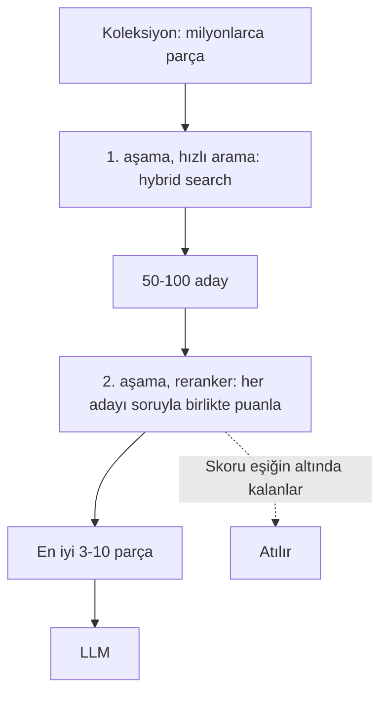

# 5.5 Reranking

## 1. Tek Cümlelik Özet (TL;DR)

**Reranking, hızlı ama kaba aramanın getirdiği onlarca adayı, her birini soruyla birlikte dikkatle okuyan daha yavaş ama daha isabetli bir modelle yeniden sıralamaktır.**

## 2. Günlük Hayattan Analoji: CV Taraması ve Mülakat

Bir ilana bin başvuru geldi. Herkesle birer saat mülakat yapamazsınız. Önce CV'lere hızlıca bakıp elli kişilik bir kısa liste çıkarırsınız; bu tarama hızlıdır ama yüzeyseldir. Sonra bu elli kişiyle tek tek, pozisyonun gereklerini düşünerek görüşür ve en iyi beşi seçersiniz.

İlk aşama **retrieval**, ikinci aşama **reranking**'dir. Mülakat çok daha isabetlidir ama bin kişiye uygulanamayacak kadar pahalıdır. Ve önemli bir sınır: kısa listeye girmemiş birini mülakat geri getiremez.

## 3. Görselleştirme



## 4. Nasıl Çalışır?

İki aşamanın arkasında iki farklı model mimarisi vardır:

| | Bi-encoder (embedding modeli) | Cross-encoder (reranker) |
|---|---|---|
| **Nasıl çalışır?** | Soru ve doküman **ayrı ayrı** vektöre çevrilir, sonra karşılaştırılır | Soru ve doküman **birlikte** modele girer, tek bir ilgi skoru çıkar |
| **Önceden hesaplama** | Doküman vektörleri bir kez hesaplanıp saklanır | Mümkün değil; her soru-doküman çifti ayrı hesaplanır |
| **Hız** | Çok hızlı; milyonlarca dokümana ölçeklenir | Yavaş; yalnızca onlarca adaya uygulanabilir |
| **İsabet** | İyi | Daha iyi: soru ile doküman kelimeleri arasındaki etkileşimi görür |

Bi-encoder, dokümanı soruyu görmeden özetlemek zorundadır. Cross-encoder ise dokümanı "bu soru için ne kadar yararlı?" gözüyle okur. Fark, özellikle ince ayrımlarda belirginleşir: "X'in yan etkileri" ile "X'in yan etkisi yoktur" cümleleri embedding uzayında yakındır; reranker ayırt edebilir.

```python
from sentence_transformers import CrossEncoder

reranker = CrossEncoder("BAAI/bge-reranker-v2-m3")      # çok dilli bir reranker

def ara_ve_sirala(soru, aday_sayisi=50, sonuc_sayisi=5, esik=0.3):
    adaylar = hibrit_ara(soru, k=aday_sayisi)           # 1. aşama: geniş ağ
    skorlar = reranker.predict([(soru, a.metin) for a in adaylar])
    sirali = sorted(zip(skorlar, adaylar), key=lambda c: c[0], reverse=True)
    return [a for s, a in sirali[:sonuc_sayisi] if s >= esik]   # ilgisizleri at
```

Reranker'ın ikinci faydası **eleme** yapabilmesidir. İlk aşama her zaman k sonuç döndürür, hiçbiri ilgili olmasa bile. Reranker skoru bir eşiğin altındaysa parça LLM'e hiç verilmez; böylece model ilgisiz bağlam yüzünden yanlış yöne sapmaz.

## 5. Ne Zaman Kullanılır / Ne Zaman Kullanılmaz?

| Durum | Öneri |
|---|---|
| Doğru parça ilk 50'de var ama ilk 5'te yok | ✅ Reranking tam bu sorunu çözer |
| LLM'e az ama isabetli bağlam vermek istiyorsunuz (maliyet, kalite) | ✅ |
| Koleksiyon gürültülü, birbirine benzeyen çok parça var | ✅ |
| Doğru parça ilk 50'de bile yok | ❌ Önce ilk aşamayı düzeltin: chunking, hybrid search |
| Gecikme bütçesi çok dar (sesli asistan gibi) | ⚠️ Aday sayısını düşürün ya da küçük bir reranker seçin |
| İlk aşamanın sıralaması zaten yeterince iyi | ❌ Eklenen gecikmeye değmez |

Karar için ölçülecek iki sayı: ilk aşamanın **recall@50** değeri (doğru parça adaylar arasında mı?) ve reranker eklenince **ilk 5'teki isabet** ne kadar artıyor?

## 6. Sık Yapılan Hatalar & İpuçları

> [!WARNING]
> **Reranker'a çok az aday vermek.** İlk aşamadan yalnızca 5 parça alıp onları yeniden sıralamak neredeyse hiçbir şey kazandırmaz. Reranking'in değeri, geniş bir aday havuzundan en iyileri süzmesindedir.

> [!WARNING]
> **Yalnızca İngilizce eğitilmiş bir reranker'ı Türkçe içerikte kullanmak.** Model kartında dil desteğini kontrol edin ve kendi verinizle sınayın.

> [!NOTE]
> **Gecikme aday sayısıyla doğrusal artar.** 100 aday, 50 adayın iki katı süre demektir. Kalite kazancının durduğu noktayı ölçerek bulun.

> [!TIP]
> **LLM'i reranker olarak kullanmak** da mümkündür ve bazen daha isabetlidir, ama belirgin biçimde daha yavaş ve pahalıdır. Özel reranker modelleri çoğu durumda daha iyi bir denge sunar.

**Akılda kalsın:** Önce geniş ağ at (recall), sonra dikkatle seç (precision). Reranker bulunmayanı getiremez, bulunanı doğru sıraya koyar.

---

[← 5.4 Hybrid Search](04-hybrid-search.md) · [5.6 GraphRAG →](06-graphrag.md)
