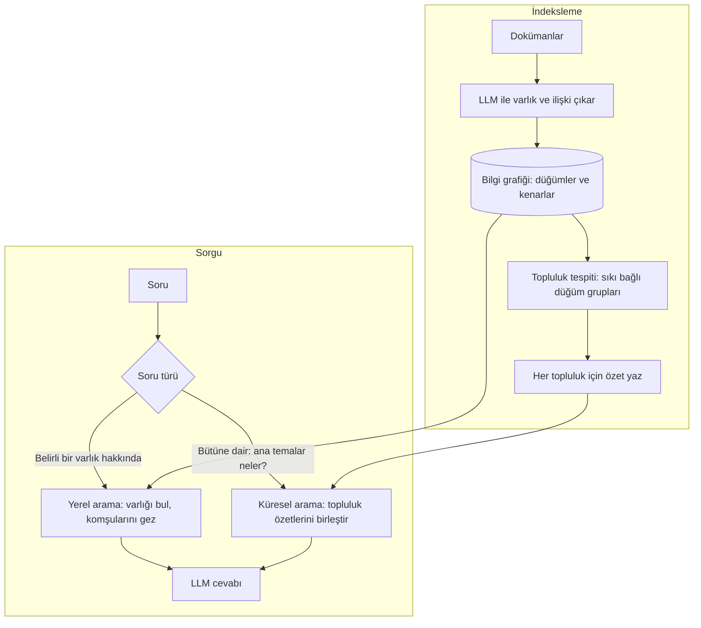

# 5.6 GraphRAG

## 1. Tek Cümlelik Özet (TL;DR)

**GraphRAG, dokümanlardan varlıkları ve aralarındaki ilişkileri çıkarıp bir bilgi grafiği kurar; böylece cevabı tek bir parçada değil, parçalar arasındaki bağlantılarda duran soruları yanıtlayabilir.**

## 2. Günlük Hayattan Analoji: Dedektif Panosu

Polisiye dizilerdeki mantar panoyu bilirsiniz: fotoğraflar, gazete kupürleri ve aralarına gerilmiş kırmızı ipler. Dedektif tek tek dosyaları okuyarak değil, **iplere bakarak** sonuca varır: "Bu kişi şu şirkette çalışmış, o şirketin sahibi de şu olayda adı geçen kişi."

Klasik RAG size en ilgili dosyaları getirir. Ama iki dosyayı birbirine bağlayan ip hiçbir dosyanın içinde yazmıyorsa, o bağlantıyı bulamaz. GraphRAG ipleri önceden gerer.

## 3. Görselleştirme



## 4. Nasıl Çalışır?

**Klasik RAG'in iki kör noktası:**

1. **Çok adımlı (multi-hop) sorular.** "Ayşe'nin yöneticisinin bağlı olduğu departmanın bütçesi ne?" Cevap üç ayrı dokümandadır ve soru metni yalnızca ilkiyle benzeşir.
2. **Bütüne dair sorular.** "Bu müşteri şikâyetlerindeki ana temalar neler?" Cevap hiçbir tekil parçada değil, hepsinin toplamındadır.

**İndeksleme:**

1. Bir LLM her parçayı okuyup varlıkları (kişi, kurum, ürün, kavram) ve ilişkileri (çalışır, sahibidir, bağlıdır) çıkarır.
2. Bunlar bir grafikte birleştirilir; aynı varlığın farklı yazımları tekilleştirilir.
3. Grafikteki sıkı bağlı gruplar (*topluluklar*) bulunur ve her biri için bir özet yazdırılır.

**Sorgu:**

- **Yerel arama:** Sorudaki varlıklar grafikte bulunur, komşuları ve ilişkileri bağlam olarak toplanır.
- **Küresel arama:** Topluluk özetleri taranır, her birinden kısmi cevap alınır ve birleştirilir.

Çok adımlı bir sorunun grafikte nasıl çözüldüğünü görelim:

```python
graf = {
    ("Ayşe", "yöneticisi"): "Mehmet",
    ("Mehmet", "departmanı"): "Ar-Ge",
    ("Ar-Ge", "bütçesi"): "12 milyon TL",
}

def izle(baslangic, iliskiler):
    dugum, yol = baslangic, [baslangic]
    for iliski in iliskiler:
        dugum = graf[(dugum, iliski)]        # bir kenar boyunca ilerle
        yol.append(dugum)
    return yol

# "Ayşe'nin yöneticisinin departmanının bütçesi ne?"
print(" -> ".join(izle("Ayşe", ["yöneticisi", "departmanı", "bütçesi"])))
```

Üç bilgi üç farklı dokümandan gelmiş olabilir; grafik onları tek bir yola bağlar.

## 5. Ne Zaman Kullanılır / Ne Zaman Kullanılmaz?

| | Klasik RAG | GraphRAG |
|---|---|---|
| **Güçlü olduğu soru** | Cevabı tek bir parçada bulunan sorular | Çok adımlı ve bütüne dair sorular |
| **İndeksleme maliyeti** | Düşük: yalnızca embedding | Yüksek: her parça için LLM çağrısı, ek olarak özetler |
| **Güncelleme** | Kolay: parçayı yeniden embed et | Zor: grafik ve özetler etkilenir |
| **Karmaşıklık** | Düşük | Yüksek |
| **Açıklanabilirlik** | Kaynak parça | Kaynak + ilişki yolu |

| Durum | Öneri |
|---|---|
| İlişki yoğun veri: kurum yapıları, hukuki dosyalar, araştırma literatürü, soruşturma | ✅ GraphRAG değerlendirilebilir |
| "Genel resim nedir?" türü analiz soruları sık soruluyor | ✅ |
| Soruların çoğu tek bir olguyu soruyor | ❌ Klasik RAG yeter |
| İçerik çok sık değişiyor | ❌ Yeniden indeksleme maliyeti yüksek |
| Klasik RAG henüz iyi ayarlanmadı | ❌ Önce onu düzeltin |

Bir ara yol: grafik kurmadan, bir agent'ın birkaç arama yapıp sonuçları birleştirmesi (bkz. 6.2) çok adımlı soruların önemli bir kısmını çözer.

## 6. Sık Yapılan Hatalar & İpuçları

> [!WARNING]
> **İndeksleme maliyetini küçümsemek.** Her parça için en az bir LLM çağrısı yapılır. Büyük koleksiyonlarda fatura, sorgu maliyetinin çok üzerine çıkabilir. Önce küçük bir alt kümede deneyin.

> [!WARNING]
> **Varlık tekilleştirmesini atlamak.** "Türk Hava Yolları", "THY" ve "Turkish Airlines" üç ayrı düğüm olarak kalırsa grafik parçalanır ve bağlantılar kaybolur.

> [!NOTE]
> **Çıkarılan grafik, onu çıkaran LLM kadar doğrudur.** Yanlış çıkarılmış bir ilişki, grafikte kalıcı bir yanlış bilgiye dönüşür.

> [!TIP]
> **Şemayı önceden belirleyin.** Hangi varlık ve ilişki türlerinin önemli olduğunu alan bilgisiyle tanımlamak, "her şeyi çıkar" yaklaşımından daha temiz ve daha ucuz bir grafik verir.

**Akılda kalsın:** Klasik RAG noktaları bulur, GraphRAG noktaları birleştirir. Birleştirme pahalıdır; sorularınız gerçekten bunu gerektiriyorsa kullanın.

---

[← 5.5 Reranking](05-reranking.md) · [6.1 Tool Use (Function Calling) →](../06-agents/01-tool-use.md)
