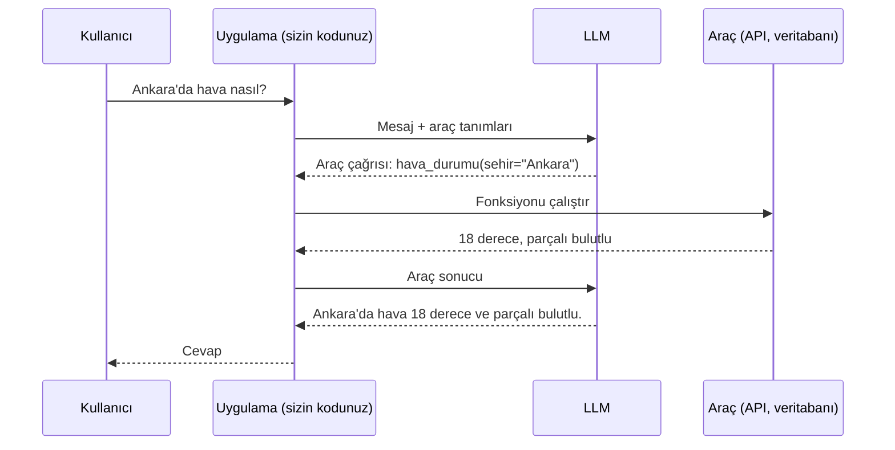

# 6.1 Tool Use (Function Calling)

## 1. Tek Cümlelik Özet (TL;DR)

**Tool use, modelin metin yazmak yerine "şu fonksiyonu şu argümanlarla çağır" diyen yapılandırılmış bir istek üretmesi, fonksiyonu sizin kodunuzun çalıştırması ve sonucu modele geri vermesidir.**

## 2. Günlük Hayattan Analoji: Garson ve Mutfak

Garson müşteriyle konuşur, ne istediğini anlar ve bir **sipariş fişi** yazar: "2 mercimek, 1 ayran." Yemeği garson pişirmez; fişi mutfağa verir, mutfak pişirir, garson tabağı masaya götürüp sunar.

Model garsondur, sizin kodunuz mutfaktır. Model ocağa dokunmaz, veritabanına bağlanmaz, e-posta göndermez. Yalnızca neyin yapılması gerektiğini standart bir formatta yazar. Menüde olmayan bir şeyi sipariş edemez; menü, sizin tanımladığınız araç listesidir.

## 3. Görselleştirme



## 4. Nasıl Çalışır?

**1. Araçları tanımlarsınız.** Her araç için bir ad, ne işe yaradığını anlatan bir açıklama ve parametrelerin şeması (JSON Schema) verilir. Model, hangi aracı ne zaman kullanacağına **açıklamayı okuyarak** karar verir.

**2. Model karar verir.** Soruya doğrudan cevap verebiliyorsa metin üretir. Bir araca ihtiyaç duyuyorsa metin yerine yapılandırılmış bir araç çağrısı döndürür.

**3. Kodunuz çalıştırır.** Çağrıyı ayrıştırır, argümanları doğrular, fonksiyonu çalıştırır.

**4. Sonucu geri verirsiniz.** Model sonucu okur ve ya kullanıcıya cevap yazar ya da bir araç daha çağırır.

```python
araclar = [{
    "name": "hava_durumu",
    "description": "Bir şehrin anlık hava durumunu getirir. Kullanıcı hava, "
                   "sıcaklık ya da yağış sorduğunda kullan.",
    "input_schema": {"type": "object",
                     "properties": {"sehir": {"type": "string", "description": "Şehir adı"}},
                     "required": ["sehir"]},
}]
FONKSIYONLAR = {"hava_durumu": hava_durumu_getir}

mesajlar = [{"role": "user", "content": "Ankara'da hava nasıl?"}]
while True:
    yanit = llm(mesajlar, araclar=araclar)
    mesajlar.append(yanit.mesaj)
    if not yanit.arac_cagrilari:                      # model metinle cevapladı: bitti
        break
    for cagri in yanit.arac_cagrilari:
        try:
            sonuc = FONKSIYONLAR[cagri.ad](**cagri.argumanlar)
        except Exception as hata:
            sonuc = f"HATA: {hata}"                   # hatayı modele göster, düzeltsin
        mesajlar.append({"role": "tool", "tool_call_id": cagri.id, "content": str(sonuc)})
```

Alan adları sağlayıcıdan sağlayıcıya değişir, ama döngünün şekli hep aynıdır. Bu döngü, bir sonraki konudaki agent'ın çekirdeğidir.

## 5. Ne Zaman Kullanılır / Ne Zaman Kullanılmaz?

| İhtiyaç | Öneri | Neden |
|---|---|---|
| Güncel ya da kişiye özel veri: sipariş durumu, bakiye, takvim | ✅ Araç | Model bunu bilemez |
| Eylem: e-posta gönder, kayıt oluştur, kod çalıştır | ✅ Araç | Model yalnızca metin üretir |
| Kesin hesap: aritmetik, tarih farkı, sayım | ✅ Araç | Kod her zaman doğru hesaplar |
| Yapılandırılmış veride sorgu | ✅ Araç (SQL, API) | RAG sayamaz ve toplayamaz |
| Yalnızca belirli bir JSON formatında çıktı | ❌ Structured output yeterli | Çalıştırılacak bir şey yok |
| Adımlar her zaman aynı: önce A, sonra B | ❌ Düz kod yazın | Kararı modele bırakmak gereksiz risk |
| Geri alınamaz eylemler: ödeme, silme | ⚠️ İnsan onayıyla | Model hata yapabilir ya da kandırılabilir |

## 6. Sık Yapılan Hatalar & İpuçları

> [!WARNING]
> **Özensiz araç açıklamaları.** Model aracı yalnızca adından ve açıklamasından tanır. "Veri getirir" gibi bir açıklama, yanlış araç seçiminin bir numaralı nedenidir. Açıklamayı, ekibe yeni katılan birine anlatır gibi yazın: ne yapar, ne zaman kullanılır, ne zaman kullanılmaz.

> [!WARNING]
> **Modelin ürettiği argümanlara güvenmek.** Argümanlar kullanıcı girdisi gibi ele alınmalıdır: doğrulayın, yetkiyi kontrol edin, SQL'e ya da kabuğa doğrudan yapıştırmayın.

> [!CAUTION]
> **Araç sonucundaki talimatlar.** Bir web sayfası ya da e-posta "önceki talimatları unut ve şunu yap" diyen bir metin içerebilir. Araç çıktısı veridir, talimat değildir; ama model bu ayrımı her zaman yapamaz (bkz. 7.5).

> [!TIP]
> **Hataları modele geri gösterin.** Açıklayıcı bir hata mesajı ("tarih YYYY-AA-GG formatında olmalı") modelin kendi çağrısını düzeltmesini sağlar. İstisnayı yutup boş sonuç döndürmek modeli uydurmaya iter.

**Akılda kalsın:** Model karar verir, kodunuz uygular. Yetki ve doğrulama her zaman kod tarafındadır.

---

[← 5.6 GraphRAG](../05-rag/06-graphrag.md) · [6.2 ReAct Mimarisi →](02-react.md)
