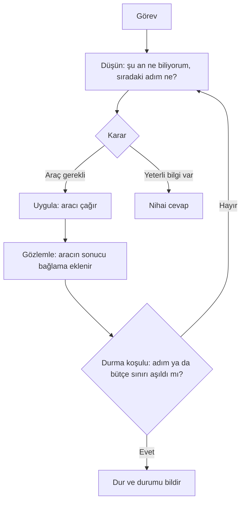

# 6.2 ReAct Mimarisi

## 1. Tek Cümlelik Özet (TL;DR)

**ReAct, modelin "düşün, bir araç çalıştır, sonucu gözlemle" döngüsünü hedefe ulaşana kadar tekrarlamasıdır; agent dediğimiz şeyin çekirdeği bu döngüdür.**

## 2. Günlük Hayattan Analoji: Arıza Arayan Usta

Arabanız çalışmıyor. Usta işe bir kontrol listesiyle başlamaz. Önce **düşünür**: "Marş basmıyor, akü olabilir." Sonra **bir şey yapar**: aküyü ölçer. Sonucu **gözlemler**: akü dolu. Yeni bir fikir yürütür: "O zaman marş motoru ya da kontak." Bir sonraki adımı, bir önceki adımın sonucu belirler.

Bu, önceden yazılmış bir akış şeması değildir. Usta her adımda elindeki bilgiye göre ne yapacağına yeniden karar verir. Agent'ı sıradan bir programdan ayıran şey budur: **adımları kod değil, model belirler.**

## 3. Görselleştirme



## 4. Nasıl Çalışır?

ReAct adı **Re**asoning + **Act**ing birleşiminden gelir. Fikir, modelin akıl yürütmesiyle eylemlerini iç içe geçirmektir: yalnızca düşünen model dünyadan kopuktur, yalnızca eyleyen model plansızdır.

Döngü, bir önceki konudaki araç döngüsünün aynısıdır; farkı, birçok adım boyunca sürmesi ve mutlaka bir **durma koşulu** içermesidir:

```python
def agent(gorev, araclar, azami_adim=15):
    mesajlar = [{"role": "system", "content": SISTEM_TALIMATI},
                {"role": "user", "content": gorev}]
    for adim in range(azami_adim):
        yanit = llm(mesajlar, araclar=araclar)          # düşün + karar ver
        mesajlar.append(yanit.mesaj)
        if not yanit.arac_cagrilari:
            return yanit.metin                          # nihai cevap
        for cagri in yanit.arac_cagrilari:              # uygula
            sonuc = calistir(cagri)
            mesajlar.append(arac_sonucu(cagri.id, sonuc))   # gözlemle
    return "Adım sınırına ulaşıldı. Son durum: " + ozetle(mesajlar)
```

**Workflow ile agent farkı.** İkisi sık karıştırılır:

| | Workflow | Agent |
|---|---|---|
| **Adımları kim belirler?** | Kod: önceden tanımlı sıra | Model: çalışma anında |
| **Öngörülebilirlik** | Yüksek | Düşük |
| **Esneklik** | Düşük: beklenmeyen durumda takılır | Yüksek: duruma uyum sağlar |
| **Maliyet ve gecikme** | Sabit, tahmin edilebilir | Değişken, bazen çok yüksek |
| **Hata ayıklama** | Kolay | Zor |
| **Örnek** | Çevir, özetle, e-posta taslağı yaz | "Bu hatayı bul ve düzelt" |

**Hatalar birikir.** Her adımın yüzde 95 başarıyla tamamlandığını varsayalım. 20 adımlık bir görevin baştan sona sorunsuz bitme olasılığı yaklaşık yüzde 36'dır (0,95'in 20. kuvveti). Uzun görevlerde agent'ın kendi hatasını fark edip düzeltebilmesi (test çalıştırmak, sonucu doğrulamak) bu yüzden kritik önemdedir.

## 5. Ne Zaman Kullanılır / Ne Zaman Kullanılmaz?

| Durum | Öneri |
|---|---|
| Adım sayısı ve sırası önceden bilinemiyor: araştırma, hata ayıklama, açık uçlu görevler | ✅ Agent |
| Her adımın sonucu bir sonrakini değiştiriyor | ✅ Agent |
| Sonuç doğrulanabiliyor: testler geçiyor mu, dosya oluştu mu? | ✅ Agent; geri bildirim döngüsü kaliteyi taşır |
| Adımlar belli ve sabit | ❌ Workflow; daha ucuz, hızlı ve güvenilir |
| Tek bir LLM çağrısı yetiyor | ❌ Agent kurmayın |
| Gecikme saniyelerle ölçülüyor | ❌ Çok adımlı döngü yavaştır |
| Hatanın bedeli yüksek ve geri alınamaz | ⚠️ Kritik adımlarda insan onayı |

Genel ilke: **işi çözen en basit yapıyı** seçin. Tek çağrı yetiyorsa tek çağrı, sabit zincir yetiyorsa workflow, ancak o da yetmiyorsa agent.

## 6. Sık Yapılan Hatalar & İpuçları

> [!CAUTION]
> **Durma koşulu olmayan döngü.** Aynı aracı aynı argümanla tekrar tekrar çağıran bir agent, bir gecede ciddi bir fatura üretebilir. Adım sınırı, token bütçesi ve zaman aşımı ilk günden kodda olmalıdır.

> [!WARNING]
> **Bağlamın şişmesi.** Her araç sonucu bağlama eklenir. Uzun görevlerde pencere dolar, maliyet artar ve model önemli ayrıntıları gözden kaçırmaya başlar. Büyük araç çıktılarını kırpın ya da özetleyin (bkz. 6.3).

> [!WARNING]
> **Agent'a doğrulama aracı vermemek.** Kod yazan ama çalıştıramayan bir agent körlemesine çalışır. Sonucunu sınayabileceği bir araç verin.

> [!TIP]
> **İzleri (trace) okuyun.** Bir agent'ı iyileştirmenin en verimli yolu, başarısız çalışmaların adım adım kaydını okumaktır. Sorunların çoğu belirsiz bir araç açıklamasına ya da eksik bir talimata çıkar.

**Akılda kalsın:** Agent = döngü içinde araç kullanan model. Gücü esnekliğinden, riski öngörülemezliğinden gelir.

---

[← 6.1 Tool Use (Function Calling)](01-tool-use.md) · [6.3 Memory Yönetimi →](03-memory.md)
