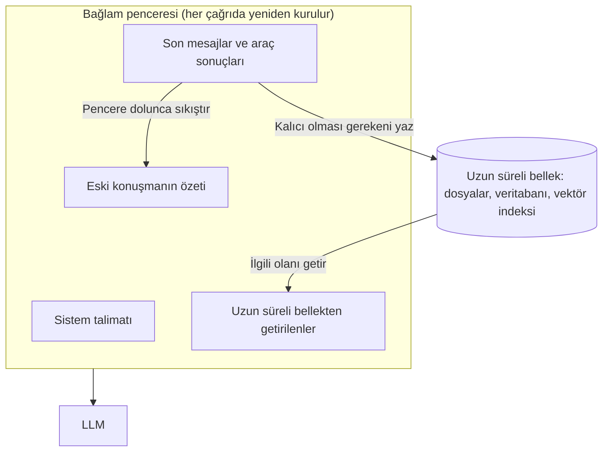

# 6.3 Memory Yönetimi

## 1. Tek Cümlelik Özet (TL;DR)

**LLM'in kendi belleği yoktur; her çağrıda yalnızca bağlam penceresine koyduğunuz şeyi bilir. Memory yönetimi, sınırlı pencereye her adımda neyin gireceğine karar verme işidir.**

## 2. Günlük Hayattan Analoji: Masa ve Dosya Dolabı

Çalışma masanız küçüktür; üzerine yalnızca o an üzerinde çalıştığınız birkaç belge sığar. Arkanızda ise her şeyin durduğu büyük bir dosya dolabı vardır.

İyi çalışan biri masasını yığmaz: o işle ilgili dosyaları dolaptan çıkarır, işi bitince önemli notları dosyalayıp yerine koyar. Masası tıka basa dolu olan kişi aradığı kâğıdı bulamaz, dolabı hiç kullanmayan kişi her sabah işe sıfırdan başlar.

Masa **bağlam penceresidir**, dolap **uzun süreli bellektir**. Model, masada olmayan hiçbir şeyi göremez.

## 3. Görselleştirme



## 4. Nasıl Çalışır?

Modelin "hatırlaması" bir yanılsamadır: uygulama her çağrıda konuşma geçmişini yeniden gönderir. Geçmiş pencereye sığmaz hale geldiğinde bir şeylerin dışarıda kalması gerekir. Asıl mühendislik, neyin kalacağını seçmektir.

**Bellek türleri:**

| Tür | Ne tutar? | Nerede durur? |
|---|---|---|
| **Kısa süreli** | Bu konuşmanın mesajları ve araç sonuçları | Bağlam penceresinde |
| **Çalışma belleği (scratchpad)** | Görev sırasında alınan notlar, plan, yapılacaklar listesi | Dosyada ya da bağlamda |
| **Uzun süreli, olgusal** | Kullanıcı tercihleri, kalıcı bilgiler: "kullanıcı Python kullanıyor" | Veritabanı ya da dosya |
| **Uzun süreli, olaysal** | Geçmiş etkileşimler: "geçen hafta şu hatayı çözdük" | Aranabilir kayıt |
| **Prosedürel** | Nasıl yapılacağına dair talimatlar, öğrenilmiş iş akışları | Talimat dosyaları |

**Temel teknikler:**

- **Kırpma:** En eski mesajları at. Basit ama önemli bilgiyi kaybedebilir.
- **Sıkıştırma (Compaction):** Eski konuşmayı bir özete çevir, son mesajları olduğu gibi tut.
- **Dışarı yazma:** Agent önemli bulguları bir dosyaya not eder; pencere temizlense bile notlar kalır.
- **Getirme:** Uzun süreli bellekten yalnızca o anki görevle ilgili olanı bağlama al (RAG'in bellek için kullanımı).

```python
def baglam_kur(sistem, gecmis, soru, token_siniri=8000, son_mesaj=10):
    eski, yeni = gecmis[:-son_mesaj], gecmis[-son_mesaj:]

    ozet = ozetle(eski) if eski else ""                    # sıkıştırma
    anilar = bellek.ara(soru, k=3)                         # uzun süreli bellekten getir

    mesajlar = [{"role": "system", "content": sistem}]
    if anilar:
        mesajlar.append({"role": "system", "content": "Bilinenler:\n" + "\n".join(anilar)})
    if ozet:
        mesajlar.append({"role": "system", "content": "Önceki konuşmanın özeti:\n" + ozet})
    mesajlar += yeni + [{"role": "user", "content": soru}]

    assert token_say(mesajlar) < token_siniri, "Bağlam bütçesi aşıldı"
    return mesajlar
```

**Bağlam mühendisliği (Context Engineering).** Pencere büyüdükçe sorun çözülmez. Bağlam doldukça modelin ilgili ayrıntıyı bulma ve talimatlara sadık kalma becerisi zayıflar. Hedef, pencereyi doldurmak değil, **o adım için gereken en küçük ve en ilgili bilgi kümesini** oraya koymaktır.

## 5. Ne Zaman Kullanılır / Ne Zaman Kullanılmaz?

| Durum | Strateji |
|---|---|
| Kısa, tek oturumluk sohbet | Tüm geçmişi gönderin; ek mekanizma gereksiz |
| Uzun sohbet | Eskiyi özetle, sonu aynen tut |
| Saatlerce süren agent görevi | Dosyaya not alma + sıkıştırma |
| Kullanıcıyı oturumlar arasında tanıması gereken asistan | Uzun süreli olgusal bellek |
| Büyük araç çıktıları (uzun dosya, sayfalarca log) | Tamamını bağlama koyma; kırp ya da dosyaya yazıp gerektiğinde oku |
| Her oturum bağımsız ve kısa | ❌ Uzun süreli bellek kurmayın; risk ve karmaşıklık getirir |

## 6. Sık Yapılan Hatalar & İpuçları

> [!WARNING]
> **"Pencere büyük, hepsini koyalım."** Maliyet ve gecikme artar, kalite düşer. İlgisiz içerik zararsız değildir; modelin dikkatini dağıtır.

> [!WARNING]
> **Özetlerken kritik ayrıntıyı kaybetmek.** Dosya adları, hata mesajları, verilen kararlar ve kullanıcının açık talimatları özete aynen taşınmalıdır. Özetleme talimatında bunları açıkça isteyin.

> [!CAUTION]
> **Kalıcı bellek kalıcı hata demektir.** Yanlış ya da kötü niyetli bir bilgi belleğe bir kez yazılırsa sonraki her oturumu etkiler. Belleğe neyin yazıldığını kullanıcıya gösterin, düzeltme ve silme imkânı verin; kullanıcılar arasında belleğin karışmadığından emin olun.

> [!TIP]
> **Agent'a not defteri verin.** "Önemli bulguları `notlar.md` dosyasına yaz" talimatı, uzun görevlerde en ucuz ve en etkili bellek mekanizmalarından biridir.

**Akılda kalsın:** Model yalnızca önüne koyduğunuzu bilir. Bellek, doğru bilgiyi doğru anda pencereye taşıma sanatıdır.

---

[← 6.2 ReAct Mimarisi](02-react.md) · [6.4 Multi-Agent Sistemler →](04-multi-agent.md)
