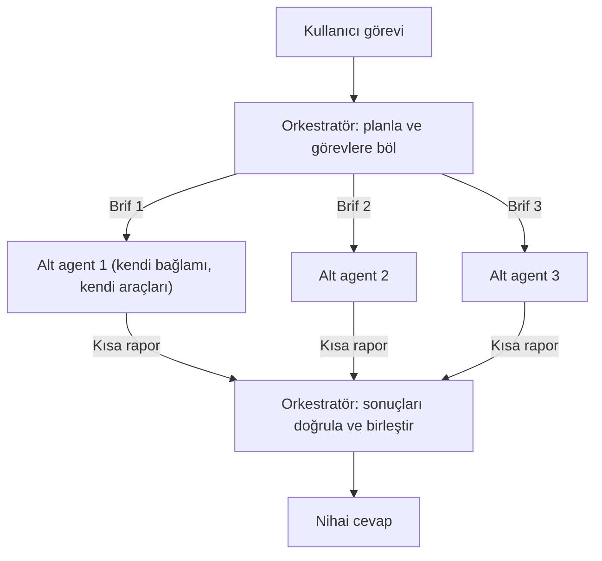

# 6.4 Multi-Agent Sistemler

## 1. Tek Cümlelik Özet (TL;DR)

**Multi-agent sistem, büyük bir işi her biri kendi bağlam penceresine ve araçlarına sahip birden çok agent'a bölmektir; kazancı paralellik ve temiz bağlam, bedeli koordinasyon yükü ve çok daha fazla token'dır.**

## 2. Günlük Hayattan Analoji: Haber Merkezi

Bir editör büyük bir dosya haberi hazırlıyor. Her şeyi tek başına araştırabilir, ama günler sürer ve notları birbirine karışır. Onun yerine üç muhabiri görevlendirir: biri belgeleri tarar, biri kaynaklarla görüşür, biri verileri inceler. Her muhabir kendi işine odaklanır ve editöre **kısa bir rapor** getirir. Editör raporları birleştirip haberi yazar.

İşin püf noktası görevlendirmededir. Editör "şu konuya bir bak" derse muhabir yanlış şeyi araştırır. Muhabir editörün kafasındaki bağlamı bilmez; ne aradığı, neyin zaten bilindiği ve raporun hangi biçimde istendiği açıkça söylenmelidir.

## 3. Görselleştirme



## 4. Nasıl Çalışır?

**Neden bölmeli?** Tek bir agent'ın iki sınırı vardır: bağlam penceresi dolar ve her şeyi sırayla yapar. Alt agent'lar ikisini de aşar:

- **Temiz bağlam:** Alt agent yüz sayfa okur, orkestratöre yarım sayfa özet döndürür. Ayrıntı alt agent'ın penceresinde kalır.
- **Paralellik:** Bağımsız alt görevler aynı anda yürür.
- **Uzmanlaşma:** Her agent'a yalnızca işine uygun araçlar ve talimatlar verilir.

**Yaygın desenler:**

| Desen | Yapı | Tipik kullanım |
|---|---|---|
| **Orkestratör-işçi** | Bir agent böler, diğerleri paralel çalışır, sonuçlar birleşir | Geniş araştırma, çok dosyalı analiz |
| **Sıralı hat (pipeline)** | Birinin çıktısı diğerinin girdisi | Araştır, yaz, düzelt |
| **Üretici-eleştirmen** | Biri üretir, diğeri denetler, gerekirse geri gönderir | Kod incelemesi, doğrulama |
| **Yönlendirici (router)** | Gelen işi uygun uzman agent'a devreder | Müşteri desteğinde konu bazlı ayrım |

```python
import asyncio

async def orkestrator(gorev):
    plan = await llm_json(f"Bu görevi bağımsız alt görevlere böl: {gorev}")

    async def alt_agent(alt_gorev):
        brif = (f"Genel hedef: {gorev}\n"
                f"Senin görevin: {alt_gorev['tanim']}\n"
                f"Kapsam dışı: {alt_gorev['kapsam_disi']}\n"
                f"Çıktı: en fazla 300 kelime, kaynaklarıyla birlikte.")
        return await agent(brif, araclar=alt_gorev["araclar"])

    raporlar = await asyncio.gather(*(alt_agent(g) for g in plan["alt_gorevler"]))
    return await llm(f"Görev: {gorev}\nRaporları doğrula, çelişkileri belirt, birleştir:\n"
                     + "\n---\n".join(raporlar))
```

**Bedeli.** Her agent kendi bağlamını kurar, kendi araç çağrılarını yapar. Toplam token tüketimi tek agent'a göre birkaç katına çıkar. Ayrıca alt agent'lar birbirinin ne yaptığını bilmez; aynı işi iki kez yapabilir ya da çelişen kararlar alabilirler.

## 5. Ne Zaman Kullanılır / Ne Zaman Kullanılmaz?

| Durum | Öneri |
|---|---|
| İş birbirinden bağımsız parçalara ayrılabiliyor | ✅ Multi-agent; paralellik gerçek kazanç sağlar |
| Gereken bilgi tek bir bağlam penceresine sığmıyor | ✅ |
| Parçalar farklı araç setleri ya da farklı yetkiler gerektiriyor | ✅ |
| Bağımsız bir gözle doğrulama isteniyor | ✅ Üretici-eleştirmen |
| Adımlar sıkı sıkıya bağlı, her biri öncekinin ayrıntısına muhtaç | ❌ Tek agent; bölmek bilgi kaybettirir |
| Görev tek agent'ın penceresine rahatça sığıyor | ❌ |
| Maliyet ve gecikme hassas | ❌ |
| Tek agent'lı sürüm henüz güvenilir çalışmıyor | ❌ Önce onu düzeltin; agent sayısını artırmak sorunu çoğaltır |

## 6. Sık Yapılan Hatalar & İpuçları

> [!WARNING]
> **Eksik brif.** Alt agent yalnızca kendisine yazılanı bilir. "Rakipleri araştır" gibi tek satırlık bir görevlendirme, tekrarlanan işe ve alakasız raporlara yol açar. Hedefi, kapsamı, kapsam dışını ve çıktı biçimini yazın.

> [!WARNING]
> **Raporları sorgulamadan birleştirmek.** Alt agent'ın "tamamlandı" demesi işin doğru yapıldığını göstermez. Orkestratör kritik iddiaları doğrulamalı, çelişkileri görmezden gelmemelidir.

> [!WARNING]
> **Paralel yazma çakışması.** İki agent aynı dosyayı ya da kaydı aynı anda değiştirirse biri diğerinin işini ezer. Yazma işlerini tek elde toplayın ya da alanları kesin biçimde ayırın.

> [!NOTE]
> **Rol oyunu mimari değildir.** Agent'lara "CEO", "mühendis", "tasarımcı" unvanları vermek kendi başına bir fayda getirmez. Faydayı getiren şey ayrı bağlam, ayrı araçlar ve net sorumluluk sınırlarıdır.

**Akılda kalsın:** Agent eklemek bağlamı böler ve işi paralelleştirir, ama her bölme bir iletişim maliyeti doğurur. Bölünmesi doğal olan işi bölün.

---

[← 6.3 Memory Yönetimi](03-memory.md) · [6.5 MCP (Model Context Protocol) →](05-mcp.md)
