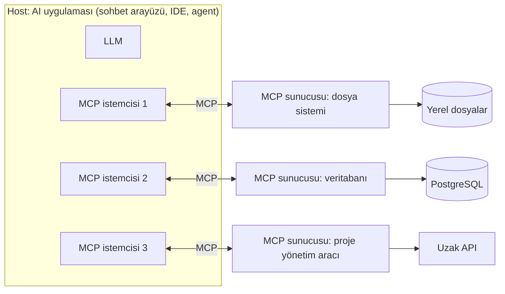

# 6.5 MCP (Model Context Protocol)

## 1. Tek Cümlelik Özet (TL;DR)

**MCP, AI uygulamalarının harici araçlara ve veri kaynaklarına bağlanması için açık bir standarttır: bir entegrasyonu bir kez MCP sunucusu olarak yazarsınız, MCP destekleyen her uygulama onu kullanabilir.**

## 2. Günlük Hayattan Analoji: Ortak Priz Standardı

Eskiden her telefonun şarj girişi farklıydı; her cihaz için ayrı kablo taşırdınız. Ortak bir standart geldikten sonra tek kablo telefonu, kulaklığı, bilgisayarı şarj eder oldu. Cihaz üreticisi şarj aletini, şarj aleti üreticisi cihazı tanımak zorunda değildir; ikisi de standarda uyar.

MCP aynı şeyi AI uygulamaları ve araçlar için yapar. Standart yokken 5 uygulamayı 10 araca bağlamak 50 ayrı entegrasyon demektir. Standartla 5 istemci ve 10 sunucu, yani 15 parça yazmak yeter.

## 3. Görselleştirme



## 4. Nasıl Çalışır?

**Üç rol:**

- **Host:** Kullanıcının karşısındaki AI uygulaması. Modeli çalıştırır, hangi sunuculara bağlanılacağını ve neye izin verileceğini yönetir.
- **İstemci (Client):** Host'un içinde, tek bir sunucuyla konuşan bağlantı bileşeni.
- **Sunucu (Server):** Belirli bir sistemin yeteneklerini standart biçimde sunan program.

**Sunucunun sunabildiği üç temel şey:**

| Öğe | Nedir? | Kim tetikler? |
|---|---|---|
| **Araçlar (Tools)** | Çalıştırılabilir fonksiyonlar: sorgu at, kayıt oluştur | Model karar verir |
| **Kaynaklar (Resources)** | Okunabilir veri: dosya, kayıt, doküman | Uygulama bağlama ekler |
| **Prompt'lar (Prompts)** | Hazır talimat şablonları | Kullanıcı seçer |

**İletişim.** Mesajlar JSON-RPC biçimindedir. Yerel sunucular genelde standart girdi/çıktı (stdio) üzerinden, uzak sunucular HTTP üzerinden konuşur. Bağlantı kurulduğunda istemci sunucuya "hangi araçların var?" diye sorar; dönen tanımlar modelin araç listesine eklenir. Bundan sonrası 6.1'deki araç döngüsünün aynısıdır.

Resmî Python SDK'sıyla (2.x sürümü) bir sunucu birkaç satırdır:

```python
from mcp.server.mcpserver import MCPServer    # SDK 1.x'te: from mcp.server.fastmcp import FastMCP

mcp = MCPServer("siparis-servisi")

@mcp.tool()
def siparis_durumu(siparis_no: str) -> str:
    """Sipariş numarasına göre kargo durumunu getirir.
    Kullanıcı siparişinin nerede olduğunu sorduğunda kullan."""
    return veritabani.siparis_bul(siparis_no).durum

@mcp.resource("katalog://iade-politikasi")
def iade_politikasi() -> str:
    """Güncel iade politikası metni."""
    return open("iade_politikasi.md", encoding="utf-8").read()

if __name__ == "__main__":
    mcp.run()        # varsayılan: stdio üzerinden
```

Fonksiyonun tip ipuçları parametre şemasına, açıklama satırı (docstring) araç açıklamasına dönüşür. Model aracı bu açıklamadan tanır.

Protokol aktif biçimde gelişiyor; yetkilendirme ve taşıma katmanı gibi ayrıntılar için güncel belirtime bakın.

## 5. Ne Zaman Kullanılır / Ne Zaman Kullanılmaz?

| Durum | Öneri |
|---|---|
| Aynı entegrasyonu birden çok AI uygulamasında kullanacaksınız | ✅ MCP sunucusu yazın |
| Ürününüzü başkalarının AI araçlarına açmak istiyorsunuz | ✅ |
| Mevcut bir MCP sunucusu ihtiyacınızı karşılıyor | ✅ Hazırını kullanın |
| Kullanıcıların kendi araçlarını bağlayabildiği bir uygulama geliştiriyorsunuz | ✅ MCP istemcisi olun |
| Tek bir uygulama, kendi kodunuzdaki birkaç fonksiyon | ❌ Doğrudan araç tanımı yeterli; ek katman gereksiz |
| Çok düşük gecikme gerektiren, sıkı bağlı iç çağrılar | ❌ Doğrudan fonksiyon çağrısı |

MCP, tool use'un yerine geçmez; araçların modele **nasıl ulaştırılacağını** standartlaştırır.

## 6. Sık Yapılan Hatalar & İpuçları

> [!CAUTION]
> **Güvenilmeyen sunucu kurmak.** MCP sunucusu, sizin yetkilerinizle kod çalıştıran bir programdır. Ayrıca araç açıklamaları modelin bağlamına girer; kötü niyetli bir sunucu açıklamaya gizli talimatlar yerleştirebilir. Sunucuları, bilgisayarınıza kurduğunuz herhangi bir yazılım gibi değerlendirin: kaynağı belli mi, hangi yetkileri istiyor?

> [!WARNING]
> **Sunucuya gereğinden geniş yetki vermek.** Yalnızca okuma gerekiyorsa salt okunur bir veritabanı kullanıcısı tanımlayın. Model yanlış bir karar verdiğinde ya da kandırıldığında zararın sınırını yetkiler belirler.

> [!WARNING]
> **Çok fazla sunucu bağlamak.** Her aracın tanımı bağlam penceresinde yer kaplar. Yüzlerce araç hem maliyeti artırır hem de modelin doğru aracı seçmesini zorlaştırır. Göreve gereken sunucuları etkinleştirin.

> [!TIP]
> **API uçlarını birebir araca çevirmeyin.** Araçları sistemin iç yapısına göre değil, kullanıcının yapmak istediği işe göre tasarlayın. `musteri_ozetini_getir` gibi tek bir araç, modelin dört ayrı ham uç noktayı sırayla çağırmasından daha güvenilirdir.

**Akılda kalsın:** MCP, araçlar için ortak fiştir. Entegrasyonu bir kez yazar, her yere takarsınız; güvenlik sorumluluğu ise her takışta sizdedir.

---

[← 6.4 Multi-Agent Sistemler](04-multi-agent.md) · [7.1 Eval Metrikleri →](../07-llmops/01-eval.md)
