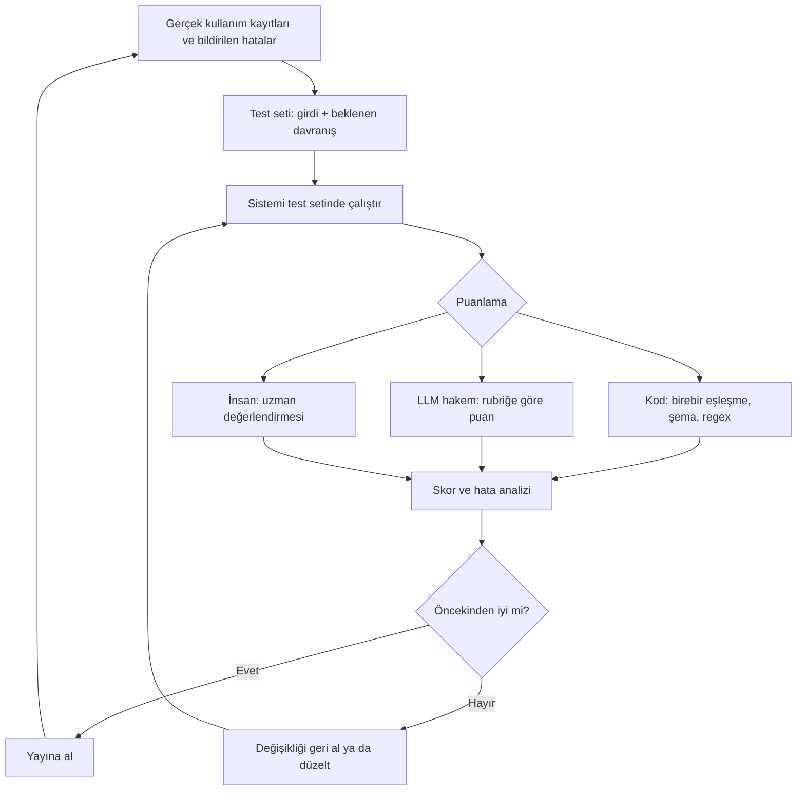

# 7.1 Eval Metrikleri

## 1. Tek Cümlelik Özet (TL;DR)

**Eval, "model iyi mi?" sorusunu histen sayıya çevirmektir: sabit bir test seti, net bir puanlama yöntemi ve her değişiklikten sonra yeniden koşulan bir ölçüm.**

## 2. Günlük Hayattan Analoji: Tadına Bakmadan Servis Etmek

İyi bir aşçı yemeği tatmadan servise göndermez. Tuzu değiştirdiyse tekrar tadar. Dahası, restoranın bir standart tadım listesi vardır: her yeni aşçı, her yeni tarif aynı tabaklar üzerinden denetlenir.

Eval'siz LLM geliştirmek, tadına bakmadan yemek göndermektir. Prompt'u değiştirirsiniz, üç örneğe bakarsınız, "daha iyi oldu galiba" dersiniz. Düzelttiğiniz üç örneğin yanında bozduğunuz on örneği görmezsiniz. Yazılımcılar için daha tanıdık bir karşılık: eval, olasılıksal sistemlerin **birim testidir**.

## 3. Görselleştirme



## 4. Nasıl Çalışır?

**1. Test seti (Golden Set).** Gerçek kullanımı temsil eden girdiler ve her biri için "iyi cevap neye benzer?" tanımı. 20-50 özenli örnekle başlamak, hiç başlamamaktan kat kat iyidir. En değerli örnekler, canlıda karşılaşılan gerçek hatalardır.

**2. Puanlama yöntemleri.**

| Yöntem | Artısı | Eksisi | Ne zaman? |
|---|---|---|---|
| **Kod tabanlı** | Hızlı, ucuz, tutarlı | Yalnızca kesin ölçütler | Sınıflandırma, veri çıkarma, format kontrolü, "cevap şu ifadeyi içeriyor mu?" |
| **LLM hakem (LLM-as-a-Judge)** | Açık uçlu cevapları ölçekli puanlar | Kendi yanlılıkları var; kalibrasyon gerekir | Doğruluk, üslup, bağlama sadakat |
| **İnsan** | En güvenilir | Yavaş ve pahalı | Hakemi kalibre etmek, kritik kararlar |

Kelime örtüşmesine dayanan klasik metrikler (BLEU, ROUGE), doğru ama farklı ifade edilmiş cevapları cezalandırdığı için LLM çıktılarında zayıf kalır.

**3. En yalın eval düzeneği:**

```python
test_seti = [
    {"soru": "İade süresi kaç gün?",        "beklenen": "14 gün"},
    {"soru": "Kargo ücreti ne kadar?",      "beklenen": "ücretsiz"},
    {"soru": "Hangi gezegende yaşıyoruz?",  "beklenen": "dokümanlarda yok"},  # reddetmeli
]

def puanla(cevap, beklenen):
    return beklenen.lower() in cevap.lower()

def eval_kos(uygulama):
    sonuclar = [(t, uygulama(t["soru"])) for t in test_seti]
    basarisiz = [(t["soru"], c) for t, c in sonuclar if not puanla(c, t["beklenen"])]
    print(f"Başarı: {1 - len(basarisiz) / len(test_seti):.0%}")
    for soru, cevap in basarisiz:                      # sayıdan önemlisi: neden?
        print(f"  HATA | {soru} -> {cevap[:80]}")

sahte_uygulama = lambda s: "İade süresi 14 gündür." if "İade" in s else "Bilmiyorum."
eval_kos(sahte_uygulama)
```

**4. Sisteme özgü metrikler.**

- **RAG:** Aramayı ve üretimi ayrı ölçün. Arama için: doğru parça ilk k sonuçta mı (*recall@k*)? Üretim için: cevap getirilen bağlama dayanıyor mu (*faithfulness*), soruyu karşılıyor mu?
- **Agent:** Görev başarıyla tamamlandı mı (son duruma bakarak), kaç adımda, ne kadar maliyetle?
- **Her sistem:** Gecikme ve istek başına maliyet de birer metriktir.

## 5. Ne Zaman Kullanılır / Ne Zaman Kullanılmaz?

| Durum | Yaklaşım |
|---|---|
| Çıktının tek bir doğru biçimi var | Kod tabanlı puanlama |
| Çıktı serbest metin, kalite ölçütü tarif edilebiliyor | LLM hakem + açık rubrik |
| Ölçüt öznel ya da uzmanlık gerektiriyor | İnsan değerlendirmesi; sonra hakemi buna göre kalibre et |
| Model ya da sağlayıcı seçimi | Kendi test setiniz; genel sıralamalar yalnızca ön eleme için |
| Prompt, model ya da arama ayarı değişikliği | Her değişiklikte tüm seti yeniden koş |
| Tek seferlik prototip, fikir denemesi | ❌ Tam düzenek gereksiz; birkaç örneğe gözle bakmak yeter |

## 6. Sık Yapılan Hatalar & İpuçları

> [!WARNING]
> **Genel benchmark sonuçlarına göre karar vermek.** Kamuya açık sıralamalar sizin görevinizi ölçmez ve test soruları zamanla eğitim verisine sızar. Sizin için geçerli tek sıralama, kendi test setinizdeki sıralamadır.

> [!WARNING]
> **LLM hakemi kalibre etmeden güvenmek.** Hakemin verdiği puanları 50-100 örnekte insan puanlarıyla karşılaştırın. Uyum düşükse rubriği netleştirin. Hakeme sayısal puan yerine geçti/kaldı kararı ve gerekçe sordurmak genelde daha tutarlıdır.

> [!WARNING]
> **Tek koşudan sonuç çıkarmak.** Çıktılar olasılıksaldır; 20 örnekte yüzde 5'lik fark gürültü olabilir. Seti büyütün ya da birkaç kez koşun.

> [!TIP]
> **Skora değil hatalara bakın.** "Yüzde 82" bir şey söylemez. Başarısız örnekleri okuyup gruplamak, bir sonraki adımda neyi düzelteceğinizi söyler.

**Akılda kalsın:** Ölçmediğiniz şeyi iyileştiremezsiniz. Önce 30 örnekli bir test seti, sonra her şey.

---

[← 6.5 MCP (Model Context Protocol)](../06-agents/05-mcp.md) · [7.2 Hallucination Azaltma →](02-hallucination.md)
