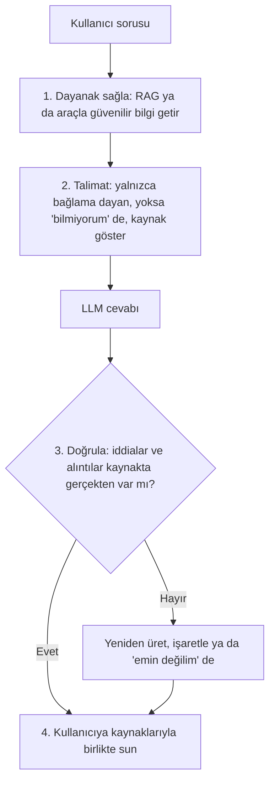

# 7.2 Hallucination Azaltma

## 1. Tek Cümlelik Özet (TL;DR)

**Hallucination, modelin akıcı ve kendinden emin bir dille yanlış ya da dayanaksız bilgi üretmesidir; sıfırlanamaz, ama katmanlı önlemlerle azaltılır ve yakalanır.**

## 2. Günlük Hayattan Analoji: Boş Bırakmayan Öğrenci

Yanlış cevabın puan götürmediği bir sınavda, bilmediği soruyu boş bırakan öğrenci sıfır alır; bir şeyler yazan öğrenci ise bazen tutturur. Yıllarca bu sınavlara giren öğrenci şunu öğrenir: **her zaman bir şey yaz ve emin görün.**

Dil modelleri benzer bir teşvikle yetişir. Hedefleri "doğruyu söylemek" değil, "olası görünen devamı üretmek"tir. Bir makalenin yazarını bilmiyorsa bile, yazar adına benzeyen bir şey üretmek, "bilmiyorum" demekten çoğu zaman daha olası bir devamdır.

## 3. Görselleştirme



Tek bir önlem yeterli değildir; her katman bir öncekinden kaçanı yakalar.

## 4. Nasıl Çalışır?

**Model neden uydurur?**

- **Eğitim hedefi:** Model olası metni üretmek için eğitildi; doğruluk bunun yan ürünüdür.
- **Bilgi eksikliği:** Soru eğitim verisinde az geçen, özel ya da kesim tarihinden sonraki bir konudadır.
- **Tahmini ödüllendiren değerlendirme:** "Bilmiyorum" cevabı çoğu ölçümde yanlışla aynı puanı alır.
- **Kötü bağlam:** RAG yanlış ya da ilgisiz parça getirmiştir; model onu kullanarak yanlış ama "dayanaklı" bir cevap kurar.
- **Baskılı prompt:** "Mutlaka bir cevap ver" talimatı, modeli emin olmadığı yerde de konuşmaya zorlar.

**Önlem katmanları:**

1. **Dayanak (Grounding).** Modelin hafızasına güvenmek yerine bilgiyi bağlama koyun: RAG, arama aracı, veritabanı sorgusu.
2. **Çıkış kapısı.** Modele açıkça "bilmiyorum" deme izni verin. İzin verilmeyen model uydurur.
3. **Alıntı zorunluluğu.** Her iddia için kaynak parçayı göstermesini isteyin. Daha güçlüsü: önce ilgili alıntıları çıkarsın, sonra yalnızca onlara dayanarak cevap yazsın.
4. **Doğrulama.** Cevaptaki alıntıların ve iddiaların kaynakta gerçekten bulunduğunu kodla ya da ikinci bir model çağrısıyla kontrol edin.
5. **Şeffaflık.** Kullanıcıya kaynakları gösterin ki kendisi de doğrulayabilsin.

```python
TALIMAT = """Soruyu YALNIZCA aşağıdaki dokümanlara dayanarak cevapla.
- Her iddiadan sonra dayandığı cümleyi <alinti> etiketi içinde aynen ver.
- Dokümanlarda cevap yoksa yalnızca şunu yaz: BILGI_YOK
Dokümanlar:
{baglam}

Soru: {soru}"""

def guvenli_cevap(soru, baglam):
    cevap = llm(TALIMAT.format(baglam=baglam, soru=soru))
    if "BILGI_YOK" in cevap:
        return "Bu konuda dokümanlarda bilgi bulamadım."
    for alinti in alintilari_cikar(cevap):
        if alinti not in baglam:                 # uydurma alıntı: kaynakta yok
            return "Cevabı kaynaklarla doğrulayamadım. Lütfen bir uzmana danışın."
    return cevap
```

## 5. Ne Zaman Kullanılır / Ne Zaman Kullanılmaz?

Önlemlerin her biri gecikme ve maliyet ekler. Ne kadarına ihtiyacınız olduğunu hatanın bedeli belirler:

| Risk düzeyi | Örnek | Önerilen önlem |
|---|---|---|
| **Düşük** | Beyin fırtınası, taslak metin, yaratıcı yazı | Kullanıcıya "kontrol edin" notu yeterli |
| **Orta** | İç bilgi asistanı, müşteri desteği | Dayanak + "bilmiyorum" izni + kaynak gösterme |
| **Yüksek** | Hukuki, tıbbi, finansal içerik | Hepsi + otomatik alıntı doğrulaması + insan onayı |
| **Kesinlik şart** | Tutar hesaplama, kayıt güncelleme | ❌ Modelin hafızasına bırakmayın; değerleri araçla getirin, hesabı koda yaptırın |

Yaratıcı görevlerde modelin "uydurması" kusur değil, istenen özelliktir. Sorun, olgusal doğruluk beklenen yerde ortaya çıkar.

## 6. Sık Yapılan Hatalar & İpuçları

> [!WARNING]
> **"RAG kurduk, artık uydurmaz" varsayımı.** Model bağlamı yanlış okuyabilir, iki parçayı yanlış birleştirebilir ya da bağlamdaki boşluğu kendi bilgisiyle doldurabilir. Bağlama sadakati ayrıca ölçün (bkz. 7.1).

> [!WARNING]
> **Kaynak göstermeyi doğrulama sanmak.** Modeller var olmayan kaynaklar, bağlantılar ve alıntılar üretebilir. Gösterilen kaynağın gerçekten var olduğunu ve iddiayı desteklediğini kodla kontrol edin.

> [!NOTE]
> **Temperature'ı sıfıra çekmek hallucination'ı çözmez.** Yalnızca aynı yanlışı daha tutarlı biçimde tekrarlatır. Sorun rastgelelik değil, bilgi eksikliğidir.

> [!NOTE]
> **Modelin kendine güven beyanı güvenilir bir ölçü değildir.** "Yüzde 95 eminim" ifadesi, gerçek doğruluk olasılığıyla zayıf ilişkilidir.

> [!TIP]
> **Test setinize cevabı olmayan sorular ekleyin.** Sistemin "bilmiyorum" demesi gereken yerde bunu yapıp yapmadığı, en az doğru cevap verme oranı kadar önemli bir metriktir.

**Akılda kalsın:** Modelin hafızasına değil, önüne koyduğunuz kaynağa güvenin; sonra kaynağa gerçekten uyup uymadığını kontrol edin.

---

[← 7.1 Eval Metrikleri](01-eval.md) · [7.3 Quantization →](03-quantization.md)
