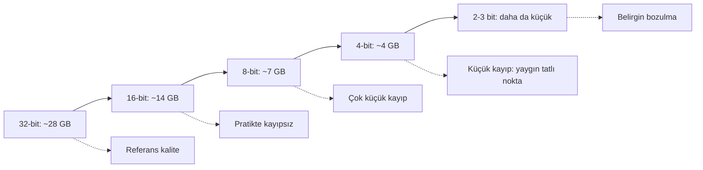

# 7.3 Quantization

## 1. Tek Cümlelik Özet (TL;DR)

**Quantization (nicemleme), modelin ağırlıklarını daha az bit'le saklayarak belleği ve maliyeti birkaç kat düşürür; karşılığında çoğu zaman küçük, bazen de fark edilir bir kalite kaybı ödenir.**

## 2. Günlük Hayattan Analoji: Fotoğrafı Sıkıştırmak

Fotoğraf makinesinden çıkan ham dosya onlarca megabayttır. Onu JPEG'e çevirdiğinizde boyut onda birine iner ve ekranda farkı göremezsiniz. Sıkıştırmayı artırdıkça dosya küçülmeye devam eder, ama bir noktadan sonra gökyüzünde bantlar, kenarlarda bozulmalar belirir.

Quantization, model ağırlıkları için aynı şeydir. Her ağırlığı milimetrik hassasiyetle saklamak yerine "yeterince yakın" bir değere yuvarlarsınız. Bir yere kadar kimse fark etmez; fazla sıkıştırırsanız model bozulur.

## 3. Görselleştirme



Bellek değerleri 7 milyar parametreli bir model için yaklaşıktır.

## 4. Nasıl Çalışır?

**Temel işlem.** Ağırlıklar eğitimde kayan noktalı sayılar olarak tutulur. Quantization, bu sürekli değerleri sınırlı sayıda basamağa eşler: 8-bit için 256, 4-bit için yalnızca 16 farklı değer.

```python
import numpy as np

def nicemle(w, bit):
    seviye = 2 ** bit - 1
    olcek = (w.max() - w.min()) / seviye
    q = np.round((w - w.min()) / olcek)            # tam sayıya yuvarla: saklanan bu
    return q * olcek + w.min()                     # kullanırken geri çevir

rng = np.random.default_rng(0)
w = rng.normal(0, 0.02, size=100_000).astype(np.float32)    # tipik ağırlık dağılımı

for bit in (8, 4, 2):
    hata = np.abs(w - nicemle(w, bit)).mean() / np.abs(w).mean()
    print(f"{bit}-bit: ortalama göreli hata %{100 * hata:.1f}")
```

Bit sayısı düştükçe hata hızla büyür. Gerçek yöntemler bu basit yuvarlamadan çok daha akıllıdır: ağırlık dağılımına uygun basamaklar seçer, hassas katmanları daha yüksek hassasiyette bırakır ve yuvarlama hatasını örnek veriyle telafi eder.

**İki yaklaşım:**

- **Eğitim sonrası (Post-Training Quantization):** Hazır modeli alır, sıkıştırırsınız. Hızlı ve ucuzdur; pratikte kullanılanların çoğu budur.
- **Nicemlemeye duyarlı eğitim (Quantization-Aware Training):** Model eğitilirken yuvarlamaya alıştırılır. Daha iyi kalite, çok daha yüksek maliyet.

**Karşınıza çıkacak formatlar:**

| Format / yöntem | Tipik kullanım |
|---|---|
| **GGUF** | llama.cpp ekosistemi; CPU ve dizüstü bilgisayarlarda yerel çalıştırma |
| **GPTQ, AWQ** | GPU üzerinde sunum; örnek veriyle kalibre edilen yöntemler |
| **bitsandbytes** | Yükleme anında 4/8-bit; özellikle QLoRA ile ince ayar (bkz. 4.3) |

**Distillation ile karıştırmayın.** Quantization aynı modeli daha az bit'le saklar. Distillation ise büyük bir modelin davranışını taklit etmek üzere **daha küçük, yeni bir model** eğitir. İkisi birlikte de kullanılabilir.

## 5. Ne Zaman Kullanılır / Ne Zaman Kullanılmaz?

| Durum | Öneri |
|---|---|
| Model GPU belleğine sığmıyor | ✅ 4-bit ya da 8-bit |
| Yerel ya da cihaz üstü çalıştırma | ✅ Fiilen zorunlu |
| Aynı donanımda daha fazla eşzamanlı istek | ✅ |
| Sınırlı bellekle ince ayar | ✅ QLoRA |
| Aynı bellek bütçesinde model seçimi | ⚠️ Daha büyük bir modelin 4-bit hali, küçük bir modelin tam hassasiyetli halinden çoğu zaman daha iyidir; kendi görevinizde ölçün |
| Kaliteden hiç ödün verilemeyen değerlendirme çalışmaları | ❌ Tam hassasiyet |
| Model zaten çok küçük | ⚠️ Küçük modeller sıkıştırmaya daha hassastır |
| API üzerinden model kullanıyorsunuz | ❌ Sizi ilgilendirmez; sağlayıcının işidir |

## 6. Sık Yapılan Hatalar & İpuçları

> [!WARNING]
> **Kalite kaybını kendi görevinizde ölçmemek.** Genel ölçümlerde "neredeyse aynı" görünen bir model, sizin dar görevinizde (uzun akıl yürütme, yapılandırılmış çıktı, Türkçe) daha belirgin bozulabilir. Aynı test setini iki sürümde de koşun.

> [!WARNING]
> **"Daha az bit, daha hızlı" varsayımı.** Bellek kesin olarak düşer; hız ise donanıma ve yazılım desteğine bağlıdır. Bazı kurulumlarda nicemlenmiş model daha yavaş çalışır. Ölçün.

> [!NOTE]
> **Aynı "4-bit" etiketi farklı kalitelere karşılık gelebilir.** Yöntem, kalibrasyon verisi ve hangi katmanların dışarıda bırakıldığı sonucu değiştirir.

> [!TIP]
> **Varsayılan başlangıç noktası 4-bit'tir.** Kalite yetmiyorsa bir kademe yukarı çıkın; bellek hâlâ yetmiyorsa daha fazla sıkıştırmak yerine daha küçük bir model değerlendirin.

**Akılda kalsın:** Quantization, kaliteden az verip bellekten çok kazandığınız bir takastır. Takasın sizin göreviniz için kârlı olup olmadığını yalnızca ölçüm söyler.

---

[← 7.2 Hallucination Azaltma](02-hallucination.md) · [7.4 Latency / Throughput Optimizasyonu →](04-latency-throughput.md)
