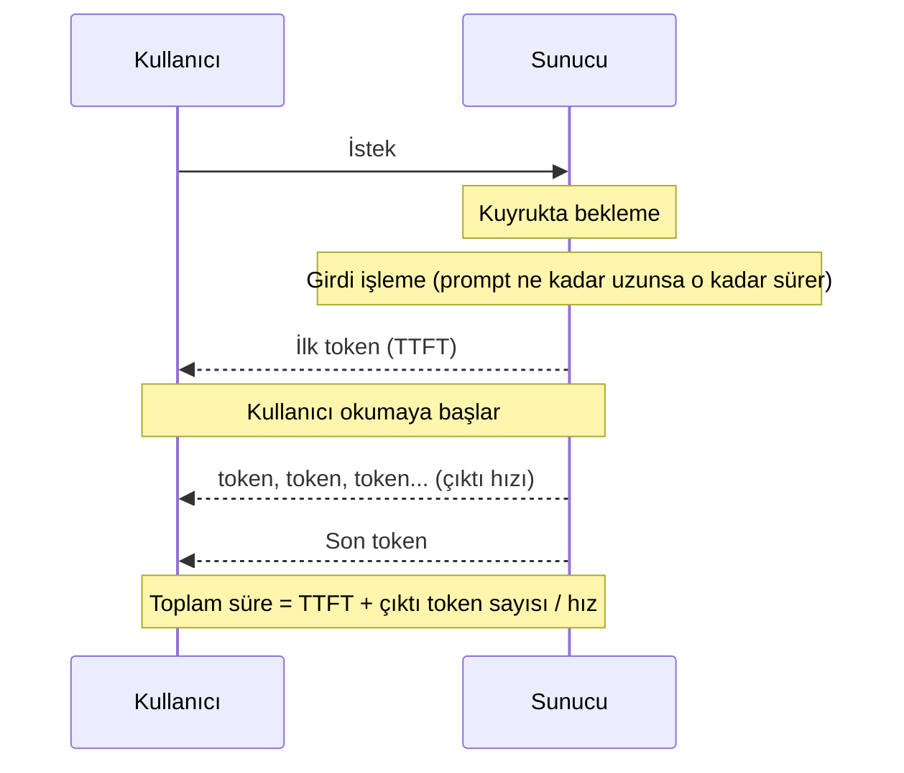

# 7.4 Latency / Throughput Optimizasyonu

## 1. Tek Cümlelik Özet (TL;DR)

**Latency tek bir kullanıcının ne kadar beklediği, throughput ise sistemin birim zamanda toplam ne kadar iş çıkardığıdır; ikisi çoğu zaman birbirine karşı çalışır ve optimizasyon, ürününüz için doğru dengeyi seçmektir.**

## 2. Günlük Hayattan Analoji: Taksi ve Dolmuş

Taksi siz biner binmez kalkar: bekleme süreniz en azdır, ama tek yolcu taşır. Dolmuş dolmasını bekler: siz biraz daha beklersiniz, ama aynı yakıtla on kişi taşınır ve kişi başı maliyet düşer.

Sohbet uygulaması taksi ister; kullanıcı ekrana bakıyor. Gece çalışan toplu belge işleme hattı dolmuş ister; kimse beklemiyor, önemli olan toplam maliyet. Aynı altyapıyla ikisini birden en iyi düzeye çıkaramazsınız.

## 3. Görselleştirme



## 4. Nasıl Çalışır?

**Ölçülecek üç sayı:**

- **TTFT (Time To First Token):** İlk token gelene kadar geçen süre. Kullanıcının "sistem cevap veriyor" hissini belirler. Kuyruk süresi ve girdi uzunluğuyla artar.
- **Çıktı hızı (token/saniye):** Üretim başladıktan sonraki akış hızı.
- **Toplam süre:** Yaklaşık olarak `TTFT + çıktı token sayısı / hız`.

```python
def toplam_sure(ttft, cikti_token, token_saniye):
    return ttft + cikti_token / token_saniye

print(f"Kısa cevap : {toplam_sure(0.5, 100, 50):.1f} sn")
print(f"Uzun cevap : {toplam_sure(0.5, 1500, 50):.1f} sn")     # çıktı uzunluğu baskın
print(f"Hızlı model: {toplam_sure(0.3, 1500, 150):.1f} sn")
```

Formülün gösterdiği şey: çoğu uygulamada süreyi **çıktı uzunluğu** belirler. Girdi token'ları paralel işlenir; çıktı token'ları tek tek üretilir.

**Kaldıraçlar (kabaca etki/emek sırasına göre):**

| Kaldıraç | Neyi iyileştirir? | Not |
|---|---|---|
| **Streaming** | Algılanan gecikme | Toplam süre aynı kalır ama kullanıcı hemen okumaya başlar |
| **Daha kısa çıktı** | Toplam süre, maliyet | Talimatla ve azami token sınırıyla |
| **Daha küçük / hızlı model** | Hepsi | Basit işler için küçük model; zor işleri büyüğe yönlendirme (*routing*) |
| **Prompt caching** | TTFT, maliyet | Tekrarlanan uzun ön ek (sistem talimatı, dokümanlar) bir kez işlenir |
| **Paralel çağrılar** | Toplam süre | Birbirinden bağımsız adımları aynı anda çalıştır |
| **Daha kısa girdi** | TTFT, maliyet | Gereksiz bağlamı ayıkla |
| **Batching** | Throughput, maliyet | İstekleri birlikte işler; tek istek biraz daha bekleyebilir |
| **Quantization** | Bellek, bazen hız | Bkz. 7.3 |
| **Cevap önbelleği** | Hepsi | Aynı ya da çok benzer sorulara saklanan cevabı dön |

**Sunucu tarafı (kendi barındırdığınız modeller için).** Modern çıkarım sunucuları *sürekli toplu işleme (continuous batching)* yapar: yeni gelen istekler, devam eden üretimlerin arasına dinamik olarak eklenir. Böylece GPU boş kalmaz ve throughput, gecikmeyi çok bozmadan artar. KV cache (bkz. 2.5) ise her token için baştan hesaplamayı önler.

## 5. Ne Zaman Kullanılır / Ne Zaman Kullanılmaz?

| Senaryo | Öncelikli metrik | Uygun kaldıraçlar |
|---|---|---|
| Sohbet arayüzü | TTFT, akış hızı | Streaming, prompt caching, kısa cevaplar |
| Sesli asistan | Uçtan uca gecikme (saniyenin altı hedeflenir) | Küçük ve hızlı model, kısa çıktı, akışı cümle cümle seslendirme |
| Kod tamamlama | TTFT | Çok küçük model, kısa bağlam |
| Agent (çok adımlı) | Görev başına toplam süre | Paralel araç çağrıları, caching, adım sayısını azaltma |
| Gece çalışan toplu işlem | Throughput, birim maliyet | Toplu işleme API'leri, yüksek eşzamanlılık; gecikme önemsiz |
| Günde birkaç yüz istek alan iç araç | ❌ Optimizasyona gerek yok | Önce kaliteyi doğrulayın |

## 6. Sık Yapılan Hatalar & İpuçları

> [!WARNING]
> **Ortalamaya bakmak.** Ortalama 2 saniye güzel görünür, ama her yirmi kullanıcıdan biri 15 saniye bekliyor olabilir. Yüzdelik dilimleri izleyin: p50, p95, p99.

> [!WARNING]
> **Önbelleği bozan prompt yapısı.** Prompt caching ön ek üzerinden çalışır. Tarih, kullanıcı adı gibi değişen bir bilgiyi prompt'un en başına koyarsanız arkasındaki her şey her istekte yeniden işlenir. Sabit içerik başa, değişken içerik sona.

> [!WARNING]
> **Streaming'siz uzun cevap.** Kullanıcı on saniye boş ekrana bakarsa uygulamanın bozulduğunu düşünür. Akış, toplam süreyi değiştirmeden deneyimi kökten iyileştirir.

> [!TIP]
> **Önce ölçün, sonra optimize edin.** Sürenin nerede geçtiğini (kuyruk, arama, model, araç çağrıları) gösteren bir iz kaydı olmadan yapılan optimizasyon çoğu zaman yanlış yeri hızlandırır.

**Akılda kalsın:** Bekleyen bir insan varsa gecikmeyi, yoksa birim maliyeti optimize edin. En büyük kaldıraç neredeyse her zaman çıktı uzunluğudur.

---

[← 7.3 Quantization](03-quantization.md) · [7.5 İzleme ve Güvenlik →](05-izleme-ve-guvenlik.md)
