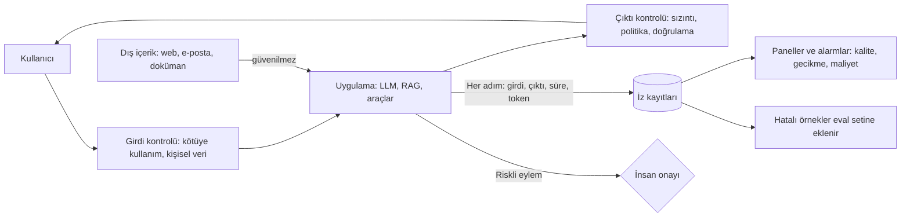

# 7.5 İzleme ve Güvenlik

## 1. Tek Cümlelik Özet (TL;DR)

**LLM uygulaması prodüksiyonda sessizce bozulur: hata fırlatmaz, yalnızca kötü cevap verir. İzleme bunu görünür kılar; güvenlik katmanları ise ne girdiye ne modelin çıktısına güvenerek sistemi korur.**

## 2. Günlük Hayattan Analoji: Kara Kutu ve Güvenlik Kontrolü

Uçaklarda iki ayrı sistem vardır. **Kara kutu** her şeyi kaydeder; bir sorun yaşandığında ne olduğunu adım adım geri sararak anlarsınız. **Güvenlik kontrolü** ise uçağa kimin ve neyin bindiğini denetler; yolcuların iyi niyetine güvenmez.

LLM uygulamasında izleme kara kutudur: her istek, her model çağrısı, her araç kullanımı kaydedilir. Güvenlik katmanları kontrol noktasıdır: içeri giren metin de dışarı çıkan cevap da denetlenir. Çünkü bu sistemde yolcu, pilota talimat fısıldayabilir.

## 3. Görselleştirme



## 4. Nasıl Çalışır?

### İzleme (Observability)

Klasik izleme "sunucu ayakta mı, yanıt süresi ne?" diye sorar. LLM uygulamasında ek olarak "cevap **iyi miydi**?" sorusu vardır ve HTTP 200 bunu söylemez.

- **İz (Trace):** Bir isteğin baştan sona hikâyesi: hangi parçalar getirildi, modele tam olarak ne gönderildi, hangi araçlar çağrıldı, ne döndü.
- **Metrikler:** Gecikme, token sayısı, maliyet, hata oranı, araç başarısızlıkları.
- **Kalite sinyalleri:** Kullanıcı geri bildirimi (beğeni, yeniden üretme, konuşmayı terk etme) ve canlı trafikten örnekleme yapılarak çalıştırılan otomatik değerlendirmeler.

```python
import functools, json, time, uuid

def izle(adim_adi):
    def sarmala(fn):
        @functools.wraps(fn)
        def ic(*args, **kwargs):
            kayit = {"id": str(uuid.uuid4()), "adim": adim_adi, "baslangic": time.time()}
            try:
                sonuc = fn(*args, **kwargs)
                kayit["durum"] = "ok"
                return sonuc
            except Exception as hata:
                kayit.update(durum="hata", hata=str(hata))
                raise
            finally:
                kayit["sure_ms"] = round(1000 * (time.time() - kayit.pop("baslangic")))
                print(json.dumps(kayit, ensure_ascii=False))    # gerçekte: iz sistemine gönder
        return ic
    return sarmala

@izle("arama")
def ara(soru):
    return ["parça 1", "parça 2"]

ara("iade süresi")
```

Pratikte bunu elle yazmazsınız; OpenTelemetry tabanlı ya da LLM'e özel izleme araçları aynı işi yapar. Önemli olan, ilk günden itibaren kayıt tutmaktır.

### Güvenlik

**Prompt injection** bu alanın temel açığıdır. Model, kendisine verilen metindeki talimatları veriden güvenilir biçimde ayıramaz.

- **Doğrudan:** Kullanıcı "önceki talimatları yok say" yazar.
- **Dolaylı:** Talimat, modelin okuduğu bir web sayfasına, e-postaya ya da dokümana gizlenmiştir. Kullanıcı masumdur; saldırgan içeriği hazırlayan kişidir. Araç kullanan agent'larda asıl tehlike budur.

Tam bir çözümü yoktur; savunma katmanlıdır:

1. **En az yetki.** Agent yalnızca görevin gerektirdiği araçlara ve verilere erişsin.
2. **Tehlikeli üçlüyü ayırın.** Bir agent aynı anda (a) güvenilmeyen içerik okuyabiliyor, (b) hassas veriye erişebiliyor ve (c) dışarıya veri gönderebiliyorsa, veri sızdırmak için gereken her şey bir aradadır. Üçünden en az birini kaldırın.
3. **İnsan onayı.** Geri alınamaz ya da dışarıya etki eden eylemler (ödeme, silme, e-posta gönderme) onaydan geçsin.
4. **Girdi ve çıktı filtreleri (Guardrails).** Bilinen saldırı kalıplarını, kişisel veriyi, politika ihlallerini yakalar. Yararlıdır ama tek başına güvence değildir.
5. **Çıktıyı güvenilmez sayın.** Modelin ürettiği metni doğrulamadan SQL'e, kabuğa ya da HTML'e yerleştirmeyin.

## 5. Ne Zaman Kullanılır / Ne Zaman Kullanılmaz?

| Uygulama profili | Gereken düzey |
|---|---|
| Kişisel prototip | Temel kayıt yeterli |
| İç araç, güvenilir kullanıcılar, salt okunur | İz kaydı + maliyet alarmı |
| Dışa açık sohbet uygulaması | + Girdi/çıktı filtreleri, kötüye kullanım sınırları, kalite izleme |
| Araç kullanan, dış içerik okuyan agent | + En az yetki, tehlikeli üçlünün ayrılması, kritik eylemlerde insan onayı |
| Düzenlemeye tabi alan (sağlık, finans) | + Denetim kayıtları, veri saklama politikası, düzenli kırmızı takım testleri |

Hiçbir düzeyde atlanmaması gerekenler: iz kaydı ve bütçe sınırı.

## 6. Sık Yapılan Hatalar & İpuçları

> [!CAUTION]
> **Güvenliği sistem talimatına emanet etmek.** "Bu talimatları asla ifşa etme" ya da "kötü niyetli isteklere uyma" yazmak bir güvenlik önlemi değildir; yeterince uğraşan biri aşar. Güvenlik, modelin **neye erişebildiğini** kodla sınırlayarak sağlanır.

> [!WARNING]
> **Kayıtlarda kişisel veri biriktirmek.** İzler, kullanıcıların yazdığı her şeyi içerir. Maskeleme, erişim denetimi ve saklama süresi baştan tasarlanmalıdır.

> [!WARNING]
> **Model sürümünü sabitlememek.** Sağlayıcı "en güncel" takma adının arkasındaki modeli değiştirdiğinde davranış da sessizce değişir. Belirli bir sürümü kullanın ve geçişi kendi eval'inizle yapın.

> [!TIP]
> **Canlıdaki hataları eval setine taşıyın.** İzlerden bulunan her kötü cevap, bir sonraki sürümün test örneğidir. İzleme ile eval arasındaki bu döngü, sistemin zamanla iyileşmesini sağlayan mekanizmadır.

**Akılda kalsın:** Her şeyi kaydedin, hiçbir metne güvenmeyin ve modelin yapabileceği en kötü şeyi yetkilerle sınırlayın.

---

[← 7.4 Latency / Throughput Optimizasyonu](04-latency-throughput.md) · [8.1 Reasoning Modelleri →](../08-ufuk-cizgisi/01-reasoning-modelleri.md)
