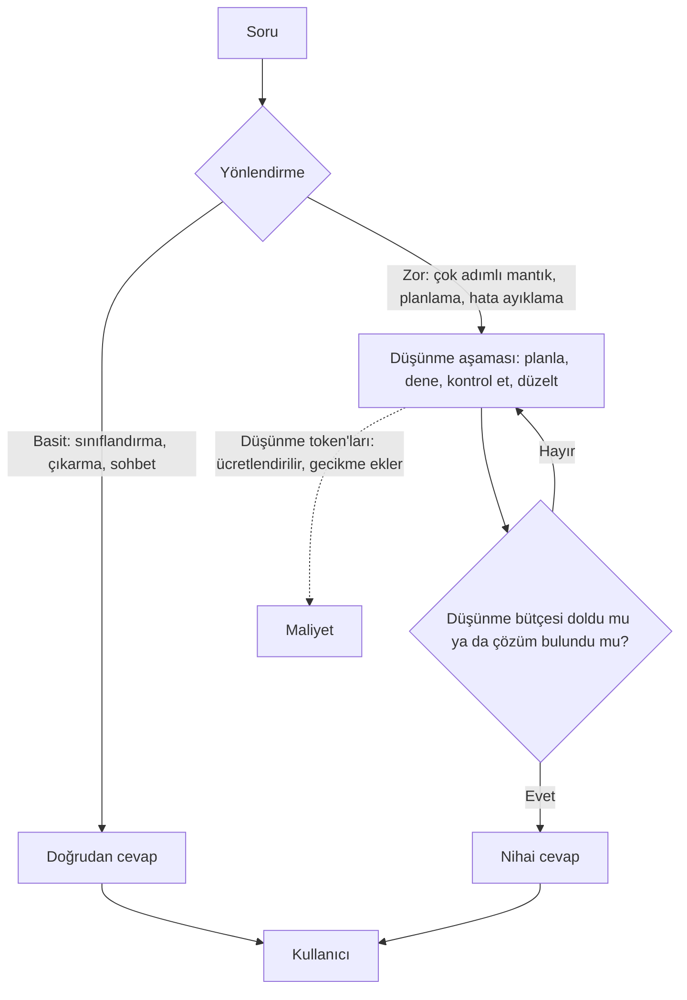

# 8.1 Reasoning Modelleri

## 1. Tek Cümlelik Özet (TL;DR)

**Reasoning modelleri, cevabı vermeden önce kendilerine "düşünme token'ları" üreterek problemi adım adım çözer; yani ek zekâyı eğitim sırasında değil, cevap anında harcanan hesaplamayla (test-time compute) satın alırsınız.**

## 2. Günlük Hayattan Analoji: Karalama Kâğıdı

"17 kere 24 kaç eder?" sorusuna anında cevap vermeye çalışırsanız büyük ihtimalle yanılırsınız. Elinize kâğıt kalem alırsanız ara adımları yazar, kontrol eder ve doğru sonuca varırsınız. Zekânız değişmedi; **düşünmek için yer ve zaman** kazandınız.

Psikolojideki ayrımla: hızlı, sezgisel düşünme ile yavaş, adım adım düşünme. Klasik LLM çağrısı birincisine benzer: ilk akla geleni yazar. Reasoning modeli ikincisini yapar: önce karalama kâğıdında çalışır, sonra temize çeker. Bedeli de aynıdır; yavaş düşünmek zaman alır.

## 3. Görselleştirme



## 4. Nasıl Çalışır?

**1. Neden işe yarıyor?** Model her token'ı tek bir ileri yayılımla üretir (bkz. 2.5); yani her adımda yapabileceği hesaplama sınırlıdır. Ara adımları yazdığında, bu adımlar bağlamın parçası olur ve sonraki token'lar onlara dayanabilir. Yazılan metin, modelin çalışma belleği işlevi görür.

**2. Gelişim çizgisi.**

- **Chain-of-Thought prompting:** Prompt'a "adım adım düşün" eklemek bile zor sorularda doğruluğu artırıyordu. Yetenek modeldeydi, tetiklenmesi gerekiyordu.
- **Eğitimle kazandırılan akıl yürütme:** Modeller, cevaptan önce uzun bir düşünme süreci yürütecek biçimde, çoğunlukla pekiştirmeli öğrenmeyle eğitildi. Doğru sonuca götüren düşünme biçimleri ödüllendirildi.
- **Ayarlanabilir bütçe:** Güncel modellerde ne kadar düşünüleceği bir parametreyle ya da modelin kendi kararıyla ayarlanır.

**3. Test-time compute.** Geleneksel olarak daha iyi sonuç için daha büyük model eğitilirdi. Reasoning modelleri ikinci bir eksen açtı: aynı model, daha uzun düşünerek daha zor problemleri çözer. Bu, çıkarım maliyetini kalite için ayarlanabilir bir düğmeye çevirir.

**4. Uygulamadaki karşılığı.** Her isteğe aynı düşünme düzeyini uygulamak israftır. Yaygın desen, işin zorluğuna göre yönlendirmedir:

```python
def cevapla(soru):
    zorluk = hizli_model(
        "Bu istek çok adımlı akıl yürütme gerektiriyor mu? Yalnızca EVET ya da HAYIR yaz.\n" + soru
    )
    if "EVET" in zorluk.upper():
        # Zor iş: güçlü model, geniş düşünme bütçesi; yavaş ve pahalı
        return guclu_model(soru, dusunme="yuksek", azami_token=16000)
    # Kolay iş: hızlı model, düşünme kapalı; ucuz ve anında
    return hizli_model(soru)
```

Parametre adları sağlayıcıya göre değişir; fikir aynıdır.

## 5. Ne Zaman Kullanılır / Ne Zaman Kullanılmaz?

| Görev | Düşünme | Neden |
|---|---|---|
| Çok adımlı matematik ve mantık problemleri | ✅ Yüksek | Ara adımlar olmadan hata birikir |
| Karmaşık hata ayıklama, mimari tasarım | ✅ Yüksek | Birden çok hipotezi tartmak gerekir |
| Uzun agent görevlerinde planlama | ✅ Orta-yüksek | Yanlış plan, sonraki tüm adımları boşa çıkarır |
| Belirsiz, çok kısıtlı kararlar | ✅ Orta | |
| Sınıflandırma, veri çıkarma, biçim dönüştürme | ❌ Kapalı | Kalite artmaz; maliyet ve gecikme artar |
| Günlük sohbet, basit soru-cevap | ❌ Kapalı ya da düşük | |
| Gerçek zamanlı etkileşim (ses, otomatik tamamlama) | ❌ Kapalı | Gecikme bütçesi yok |
| Yüksek hacimli toplu işler | ⚠️ Yalnızca gerekli alt kümede | Maliyet hızla katlanır |

## 6. Sık Yapılan Hatalar & İpuçları

> [!WARNING]
> **Her isteğe en yüksek düşünme düzeyini açmak.** Basit işlerde kaliteye katkısı yoktur, ama gecikmeyi ve faturayı katlar. Düşünme token'ları da ücretlendirilir.

> [!WARNING]
> **Reasoning modelini mikro yönetmek.** "Önce şunu, sonra bunu düşün" gibi ayrıntılı adım talimatları, kendi başına akıl yürütmek üzere eğitilmiş modellerde çoğu zaman gereksizdir, bazen zarar verir. Hedefi ve kısıtları net verin, yöntemi modele bırakın.

> [!NOTE]
> **Görünen düşünme metni, modelin iç işleyişinin birebir dökümü değildir.** Model, yazdığı gerekçeden farklı bir yoldan sonuca varmış olabilir. Düşünme çıktısı hata ayıklamada yararlı bir ipucudur, kanıt değildir.

> [!TIP]
> **Düşünme düzeyini eval ile seçin.** Aynı test setini farklı düzeylerde koşun. Kalitenin artmayı bıraktığı nokta, sizin için doğru ayardır.

**Akılda kalsın:** Düşünme, cevap anında satın alınan zekâdır. Zor işte çok değerlidir, kolay işte israftır.

---

[← 7.5 İzleme ve Güvenlik](../07-llmops/05-izleme-ve-guvenlik.md) · [8.2 World Models (Dünya Modelleri) →](02-world-models.md)
