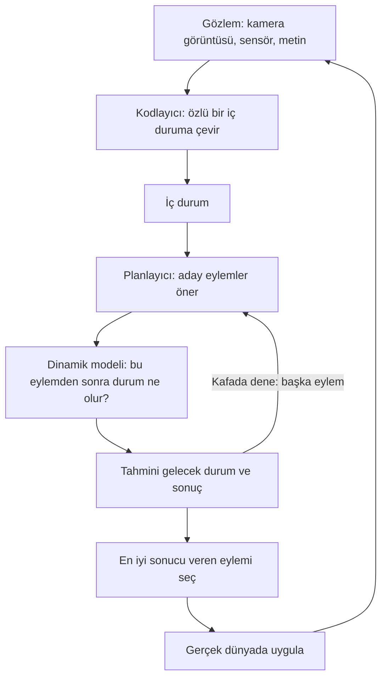

# 8.2 World Models (Dünya Modelleri)

## 1. Tek Cümlelik Özet (TL;DR)

**Dünya modeli, bir sistemin "şunu yaparsam ne olur?" sorusunu harekete geçmeden önce kafasında canlandırabilmesini sağlayan içsel temsildir; LLM'lerin metinden böyle bir model öğrenip öğrenmediği ise alanın en canlı tartışmalarından biridir.**

## 2. Günlük Hayattan Analoji: Hamleyi Kafada Oynamak

Satranç oyuncusu taşa dokunmadan önce düşünür: "Atı buraya oynarsam o fili çeker, ben de kaleyle karşılık veririm." Tahta üzerinde hiçbir şey değişmemiştir; her şey kafasındaki tahtada olur.

Bardağı masanın kenarına koyarken de aynısını yaparsınız: düşeceğini, kırılacağını, suyun döküleceğini **denemeden** bilirsiniz. Çünkü kafanızda dünyanın nasıl işlediğine dair bir model vardır. Bu model sayesinde hatayı gerçek dünyada değil, hayalinizde yaparsınız.

## 3. Görselleştirme



## 4. Nasıl Çalışır?

**1. Pekiştirmeli öğrenmedeki kökeni.** Bir robotun yürümeyi gerçek dünyada milyonlarca kez düşerek öğrenmesi yavaş, pahalı ve tehlikelidir. Çözüm: önce ortamın nasıl davrandığını öğrenen bir model kur, sonra bu modelin içinde, yani "hayal ederek" pratik yap. Bu yaklaşım, oyun ve kontrol problemlerinde çok daha az gerçek denemeyle öğrenmeyi mümkün kıldı.

**2. Üç bileşen.**

- **Temsil:** Ham gözlemi (pikseller) karar için önemli olan özlü bir duruma indirger.
- **Dinamik:** Bir durum ve bir eylem verildiğinde sonraki durumu tahmin eder.
- **Planlama:** Dinamik modelini kullanarak eylem dizilerini ileriye doğru dener ve en iyisini seçer.

Fikri en yalın haliyle gösteren bir örnek:

```python
def dunya_modeli(konum, eylem):
    """Öğrenilmiş dinamik: bu eylemden sonra nerede olurum?"""
    return konum + {"sol": -1, "dur": 0, "sag": +1}[eylem]

def planla(konum, hedef, derinlik=3):
    """Eylem dizilerini gerçekte uygulamadan, modelin içinde dene."""
    if derinlik == 0 or konum == hedef:
        return abs(hedef - konum), []
    en_iyi = (float("inf"), [])
    for eylem in ("sol", "dur", "sag"):
        mesafe, devam = planla(dunya_modeli(konum, eylem), hedef, derinlik - 1)
        if mesafe < en_iyi[0]:
            en_iyi = (mesafe, [eylem] + devam)
    return en_iyi

print(planla(konum=0, hedef=3))     # hiçbir gerçek adım atmadan bulunan plan
```

**3. Güncel yönler.**

- **Video ve etkileşimli ortam üretimi:** Sonraki kareleri tahmin eden büyük modeller, fiziğe benzer davranışlar sergileyen sahneler ve içinde gezilebilen ortamlar üretebiliyor. Bunların ne ölçüde "fiziği anladığı" tartışmalıdır.
- **Gizli uzayda tahmin:** Bazı araştırmacılar, pikselleri tek tek tahmin etmenin israf olduğunu, modelin soyut bir temsil uzayında tahmin yapması gerektiğini savunur.
- **Robotik ve otonom sürüş:** Dünya modelleri, nadir ve tehlikeli senaryoları simülasyonda üretmek ve eylemlerin sonucunu önceden kestirmek için kullanılır.

**4. LLM'ler dünya modeli öğrenir mi?**

| "Evet, bir ölçüde" diyenlerin dayanağı | "Hayır, yeterince değil" diyenlerin dayanağı |
|---|---|
| Yalnızca hamle dizileriyle eğitilen modellerin içinde oyun tahtasının durumunu izleyen temsiller bulundu | Bu temsiller çoğu zaman kırılgan; alışılmadık durumlarda tutarsızlaşıyor |
| İyi tahmin için metnin arkasındaki dünyayı modellemek gerekir | Metin, dünyanın dolaylı ve eksik bir yansımasıdır; fiziksel sezgi metinden öğrenilemeyebilir |
| Modeller mekânsal ve nedensel sorularda giderek iyileşiyor | Başarı, anlama yerine geniş bir kalıp eşleştirmesiyle de açıklanabilir |

Olgun bir bakış ikili bir cevap aramaz: modellerin iç temsilleri var, ama bu temsillerin ne kadar tutarlı ve genellenebilir olduğu görevden göreve değişiyor.

## 5. Ne Zaman Kullanılır / Ne Zaman Kullanılmaz?

| Alanınız | Dünya modelleri sizin için ne ifade eder? |
|---|---|
| Robotik, otonom sistemler, oyun yapay zekâsı | ✅ Doğrudan ilgili; simülasyonda öğrenme ve planlama temel araçtır |
| Simülasyon ve sentetik veri üretimi | ✅ Nadir senaryoları çoğaltmak için |
| Fiziksel ya da mekânsal akıl yürütme gerektiren LLM uygulamaları | ⚠️ Modelin sezgisine güvenmeyin; hesaplamayı ve simülasyonu araçla yaptırın |
| Metin tabanlı ürünler: RAG, sohbet, doküman işleme | ❌ Günlük mühendislik kararlarınızı etkilemez; tartışmayı takip etmek yeterli |

Agent geliştiricileri için pratik bir karşılık: agent'a eylemin sonucunu **önceden görme** imkânı vermek (deneme ortamı, kuru çalıştırma modu, test paketi), ona küçük bir dünya modeli vermektir ve güvenilirliği belirgin biçimde artırır.

## 6. Sık Yapılan Hatalar & İpuçları

> [!WARNING]
> **Gerçekçi görüntüyü anlama kanıtı saymak.** Göze inandırıcı gelen bir video, modelin fizik yasalarını öğrendiğini göstermez. Asıl sınav, alışılmadık durumlarda ve uzun süreli tutarlılıkta verilir.

> [!WARNING]
> **Tartışmayı "anlıyor / anlamıyor" ikiliğine indirgemek.** Daha verimli soru şudur: hangi görevde, ne kadar tutarlı ve hangi koşulda bozuluyor?

> [!NOTE]
> **Terim iki farklı anlamda kullanılıyor.** Bazen açıkça inşa edilmiş bir simülatör modeli, bazen de bir modelin içinde kendiliğinden oluşan temsiller kastedilir. Bir iddiayı okurken hangisinin kastedildiğine bakın.

> [!TIP]
> **Fiziksel doğruluk gerekiyorsa** modelin tahminine değil, gerçek bir simülatöre ya da hesaplama aracına dayanın.

**Akılda kalsın:** Dünya modeli, harekete geçmeden önce sonucu hayal edebilmektir. Bu yeteneğin makinelerde ne kadar bulunduğu hâlâ açık bir sorudur.

---

[← 8.1 Reasoning Modelleri](01-reasoning-modelleri.md) · [8.3 AI Safety →](03-ai-safety.md)
