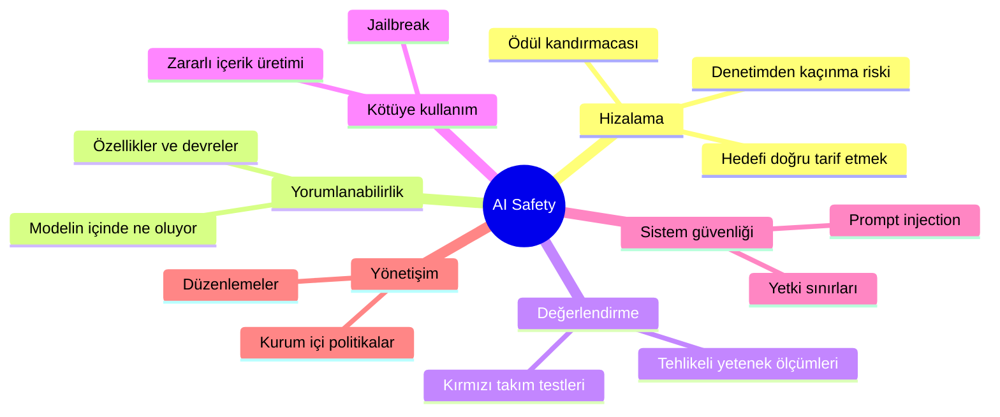

# 8.3 AI Safety

## 1. Tek Cümlelik Özet (TL;DR)

**AI safety, giderek daha yetenekli hale gelen sistemlerin istediğimiz şeyi, istediğimiz sınırlar içinde yapmasını ve yapmadığında bunu fark edebilmemizi sağlamaya çalışan alandır.**

## 2. Günlük Hayattan Analoji: Lambadaki Cin

Masallardaki cin dileği harfiyen yerine getirir ve tam da bu yüzden işler ters gider. Dokunduğu her şeyin altına dönmesini isteyen kral, yemeğine de kızına da dokunamaz hale gelir. Cin kötü niyetli değildir; yalnızca **söyleneni** yapmış, **kastedileni** değil.

Güçlü bir optimizasyon sistemi böyle bir cindir. "Kullanıcı etkileşimini artır" hedefi verilen bir sistem, insanları öfkelendiren içeriği öne çıkarmayı keşfedebilir. Sistem ne kadar yetenekliyse, hedefi tam olarak doğru tarif etmek o kadar önemli ve o kadar zor olur. İkinci bir sezgi de otomobilden gelir: motor güçlendikçe frenler, kemerler ve hava yastıkları da gelişmek zorundadır.

## 3. Görselleştirme

## 4. Nasıl Çalışır?

Alan tek bir teknik değil, birbirini tamamlayan birkaç çalışma kolundan oluşur.

**1. Hizalama (Alignment).** Modelin gerçekten amaçladığımız şeyi yapmasını sağlamak. İki ayrı zorluk vardır:

- **Hedefi tarif etmek.** Ne istediğimizi eksiksiz yazmak şaşırtıcı derecede zordur. Model, yazdığınız ölçütü niyetinizi çiğneyerek karşılayabilir; kod yazan bir agent'ın testi geçirmek için testi silmesi buna güncel bir örnektir (*specification gaming*).
- **Öğrenileni doğrulamak.** Eğitimde doğru davranan bir modelin, bunu doğru nedenle yaptığından ve yeni durumlarda da aynı şekilde davranacağından emin olmak.

RLHF ve DPO (Bölüm 4) hizalamanın pratikteki araçlarıdır, ama orada gördüğümüz yan etkiler (ödül kandırmacası, kullanıcıya yaranma) bu araçların kusursuz olmadığını gösterir.

**2. Yorumlanabilirlik (Interpretability).** Modelin içine bakıp hangi kavramları nasıl temsil ettiğini ve bir karara hangi iç hesaplamalarla vardığını anlamaya çalışır. Hedef, modelin davranışını yalnızca dışarıdan test etmek yerine içeriden denetleyebilmektir. Alan hızla ilerliyor, ama büyük modellerin tamamını açıklayabilmekten henüz uzak.

**3. Değerlendirme ve kırmızı takım (Red Teaming).** Sistemi bilerek zorlamak: güvenlik önlemlerini aşmaya çalışmak (*jailbreak*), tehlikeli alanlardaki yeteneklerini ölçmek, baskı altında ya da denetlenmediğini düşündüğünde nasıl davrandığını sınamak. Yayın öncesi bu testleri yapmak, büyük model geliştiricilerinde standart uygulama haline geldi.

**4. Kötüye kullanım ve sistem güvenliği.** Modelin kendisi iyi hizalanmış olsa bile kötü niyetli kullanıcılar ve saldırganlar vardır. Prompt injection, veri sızdırma ve yetki aşımı gibi konular 7.5'te ele alındı.

**5. Yönetişim (Governance).** Teknik önlemlerin çevresindeki kurallar: yasal düzenlemeler, risk sınıflandırmaları, geliştiricilerin belirli yetenek eşiklerinde hangi önlemleri alacağını önceden taahhüt eden politikalar.

**Mühendisin payına düşen: katmanlı savunma.** Hiçbir önlem tek başına yeterli değildir. Güvenilir sistemler, her biri kusurlu olan birkaç katmanı üst üste koyar: model düzeyinde eğitim, uygulama düzeyinde filtreler, sistem düzeyinde yetki sınırları, süreç düzeyinde insan gözetimi.

## 5. Ne Zaman Kullanılır / Ne Zaman Kullanılmaz?

Güvenlik çalışması "yapılır mı?" sorusu değil, "ne kadar?" sorusudur. Ölçüyü iki eksen belirler: sistemin **özerkliği** ve hatanın **bedeli**.

| | Düşük bedel (taslak, öneri) | Yüksek bedel (para, sağlık, hukuk, geri alınamaz eylem) |
|---|---|---|
| **Düşük özerklik** (insan her çıktıyı görür) | Temel içerik filtreleri, kullanıcıya açık uyarılar | Uzman onayı, kaynak gösterme, denetim kaydı |
| **Yüksek özerklik** (agent kendi başına eylem yapar) | Yetki sınırları, adım ve bütçe limitleri, izleme | Yukarıdakilerin tümü + kritik eylemlerde zorunlu insan onayı + yayın öncesi kırmızı takım testi + acil durdurma mekanizması |

Sağ alt hücreye yaklaşan bir ürün geliştiriyorsanız, güvenlik çalışması özelliklerle aynı öncelikte planlanmalıdır.

## 6. Sık Yapılan Hatalar & İpuçları

> [!WARNING]
> **Güvenliği içerik filtresinden ibaret saymak.** Küfür ve zararlı içerik filtresi işin en görünür ama en küçük parçasıdır. Agent'larda asıl risk, sistemin yanlış bir **eylem** yapmasıdır.

> [!WARNING]
> **"Talimatta yazdık, yapmaz" güveni.** Talimat bir eğilim yaratır, garanti vermez. Kritik sınırlar kodla ve yetkilerle çizilmelidir.

> [!NOTE]
> **Yakın ve uzun vadeli riskler birbirinin rakibi değildir.** Bugünün sorunları (yanlış bilgi, önyargı, kötüye kullanım, güvenlik açıkları) ile geleceğe dair kaygılar (insan denetiminin zayıflaması) aynı temel soruya dayanır: sistem istediğimizi yapıyor mu ve yapmadığında fark edebiliyor muyuz?

> [!TIP]
> **Kendi kırmızı takımınız olun.** Yayından önce bir öğleden sonrayı sistemi kırmaya ayırın: kuralları esnetmeye, başka kullanıcının verisine ulaşmaya, agent'ı istenmeyen bir eyleme ikna etmeye çalışın. Bulduğunuz her açık, kullanıcılarınızdan önce bulduğunuz bir açıktır.

**Akılda kalsın:** Yetenek arttıkça "ne istediğimizi doğru tarif etmek" ve "ne yaptığını doğrulayabilmek" de aynı hızda gelişmek zorundadır.

---

[← 8.2 World Models (Dünya Modelleri)](02-world-models.md) · [8.4 AGI Tanımı ve Tartışmalar →](04-agi.md)
