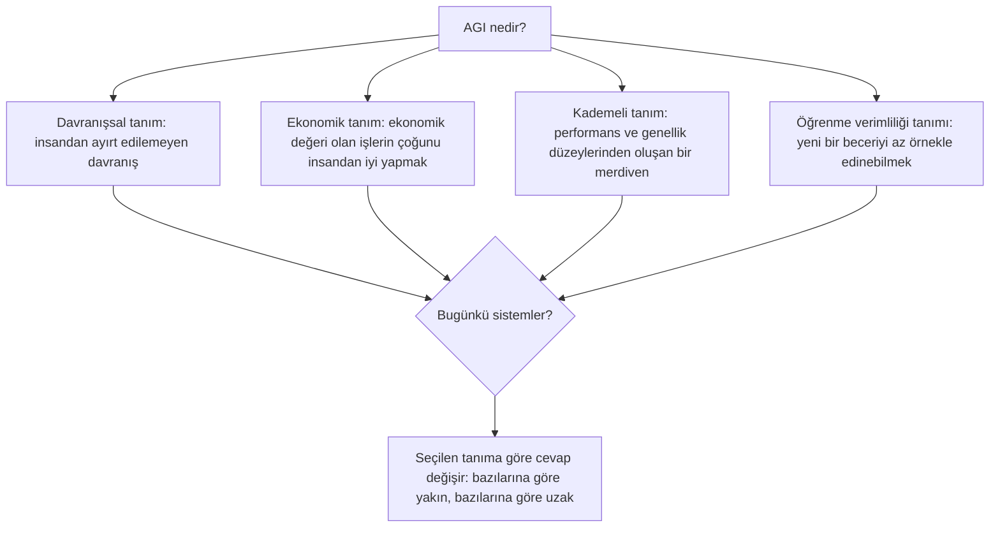

# 8.4 AGI Tanımı ve Tartışmalar

## 1. Tek Cümlelik Özet (TL;DR)

**AGI (Artificial General Intelligence, Yapay Genel Zekâ), kabaca "insanın yapabildiği bilişsel işlerin çoğunu en az insan kadar iyi yapabilen sistem" demektir; ancak üzerinde uzlaşılmış tek bir tanımı ve dolayısıyla "ulaştık mı?" sorusunun tek bir cevabı yoktur.**

## 2. Günlük Hayattan Analoji: "Yetişkin Olmak" Ne Demek?

Bir insan ne zaman yetişkin olur? On sekiz yaşına bastığında mı? Ehliyet aldığında mı? Kendi evine çıktığında, ilk maaşını aldığında, çocuğu olduğunda mı? Hangi ölçütü seçtiğinize göre aynı kişi yetişkindir ya da değildir. Ve yetişkinlik bir gecede gerçekleşmez; kişi bazı açılardan olgun, bazı açılardan hâlâ çocuktur.

AGI tartışması böyledir. "AGI'ye ulaşıldı mı?" sorusuna verilen farklı cevapların çoğu, olgular hakkındaki değil **tanım** hakkındaki anlaşmazlıktan doğar.

## 3. Görselleştirme

## 4. Nasıl Çalışır?

**1. Dar ve genel zekâ.** Satranç programı dünya şampiyonunu yener ama dama oynayamaz: bu dar zekâdır. "Genel" kelimesi, tek bir sistemin çok farklı görevlerde, o göreve özel olarak tasarlanmadan başarılı olmasını anlatır. LLM'ler bu yönde belirgin bir adımdır: aynı model çeviri yapar, kod yazar, sınav sorusu çözer.

**2. Rakip tanımlar.**

| Yaklaşım | Ölçüt | Zayıf yanı |
|---|---|---|
| **Davranışsal** | Konuşmada insandan ayırt edilememek | İkna edici konuşmak, yetkin olmakla aynı şey değil |
| **Ekonomik** | Ekonomik açıdan değerli işlerin çoğunda insanı geçmek | "Çoğu" ve "iş" tanımları esnek; fiziksel işler dahil mi? |
| **Kademeli** | Performans (acemi, yetkin, uzman, insanüstü) ve genellik düzeyleri | Bir eşik değil, bir yelpaze sunar; "ulaşıldı" anı yoktur |
| **Öğrenme verimliliği** | Daha önce görmediği türde bir problemi az örnekle çözebilmek | Ölçmesi zor; testler zamanla aşılabiliyor |

**3. Pürüzlü sınır (Jagged Frontier).** Bugünkü sistemlerin yetenek profili insanınkine benzemez. Aynı model bir alanda uzman düzeyinde iş çıkarırken, bir çocuğun kolayca yaptığı başka bir işte tökezleyebilir. "İnsan düzeyi" tek bir çizgi olmadığı için "geçti mi?" sorusu da tek bir cevaba sığmaz.

**4. Ölçüm sorunu.**

- **Doygunluk:** Zor diye tasarlanan testler birkaç yıl içinde tavan yapıyor.
- **Sızıntı:** Test soruları eğitim verisine karışabiliyor; ölçülen şey yetenek mi, hatırlama mı?
- **Test ile gerçek iş arasındaki fark:** Sınav sorusu çözmek ile haftalarca süren, belirsiz tanımlı bir projeyi yürütmek farklı becerilerdir. Bu yüzden bazı güncel ölçümler, sistemlerin kendi başına tamamlayabildiği görevlerin **uzunluğuna** bakıyor.

**5. İki kamp.**

| İyimser görüş | Şüpheci görüş |
|---|---|
| Ölçekleme, daha iyi eğitim yöntemleri ve agent yapıları ilerlemeyi sürdürüyor | Mevcut yaklaşımın temel eksikleri var: sürekli öğrenememe, örnek verimsizliği, güvenilirlik |
| Sistemlerin kendi başına tamamlayabildiği görevler düzenli biçimde uzuyor | Test başarısı gerçek dünyadaki özerkliğe aynı oranda yansımıyor |
| Yapay zekânın yapay zekâ araştırmasını hızlandırması ilerlemeyi katlayabilir | Fiziksel dünya, veri ve enerji gibi darboğazlar hızı sınırlar |
| Yeni bir mimari atılım gerekmeyebilir | Dünya modeli ve planlama için yeni fikirler gerekebilir (bkz. 8.2) |

İki kampta da ciddi araştırmacılar var. Zaman tahminleri birkaç yıl ile onlarca yıl arasında değişiyor ve geçmişteki tahminlerin isabeti her iki yönde de zayıf.

## 5. Ne Zaman Kullanılır / Ne Zaman Kullanılmaz?

AGI bir araç değil, bir tartışmadır. Mühendis için soru şudur: bu tartışma hangi kararlarımı etkilemeli?

| Karar | AGI tartışmasına göre mi? | Öneri |
|---|---|---|
| Bugün hangi özelliği geliştireceğim? | ❌ | Bugünkü modellerin kendi eval'inizde gösterdiği yeteneğe göre karar verin |
| Mimariyi nasıl kuracağım? | ⚠️ Kısmen | Modeli kolayca değiştirebileceğiniz biçimde kurun; daha iyi model geldiğinde hemen yararlanın |
| Modelin eksiğini kapatan karmaşık bir yapı kurmalı mıyım? | ⚠️ Kısmen | Kurun ama hafif tutun; bir sonraki model nesli bu yapıyı gereksiz kılabilir |
| Hangi beceriye yatırım yapmalıyım? | ✅ | Problem tanımlama, değerlendirme tasarımı, sistem düşüncesi; bunlar model değişse de değerini korur |
| Güvenlik ve gözetime ne kadar önem vermeliyim? | ✅ | Yetenek ve özerklik arttıkça önemi artar (bkz. 8.3) |

## 6. Sık Yapılan Hatalar & İpuçları

> [!WARNING]
> **Tek bir test sonucunu AGI kanıtı ya da çürütmesi saymak.** Bir sınavı geçmek genel zekâyı, tek bir basit soruda yanılmak da yeteneksizliği kanıtlamaz. Profil pürüzlüdür; ikisi aynı anda doğru olabilir.

> [!WARNING]
> **Bugünkü sınırı kalıcı, bugünkü yeteneği genel sanmak.** "Modeller bunu asla yapamaz" iddialarının birçoğu kısa sürede eskidi. Öte yandan bir gösterimde etkileyici çalışan sistemin her koşulda güvenilir çalışacağı varsayımı da aynı sıklıkta yanlış çıkıyor.

> [!NOTE]
> **Tanımların arkasında çıkarlar da vardır.** Bir kurumun "AGI" için seçtiği tanım, o kurumun stratejisini, pazarlamasını ya da sözleşmelerini yansıtıyor olabilir. Bir iddiayı okurken hangi tanımın kullanıldığına bakın.

> [!TIP]
> **"AGI geldi mi?" yerine daha yararlı sorular sorun:** Hangi işleri, hangi güvenilirlikle, ne kadar süre gözetimsiz yapabiliyor? Bu soruların ölçülebilir cevapları var ve kararlarınızı gerçekten etkiliyor.

**Akılda kalsın:** AGI bir bitiş çizgisi değil, tanımı tartışmalı bir yelpazedir. Etikete değil, sistemin bugün ölçülebilir biçimde neyi yapıp neyi yapamadığına bakın.

---

[← 8.3 AI Safety](03-ai-safety.md)
