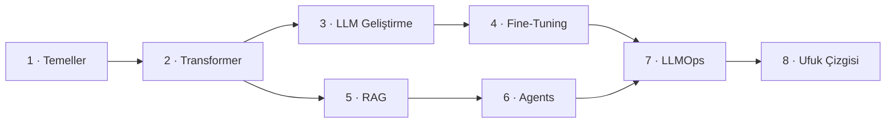

# AI & LLM Mühendisliği El Kitabı

Makine öğrenmesinin temellerinden LLM geliştirmeye, Fine-Tuning'den RAG'e, agent'lardan AGI tartışmalarına uzanan; **sezgisel ama teknik doğruluğundan ödün vermeyen** açık kaynak bir Türkçe el kitabı.

**Kimler için?** Yazılımcılar, veri bilimine geçmek isteyenler ve AI ürünü geliştiren mühendisler.

## Bu kitap nasıl okunur?

Her konu aynı 6 adımlı şablonla yazılır; bir sayfayı okuduysanız hepsinin haritasını bilirsiniz:

| # | Adım | Ne işe yarar? |
|---|------|---------------|
| 1 | **Tek Cümlelik Özet (TL;DR)** | Konuyu tek cümlede cebinize koyar |
| 2 | **Günlük Hayattan Analoji** | Teknik detaydan önce sezgiyi kurar |
| 3 | **Görselleştirme** | Mimariyi veya veri akışını diyagramla gösterir |
| 4 | **Nasıl Çalışır?** | Mekanizmayı adım adım, kısa bir kod örneğiyle anlatır |
| 5 | **Ne Zaman Kullanılır / Kullanılmaz?** | Mühendislik karar matrisi |
| 6 | **Sık Yapılan Hatalar & İpuçları** | Pratikte karşınıza çıkacak tuzaklar |



> [!TIP]
> **Acelesi olanlar için kısa yol:** Model eğitmeyecek, hazır LLM'lerle ürün geliştirecekseniz 1 → 2 → 5 → 6 → 7 sırası yeterlidir. Bölüm 3 ve 4'e ihtiyaç duyduğunuzda dönersiniz.

## Klasör yapısı

```text
ai-llm-el-kitabi/
├── README.md                      # GitHub vitrini: kitap ne, nasıl katkı verilir
├── mkdocs.yml                     # Site ayarları ve menü (nav)
└── docs/
    ├── index.md                   # Bu sayfa: yol haritası + içindekiler
    ├── 01-temeller/
    ├── 02-transformer/
    ├── 03-llm-gelistirme/
    ├── 04-hizalama-ve-fine-tuning/
    ├── 05-rag/
    ├── 06-agents/
    ├── 07-llmops/
    ├── 08-ufuk-cizgisi/
    ├── ekler/                     # Sözlük, kaynakça, bölüm şablonu
    └── assets/                    # SVG şemalar ve görseller
```

Adlandırma kuralı: klasörler `NN-konu/`, sayfalar `NN-baslik.md`; Türkçe karakter ve boşluk kullanılmaz, böylece URL'ler temiz kalır.

## İçindekiler

Durum: ✅ yazıldı · 📝 sırada

### Bölüm 1 — Temeller · `docs/01-temeller/`

| # | Dosya | Konu | Alt başlıklar | Durum |
|---|-------|------|---------------|-------|
| 1.1 | [`01-ml-nedir.md`](01-temeller/01-ml-nedir.md) | Makine Öğrenmesi Nedir? | Kural yazmak vs. veriden öğrenmek · model, parametre, kayıp · eğitim ve çıkarım · üç öğrenme türüne kuş bakışı | ✅ |
| 1.2 | [`02-ogrenme-turleri.md`](01-temeller/02-ogrenme-turleri.md) | Öğrenme Türleri | Gözetimli (Supervised) · Gözetimsiz (Unsupervised) · Pekiştirmeli (Reinforcement) · Kendi Kendine Gözetimli (Self-Supervised) ve LLM'lerle bağı | ✅ |
| 1.3 | [`03-sinir-aglari.md`](01-temeller/03-sinir-aglari.md) | Sinir Ağları (Neural Networks) | Nöron, ağırlık, bias · aktivasyon fonksiyonları · katmanlar ve derinlik · ileri yayılım (Forward Pass) | ✅ |
| 1.4 | [`04-geri-yayilim.md`](01-temeller/04-geri-yayilim.md) | Geri Yayılım (Backpropagation) | Kayıp fonksiyonu · gradyan inişi (Gradient Descent) · zincir kuralı sezgisi · öğrenme oranı | ✅ |
| 1.5 | [`05-egitim-pratigi.md`](01-temeller/05-egitim-pratigi.md) | Eğitim Pratiği | Train/validation/test · aşırı öğrenme (Overfitting) · regularization · optimizer'lar (SGD, Adam) · batch ve epoch | ✅ |

### Bölüm 2 — Derin Öğrenme & Transformer Devrimi · `docs/02-transformer/`

| # | Dosya | Konu | Alt başlıklar | Durum |
|---|-------|------|---------------|-------|
| 2.1 | [`01-tokenization.md`](02-transformer/01-tokenization.md) | Tokenization | Metin neden parçalanır · BPE / WordPiece / SentencePiece · Türkçe ve eklemeli dillerde token maliyeti · bağlam penceresi (Context Window) | ✅ |
| 2.2 | [`02-embeddings.md`](02-transformer/02-embeddings.md) | Embeddings (Vektör Uzayı) | Anlamı sayıya çevirmek · kosinüs benzerliği · token vs. cümle embedding'i · konum bilgisi (Positional Encoding) | ✅ |
| 2.3 | [`03-self-attention.md`](02-transformer/03-self-attention.md) | Dikkat Mekanizması (Attention) | RNN'lerin sınırı · Query-Key-Value sezgisi · Self-Attention adım adım · Multi-Head Attention | ✅ |
| 2.4 | [`04-transformer-mimarisi.md`](02-transformer/04-transformer-mimarisi.md) | Transformer Mimarisi | "Attention Is All You Need" · Encoder / Decoder / Decoder-only · residual bağlantılar ve normalizasyon · BERT vs. GPT ailesi | ✅ |
| 2.5 | [`05-metin-uretimi.md`](02-transformer/05-metin-uretimi.md) | Metin Üretimi (Decoding) | Sıradaki token tahmini · temperature, top-k, top-p · greedy vs. sampling · KV cache | ✅ |

### Bölüm 3 — LLM Geliştirme Süreci · `docs/03-llm-gelistirme/`

| # | Dosya | Konu | Alt başlıklar | Durum |
|---|-------|------|---------------|-------|
| 3.1 | [`01-pre-training.md`](03-llm-gelistirme/01-pre-training.md) | Ön Eğitim (Pre-training) | Sıradaki token hedefi · kendi kendine gözetim · eğitim döngüsü · ön eğitimli model ne bilir, ne bilmez | ✅ |
| 3.2 | [`02-veri-hazirligi.md`](03-llm-gelistirme/02-veri-hazirligi.md) | Veri Hazırlığı | Veri kaynakları · temizlik, tekilleştirme, filtreleme · veri kalitesi vs. miktarı · telif ve lisans | ✅ |
| 3.3 | [`03-scaling-laws.md`](03-llm-gelistirme/03-scaling-laws.md) | Ölçekleme Yasaları (Scaling Laws) | Parametre–veri–compute üçgeni · Chinchilla sezgisi · azalan getiri · emergent yetenekler tartışması | ✅ |
| 3.4 | [`04-maliyet-dinamikleri.md`](03-llm-gelistirme/04-maliyet-dinamikleri.md) | Altyapı ve Maliyet Dinamikleri | GPU, bellek, dağıtık eğitim · mixed precision · eğitim vs. çıkarım maliyeti · "sıfırdan eğitmeli miyim?" | ✅ |

### Bölüm 4 — Hizalama ve Özelleştirme · `docs/04-hizalama-ve-fine-tuning/`

| # | Dosya | Konu | Alt başlıklar | Durum |
|---|-------|------|---------------|-------|
| 4.1 | [`01-ozellestirme-haritasi.md`](04-hizalama-ve-fine-tuning/01-ozellestirme-haritasi.md) | Özelleştirme Haritası | Prompt Engineering vs. RAG vs. Fine-Tuning · karar ağacı · maliyet/performans dengesi | ✅ |
| 4.2 | [`02-sft.md`](04-hizalama-ve-fine-tuning/02-sft.md) | SFT (Supervised Fine-Tuning) | Instruction tuning · veri seti formatı · chat template · catastrophic forgetting | ✅ |
| 4.3 | [`03-lora-qlora.md`](04-hizalama-ve-fine-tuning/03-lora-qlora.md) | LoRA / QLoRA | Düşük ranklı adaptör sezgisi · rank ve alpha · QLoRA ile 4-bit eğitim · adaptör birleştirme | ✅ |
| 4.4 | [`04-rlhf.md`](04-hizalama-ve-fine-tuning/04-rlhf.md) | RLHF | İnsan tercihlerinden öğrenme · ödül modeli (Reward Model) · PPO sezgisi · zorlukları | ✅ |
| 4.5 | [`05-dpo.md`](04-hizalama-ve-fine-tuning/05-dpo.md) | DPO | Ödül modeli olmadan tercih öğrenme · RLHF ile karşılaştırma · tercih verisi toplama | ✅ |

### Bölüm 5 — RAG (Retrieval-Augmented Generation) · `docs/05-rag/`

| # | Dosya | Konu | Alt başlıklar | Durum |
|---|-------|------|---------------|-------|
| 5.1 | [`01-rag-nedir.md`](05-rag/01-rag-nedir.md) | RAG Nedir? | Açık kitap sınavı sezgisi · indexleme ve sorgu akışı · naive RAG'in sınırları | ✅ |
| 5.2 | [`02-chunking.md`](05-rag/02-chunking.md) | Chunking Stratejileri | Sabit boyut, overlap · yapısal ve semantik chunking · parent-child · chunk boyutu seçimi | ✅ |
| 5.3 | [`03-vektor-veritabanlari.md`](05-rag/03-vektor-veritabanlari.md) | Vektör Veritabanları | ANN arama (HNSW, IVF) · metadata filtreleme · pgvector, Qdrant, Milvus vb. seçim kriterleri | ✅ |
| 5.4 | [`04-hybrid-search.md`](05-rag/04-hybrid-search.md) | Hybrid Search | BM25 + vektör arama · Reciprocal Rank Fusion · sorgu yeniden yazımı (Query Rewriting) | ✅ |
| 5.5 | [`05-reranking.md`](05-rag/05-reranking.md) | Reranking | Bi-encoder vs. cross-encoder · iki aşamalı retrieval · gecikme/kalite dengesi | ✅ |
| 5.6 | [`06-graphrag.md`](05-rag/06-graphrag.md) | GraphRAG | Bilgi grafiği çıkarımı · topluluk özetleri · çok adımlı sorular · ne zaman değer, ne zaman değmez | ✅ |

### Bölüm 6 — AI Agents & Tool Use · `docs/06-agents/`

| # | Dosya | Konu | Alt başlıklar | Durum |
|---|-------|------|---------------|-------|
| 6.1 | [`01-tool-use.md`](06-agents/01-tool-use.md) | Tool Use (Function Calling) | Modele "el" vermek · araç şeması · çağrı–sonuç döngüsü · hata yönetimi | ✅ |
| 6.2 | [`02-react.md`](06-agents/02-react.md) | ReAct Mimarisi | Düşün–Uygula–Gözlemle döngüsü · planlama · durma koşulları · workflow vs. agent | ✅ |
| 6.3 | [`03-memory.md`](06-agents/03-memory.md) | Memory Yönetimi | Kısa ve uzun süreli bellek · bağlam sıkıştırma · context engineering | ✅ |
| 6.4 | [`04-multi-agent.md`](06-agents/04-multi-agent.md) | Multi-Agent Sistemler | Orkestratör–işçi deseni · görev paylaşımı · koordinasyon maliyeti · tek agent ne zaman yeter | ✅ |
| 6.5 | [`05-mcp.md`](06-agents/05-mcp.md) | MCP (Model Context Protocol) | Problem: N×M entegrasyon · host, client, server · tools / resources / prompts · güvenlik | ✅ |

### Bölüm 7 — Değerlendirme ve Prodüksiyon (LLMOps) · `docs/07-llmops/`

| # | Dosya | Konu | Alt başlıklar | Durum |
|---|-------|------|---------------|-------|
| 7.1 | [`01-eval.md`](07-llmops/01-eval.md) | Eval Metrikleri | Neden eval · golden set · otomatik metrikler · LLM-as-a-Judge · RAG ve agent eval'i | ✅ |
| 7.2 | [`02-hallucination.md`](07-llmops/02-hallucination.md) | Hallucination Azaltma | Model neden uydurur · grounding ve atıf · "bilmiyorum" diyebilme · doğrulama katmanları | ✅ |
| 7.3 | [`03-quantization.md`](07-llmops/03-quantization.md) | Quantization | FP16 → INT8 → 4-bit · GGUF, AWQ, GPTQ · kalite kaybı ölçümü · distillation ile farkı | ✅ |
| 7.4 | [`04-latency-throughput.md`](07-llmops/04-latency-throughput.md) | Latency / Throughput | TTFT ve token/sn · batching · prompt caching · streaming · model yönlendirme (Routing) | ✅ |
| 7.5 | [`05-izleme-ve-guvenlik.md`](07-llmops/05-izleme-ve-guvenlik.md) | İzleme ve Güvenlik | Observability ve tracing · guardrail'ler · prompt injection · maliyet takibi | ✅ |

### Bölüm 8 — Ufuk Çizgisi: AGI & Gelecek · `docs/08-ufuk-cizgisi/`

| # | Dosya | Konu | Alt başlıklar | Durum |
|---|-------|------|---------------|-------|
| 8.1 | [`01-reasoning-modelleri.md`](08-ufuk-cizgisi/01-reasoning-modelleri.md) | Reasoning Modelleri | Test-time compute · Chain-of-Thought'tan düşünen modellere · düşünme bütçesi ve maliyeti | ✅ |
| 8.2 | [`02-world-models.md`](08-ufuk-cizgisi/02-world-models.md) | World Models | Dünyayı simüle etmek · LLM'ler dünya modeli öğrenir mi tartışması · video ve robotik | ✅ |
| 8.3 | [`03-ai-safety.md`](08-ufuk-cizgisi/03-ai-safety.md) | AI Safety | Hizalama problemi · yorumlanabilirlik (Interpretability) · red teaming · yönetişim | ✅ |
| 8.4 | [`04-agi.md`](08-ufuk-cizgisi/04-agi.md) | AGI Tanımı ve Tartışmalar | Rakip tanımlar · ölçüm sorunu · iyimser ve şüpheci görüşler · mühendis için anlamı | ✅ |

### Ekler · `docs/ekler/`

| Dosya | İçerik | Durum |
|-------|--------|-------|
| `sozluk.md` | Türkçe–İngilizce terimler sözlüğü | 📝 |
| `kaynakca.md` | Bölüm bölüm makaleler ve ileri okuma | 📝 |
| `bolum-sablonu.md` | Katkı verenler için boş 6 adımlı şablon | 📝 |
